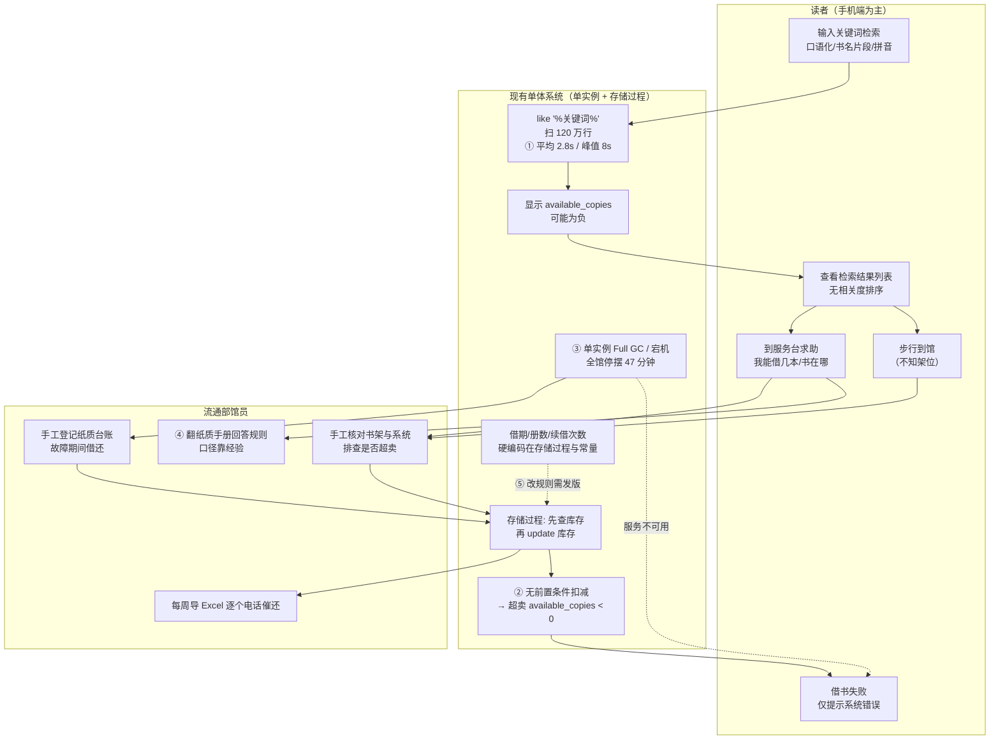
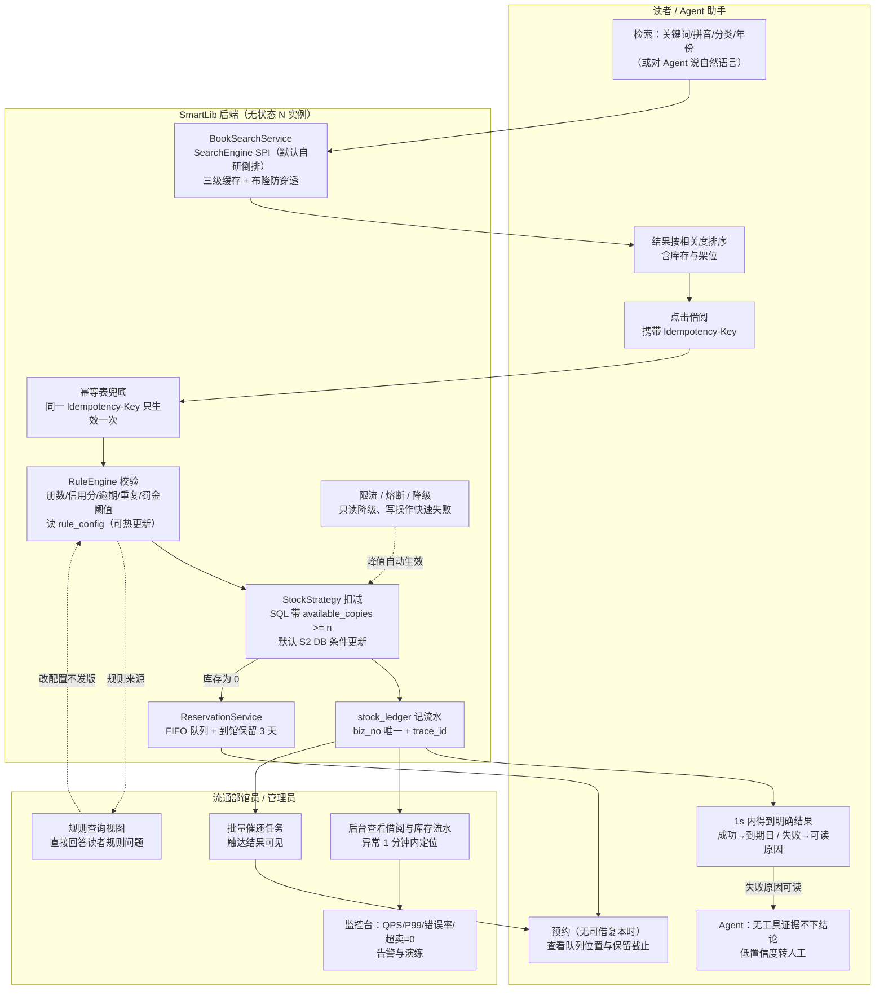

# SmartLib 需求分析文档

> - 项目代号：**SmartLib**（高校图书馆智能借阅与推荐平台）
> - 依据契约：`docs/00-项目蓝图.md`（v1.0.0，本文档唯一上游基线）
> - 本文档版本：**v1.0.0**
> - 阶段门：**M1 需求**（通过标准：用户故事覆盖 6 大痛点，需求可测试）
> - 阅读须知：本文档中所有**性能、准确率、并发数值均为「目标值 / 验收线」**，来自蓝图第 7 章 SLO；
>   凡未跑过压测或评测的数字一律标注 **`【待实测回填】`**，禁止以任何形式伪装成实测结果。

---

## 1. 文档修订记录

| 版本 | 日期 | 作者角色 | 变更说明 |
|---|---|---|---|
| v0.1.0 | 2026-02-10 | 需求分析师（BA） | 依据蓝图 §1 场景与痛点，产出背景、干系人、Persona 初稿 |
| v0.2.0 | 2026-02-13 | 需求分析师（BA） | 补充 AS-IS / TO-BE 业务流程泳道图；拆解 FR-01~FR-40 功能需求 |
| v0.3.0 | 2026-02-16 | 后端架构师 | 对齐蓝图 §7 SLO，补齐 NFR-01~NFR-20 与验证方式；补充范围外与风险登记册 |
| v0.4.0 | 2026-02-18 | 需求分析师（BA） | 用户故事扩充至 22 条并逐条补 Given-When-Then；补 RTM 草表 |
| **v1.0.0** | 2026-02-20 | 需求分析师（BA）/ 评审人：后端架构师、测试工程师 | 评审问题闭环，需求基线冻结；MVP / V1.1 / V2.0 排期确认 |

**变更控制**：本文档为需求阶段基线，冻结后任何增删需求（FR/NFR 编号）必须走变更流程——提交变更申请 → 影响面分析（设计/DB/测试）→ 评审 → 更新本文档版本号 → 同步更新 `docs/11-架构决策记录ADR.md`（若涉及技术选型）。蓝图变更优先级高于本文档。

---

## 2. 项目背景与现状问题

### 2.1 业务背景

某"双一流"高校图书馆正在使用 **2013 年建设的单体 Java 系统**（存储过程承载核心业务规则、无缓存层、无检索优化、单实例部署）。十年间业务量与系统能力的剪刀差已经非常明显：

| 维度 | 现状基线（蓝图 §1.1） | 对系统的压力含义 |
|---|---|---|
| 在校师生 | 32,000 人 | 开学/考试周极短时间内的突发并发 |
| 馆藏规模 | 58 万种 / 120 万册 | 检索必须避免 120 万行全表扫描 |
| 年借阅量 | 96 万次 | 日均约 4,000 次借还，峰值更高 |
| 日均借还 | 约 4,000 次 | 单实例 + 存储过程已接近处理上限 |
| 开学/考试周峰值 | 借还峰值约 30 QPS、检索峰值 1,500 QPS；热门书目单书目瞬时并发 200+ | 现有架构无法弹性扩容；超卖来自**单行热点竞争**而非整体高 QPS |
| 部署形态 | 单实例、无缓存 | 任何一次 GC/宕机即全馆停摆 |

业务侧的诉求可以概括成一句话：**读者要"快、准、不白跑"，馆员要"少重复、能批量"，管理员要"改规则不发版、出事能定位"**。

### 2.2 六大痛点展开（现象 → 量级 → 影响）

> 说明：下列量级数字来自蓝图 §1.2 的现状系统工单记录基线，属于**现状描述**，不是本项目实测值。
> 本项目改造后的效果一律写成目标值，实测结果统一回填到 `docs/06-测试计划与报告.md`。

**P1 库存超卖**

- 现象：开学季热门教材（如《高等数学》）在多个借阅窗口被同时借阅时，`available_copies` 被扣成负数，出现"系统显示可借、到馆发现书已被借走"。
- 量级：2024 年相关投诉 **37 起**；高峰出现在开学前两周。
- 影响：读者空跑一趟（单次往返约 20~40 分钟）；服务台被迫人工赔礼与协调；馆藏数据的公信力受损。
- 根因：存储过程中「先查询库存 → 再更新库存」非原子操作，没有任何扣减前置条件（等价于无约束 `update`）。

**P2 检索慢且不准**

- 现象：读者搜索"计算机网络 谢希仁"，系统执行 `like '%关键词%'` 全表扫描 120 万行，**平均 2.8s**，峰值超时 **8s**；无分词、无拼音、无相关度排序。
- 量级：检索类请求占读者端交互的绝大多数；考试周检索 QPS 峰值 1,500+。
- 影响：读者在手机上等 3 秒以上大概率直接退出；只记得读音（"xie xiren"）或只记得半个书名时完全搜不到。
- 根因：无倒排索引/全文索引，无中文分词，无拼音转换，无相关度打分。

**P3 单点故障**

- 现象：借阅服务单实例部署，一次 Full GC 或机器故障导致**全馆借还停摆 47 分钟**。
- 量级：单次事故影响约 4,000 次日均借还流量；故障期间零服务能力（非降级，而是完全不可用）。
- 影响：服务台被围堵、投诉集中爆发；馆员只能手工登记纸质台账，事后补录带来数据不一致。
- 根因：有状态单实例、无负载均衡、无健康检查、无优雅停机、无降级兜底。

**P4 服务台咨询压力**

- 现象：读者不会写检索式、找不到书、不清楚借阅规则，全部涌向服务台。
- 量级：服务台日均咨询 **260 人次**，其中 **68% 是重复问题**（"我能借几本""怎么续借""这本书在几楼"）。
- 影响：馆员每天约 177 人次的时间被重复劳动占用，真正需要人工判断的异常业务被拖延。
- 根因：规则只存在于纸质手册与馆员经验中，系统内没有面向读者的自然语言入口。

**P5 人工催还**

- 现象：逾期名单靠馆员每周手工导出 Excel 后逐个打电话。
- 量级：按年借阅 96 万次、行业常见逾期比例区间估算，每周待催名单规模在**数百至上千条**（精确分布**`【待实测回填】`**，需接入真实现状数据后确认）。
- 影响：人力成本高、触达率低、口径不统一（不同馆员催还尺度不同）；逾期罚金争议难以举证。
- 根因：无自动逾期扫描任务、无消息触达通道、无罚金与信用分联动。

**P6 规则硬编码**

- 现象：借阅册数、借期、续借次数散落在存储过程与 Java 常量中，改一次规则必须发版。
- 量级：每次规则调整走"提需求 → 排期 → 改代码 → 测试 → 发版"流程，按现状节奏是**周级**（精确人天**`【待实测回填】`**）。
- 影响：开学季临时调整借期这类强时效诉求无法响应；规则口径分散导致同一规则在不同入口表现不一致。
- 根因：规则以代码常量而非配置数据存在，缺少统一 `RuleEngine` 与 `rule_config` 表。

### 2.3 痛点 → 影响 → 紧迫度

| 编号 | 痛点 | 可观测现象（可验证） | 量级（现状基线） | 业务影响 | 技术影响 | 紧迫度 | 对应目标 |
|---|---|---|---|---|---|---|---|
| P1 | 并发借阅超卖 | `book_stock.available_copies < 0` | 2024 年投诉 37 起 | 读者空跑、数据公信力受损 | 扣减非原子、无前置条件 | **P0 最高** | 超卖数 = 0 |
| P2 | 检索慢且不准 | `GET /api/books` 耗时 > 2s 的请求占比 | 均值 2.8s / 峰值 8s | 读者流失、检索形同虚设 | 全表扫描、无索引无分词 | **P0 最高** | 检索 P99 < 300ms |
| P3 | 单点故障 | 实例不可用导致的借还失败率 | 单次停摆 47 分钟 | 全馆停摆、转手工台账 | 有状态单实例、无降级 | **P0 最高** | 可用性 99.9%、恢复 < 30s |
| P4 | 服务台重复咨询 | 重复问题占咨询总量比例 | 日 260 人次 / 68% 重复 | 馆员被重复劳动占用 | 规则未产品化、无对话入口 | P1 高 | 重复咨询量下降 ≥ 60% |
| P5 | 人工催还 | 逾期名单处理方式与耗时 | 周级批量人工外呼 | 触达率低、口径不一、易生争议 | 无定时任务、无触达与罚金联动 | P1 高 | 逾期自动触达、罚金可举证 |
| P6 | 规则硬编码 | 规则调整所需交付时长 | 改规则需发版（周级） | 时效诉求无法响应 | 规则散落在存储过程/常量 | P2 中 | 改规则不发版（热生效 ≤ 1min） |

**紧迫度排序结论**：P1、P2、P3 是"系统还能不能用"的问题，必须进 **MVP**；P4、P5 是"人力能否被释放"的问题，进 **MVP/V1.1**；P6 是"响应速度"问题，因其是 P5 与后续运营的前提（规则配置化后才能做信用分与罚金的灵活策略），提前到 **MVP**（见 §10 排期）。

---

## 3. 干系人分析

| 干系人 | 角色 | 核心关注点 | 影响力 | 参与方式 |
|---|---|---|---|---|
| 图书馆馆长 / 分管副馆长 | 业务决策者 | 读者满意度、投诉量、预算投入产出比 | 高 | 里程碑评审、验收签字 |
| 流通部馆员 | 前台业务执行者 | 借还异常处理效率、催还省力、预约到馆通知 | 中高 | 需求访谈、UAT、试用反馈 |
| 采编部馆员 | 后台数据维护者 | 书目/复本维护效率、批量导入、分类准确性 | 中 | 需求访谈、后台功能验收 |
| 系统管理员（运维） | 技术与运维负责人 | 规则配置、容量与告警、故障定位速度、升级不影响业务 | 高 | 需求评审、SLO 确认、演练验收 |
| 读者-本科生 | 高频用户（人数最多） | 快速找到书、知道在不在馆/在几楼、什么时候还 | 中（人数权重高） | 问卷、可用性测试、灰度试用 |
| 读者-研究生/教师 | 高价值用户（借阅量大） | 主题推荐、批量预约、长借期、文献服务 | 中 | 访谈、推荐效果主观评测 |
| 智能助手（Agent，系统角色） | 系统内自治角色 | 能查真实数据、能替读者办事、不编造 | 中 | 效果评测（`run_eval.py`）、护栏验收 |
| 学校信息化办公室 | 基础设施与安全归口 | 合规（个人信息保护）、安全审计、系统对接 | 中高 | 安全评审、上线审批 |
| 数据库/中间件管理员 | 平台支撑 | 库表变更、备份恢复、连接数与容量 | 中 | DDL 评审、变更窗口协调 |
| 项目组自身（BA/后端/测试/Agent 工程） | 交付方 | 需求可测试、排期可控、技术亮点可展示 | 高 | 全程 |

**关键结论**：本项目是"**双主用户**"结构——读者决定满意度，馆员/管理员决定系统能否被真正用起来与运维下去。因此需求必须同时满足"读者端体验指标"（P99 延迟、检索召回）与"后台可用性指标"（规则配置化、可观测、可回滚），任何只优化读者端而牺牲后台可运维性的方案不予采纳。

---

## 4. 用户画像 Persona

> 4 个 Persona 均为**基于蓝图角色定义构造的典型用户画像**（构造性素材），非真实个人信息。

### Persona-1 李思远 · 本科二年级学生

| 维度 | 内容 |
|---|---|
| 身份 | 计算机学院大二本科生，借阅类型 `UNDERGRAD`（可借 10 册 / 借期 30 天 / 可续借 2 次） |
| 技术水平 | 中；熟练使用手机 App 与微信小程序，不会写检索式，不理解"主题词/分类号" |
| 目标 | 3 分钟内找到课程指定教材，并知道"能不能借、在哪个馆区几楼、什么时候必须还" |
| 痛点 | 记得书名记不全（只记得"计算机网络 谢希仁"）；搜出来的结果没有相关度排序；显示可借到馆却没有；不知道自己还能借几本 |
| 典型场景 | 上午课间在手机上下单借书，午休去馆取。搜索关键词用口语，期望系统"猜到"他要哪本；借书失败时希望立刻知道原因（超册数/有逾期/分数不足）而不是到馆才发现 |
| 成功标准 | ① 搜索结果首屏前 3 条命中目标教材；② 借阅请求在 1 秒内给出明确成功或可读的失败原因；③ 首页直接显示"还能借 7 册、最近到期日" |
| 对系统的隐含要求 | 拼音/模糊检索、库存与馆藏位置实时可见、失败原因可读、移动端轻量 |

### Persona-2 陈雨桐 · 材料学院博士研究生

| 维度 | 内容 |
|---|---|
| 身份 | 博士三年级，科研需求，借阅类型 `POSTGRAD`（可借 15 册 / 借期 60 天 / 可续借 3 次） |
| 技术水平 | 高；会使用 Web of Science、Zotero；对检索质量敏感，能接受稍慢但准的结果 |
| 目标 | 围绕研究主题快速定位馆藏、批量预约、尽量少跑馆；关心"这本书是否与我当前的阅读兴趣相关" |
| 痛点 | 现有系统只能精确匹配关键词，无法做主题推荐；预约到馆通知不及时；续借时不知道有没有人排队；借期长但不确定规则细节 |
| 典型场景 | 写文献综述时需要一次性确认 8 本参考书的在馆状态；把 2 本已借出的核心参考书加入预约队列并希望自动收到到馆通知；需要按主题（而非书名）发现馆藏 |
| 成功标准 | ① 相似书/主题推荐主观相关性可通过（人工抽样打分基线 **`【待实测回填】`**）；② 预约队列位置、到馆保留截止时间透明可见；③ 续借前置条件（无预约队列、次数未用尽、未逾期）在界面上提前告知 |
| 对系统的隐含要求 | 相关度排序、推荐服务、预约队列 FIFO、续借规则引擎前置校验、长借期规则可配置 |

### Persona-3 王秀兰 · 流通部馆员（前台/还书台）

| 维度 | 内容 |
|---|---|
| 身份 | 流通部馆员，工龄 12 年，负责前台借还、异常处理、催还、预约到馆通知 |
| 技术水平 | 中低；熟练使用现有后台与 Excel，不熟悉命令行，对"技术概念"无兴趣，只看结果 |
| 目标 | 快速处理异常借还（库存不一致、丢书、罚金争议）；把催还从"逐条外呼"变成"批量自动"；减少被重复咨询打断 |
| 痛点 | 超卖后要人工在系统与书架之间反复核对；催还名单要手工导出 Excel；读者问"我能借几本"要翻手册；预约到馆通知靠记忆 |
| 典型场景 | 开学首日前台排长队，一台借阅失败（提示库存异常），需要现场 1 分钟内判断"是超卖还是读者资格问题"，并能一键看到库存流水证据；每周一需要一键触发逾期催还批量通知并查看触达结果 |
| 成功标准 | ① 异常借还可在后台看到完整 `stock_ledger` 流水并定位原因；② 催还一键批量下发并可见触达成功/失败统计；③ 后台提供规则查询视图，无需翻手册即可回答读者 |
| 对系统的隐含要求 | 库存流水可查、后台管理功能、批量催还任务、规则查询接口、失败原因结构化返回 |

### Persona-4 张明 · 系统管理员（运维）

| 维度 | 内容 |
|---|---|
| 身份 | 图书馆信息中心系统管理员，负责容量、监控、故障处理、规则配置与版本发布 |
| 技术水平 | 高；熟悉 Linux、Docker/K8s、Prometheus/Grafana，能看懂 SQL 与日志 |
| 目标 | 改借阅规则不发版；故障 5 分钟内定位到模块；扩容/重启对读者无感；SLO 一目了然 |
| 痛点 | 规则在存储过程里，改规则要排开发；故障只能靠读者电话发现；单实例重启即停服；没有可观测面板 |
| 典型场景 | 开学前需要把本科生借期临时从 30 天调整为 45 天，要求 1 分钟内热生效且无需发版；考试周检索 QPS 达到 1,500+ 时需要看到限流与降级是否生效，并能在不中断服务的前提下滚动重启实例 |
| 成功标准 | ① 规则改动经 `rule_config` 生效，≤ 1 分钟完成，零发版；② `/actuator/health`、`/actuator/prometheus` 可被监控系统采集，关键指标可配告警；③ 滚动重启/单实例宕机期间借还失败率 < 0.1%，恢复 < 30s |
| 对系统的隐含要求 | 规则配置化、Prometheus 指标、健康探针、优雅停机、限流熔断、trace_id 全链路 |

---

## 5. 调研方法与素材

> ### ⚠️ 重要声明：本节全部为「模拟素材」
> 本项目是**个人简历项目**，不存在真实客户、真实访谈与真实生产工单系统。
> 本节所有访谈摘要、工单抽样统计表均为**依据蓝图 §1.1/§1.2 的现状基线构造的模拟调研素材**，
> 目的是演示"需求从何而来"的推导过程，**不代表任何真实机构的调研结果，不得作为事实引用，不得包装成真实数据**。
> 表格中凡涉及具体数量与比例的，均与本项目实测无关；真实效果数据只会在 `docs/06-测试计划与报告.md` 出现。

### 5.1 调研方法设计（方法论说明）

| 方法 | 设计 | 样本（模拟） | 期望产出 |
|---|---|---|---|
| 半结构化访谈 | 每人 30~45 分钟，围绕"最近一次不顺利的借书经历"展开 | 馆员 3 人、读者 5 人、管理员 1 人 | 痛点场景、语言习惯（检索词形态）、规则盲区 |
| 服务台工单抽样 | 按重复问题类型归类计数 | 蓝图基线：日均 260 人次、68% 为重复问题 | 优先级排序与 Agent 意图清单 |
| 现状系统走查 | 观察检索、借还、续借、后台配置全流程 | 1 套系统 | AS-IS 流程图与瓶颈点 |
| 可用性测试（规划） | 5 人任务测试：找书 → 借书 → 续借 → 查规则 | 5 人（**`【待执行回填】`**） | 交互改进点，MVP 后补充 |
| 竞品/同类系统对照 | 对照主流商业图书馆系统的检索与规则配置能力 | 3 个 | 功能基线参考 |

### 5.2 访谈摘要（模拟素材，3 段）

**访谈 A｜流通部馆员，工龄 12 年（对应 Persona-3 王秀兰）**

> "开学第一周最怕的就是书上显示'可借'，学生跑过来书架上没有。以前我只能让他在前台等，自己去书架翻，再回来查系统——查出来就是那个负库存。到底哪一步扣错了，系统里看不到任何记录，只能靠记忆。"
>
> "催还更麻烦。每周一我要把逾期名单导成 Excel，然后一个个打电话。打不通就第二天再打。学生反问'我什么时候逾期的、罚多少钱'，我还得回系统里一条条查。"
>
> **推导需求**：库存流水可审计（FR-33/FR-34）、异常借还可举证、逾期批量触达（FR-23/FR-25）、罚金计算与明细可查（FR-20）。

**访谈 B｜本科二年级学生（对应 Persona-1 李思远）**

> "我一般就搜书名几个字，比如'计算机网络 谢希仁'，等好久才出来，而且出来的第一本还不是我要的那版。有时候只记得'那个谢希仁写的'，打拼音也搜不出来。"
>
> "'我能借几本'这个问题我每次都忘，问了馆员三遍。app 里也没地方看。还有我借的书什么时候到期，也得自己数。"
>
> **推导需求**：分词与拼音检索（FR-01/FR-03）、相关度排序（FR-04）、检索延迟目标（FR-05/NFR-01）、读者信用与权限可见（FR-16）、到期日可视化（FR-14）。

**访谈 C｜系统管理员（对应 Persona-4 张明）**

> "最难受的是改规则。馆长说开学把借期从 30 天改成 45 天，我得找人改存储过程、改常量、测试、发版，一周就过去了，等上线都开学第二周了。"
>
> "还有就是出事我是最后一个知道的——通常是读者打投诉电话。我需要有个地方能看到 QPS、错误率、慢查询，最好还能告诉我哪个实例不健康。"
>
> **推导需求**：规则配置化与热生效（FR-32/FR-29）、监控指标与告警（FR-38/FR-39）、健康探针与优雅停机（FR-40/NFR-05）、trace_id 全链路（FR-39）。

### 5.3 服务台工单抽样统计表（模拟素材）

**抽样口径（模拟）**：以蓝图基线「日均咨询 260 人次、重复问题占 68%」为总体，模拟抽取**一周 7 天的重复问题工单 300 条**做分类统计。

| 工单类型（模拟） | 工单数（条） | 占重复问题比例 | 关联痛点 | 是否可由 Agent/系统自助解决 | 对应需求 |
|---|---|---|---|---|---|
| "我能借几本 / 借期多久 / 怎么续借"规则类 | 96 | 32.0% | P4、P6 | 是（RAG 规则问答 + 读者权限查询） | FR-16、FR-31、FR-35 |
| "这本书在不在馆 / 在几楼哪个架位" | 62 | 20.7% | P2、P4 | 是（库存与馆藏位置查询工具） | FR-06、FR-35 |
| "显示可借但书没了 / 借书失败" | 41 | 13.7% | P1、P4 | 部分（需馆员核对流水） | FR-08、FR-33、FR-34 |
| "怎么预约 / 预约到馆没通知我" | 34 | 11.3% | P4、P5 | 是（预约状态查询 + 到馆通知） | FR-18、FR-19 |
| "我什么时候到期 / 有没有逾期" | 29 | 9.7% | P4、P5 | 是（我的借阅 + 到期提醒） | FR-14、FR-24 |
| "为什么要罚款 / 罚金怎么算的" | 21 | 7.0% | P4、P5 | 是（罚金明细与规则解释） | FR-20、FR-31 |
| 其他（账号、开馆时间、办证等） | 17 | 5.6% | P4 | 部分（知识库问答） | FR-35 |
| **合计** | **300** | **100%** | — | 可自助化比例目标 **≥ 60%`【待实测回填】`** | — |

**统计结论（用于优先级推导）**：

1. 规则类 + 位置类合计 52.7%，是「低成本、高收益」的自助化切入点 → Agent 的 RAG 知识问答与工具查询必须进 MVP。
2. "显示可借但书没了"虽然仅 13.7%，但属于**信任级问题**（一次事故影响读者对整个系统的信任），必须零容忍 → P1 超卖治理为 MVP 第一优先级。
3. 可通过系统自助解决的占比目标设为 ≥ 60%，直接对齐蓝图 §1.4「服务台重复咨询量下降 ≥ 60%」；该数字为**目标值**，闭环验证需在灰度后统计真实工单分布 **`【待实测回填】`**。

---

## 6. 业务流程：AS-IS 与 TO-BE

### 6.1 现状（AS-IS）借书流程泳道图

关键问题在图中标注：`①` 全表扫描慢、`②` 非原子扣减→超卖、`③` 单实例故障即停摆、`④` 规则散落导致口径不一、`⑤` 读者只能靠服务台。

### 6.2 目标（TO-BE）借书流程泳道图

**TO-BE 关键改进点对照**：

| 编号 | AS-IS 问题 | TO-BE 设计 | 落地位置（蓝图 §4.2） | 验收锚点 |
|---|---|---|---|---|
| ① | 全表扫描 2.8s | 倒排索引 + 三级缓存 + 布隆过滤 | `service/search/*`、`cache/*` | NFR-01、FR-05 |
| ② | 非原子扣减 | 条件更新 `where available_copies >= n` + 流水 | `service/stock/OptimisticDbStockStrategy` | NFR-04、FR-08 |
| ③ | 单实例停摆 | 无状态多实例 + 限流熔断降级 + 优雅停机 | `support/*`、`deploy/nginx` | NFR-05、NFR-06 |
| ④ | 规则散落 | `RuleEngine` + `rule_config` 热更新 | `service/RuleEngine` | FR-29、FR-32 |
| ⑤ | 读者只能问人 | Agent 工具调用 + RAG 规则问答 | `agent-service/app/agent`、`rag/` | FR-35~FR-37 |

---

## 7. 功能需求列表（FR-01 ~ FR-40）

**优先级采用 MoSCoW**：`M`=Must have（MVP 必须）、`S`=Should have（V1.1）、`C`=Could have（V2.0）、`W`=Won't have（本期不做，见 §11）。

### 7.1 检索与发现（FR-01 ~ FR-07）

| 编号 | 模块 | 需求名称 | 描述 | 优先级 | 来源痛点 | 验收标准摘要（可测试） |
|---|---|---|---|---|---|---|
| FR-01 | 检索 | 关键词检索 | `GET /api/books?query=`，对 title/author/publisher/tags 做分词检索，支持多词任意顺序命中 | M | P2 | 给定可复现测试集（书名+作者片段），返回结果包含目标书；空关键词返回全量分页而非报错 |
| FR-02 | 检索 | 多条件筛选 | 支持 category / publisher / yearFrom / yearTo / availableOnly 组合筛选 | M | P2 | 每个筛选条件单独与组合各有 1 条用例，返回结果全部满足条件；非法年份区间返回参数错误码 |
| FR-03 | 检索 | 拼音与首字母检索 | 支持全拼（xiexiren）与首字母（xxr）命中中文标题/作者 | S | P2 | 输入 "jsjwl" 能命中《计算机网络》；拼音与中文关键词结果交集 ≥ 目标阈值，阈值验证见 `docs/06` **`【待实测回填】`** |
| FR-04 | 检索 | 相关度排序 | 提供 `sort=relevance`，标题命中权重 > 作者 > 标签，含发布时间衰减 | M | P2 | 对固定查询集，目标书排在 TopK 内的用例全部通过（基线集召回 **`【待实测回填】`**）；`sort` 非法值回落默认排序 |
| FR-05 | 检索 | 检索性能与降级 | 检索 P99 目标 < 300ms（120 万书目，TopK 20），超时或引擎不可用降级为 DB 直查 | M | P2、P3 | 压测脚本产出 P50/P99/QPS 报告；降级开关打开后接口仍 200 且响应体标记 `degraded=true` |
| FR-06 | 检索 | 书目详情与馆藏位置 | `GET /api/books/{id}` 返回库存、架位、简介、可预约状态 | M | P2、P4 | 详情字段完整率 100%（对比接口契约）；不存在的 id 返回业务错误码而非 500 |
| FR-07 | 检索 | 热门榜与相似推荐 | `/api/books/hot` 与 `/api/books/{id}/similar` | S | P2、P4 | 热门榜按借阅量倒序且有缓存；相似推荐在推荐服务不可用时降级为热门榜且不报错 |

### 7.2 借阅（FR-08 ~ FR-13）

| 编号 | 模块 | 需求名称 | 描述 | 优先级 | 来源痛点 | 验收标准摘要 |
|---|---|---|---|---|---|---|
| FR-08 | 借阅 | 并发安全库存扣减 | `POST /api/borrows`，扣减必须满足 `available_copies >= n`，任何方案不允许无约束 update | M | P1 | 200 线程抢 10 册：成功 10 笔、`available_copies == 0`、无负库存 |
| FR-09 | 借阅 | 借阅资格规则校验 | 依次校验：库存、册数上限、信用分 < 60、存在逾期、同书重复持有、罚金未缴清 > 10 元 | M | P1、P6 | 每条规则 1 正 1 反用例；失败返回结构化原因码（可区分 6 类）而非笼统"操作失败" |
| FR-10 | 借阅 | 借阅幂等 | `Idempotency-Key` 必填；同 key 重复请求只生效一次并返回首次结果 | M | P1 | 同 key 并发 20 次请求，仅产生 1 条 `borrow_record`，`stock_ledger` 仅 1 条流水 |
| FR-11 | 借阅 | 到期日与借期计算 | 到期日按读者类型借期计算，规则取自 `rule_config` | M | P6 | 本科生 30 天、研究生 60 天、教师 90 天各 1 条用例；改动配置后新借阅按新借期生效 |
| FR-12 | 借阅 | 借阅结果原子返回 | 返回 `{ok, borrowId, dueDate}` 或 `{ok:false, reason}` | M | P1 | 成功路径含非空 borrowId 与未来 dueDate；失败路径 reason 属于预定义枚举 |
| FR-13 | 借阅 | 借阅流水记录 | 每次借出写 `borrow_record`（status=BORROWED）与 `stock_ledger` | M | P1、P5 | 借阅成功后流水条数与库存变化量一致；`biz_no` 唯一约束生效（重复插入报冲突） |

### 7.3 归还（FR-14 ~ FR-15）

| 编号 | 模块 | 需求名称 | 描述 | 优先级 | 来源痛点 | 验收标准摘要 |
|---|---|---|---|---|---|---|
| FR-14 | 归还 | 归还与状态流转 | `POST /api/borrows/{id}/return`，`BORROWED/OVERDUE` → `RETURNED`，回补库存并写流水 | M | P1、P5 | 归还后 `available_copies` +1；重复归还返回幂等提示且库存不重复回补；已 RETURNED 记录不可再归还 |
| FR-15 | 归还 | 归还触发预约队列推进 | 有预约队列时，归还后队首转为 `READY`，设置 `ready_at`/`expire_at`（保留 3 天）并通知 | M | P4、P5 | 归还后队首状态为 `READY` 且 `expire_at - ready_at == 3 天`；通知记录可查 |

### 7.4 续借（FR-16 ~ FR-17）

| 编号 | 模块 | 需求名称 | 描述 | 优先级 | 来源痛点 | 验收标准摘要 |
|---|---|---|---|---|---|---|
| FR-16 | 续借 | 续借规则校验 | `POST /api/borrows/{id}/renew`：该书无预约队列、续借次数未用尽、非逾期状态 | M | P6、P4 | 三类拒绝场景各 1 条用例，返回可读原因；合法续借后 `renew_count` +1、`due_at` 顺延单次续借天数 |
| FR-17 | 续借 | 续借上限与配置化 | 次数与天数由 `rule_config` 决定（本科 2 次×30 天；研究生/教师 3 次×60/90 天） | M | P6 | 用尽次数后续借被拒；改配置（如本科 3 次）无需发版即生效，生效时延目标 ≤ 1min |

### 7.5 预约队列（FR-18 ~ FR-19）

| 编号 | 模块 | 需求名称 | 描述 | 优先级 | 来源痛点 | 验收标准摘要 |
|---|---|---|---|---|---|---|
| FR-18 | 预约 | 预约与 FIFO 队列 | `available_copies = 0` 时允许 `POST /api/reservations`，按 `queue_no` FIFO | M | P4 | 3 人依次预约得到 queue_no 1/2/3；有可借复本时预约被拒并提示直接借阅 |
| FR-19 | 预约 | 到馆保留与过期出队 | `READY` 保留 3 天，超时置 `EXPIRED`，自动通知下一位；支持读者取消 | M | P4、P5 | 冻结时间推进 3 天后状态为 `EXPIRED` 且下一位转 `READY`；取消后队列位置正确前移 |

### 7.6 逾期与罚金（FR-20 ~ FR-22）

| 编号 | 模块 | 需求名称 | 描述 | 优先级 | 来源痛点 | 验收标准摘要 |
|---|---|---|---|---|---|---|
| FR-20 | 罚金 | 逾期识别与罚金计算 | 定时扫描 `due_at < now` 的 BORROWED 记录，置 `OVERDUE`，按 0.2 元/天/册计罚，封顶书价 | M | P5、P6 | 逾期 5 天罚金 1.00 元；超长逾期时罚金等于 `book.price` 不再增长；费率改配置后新计算生效 |
| FR-21 | 罚金 | 罚金缴纳与借阅闸门 | 罚金未缴清且累计 > 10 元禁止新借；缴纳后可借 | M | P5、P1 | 欠费 9.9 元可借、10.1 元被拒（边界各 1 条）；缴纳后同请求可借 |
| FR-22 | 罚金 | 罚金明细可查 | 读者/馆员可查每笔罚金的 `borrowId / 天数 / 费率 / 金额` | S | P5 | 明细金额与计算口径一致；馆员视图可导出 |

### 7.7 信用分（FR-23）

| 编号 | 模块 | 需求名称 | 描述 | 优先级 | 来源痛点 | 验收标准摘要 |
|---|---|---|---|---|---|---|
| FR-23 | 信用分 | 信用分变更规则 | 初始 100；逾期 1 次 −5；预约到馆未取 −3；按时归还 +1；上下限 [0,100]；`< 60` 禁借但可查 | M | P1、P5 | 每条增减各 1 条用例；连续按时归还不会超过 100；多次逾期不会低于 0；分数变更留变更明细 |

### 7.8 规则配置化（FR-24 ~ FR-26）

| 编号 | 模块 | 需求名称 | 描述 | 优先级 | 来源痛点 | 验收标准摘要 |
|---|---|---|---|---|---|---|
| FR-24 | 规则配置 | 规则集中存储 | 借期/册数/续借/预约保留/罚金/信用分阈值统一落 `rule_config`（uk: rule_key + reader_type） | M | P6 | 蓝图 §2.2 的 9 条规则在表中有对应行；重复写入被唯一约束拒绝 |
| FR-25 | 规则配置 | 规则热更新 | 后台改规则后 ≤ 1min 生效，无需发版重启 | M | P6 | 修改借期 30→45 天后，新建借阅的 `due_at` 按 45 天计算；期间服务不中断（可用性探针无失败） |
| FR-26 | 规则配置 | 规则查询视图 | 前台可按读者类型查询自己适用的规则（册数/借期/续借/罚金） | S | P4 | 三种读者类型各自查询结果与配置一致；接口 200 且响应时间满足 NFR-01 目标 |

### 7.9 库存与流水（FR-27 ~ FR-28）

| 编号 | 模块 | 需求名称 | 描述 | 优先级 | 来源痛点 | 验收标准摘要 |
|---|---|---|---|---|---|---|
| FR-27 | 库存 | 库存流水全记录 | 每次扣减/回补写 `stock_ledger`（op_type, delta, before_qty, after_qty, biz_no, trace_id） | M | P1、P5 | 任意时刻 `sum(delta)` == `available_copies` 变化量；`biz_no` 重复插入报唯一约束冲突 |
| FR-28 | 库存 | 对账与超卖探测 | 提供对账能力：库存 vs 流水不一致时告警，并暴露"超卖数"指标 | M | P1、P3 | 人为造一条不一致数据后对账任务能报出差异；超卖指标在正常压测后为 0 |

### 7.10 后台管理（FR-29 ~ FR-34）

| 编号 | 模块 | 需求名称 | 描述 | 优先级 | 来源痛点 | 验收标准摘要 |
|---|---|---|---|---|---|---|
| FR-29 | 后台 | 规则配置管理 | 管理员通过后台/接口增删改查规则，变更留痕（操作人、时间、前后值） | M | P6 | 每次变更产生审计记录；回滚到旧值可用 |
| FR-30 | 后台 | 书目与复本维护 | 书目 CRUD、复本数量调整、分类维护；调整复本同步 `book_stock` 并写流水 | S | P6、P1 | 增加 3 册复本后 `total_copies`/`available_copies` 同步 +3 且有流水；非法 ISBN 被拒 |
| FR-31 | 后台 | 读者与信用管理 | 读者查询、状态启停、信用分调整、逾期与罚金查询 | S | P5 | 停用读者后无法借书且返回明确原因；信用分手工调整留痕 |
| FR-32 | 后台 | 借阅/预约记录管理 | 按读者/书目/状态/时间检索记录，支持导出 | S | P5 | 组合条件检索结果正确；导出字段与列表一致 |
| FR-33 | 后台 | 库存流水审计视图 | 按 book_id / biz_no / trace_id 查询流水链路 | M | P1 | 输入一个 `trace_id` 能还原该请求的全部库存动作顺序 |
| FR-34 | 后台 | 异常借还处置 | 馆员可对异常单执行人工处置（登记丢失 `LOST`、修正记录）并留痕 | S | P1 | 置 `LOST` 后库存与罚金按规则处理；处置动作有审计记录 |

### 7.11 Agent 智能助手（FR-35 ~ FR-37）

| 编号 | 模块 | 需求名称 | 描述 | 优先级 | 来源痛点 | 验收标准摘要 |
|---|---|---|---|---|---|---|
| FR-35 | Agent | 工具调用查询真实数据 | search_books / get_stock / my_loans / reader_profile 等工具必须走 `/internal/agent/tools/**` 取真实数据 | M | P4、P2 | 事实性提问的回答 100% 带工具证据（trace 中有工具调用记录）；无工具调用时不得给出具体库存/位置 |
| FR-36 | Agent | 代办借阅/续借/预约 | 通过工具执行 borrow / renew / reservations，幂等键透传 | M | P4 | 同一次对话重复请求不产生重复借阅；被规则拒绝时回复可读原因而非泛化道歉 |
| FR-37 | Agent | 规则知识问答（RAG） | 基于借阅规则/馆藏分布知识库回答策略类问题并给出出处 | M | P4、P6 | 规则问答测试集上答案与规则一致；回答携带 `source`；低置信度转人工 |
| FR-38 | Agent | 护栏与转人工 | 敏感词、无证据不下结论、超时(3s)/重试(2)/熔断、越权工具拒绝 | M | P4 | 工具白名单外的调用被拒；注入"忽略规则"类输入不改变工具调用链路；连续失败转人工 |

### 7.12 监控告警（FR-39 ~ FR-40）

| 编号 | 模块 | 需求名称 | 描述 | 优先级 | 来源痛点 | 验收标准摘要 |
|---|---|---|---|---|---|---|
| FR-39 | 监控 | 指标暴露与全链路追踪 | 暴露 `/actuator/prometheus`（QPS、P99、错误率、超卖数、缓存命中率），`trace_id` 跨 Java/Python 透传 | M | P3、P1 | 一次 Agent 发起的借阅，其 `trace_id` 在 Java 日志与 Python 日志中可关联检索到 |
| FR-40 | 监控 | 健康探针与告警规则 | `/actuator/health` 支持 readiness/liveness；关键指标配告警规则与演练 | M | P3 | 杀掉 1 个实例后探针摘除该实例，流量 0 失败或 < 0.1% 且 1s 内恢复；告警在演练中可触发 |

**功能需求统计**：Must 26 条 / Should 11 条 / Could 0 条 / Won't 见 §11，合计 40 条。痛点覆盖：P1→FR-08/09/10/12/13/14/21/23/27/28/33/34/39；P2→FR-01~07/35；P3→FR-05/28/39/40；P4→FR-06/07/15/18/19/26/31/35/36/37/38；P5→FR-13/14/15/19/20/21/22/23/27/31/32；P6→FR-09/11/16/17/20/24/25/26/29/30/37。**六大痛点全部有 Must 级需求承接**，满足 M1 阶段门要求。

---

## 8. 非功能需求（NFR-01 ~ NFR-20）

> 指标来源：蓝图 §7 SLO。标注 **`【待实测回填】`** 的项目表示验收时必须写入真实测量值；
> 本节出现的数字全部是**目标值/验收线**，不是实测结果。

### 8.1 性能（NFR-01 ~ NFR-03）

| 编号 | 分类 | 需求描述 | 指标（目标值） | 验证方式 |
|---|---|---|---|---|
| NFR-01 | 性能 | 借阅接口低延迟 | 借阅 P99 < 200ms（单实例 4C8G，S2 策略） | `BorrowBenchmarkTest` / JMeter 压测，产出 P50/P95/P99，回填 `docs/06` |
| NFR-02 | 性能 | 借阅吞吐 | 借阅 QPS ≥ 200（单实例，S2 策略） | 阶梯加压测出拐点，记录错误率随 QPS 变化曲线 |
| NFR-03 | 性能 | 检索延迟与召回 | 检索 P99 < 300ms（120 万书目，TopK 20）；召回率 ≥ 95%（对比人工标注集） | `SearchBenchmarkTest` 输出各引擎对比表；召回率用标注集脚本计算 |

### 8.2 可用性（NFR-04 ~ NFR-06）

| 编号 | 分类 | 需求描述 | 指标（目标值） | 验证方式 |
|---|---|---|---|---|
| NFR-04 | 可用性 | 服务可用性 | 99.9%（月度） | 监控统计可用性，故障演练记录时长 |
| NFR-05 | 可用性 | 实例故障快速恢复 | 单实例故障恢复 < 30s，错误率 < 0.1% | `docker kill` / `kubectl delete pod` + 持续压测，统计失败请求数与恢复时间 |
| NFR-06 | 可用性 | 优雅停机与滚动升级 | 滚动重启期间无请求中断（除已在途长事务） | 停机脚本 + 压测，观察连接拒绝数与 5xx 数 |

### 8.3 一致性（NFR-07 ~ NFR-08）

| 编号 | 分类 | 需求描述 | 指标（目标值） | 验证方式 |
|---|---|---|---|---|
| NFR-07 | 一致性 | 零超卖 | 200 并发抢 10 册，超卖数 = **0** | `BorrowConcurrencyTest` 断言 `available_copies == 0` 且成功借出 == 10 |
| NFR-08 | 一致性 | 库存流水守恒 | `sum(stock_ledger.delta) == available_copies 变化量` | 对账 SQL + 单测；流水缺一条即失败 |

### 8.4 安全（NFR-09 ~ NFR-11）

| 编号 | 分类 | 需求描述 | 指标（目标值） | 验证方式 |
|---|---|---|---|---|
| NFR-09 | 安全 | 接口幂等 | 同 `Idempotency-Key` 重复请求只生效一次 | 并发 20 次同 key 请求，断言仅 1 条业务记录与 1 条流水 |
| NFR-10 | 安全 | 内部工具接口鉴权 | `/internal/agent/**` 必须校验 `X-Internal-Sign`(HMAC)，签名错误拒绝 | 篡改签名请求返回 401/403；无签名请求被拒 |
| NFR-11 | 安全 | 越权与参数防护 | 读者只能访问本人借阅/预约数据；所有入参有校验；SQL 全参数化 | 用 A 的 token 查 B 的 loans 返回 403；注入类用例全部被参数化拦截 |

### 8.5 可观测（NFR-12 ~ NFR-14）

| 编号 | 分类 | 需求描述 | 指标（目标值） | 验证方式 |
|---|---|---|---|---|
| NFR-12 | 可观测 | 指标可采集 | Prometheus 指标覆盖 QPS/P99/错误率/超卖数/缓存命中率/队列长度 | 抓取 `/actuator/prometheus` 校验指标名存在且有值 |
| NFR-13 | 可观测 | 全链路追踪 | 一次请求的 `trace_id` 在 Java 与 Python 日志中均可检索到 | 端到端用例后按 trace_id 检索两侧日志；缺失即失败 |
| NFR-14 | 可观测 | 告警有效性 | 关键告警（超卖>0、错误率、实例不可用、检索 P99 超阈值）在演练中触发 | 故障演练记录：注入故障 → 告警触发时间 → 恢复时间 |

### 8.6 可维护（NFR-15 ~ NFR-16）

| 编号 | 分类 | 需求描述 | 指标（目标值） | 验证方式 |
|---|---|---|---|---|
| NFR-15 | 可维护 | 策略可插拔 | 库存扣减与检索引擎通过 SPI + 配置切换，不改业务代码 | 切换 `smartlib.stock.strategy` / 检索实现后跑同一批用例全绿 |
| NFR-16 | 可维护 | 规则改配置不发版 | 规则调整生效 ≤ 1min，无需重启 | 改 `rule_config` → 观察生效时间与探针可用性 |

### 8.7 成本（NFR-17 ~ NFR-18）

| 编号 | 分类 | 需求描述 | 指标（目标值） | 验证方式 |
|---|---|---|---|---|
| NFR-17 | 成本 | 可离线运行 | 无 LLM API Key 时 MockLLM 可完整演示与跑通测试 | CI 中不注入 Key 执行 `pytest` 全绿 |
| NFR-18 | 成本 | 资源占用可控 | 单实例内存与 CPU 满足 4C8G 部署约束（本地/Compose 可跑） | 压测期间记录容器资源曲线；超限需说明原因 |

### 8.8 合规（NFR-19 ~ NFR-20）

| 编号 | 分类 | 需求描述 | 指标（目标值） | 验证方式 |
|---|---|---|---|---|
| NFR-19 | 合规 | 个人信息最小化 | 日志不落证件号/手机号原文，必要字段脱敏；数据仅用于借阅业务 | 日志扫描脚本检索敏感字段模式，命中即失败 |
| NFR-20 | 合规 | 操作可审计 | 规则变更、异常处置、信用分调整均可审计（谁、何时、改了什么） | 审计表记录完整性抽查；关键操作 100% 有记录 |

---

## 9. 用户故事（22 条，含 Given-When-Then）

**US-01｜快速找书**
作为**本科生读者**，我希望用不完整的书名或作者关键词就能检索到目标教材，以便在课间 3 分钟内决定要不要去馆里取书。
- Given 馆藏中存在《计算机网络》谢希仁版，When 我搜索"计算机网络 谢希仁"，Then 结果首屏前 5 条包含该书且展示库存与架位。
- Given 我不输入任何关键词，When 我点击检索，Then 系统返回分页的全量列表或提示"请输入关键词"，而不是报错。

**US-02｜拼音检索**
作为**本科生读者**，我希望输入拼音或首字母也能搜到书，以便在只记得发音、打不出准确汉字时仍能找到书。
- Given 馆藏含《计算机网络》，When 我输入 "jisuanjiwangluo" 或 "jsjwl"，Then 结果中包含该书。
- Given 拼音无匹配，When 我提交检索，Then 返回空结果且提示"未找到，试试其他关键词"，不报 500。

**US-03｜知道书在哪、能不能借**
作为**本科生读者**，我希望在检索结果里直接看到"可借册数 + 馆区架位"，以便不做无效的往返。
- Given 某书 `available_copies=0`，When 我查看列表与详情，Then 显示"暂无可借"并提供预约入口。
- Given 某书 `available_copies=2`，Then 详情页显示可借数、总册数与架位，且数值与后台库存一致。

**US-04｜借书不超卖**
作为**本科生读者**，我希望并发抢书时系统绝不把书借给超出实际复本数的人，以便到馆一定能取到书。
- Given 库存 10 册，When 200 个请求同时借阅，Then 恰好 10 个成功、`available_copies=0`、无负库存。
- Given 我借书成功，Then 我能拿到到期日，且后台流水中有且仅有一条对应扣减记录。

**US-05｜借书失败原因可读**
作为**本科生读者**，我希望借书失败时直接告诉我原因（超册数/有逾期/分数不足/有罚金），以便我立刻知道该怎么处理。
- Given 我已有 10 册在借（本科上限 10），When 我借第 11 册，Then 提示"已达可借上限 10 册"。
- Given 我信用分 55，When 我借书，Then 提示"信用分不足（55 < 60），可查询不可借阅"。

**US-06｜重复点击不重复借**
作为**本科生读者**，我希望网络不好重复点提交时不会借出两本，以便不多担责任与罚金。
- Given 同一 `Idempotency-Key`，When 请求重复到达 20 次，Then 只产生 1 条借阅记录并都返回同一 `borrowId`。
- Given 我在 1 秒内连点两次"借阅"，Then 我在借册数只增加 1。

**US-07｜查看我的借阅与到期**
作为**本科生读者**，我希望一处看到所有在借、到期日与是否可续借，以便不逾期。
- Given 我有 3 册在借，When 我打开"我的借阅"，Then 每册显示书名、借出日、到期日、剩余天数、可否续借。
- Given 某册书已被他人预约，Then 该册的"可否续借"显示为不可续借并说明原因。

**US-08｜续借**
作为**本科生读者**，我希望在没有预约排队时直接续借，以便少跑一趟。
- Given 我未逾期、续借次数未用尽、该书无预约队列，When 我点续借，Then 到期日顺延 30 天且 `renew_count+1`。
- Given 该书已有预约队列，When 我点续借，Then 提示"该书馆藏已被预约，无法续借"。

**US-09｜预约排队**
作为**研究生读者**，我希望核心参考书被借走时能排队预约，以便书还回来时优先拿到。
- Given 某书 `available_copies=0`，When 我提交预约，Then 我得到队列号并可在"我的预约"看到位置。
- Given 我已是同一书的在借人，When 我预约同书，Then 系统拒绝并说明原因。

**US-10｜预约到馆通知与保留**
作为**研究生读者**，我希望书到馆后立即收到通知并知道保留截止时间，以便 3 天内取书。
- Given 我的预约转 `READY`，Then 我收到通知且能看到 `expire_at`（保留 3 天）。
- Given 我 3 天内未取，Then 我的预约转 `EXPIRED`，下一位读者收到通知。

**US-11｜逾期罚金透明**
作为**本科生读者**，我希望看到逾期天数与每笔罚金怎么算出来的，以便我认可并缴纳。
- Given 我逾期 5 天归还，Then 罚金显示 1.00 元并附计算明细（0.2 元/天 × 5 天）。
- Given 罚金累计已达该书书价，Then 继续逾期不再增加罚金。

**US-12｜信用分可见**
作为**本科生读者**，我希望看到自己的信用分和它会怎么变，以便避免被限制借阅。
- Given 我按时归还 1 册，Then 信用分 +1（不超过 100）且我能在变更记录中看到这条。
- Given 我因预约到馆未取被扣分，Then 记录显示"预约到馆未取 −3"。

**US-13｜Agent 自助问规则**
作为**本科生读者**，我希望直接问"我能借几本、借多久、怎么续借"就得到准确答案，以便不用去服务台排队。
- Given 我问"本科生能借几本"，Then Agent 基于规则库回答 10 册并给出规则出处（`source`）。
- Given 问题超出知识库，Then Agent 明确说"不确定"并引导转人工，而不是编造答案。

**US-14｜Agent 代查真实数据**
作为**本科生读者**，我希望问"《算法导论》还有几本、在几楼"时得到真实库存而不是猜测。
- Given 该书库存为 1，When 我问库存与位置，Then 回答数值等于后端库存接口返回值，且 trace 中有 `get_stock` 工具调用。
- Given 后端库存服务不可用，Then Agent 回答"暂时查不到实时库存"而不是给一个具体数字。

**US-15｜Agent 代办借阅**
作为**本科生读者**，我希望用对话直接完成借书，以便懒得点页面。
- Given 我满足全部借阅规则，When 我让 Agent 帮我借《算法导论》，Then 生成唯一借阅记录并告知到期日。
- Given 我已有该书的在借记录，When 我让 Agent 再借一本同名书，Then Agent 拒绝并解释"同一书目最多同时持有 1 册"。

**US-16｜Agent 多步任务**
作为**研究生读者**，我希望一句话完成"借这本书 + 推荐同类 + 查我有没有逾期"，以便节省操作步骤。
- Given 复合指令，When Agent 执行，Then 计划中依次包含 borrow、recommend、my_loans 工具，且每一步结果都反映真实数据。
- Given 中间某一步失败（如借阅被拒），Then Agent 明确报告失败步骤与原因，其余步骤继续或明确终止。

**US-17｜馆员快速定位超卖/异常**
作为**流通部馆员**，我希望看到某本书的库存流水链路与请求 trace，以便 1 分钟内判断是不是超卖。
- Given 一个借阅失败的 `biz_no`，When 我查询流水，Then 我能看到 before/after 库存、操作类型与 `trace_id`。
- Given 输入一个 `trace_id`，Then 我能还原该请求全部库存动作的顺序。

**US-18｜馆员一键催还**
作为**流通部馆员**，我希望一键对全部逾期读者批量下发通知并看到触达结果，以便不再逐个打电话。
- Given 存在 120 条逾期记录，When 我触发批量催还，Then 生成 120 条通知任务并展示成功/失败统计。
- Given 某读者通知失败，Then 名单中标记失败原因，支持重试而不重复打扰已成功者。

**US-19｜馆员直接回答规则问题**
作为**流通部馆员**，我希望在后台直接查到某类读者的借阅规则，以便不用翻纸质手册。
- Given 读者问"研究生能借几本、多久", When 我查询规则视图，Then 显示 15 册 / 60 天 / 续借 3 次 × 60 天。
- Given 管理员刚改了规则，Then 我的查询结果立即反映新值。

**US-20｜管理员改规则不发版**
作为**系统管理员**，我希望改借阅规则后 1 分钟内生效且不用发版，以便响应开学季的临时调整。
- Given 我把本科借期从 30 天改为 45 天，When 新读者借书，Then 到期日按 45 天计算。
- Given 改动生效期间，Then `/actuator/health` 始终 UP、无请求失败、变更留痕可回滚。

**US-21｜管理员故障快速恢复**
作为**系统管理员**，我希望杀掉一个实例时读者几乎无感，以便能在业务时间内安全运维。
- Given 双实例负载 + 持续压测，When 我杀掉 1 个实例，Then 失败率 < 0.1%、30s 内恢复、探针自动摘除坏实例。
- Given 实例恢复，Then 新实例自动重新接入负载且无需人工改配置。

**US-22｜管理员监控与告警**
作为**系统管理员**，我希望超卖或错误率异常时收到告警而不是等投诉电话，以便主动处置。
- Given 我人为制造一次库存不一致，When 对账任务运行，Then 告警在演练中被触发并记录时间。
- Given 检索 P99 超过目标阈值，Then 监控面板可见异常曲线，且限流/降级状态可查。

**故事覆盖检查**：US-01~US-03 对应 P2；US-04~US-06 对应 P1；US-07~US-08 对应 P6/P4；US-09~US-10 对应 P4/P5；US-11~US-12 对应 P5/P1；US-13~US-16 对应 P4（Agent 侧）；US-17~US-19 对应 P1/P5/P4；US-20~US-22 对应 P6/P3。**六大痛点全覆盖，且每条故事都有可执行验收标准**。

---

## 10. 需求优先级与迭代排期

### 10.1 三批交付总览

| 批次 | 主题 | 目标 | 里程碑 |
|---|---|---|---|
| **MVP** | 正确性与可用性打底 | 零超卖、检索达标、规则配置化、Agent 基本可用 | M2 设计 → M3 编码 → M4 测试 |
| **V1.1** | 运营效率与体验增强 | 推荐、后台完善、批量运营、导出与统计 | M5 上线后 |
| **V2.0** | 智能化与规模扩展 | 向量检索、画像驱动推荐、多校区/多租户 | M6 运维迭代 |

### 10.2 排期表

| 批次 | 需求编号 | 交付要点 | 依赖 | 完成判据 |
|---|---|---|---|---|
| **MVP** | FR-08, FR-09, FR-10, FR-11, FR-12, FR-13 | 借阅主链路：条件更新扣减 + RuleEngine + 幂等 + 流水 | DDL、`RuleEngine` | 并发测试零超卖；规则 6 类拒绝可区分 |
| **MVP** | FR-01, FR-02, FR-04, FR-05, FR-06 | 检索主链路：自研倒排 + 三级缓存 + 相关度排序 | `SearchEngine` SPI、缓存组件 | 检索 P99 达标（实测回填）；降级可用 |
| **MVP** | FR-14, FR-15 | 归还 + 预约队列推进 | FR-08、FR-18 | 归还回补库存并推进队首 |
| **MVP** | FR-18, FR-19 | 预约 FIFO + 到馆保留 3 天 + 过期出队 | 定时任务 | 队列顺序与过期用例通过 |
| **MVP** | FR-20, FR-21, FR-23 | 逾期扫描、罚金计算、信用分联动、借阅闸门 | FR-24、定时任务 | 罚金与信用分用例通过；欠费闸门边界正确 |
| **MVP** | FR-24, FR-25 | `rule_config` 落库 + 热更新 ≤1min | DDL | 改规则不发版即生效 |
| **MVP** | FR-27, FR-28, FR-33 | 库存流水 + 对账 + 超卖指标 + 审计视图 | FR-08 | 流水守恒；trace 可还原动作链 |
| **MVP** | FR-35, FR-36, FR-37, FR-38 | Agent：工具调用、代办、RAG 规则问答、护栏 | 内部工具 API | 事实性回答 100% 有工具证据；转人工可用 |
| **MVP** | FR-39, FR-40 | 指标暴露、trace 透传、探针与告警 | Actuator | 故障演练告警触发；trace 双侧可查 |
| **MVP** | NFR-01~NFR-05, NFR-07~NFR-13, NFR-17 | SLO 主项验收 | 压测环境 | 报告回填 `docs/06`，达标或写明差距原因 |
| **V1.1** | FR-03 | 拼音与首字母检索 | 分词组件 | 拼音用例通过；阈值实测回填 |
| **V1.1** | FR-07 | 热门榜与相似推荐 | FR-01、借阅流水 | 推荐降级不报错 |
| **V1.1** | FR-16, FR-17 | 续借规则完善与配置化收口 | FR-24 | 三类拒绝场景用例通过 |
| **V1.1** | FR-22 | 罚金明细与导出 | FR-20 | 明细与计算一致 |
| **V1.1** | FR-26 | 规则查询视图（前台自助） | FR-24 | 三类读者查询一致 |
| **V1.1** | FR-30, FR-31, FR-32, FR-34 | 后台：书目/读者/记录管理、异常处置与留痕 | 后台框架 | 后台功能验收 + 审计完整 |
| **V1.1** | NFR-06, NFR-14, NFR-15, NFR-16, NFR-18~NFR-20 | 滚动升级、告警演练、SPI 切换、合规审计 | MVP 基线 | 演练记录 + 日志脱敏扫描通过 |
| **V2.0** | 向量检索与混合召回 | BM25 + 向量混合，画像驱动推荐 | 数据积累 | 主观相关性评测方案与结果 |
| **V2.0** | 多校区/多租户与容量扩展 | 数据量 > 500 万时切 ES 方案 | 规模验证 | 切换只改配置（SPI 验证） |
| **V2.0** | 推荐与运营看板 | 借阅趋势、馆藏周转分析 | 数据仓库/统计 | 看板指标可复算 |

### 10.3 排期原则

1. **正确性先于性能**：先保证零超卖（FR-08/NFR-07），再做延迟优化（NFR-01）。
2. **可观测先于优化**：没有指标就无法证明优化有效，FR-39/FR-40 与检索优化同期交付。
3. **能降级的功能才允许上线**：任何新能力（检索、推荐、Agent）必须定义降级路径。
4. **每批结束必须有实测数据回填**，未回填的数据项不得在简历/文档中作为结论陈述。

---

## 11. 范围外（明确不做什么）

| 编号 | 不做的事 | 原因 | 替代/后续 |
|---|---|---|---|
| OOS-01 | 原生 iOS / Android App 与微信小程序前端完整实现 | 项目定位是 **Java 后端 + Agent 服务**，前端投入产出比低；简历目标岗位不需要 | 提供 OpenAPI/Swagger 与最小可演示页面；前端作为 V2.0 备选 |
| OOS-02 | 真实支付/在线罚款收缴 | 涉及资金合规、支付资质与对账体系，远超个人项目边界 | 罚金只做"计算 + 状态标记（已缴/未缴）"，缴费走线下 |
| OOS-03 | 校园一卡通/统一身份认证（CAS/OAuth 真实对接） | 需要校方授权与网络打通 | 使用模拟 JWT 登录，预留认证适配接口 |
| OOS-04 | 自助借还机、RFID 门禁、盘点车等硬件对接 | 无硬件、协议私有，且与核心后端能力无关 | 接口预留（复本条码字段），不实现驱动 |
| OOS-05 | 采购/编目/期刊/学位论文等全图书馆业务域 | 范围聚焦"借阅与推荐"主链路，全域会导致范围失控 | 仅在术语与数据模型上兼容分类字段 |
| OOS-06 | Elasticsearch / 向量数据库等重型中间件的**必选**引入 | 目标是零外部依赖可演示；引入重型组件会破坏"本机一键跑通" | 以 SPI 保留切换能力（Q5、向量库），默认走自研实现 |
| OOS-07 | 真实 LLM 效果调优（微调训练、大规模评测集） | 无标注资源与算力预算，且模型能力非本项目考察点 | 用 MockLLM 保证可测；用自研 eval 集给目标值，实测回填 |
| OOS-08 | 生产级高可用（跨机房容灾、双活、多活数据库） | 个人项目无真实机房资源；做到多实例 + 故障转移已足以证明能力 | 文档给出方案与取舍，不落地跨机房 |
| OOS-09 | 读者社交功能（书评社区、关注、私信） | 与六大痛点无关，且引入内容审核成本 | 不做；如需可列为远期想法 |
| OOS-10 | 旧系统数据迁移工具与十年历史数据清洗 | 无真实旧库；迁移是工程脏活而非架构能力展示 | 提供 schema + 模拟数据生成脚本（`scripts/`） |

---

## 12. 假设与约束、风险登记册

### 12.1 假设（Assumptions）

| 编号 | 假设 | 若不成立的影响 |
|---|---|---|
| A-01 | 读者以移动端 Web/小程序为主，检索与借阅是最高频动作 | 若桌面端为主，缓存与交互设计需调整 |
| A-02 | 借阅规则（册数/借期/续借/罚金/信用分）可由 `rule_config` 完整表达 | 需引入脚本化规则引擎（Drools 等），复杂度上升 |
| A-03 | 单机可跑通全链路（H2 + 无 Redis 降级 + MockLLM） | 演示与 CI 依赖外部服务，可复现性下降 |
| A-04 | H2 `MODE=MySQL` 的行为与 MySQL 8.0 在核心 SQL 上一致 | 本地通过、生产失败；需双数据库回归 |
| A-05 | 内部工具接口仅由 Agent 服务调用，网络可信 | 必须额外加 mTLS/网关白名单 |
| A-06 | 痛点量级（工单、投诉、停摆时长）来自蓝图基线，可直接作为需求输入 | 需求优先级需重新排序 |

### 12.2 约束（Constraints）

| 编号 | 约束 | 来源 |
|---|---|---|
| C-01 | 技术栈版本以蓝图 §3 为准（Spring Boot 4.1.1、MyBatis 4.1.0、Java 21 字节码） | 蓝图技术契约 |
| C-02 | 不用 JPA（避免字节码增强风险），SQL 全可控 | 蓝图 §3.1 |
| C-03 | 库存唯一事实源必须是 DB，缓存不得作为扣减依据 | 蓝图 §5、§6.5 |
| C-04 | 所有扣减 SQL 必须带 `available_copies >= n` | 蓝图 §5 |
| C-05 | 无 LLM API Key 也必须能完整演示与跑测试 | 蓝图 §3.2 |
| C-06 | 交付物与文档矩阵必须覆盖蓝图 §9 清单 | 蓝图 §9 |
| C-07 | 所有指标必须可追溯到"谁测的、怎么测的、实测值" | 蓝图 §7 尾注 |
| C-08 | 单实例部署假设为 4C8G，SLO 以此为基准 | 蓝图 §7 |

### 12.3 风险登记册

**概率/影响**：高 / 中 / 低。**等级** = 概率 × 影响。

| 编号 | 风险 | 概率 | 影响 | 等级 | 应对措施 | 触发信号 | 责任人 |
|---|---|---|---|---|---|---|---|
| R-01 | 需求蔓延（不断加功能导致 MVP 无法收口） | 高 | 高 | **极高** | 需求基线冻结 + §11 范围外清单 + 变更走评审；MVP 只承诺 Must | 单周新增 FR > 3 条 | BA |
| R-02 | 性能目标无法达标（检索 P99、借阅 QPS） | 中 | 高 | 高 | 提前做基线压测；准备 Q4/ES 切换与缓存优化作为后手；不达标时按"实测值 + 差距原因"写入报告 | 压测 P99 超目标 50% 以上 | 后端架构师 |
| R-03 | 并发扣减仍有极低概率超卖（含降级路径） | 低 | 极高 | 高 | 条件更新 + 流水 + 对账任务三重防线；降级到 S2 时必须仍满足 `>= n` 约束；把超卖数做成指标告警 | 对账出现差异 | 后端架构师 |
| R-04 | Agent 幻觉给出错误库存/位置 | 中 | 高 | 高 | 硬约束"无工具证据不下结论"；护栏层拦截；低置信度转人工；评测集覆盖事实类问题 | 评测中事实性问题无工具调用 | Agent 工程 |
| R-05 | 规则热更新引入不一致（多实例读到不同规则） | 中 | 中 | 中 | 规则带 `version` 字段；实例本地缓存短 TTL + 变更广播/轮询；生效时间纳入监控 | 同一规则在不同实例表现不同 | 后端架构师 |
| R-06 | H2 与 MySQL 行为差异导致生产问题 | 中 | 中 | 中 | 关键 SQL 双库回归；CI 增加 MySQL 容器作业 | H2 通过而 MySQL 失败 | 测试工程师 |
| R-07 | 幂等表膨胀 / 清理策略缺失 | 中 | 低 | 低 | `idem_key` 唯一索引 + TTL 归档任务；限制 key 长度与格式 | 表行数异常增长 | 后端工程师 |
| R-08 | 时间与精力不足（个人项目并行求职） | 高 | 高 | **极高** | 严格 MoSCoW；Should 全部可延后；文档与代码同步提交避免返工；每批结束后复盘调整 | 连续两周无提交 | 项目负责人 |
| R-09 | LLM 供应商额度/可用性波动 | 中 | 中 | 中 | MockLLM 兜底；provider 可切换（DeepSeek/通义/本地 vLLM）；熔断 + 超时 | 调用报 429/超时率上升 | Agent 工程 |
| R-10 | 定时任务（逾期/预约过期）在多实例下重复执行 | 中 | 中 | 中 | 任务加分布式锁或单实例调度（本地用锁 + 幂等操作兜底） | 同一读者收到多条通知 | 后端工程师 |
| R-11 | 敏感信息落日志（合规风险） | 中 | 中 | 中 | 日志脱敏规范 + 扫描脚本纳入 CI；NFR-19 验收 | 扫描脚本命中 | 后端架构师 |
| R-12 | 压测环境与生产/演示环境不一致，数据不可信 | 中 | 中 | 中 | 固定压测机规格（4C8G）与数据集（120 万书目生成脚本），记录环境参数 | 换机器结果波动 > 30% | 测试工程师 |
| R-13 | 依赖版本升级（Boot 4.x / MyBatis 4.x）导致 API 变更返工 | 低 | 中 | 低 | 版本锁死在 `pom.xml`；升级需走 ADR | 构建出现破坏性变更 | 后端工程师 |
| R-14 | 文档与代码不一致（评审被追问穿帮） | 中 | 高 | 高 | 文档中数字只能来自真实跑测；建立 RTM 反向校验：每条 FR 必须有代码与用例 | 抽查 FR 找不到实现 | 项目负责人 |

---

## 13. 需求追踪矩阵（RTM）

> 说明：`设计章节` / `代码模块` / `测试用例` 三列在需求阶段先给出**目标落点**；进入 M2 设计阶段后由设计文档回填精确章节号，
> 进入 M4 测试阶段后由测试报告回填用例编号。凡尚未落地的单元格统一写"见详设 / 见测试报告"，**不得编造编号**。
> 代码模块路径依据蓝图 §4.2 包结构与 §8 接口契约。

| 需求编号 | 来源痛点 | 设计章节（目标落点） | 代码模块（蓝图 §4.2） | 测试用例编号 |
|---|---|---|---|---|
| FR-01 | P2 | 见 `02-概要设计` 检索模块 / 见详设 | `service/search/BookSearchService`、`web/BookController` | 见测试报告 `TC-SEARCH-*` |
| FR-02 | P2 | 见详设 检索参数校验 | `domain/dto/BookQuery`、`web/BookController` | 见测试报告 `TC-SEARCH-*` |
| FR-03 | P2 | 见详设 分词与拼音方案 | `service/search/`（ngram + 拼音首字母） | 见测试报告 `TC-SEARCH-PINYIN-*` |
| FR-04 | P2 | 见详设 相关度打分算法 | `service/search/`（TopK 堆 + 权重） | 见测试报告 `TC-SEARCH-RANK-*` |
| FR-05 | P2, P3 | 见概设 性能与降级设计 | `service/search/SearchEngine` SPI、`support/DegradeFallback` | `SearchBenchmarkTest` |
| FR-06 | P2, P4 | 见详设 书目详情聚合 | `service/BookService`、`cache/MultiLevelCache` | 见测试报告 `TC-BOOK-*` |
| FR-07 | P2, P4 | 见概设 推荐模块 | `service/RecommendService` | 见测试报告 `TC-REC-*` |
| FR-08 | P1 | 见详设 并发扣减与事务 | `service/stock/OptimisticDbStockStrategy`、`StockStrategyFactory` | `BorrowConcurrencyTest` |
| FR-09 | P1, P6 | 见详设 规则引擎校验链 | `service/RuleEngine` | 见测试报告 `TC-RULE-*` |
| FR-10 | P1 | 见详设 幂等设计 | `common/IdempotencyAspect`、`idempotent_record` | 见测试报告 `TC-IDEM-*` |
| FR-11 | P6 | 见详设 借期计算 | `service/RuleEngine`、`service/BorrowService` | 见测试报告 `TC-DUE-*` |
| FR-12 | P1 | 见详设 统一响应体 | `common/Result`、`common/ErrorCode`、`web/BorrowController` | 见测试报告 `TC-BORROW-API-*` |
| FR-13 | P1, P5 | 见详设 流水模型 | `mapper/BorrowRecordMapper`、`StockLedger` | 见测试报告 `TC-LEDGER-*` |
| FR-14 | P1, P5 | 见详设 归还状态机 | `service/BorrowService`、`domain/enums/BorrowStatus` | 见测试报告 `TC-RETURN-*` |
| FR-15 | P4, P5 | 见详设 预约状态机 | `service/ReservationService`、`domain/enums/ReservationStatus` | 见测试报告 `TC-RESV-READY-*` |
| FR-16 | P6, P4 | 见详设 续借校验 | `service/BorrowService`、`service/RuleEngine` | 见测试报告 `TC-RENEW-*` |
| FR-17 | P6 | 见详设 规则配置项 | `rule_config`、`RuleConfigMapper` | 见测试报告 `TC-RENEW-CFG-*` |
| FR-18 | P4 | 见详设 队列模型 | `service/ReservationService`、`mapper/ReservationMapper` | 见测试报告 `TC-RESV-QUEUE-*` |
| FR-19 | P4, P5 | 见详设 定时任务 | 定时任务 + `service/ReservationService` | 见测试报告 `TC-RESV-EXPIRE-*` |
| FR-20 | P5, P6 | 见详设 罚金计算 | 定时任务 + `service/BorrowService` | 见测试报告 `TC-FINE-*` |
| FR-21 | P5, P1 | 见详设 借阅闸门 | `service/RuleEngine` | 见测试报告 `TC-FINE-GATE-*` |
| FR-22 | P5 | 见详设 罚金明细 | `service/BorrowService`、`web/ReaderController` | 见测试报告 `TC-FINE-DETAIL-*` |
| FR-23 | P1, P5 | 见详设 信用分模型 | `service/ReaderService`、`domain/entity/Reader` | 见测试报告 `TC-CREDIT-*` |
| FR-24 | P6 | 见概设 规则配置化 | `rule_config`、`service/RuleEngine` | 见测试报告 `TC-RULECFG-*` |
| FR-25 | P6 | 见详设 热更新机制 | `config/CacheConfig`、`service/RuleEngine` | 见测试报告 `TC-RULECFG-HOT-*` |
| FR-26 | P4 | 见详设 规则查询接口 | `web/ReaderController`、`service/RuleEngine` | 见测试报告 `TC-RULE-QUERY-*` |
| FR-27 | P1, P5 | 见详设 流水与守恒 | `domain/entity/StockLedger`、`StockLedgerMapper` | 见测试报告 `TC-LEDGER-CONSIST-*` |
| FR-28 | P1, P3 | 见详设 对账任务 | 定时任务 + `mapper/BookStockMapper` | 见测试报告 `TC-RECON-*` |
| FR-29 | P6 | 见概设 后台管理模块 | `web/AdminController`、`service/RuleEngine` | 见测试报告 `TC-ADMIN-RULE-*` |
| FR-30 | P6, P1 | 见详设 复本调整 | `service/BookService`、`BookStockMapper` | 见测试报告 `TC-ADMIN-BOOK-*` |
| FR-31 | P5 | 见概设 读者管理 | `service/ReaderService`、`web/AdminController` | 见测试报告 `TC-ADMIN-READER-*` |
| FR-32 | P5 | 见概设 记录检索与导出 | `web/AdminController`、`mapper/BorrowRecordMapper` | 见测试报告 `TC-ADMIN-EXPORT-*` |
| FR-33 | P1 | 见详设 审计视图 | `StockLedgerMapper`、`web/AdminController` | 见测试报告 `TC-AUDIT-LEDGER-*` |
| FR-34 | P1 | 见详设 异常处置 | `service/BorrowService`、`BorrowStatus.LOST` | 见测试报告 `TC-EXCEPTION-*` |
| FR-35 | P4, P2 | 见概设 Agent 工具契约（蓝图 §8.2） | `agent-service/app/tools/*`、`web/AgentToolController` | `test_tools.py` |
| FR-36 | P4 | 见详设 工具幂等与校验 | `agent-service/app/agent/executor.py`、`client/java_client.py` | `test_tools.py` / `test_agent_e2e.py` |
| FR-37 | P4, P6 | 见概设 RAG 设计 | `agent-service/app/rag/*` | `test_rag.py` |
| FR-38 | P4 | 见详设 护栏设计 | `agent-service/app/agent/guardrail.py` | `test_intent.py` / `test_agent_e2e.py` |
| FR-39 | P3, P1 | 见概设 可观测设计 | `common/TraceIdFilter`、`/actuator/prometheus` | 见测试报告 `TC-OBS-*` |
| FR-40 | P3 | 见概设 部署拓扑（蓝图 §3.3） | `deploy/`、`support/GracefulShutdown` | 见测试报告 `TC-HA-*` |
| NFR-01 | P2 | 见概设 性能设计 | `service/BorrowService` | `BorrowBenchmarkTest` |
| NFR-02 | P1 | 见概设 容量设计 | `service/stock/*` | 见测试报告 `TC-PERF-*` |
| NFR-03 | P2 | 见概设 检索设计 | `service/search/*` | `SearchBenchmarkTest` |
| NFR-04 | P3 | 见概设 可用性设计 | `deploy/` | 见测试报告 `TC-AVAIL-*` |
| NFR-05 | P3 | 见概设 高可用方案（蓝图 §6.3） | `support/CircuitBreaker`、`deploy/nginx` | 见测试报告 `TC-HA-FAILOVER-*` |
| NFR-06 | P3 | 见详设 优雅停机 | `support/GracefulShutdown` | 见测试报告 `TC-GRACEFUL-*` |
| NFR-07 | P1 | 见详设 并发正确性 | `service/stock/*` | `BorrowConcurrencyTest` |
| NFR-08 | P1 | 见详设 对账 | `StockLedgerMapper` | 见测试报告 `TC-RECON-*` |
| NFR-09 | P1 | 见详设 幂等 | `common/IdempotencyAspect` | 见测试报告 `TC-IDEM-*` |
| NFR-10 | P3 | 见概设 内部接口鉴权（蓝图 §8.2） | `web/AgentToolController` | 见测试报告 `TC-SIGN-*` |
| NFR-11 | P1 | 见详设 安全设计 | `common/GlobalExceptionHandler`、`mapper/*.xml` | 见测试报告 `TC-SEC-*` |
| NFR-12 | P3 | 见概设 可观测设计 | `config/*`、Actuator | 见测试报告 `TC-METRIC-*` |
| NFR-13 | P3 | 见详设 追踪透传 | `common/TraceIdFilter`、`client/java_client.py` | `test_agent_e2e.py` |
| NFR-14 | P3 | 见概设 告警设计 | `deploy/`、Prometheus 规则 | 见测试报告 `TC-ALERT-*` |
| NFR-15 | P6 | 见详设 SPI 设计 | `service/stock/StockStrategy`、`service/search/SearchEngine` | 见测试报告 `TC-SPI-*` |
| NFR-16 | P6 | 见详设 配置生效机制 | `service/RuleEngine`、`rule_config` | 见测试报告 `TC-RULECFG-HOT-*` |
| NFR-17 | P4 | 见概设 LLM 抽象（蓝图 §3.2） | `agent-service/app/llm/mock.py`、`router.py` | CI `pytest` 无 Key 作业 |
| NFR-18 | — | 见概设 部署拓扑 | `deploy/docker-compose.yml` | 见测试报告 `TC-RESOURCE-*` |
| NFR-19 | — | 见详设 日志脱敏规范 | `common/JsonUtils`、日志配置 | 见测试报告 `TC-COMPLIANCE-*` |
| NFR-20 | P6 | 见详设 审计设计 | `web/AdminController`、审计表 | 见测试报告 `TC-AUDIT-*` |

**RTM 使用规则**：① 任何新增 FR 必须同时补 RTM 行，否则评审不通过；② M4 结束时 RTM 不得存在"无代码模块"的 FR；③ RTM 是简历项目"需求→代码→测试"闭环叙事的证据链。

---

## 14. 需求评审结论

### 14.1 评审基本信息

| 项目 | 内容 |
|---|---|
| 评审对象 | `docs/01-需求分析.md` v0.4.0 |
| 评审时间 | 2026-02-20（模拟评审会） |
| 评审人角色 | 后端架构师、测试工程师、Agent 工程、项目负责人（兼业务方代表） |
| 评审方式 | 逐节走查 + 需求可测试性抽查（随机抽 10 条 FR 要求现场给出验证方法） |

### 14.2 评审问题清单

| 编号 | 问题描述 | 提出人 | 严重度 | 处理结论 |
|---|---|---|---|---|
| RV-01 | FR-05 只写了"检索快"，缺可执行的验证口径（数据量、TopK、统计分位） | 测试工程师 | 高 | **已修订**：明确"120 万书目 / TopK 20 / P99"，并指定 `SearchBenchmarkTest` 产出报告 |
| RV-02 | 罚款"未缴清不可借"与"阈值 10 元"表述冲突，边界不清 | 后端架构师 | 高 | **已修订**：统一为"累计未缴 > 10 元禁借"，并补边界用例（9.9 元可借 / 10.1 元禁借） |
| RV-03 | 信用分变更缺少"变更明细"要求，无法审计 | 项目负责人 | 中 | **已修订**：FR-23 增加分数变更明细与留痕要求 |
| RV-04 | Agent 侧需求（FR-35~FR-38）写成了技术方案（工具名、超时秒数），需求与设计边界模糊 | 后端架构师 | 中 | **已修订**：需求层只保留"必须取真实数据/不得无证据下结论"，工具清单与参数移到设计文档；保留 `【待实测回填】` 的评测目标 |
| RV-05 | 规则热更新在"多实例"下的生效语义未定义，可能读写不一致 | 后端架构师 | 高 | **已修订**：FR-25 明确 ≤1min 生效目标，风险 R-05 补充 `version` 字段 + 短 TTL 缓存策略 |
| RV-06 | NFR 中"可用性 99.9%"若无统计口径则不可验证 | 测试工程师 | 高 | **已修订**：NFR-04 明确"月度可用性"，并以故障演练时长与监控统计为验证方式 |
| RV-07 | 范围外清单不完整，"是否做前端"反复被提及 | 项目负责人 | 中 | **已修订**：§11 扩至 10 条，明确前端、支付、硬件、认证真实对接均不做 |
| RV-08 | 缺少"现状量级"与"目标值"的区分，容易被误读成实测数据 | 项目负责人 | 高 | **已修订**：全文统一标注，§5 增加"模拟素材"显著声明，性能类数字全部标为目标值或 `【待实测回填】` |
| RV-09 | 定时任务（逾期扫描、预约过期）在多实例部署下可能重复执行 | 后端架构师 | 中 | **已修订**：新增风险 R-10 与应对（分布式锁 / 单实例调度 + 操作幂等） |
| RV-10 | 用户故事只有 15 条，未覆盖 Agent 多步任务与后台异常处置 | 项目负责人 | 中 | **已修订**：扩充至 22 条，新增 US-16（多步任务）、US-17（异常定位）、US-18（批量催还）、US-19（规则查询）等 |

### 14.3 评审结论

1. **通过（条件通过）**：本文档 v1.0.0 作为**需求阶段基线**冻结，可用于 M2 概要/详细设计输入。
2. 十大痛点（P1~P6）在功能需求、非功能需求、用户故事三个层面**全部有承接项**，且每条需求均有可执行验收标准，满足 M1 阶段门"需求可测试"要求。
3. 性能与准确率类指标**全部以目标值形式给出**，实测值统一在 `docs/06-测试计划与报告.md` 回填；任何未回填数据不得进入简历与对外材料。
4. 范围裁剪结论：MVP 承担全部 P0 痛点治理（超卖、检索、单实例），P4/P5 的高频自助场景在 MVP 内以 Agent 最小可用形态交付，后台完善类功能下沉 V1.1。

### 14.4 待办（Action Items）

| 编号 | 待办事项 | 负责角色 | 截止 | 状态 |
|---|---|---|---|---|
| AI-01 | 基于冻结的 FR 清单产出 `docs/02-概要设计.md`（模块划分、架构图、接口契约） | 后端架构师 | M2 | 待开始 |
| AI-02 | 编写 `deploy/sql/01-schema.sql` 与 ER 图，落实 §5 数据模型与索引 | 后端架构师 | M2 | 待开始 |
| AI-03 | 编写 120 万书目 + 模拟借阅流水的数据生成脚本（供检索压测与对账验证） | 测试工程师 | M2 | 待开始 |
| AI-04 | 把 §7 的 40 条 FR 逐条转为测试用例编号（`TC-*`），回填 RTM 第 5 列 | 测试工程师 | M3 | 待开始 |
| AI-05 | 补齐 Agent 评测集（意图/工具选择/参数/端到端），给出目标值与实测回填模板 | Agent 工程 | M3 | 待开始 |
| AI-06 | 建立压测脚本与固定环境记录模板（4C8G、数据集版本、JVM 参数） | 测试工程师 | M3 | 待开始 |
| AI-07 | 评审 RV-07 衍生的"是否提供最小可演示页面"给出结论并记录 | 项目负责人 | M2 | 待开始 |
| AI-08 | 为每条 NFR 指定"谁测、怎么测、在哪台环境测"，写入测试计划 | 测试工程师 | M3 | 待开始 |

---

## 附录 A：术语与蓝图一致性检查

| 术语（蓝图 §11） | 本文档使用情况 | 一致性 |
|---|---|---|
| 复本 | 用于 FR-30 复本维护、US-04 超卖描述 | ✅ 一致 |
| 超卖 | P1、FR-08、NFR-07、R-03 统一使用 | ✅ 一致 |
| 在借 | FR-09 册数约束、US-07 我的借阅 | ✅ 一致 |
| 到馆保留 | FR-19、US-10，固定 3 天 | ✅ 一致 |
| 单飞 | 未在需求层展开，属设计层（蓝图 §6.2） | ✅ 未越界 |
| SPI | NFR-15 使用（搜索/库存策略可插拔） | ✅ 一致 |
| trace_id | FR-39、NFR-13、US-17 全链路追踪 | ✅ 一致 |

## 附录 B：需求→痛点覆盖反向索引

| 痛点 | 关键承接需求 | 关键用户故事 | 关键 NFR |
|---|---|---|---|
| P1 超卖 | FR-08, FR-09, FR-10, FR-13, FR-21, FR-23, FR-27, FR-28, FR-33, FR-34 | US-04, US-05, US-06, US-17 | NFR-02, NFR-07, NFR-08, NFR-09, NFR-11 |
| P2 检索慢 | FR-01, FR-02, FR-03, FR-04, FR-05, FR-06, FR-07 | US-01, US-02, US-03 | NFR-01, NFR-03 |
| P3 单点故障 | FR-05, FR-28, FR-39, FR-40 | US-21, US-22 | NFR-04, NFR-05, NFR-06, NFR-10, NFR-12, NFR-14 |
| P4 服务台压力 | FR-06, FR-07, FR-15, FR-18, FR-19, FR-26, FR-35, FR-36, FR-37, FR-38 | US-09, US-10, US-13, US-14, US-15, US-16, US-19 | NFR-17 |
| P5 人工催还 | FR-13, FR-14, FR-15, FR-19, FR-20, FR-21, FR-22, FR-23, FR-27, FR-31, FR-32 | US-11, US-12, US-18 | NFR-08, NFR-20 |
| P6 规则硬编码 | FR-09, FR-11, FR-16, FR-17, FR-20, FR-24, FR-25, FR-26, FR-29, FR-30, FR-37 | US-08, US-19, US-20 | NFR-15, NFR-16, NFR-20 |

> **文档结束**。下一步：`docs/02-概要设计.md`（M2 设计阶段），设计章节号回填本文档 §13 RTM 的"设计章节"列。
