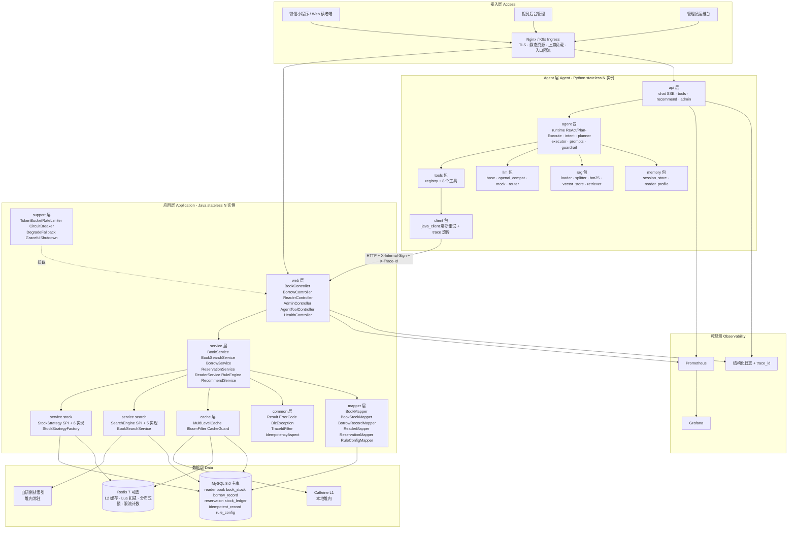
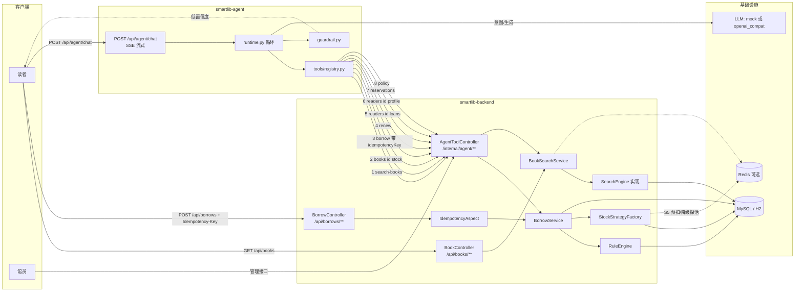
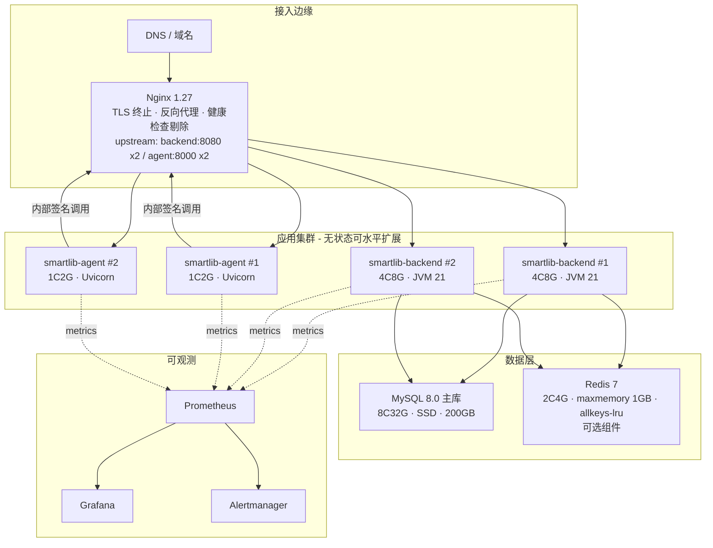
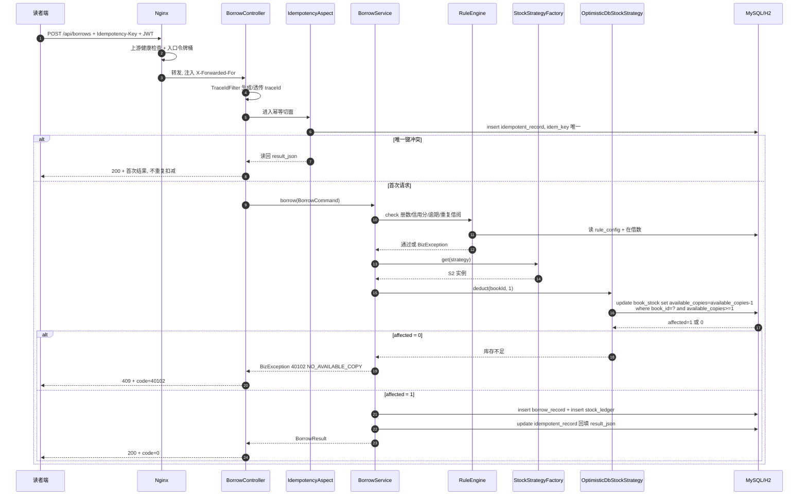
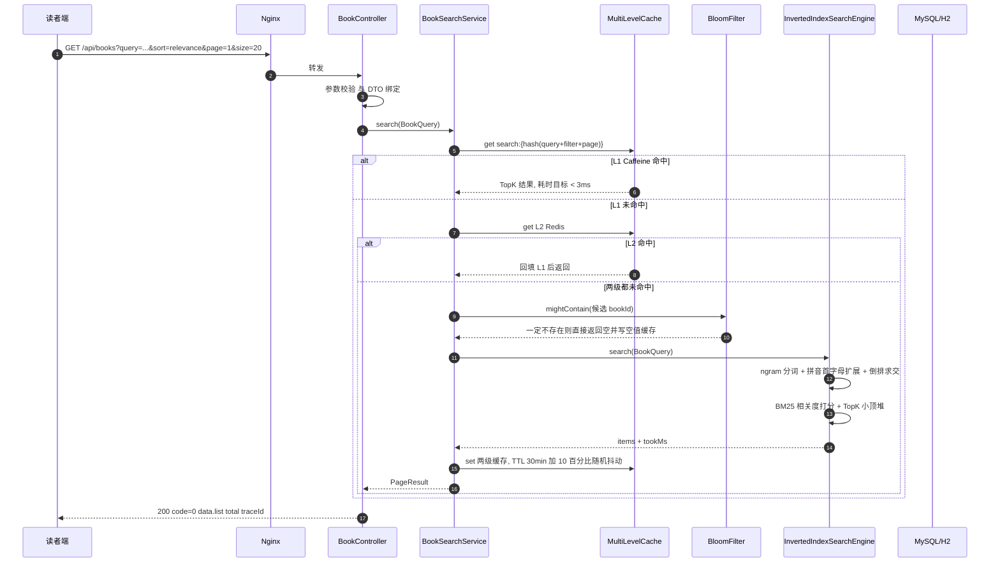
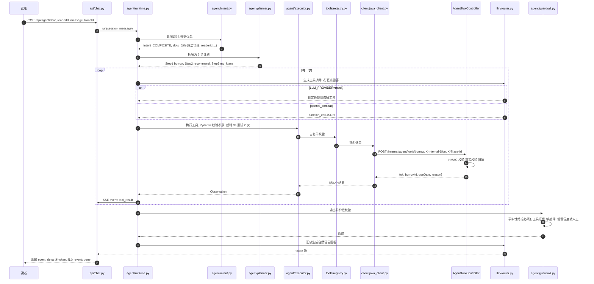
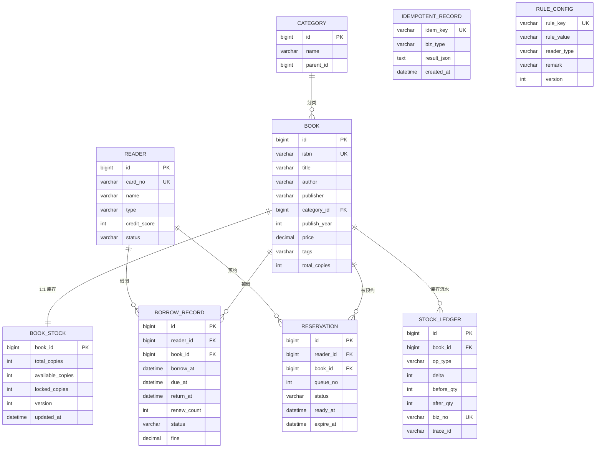
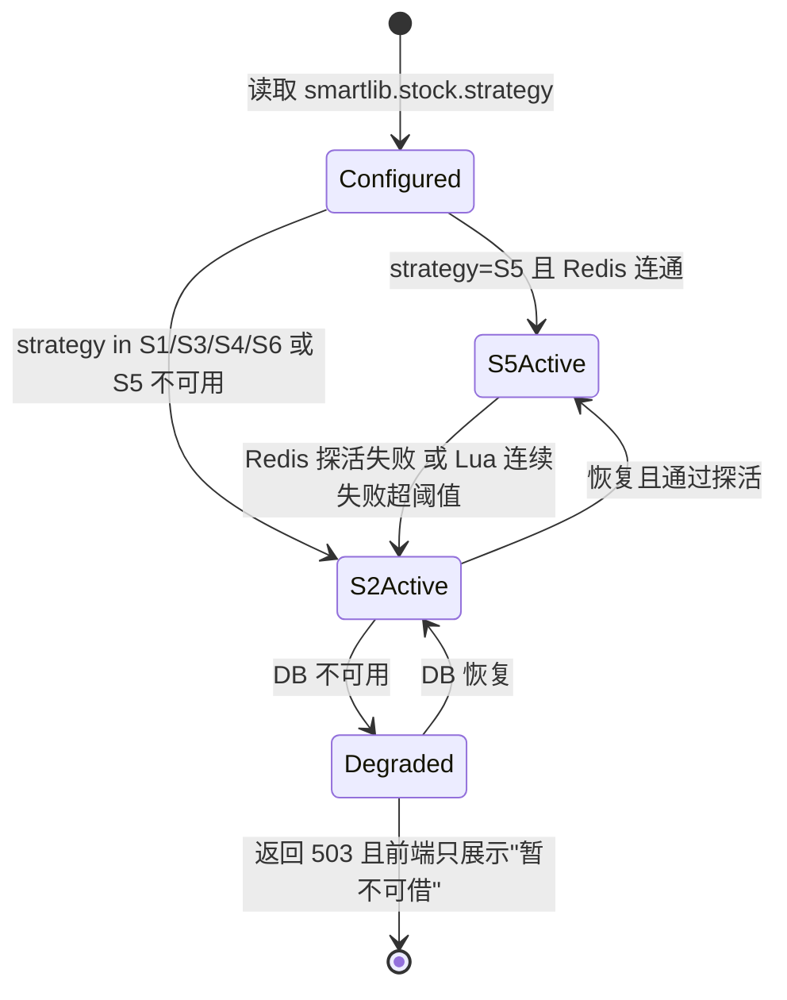
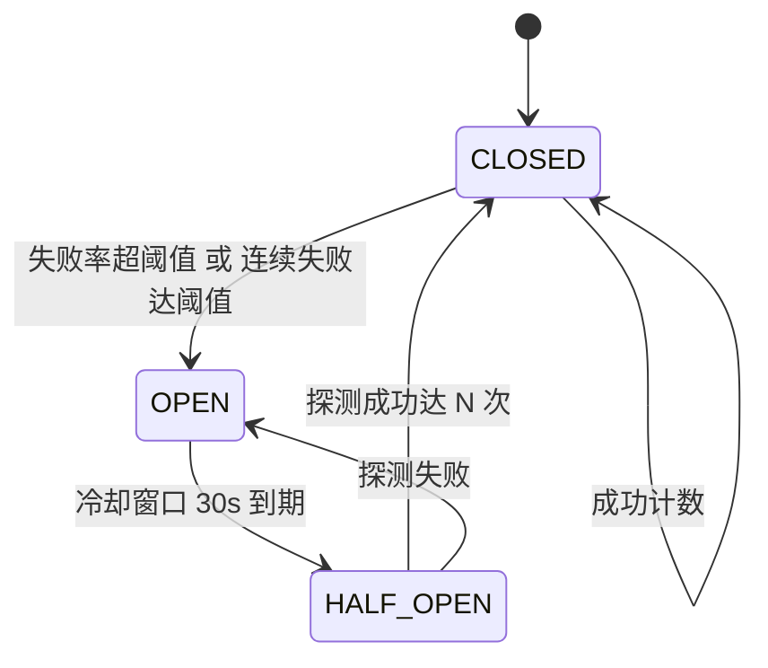
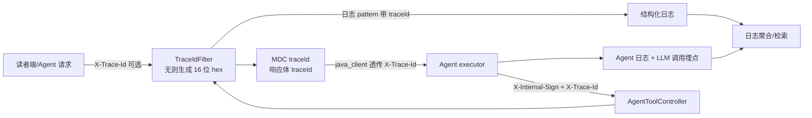

# SmartLib 概要设计文档

> 项目代号：**SmartLib**｜项目全称：高校图书馆智能借阅与推荐平台
> 文档版本：v1.0.0｜阶段：M2 设计阶段门
> 上游契约：[`docs/00-项目蓝图.md`](./00-项目蓝图.md)（本文档所有版本号、类名、接口路径、表名均以其为准，不得改动）
> 配套文档：[`docs/03-详细设计.md`](./03-详细设计.md)、[`docs/04-数据库设计.md`](./04-数据库设计.md)、[`docs/11-架构决策记录ADR.md`](./11-架构决策记录ADR.md)

**关于性能数据的重要声明**：本文档出现的所有耗时、QPS、容量数字，**除明确标注「现状基线」的部分来自现状系统工单记录外，其余全部为设计目标值（Target）或待实测回填项（TBD）**。项目尚未完成压测，任何实测数据一律禁止在本文档中编造；压测结果统一回填至 [`docs/06-测试计划与报告.md`](./06-测试计划与报告.md) 与 [`docs/09-多种解决方案对比手册.md`](./09-多种解决方案对比手册.md)。

---

## 1. 设计目标与约束

### 1.1 设计目标（对齐蓝图 §1.4 与 §7 SLO）

| 编号 | 目标 | 量化口径 | 对应痛点 | 验证方式 |
|---|---|---|---|---|
| G1 | 零超卖 | 200 并发抢 10 册，成功借出数 == 10，`available_copies == 0` | P1 | `BorrowConcurrencyTest` |
| G2 | 检索提速 | 检索 P99 < 300ms（120 万书目、TopK 20、召回率 ≥ 95%） | P2 | `SearchBenchmarkTest` |
| G3 | 高可用 | 可用性 99.9%，单实例故障 < 30s 恢复，错误率 < 0.1% | P3 | `docker kill` + 压测 |
| G4 | 服务台减负 | 重复咨询量下降 ≥ 60% | P4 | Agent 会话抽样统计 |
| G5 | 规则配置化 | 改规则不发版（全量落 `rule_config` 表） | P6 | 配置变更用例 |
| G6 | Agent 可信 | 事实性回答工具证据比例 100%，意图准确率 ≥ 92% | P4 | `agent-service/eval/run_eval.py` |
| G7 | 可观测 | 一次请求跨 Java/Python 可由单一 `trace_id` 还原 | P3 | 日志检索演练 |

### 1.2 技术约束（硬约束，来源：蓝图 §3）

| 约束 | 内容 | 影响 |
|---|---|---|
| C1 版本冻结 | Spring Boot **4.1.1**、Java **21**（字节码，本机运行在 Java 25 LTS 上）、MyBatis Starter **4.1.0**、springdoc **3.1.1**、Caffeine **3.3.1**、H2 **2.5.252**、Maven **3.9.9** | 不得升降级；升级需 ADR |
| C2 禁用 Lombok | 实体/DTO 手写 getter/setter/构造器，DTO 统一用 `record` | 见 ADR-003 |
| C3 禁止字节码增强 | 不用 JPA/Hibernate，不做运行期织入 | 见 ADR-002 |
| C4 双数据库 | local/demo 用 H2 `MODE=MySQL`，prod 用 MySQL 8.0 | 见 ADR-008 |
| C5 缓存可降级 | Redis 为 **可选** 依赖，不可用时系统功能完整、仅性能下降 | 见 ADR-005/ADR-009 |
| C6 零外部重型依赖 | 默认路径不依赖 ES / 向量库 / 消息中间件；MQ 方案以本地有界队列模拟 | 保证 `mvn test` 与 `pytest` 全离线可跑 |
| C7 Agent 可离线 | 默认 `LLM_PROVIDER=mock`，无任何 API Key 也能完整演示 | 见 ADR-011 |
| C8 SQL 可控 | 扣减 SQL 必须显式书写条件，任何方案不允许无约束 `update` | 见 ADR-004 |

### 1.3 业务约束

| 约束 | 内容 | 落地位置 |
|---|---|---|
| B1 库存永不为负 | `available_copies >= n` 是借阅的必要条件，且是扣减 SQL 的 `where` 条件 | `stock/` 全部 6 个策略 |
| B2 库存唯一事实源 | 缓存只服务查询展示，**任何扣减都必须落到 DB** | `MultiLevelCache` + `StockStrategy` |
| B3 幂等必填 | `POST /api/borrows` 必须携带 `Idempotency-Key`，缺失直接拒绝 | `IdempotencyAspect` + `idempotent_record` |
| B4 预约 FIFO | 预约队列严格先到先得，到馆保留 3 天，过期自动出队并通知下一位 | `reservation` + 定时任务 |
| B5 重复借阅限制 | 同一读者对同一 `book_id` 同时最多持有 1 册（复本合并计数） | `RuleEngine` |
| B6 借阅规则全配置 | 册数/期限/续借次数/信用分阈值/罚金费率全部读 `rule_config` | `RuleEngine` + `RuleConfigMapper` |
| B7 流水强审计 | 每一次库存变更写 `stock_ledger`，`sum(delta)` 必须等于库存变化量 | `StockLedger` + 对账任务 |
| B8 内部接口隔离 | `/internal/agent/**` 仅限 Agent 服务调用，带 HMAC 签名，限流与公共 API 隔离 | `AgentToolController` |
| B9 事实不下无据结论 | Agent 回答库存/位置/借阅状态类问题必须有工具返回证据 | `agent/guardrail.py` |

### 1.4 明确的范围外（本版不做）

- 不做支付/罚金线上缴纳闭环（仅记录罚金金额）。
- 不做短信/微信推送通道对接（仅留下发接口与日志埋点）。
- 不做多租户（单校部署）。
- 不引入服务网格、不做读写分离与分库分表（容量测算见 §13，3 年内单库足够）。

---

## 2. 总体架构

### 2.1 分层架构图



### 2.2 组件交互图（含契约边界）



### 2.3 部署拓扑图



**部署形态差异**

| 维度 | Docker Compose（local/demo） | K8s（prod） |
|---|---|---|
| 后端实例 | backend x2 + nginx | Deployment replicas=2（HPA 上限按 §13 产能）|
| 数据库 | 容器 MySQL 8.0（或 H2 内存档） | 托管 RDS / 独立节点 |
| 探针 | `healthcheck` + `depends_on` | `readinessProbe: /actuator/health/readiness`、`livenessProbe: /actuator/health/liveness` |
| 停机 | `server.shutdown: graceful` + `stop_grace_period` | `terminationGracePeriodSeconds: 30` + `preStop sleep` |
| Agent | agent x1（演示） | agent x2（与后端同域，走 Nginx 内部路由） |

---

## 3. 模块划分与职责

### 3.1 后端（Java · `com.smartlib`）

| 模块 | 职责 | 依赖 | 对外接口 | 关键类 |
|---|---|---|---|---|
| `common` | 统一响应体、错误码、异常、trace 注入、幂等切面、JSON 工具 | 无（最底层） | `Result<T>`、`PageResult<T>`、`BizException` | `Result` `ErrorCode` `BizException` `GlobalExceptionHandler` `TraceIdFilter` `IdempotencyAspect` `JsonUtils` |
| `config` | Bean 装配：数据源、MyBatis、MVC、缓存、OpenAPI、扣减策略选择 | `common` | Spring 配置类 | `MyBatisConfig` `WebMvcConfig` `CacheConfig` `OpenApiConfig` `StockStrategyConfig` |
| `domain.entity` | 与表 1:1 的持久化对象（手写 getter/setter，禁 Lombok） | 无 | POJO | `Book` `BookStock` `Category` `Reader` `BorrowRecord` `Reservation` `StockLedger` `RuleConfig` |
| `domain.enums` | 领域枚举，与 DB 中字符串码一一对应 | 无 | 枚举 | `ReaderType` `BorrowStatus` `ReservationStatus` `StockOpType` |
| `domain.dto` | 入参/出参契约，全部用 `record`（不可变、自带 equals/hashCode） | `domain.enums` | `record` | `BookQuery` `BorrowCommand` `BorrowResult` `StockView` `ReaderProfile` |
| `mapper` | 纯 SQL 访问层，XML 与注解并用；慢 SQL 显式书写便于分析 | `domain` | Mapper 接口 | `BookMapper` `BookStockMapper` `BorrowRecordMapper` `ReaderMapper` `ReservationMapper` `RuleConfigMapper` |
| `service` | 业务编排、事务边界、规则校验 | `mapper` `cache` `support` | `XxxService` | `BookService` `BookSearchService` `BorrowService` `ReservationService` `ReaderService` `RuleEngine` `RecommendService` |
| `service.stock` | 库存扣减策略 SPI 与 6 个实现；唯一的扣减入口 | `mapper` `support` | `StockStrategy`、`StockStrategyFactory` | `StockStrategy`（SPI）`LocalLockStockStrategy` `OptimisticDbStockStrategy` `PessimisticDbStockStrategy` `VersionRetryStockStrategy` `RedisLuaStockStrategy` `MqSerialStockStrategy` `StockStrategyFactory` |
| `service.search` | 检索引擎 SPI 与 5 个实现；分词/拼音/相关度 | `mapper` `cache` | `SearchEngine`、`BookSearchService` | `SearchEngine`（SPI）`LikeSearchEngine` `PrefixIndexSearchEngine` `InvertedIndexSearchEngine` `NgramFullTextSearchEngine` `ElasticsearchSearchEngine` |
| `cache` | 三级缓存、布隆过滤、缓存防护（穿透/击穿/雪崩） | `common` | `MultiLevelCache` `BloomFilter` `CacheGuard` | `MultiLevelCache` `BloomFilter` `CacheGuard` |
| `support` | 韧性组件：限流、熔断、降级、优雅停机 | `common` | `TokenBucketRateLimiter` `CircuitBreaker` `DegradeFallback` `GracefulShutdown` | 同名类 |
| `web` | HTTP 出入口：路由、参数校验、DTO 转换、SSE 代理 | `service` `common` | REST 控制器 | `BookController` `BorrowController` `ReaderController` `AdminController` `AgentToolController` `HealthController` |

### 3.2 Agent 服务（Python · `agent-service/app`）

| 模块 | 职责 | 依赖 | 对外接口 | 关键类/文件 |
|---|---|---|---|---|
| `main.py` | FastAPI 入口、路由装配、生命周期（索引预热、httpx 连接池） | 全部 | ASGI App | `main.py` |
| `config.py` | Pydantic Settings 配置（LLM_PROVIDER、超时、熔断阈值、后端地址） | 环境变量 | `Settings` | `config.py` |
| `api` | 对外 HTTP：SSE 流式对话、工具直调、推荐、运维 | `agent` `tools` | `POST /api/agent/chat` | `chat.py` `tools.py` `recommend.py` `admin.py` |
| `agent` | Agent 主循环与护栏 | `llm` `tools` `rag` `memory` | `run()` 协程 | `runtime.py` `intent.py` `planner.py` `executor.py` `prompts.py` `guardrail.py` |
| `llm` | LLM 抽象与路由：mock / openai_compat，失败回退 mock | 无 | `LLMClient` 协议 | `base.py` `openai_compat.py` `mock.py` `router.py` |
| `tools` | 8 个工具的定义、Pydantic 参数 schema、注册与白名单 | `client` | `ToolRegistry` | `registry.py` + `search_books` `get_stock` `borrow` `renew` `my_loans` `get_reader_profile` `policy_qa` `recommend` |
| `rag` | 知识库加载切分、BM25 检索、可选向量、混合召回 | 无（numpy 可选） | `Retriever` | `loader.py` `splitter.py` `bm25.py` `vector_store.py` `retriever.py` |
| `memory` | 会话短期记忆 + 读者画像长期记忆 | `client` | `SessionStore` `ReaderProfileStore` | `session_store.py` `reader_profile.py` |
| `client` | 调 Java 后端：HMAC 签名、trace 透传、超时/重试/熔断 | 无 | `JavaClient` | `java_client.py` |
| `eval` | 离线评测：数据集驱动，产出 5 项指标 | `agent` | CLI 脚本 | `dataset.jsonl` `run_eval.py` `metrics.py` |
| `tests` | 单测与端到端 | 全部 | pytest 用例 | `test_intent` `test_tools` `test_rag` `test_agent_e2e` |

### 3.3 模块依赖规则（架构守护）

| 规则 | 说明 | 违规示例 |
|---|---|---|
| R1 单向依赖 | `web → service → mapper`，禁止 `mapper` 反向依赖 `service` | Mapper 里注入 Service |
| R2 跨层禁止 | `web` 不得直接注入 `mapper` | Controller 直接调 `BookMapper` |
| R3 扣减唯一入口 | 库存变更只能经 `StockStrategy`，禁止任何类直接 `update book_stock` | `BorrowService` 里手写 `update book_stock set ...` |
| R4 策略可插拔 | 新增扣减/检索方案只新增实现类 + 枚举，不改 `service` 调用方 | 在 `BorrowService` 里写 `if (strategy == S5)` |
| R5 Agent 不碰 DB | Agent 只能经 `/internal/agent/**` 访问数据，禁止直连数据库 | Python 直连 MySQL |
| R6 Prompt 集中 | 所有 Prompt 只在 `agent/prompts.py` 定义 | 工具文件里内联 Prompt |

---

## 4. 关键请求链路走查

### 4.1 链路 A：读者借书 `POST /api/borrows`

**场景**：开学季，200 并发抢同一本《高等数学》，`available_copies = 10`，默认策略 S2。



| # | 跳 | 动作 | 关键状态 / 副作用 |
|---|---|---|---|
| 1 | 读者端 | 携带 `Idempotency-Key`（客户端 UUID）与 JWT 发起 POST | 无 |
| 2 | Nginx | 健康检查剔除失效上游；入口令牌桶按 IP+接口限流 | 超限返回 429 `ErrorCode.42900` |
| 3 | `TraceIdFilter` | 无 `X-Trace-Id` 则生成，写入 MDC 与响应体 | `trace_id` 贯穿后续所有日志 |
| 4 | `IdempotencyAspect` | 以 `idem_key` 尝试 `insert idempotent_record` | 唯一键冲突 ⇒ 判定为重放 |
| 5 | `BorrowService` | 开启事务，调 `RuleEngine` 做 6 项校验 | 读 `rule_config` → 命中 L1 缓存 |
| 6 | `StockStrategyFactory` | 按 `smartlib.stock.strategy` 返回策略；不可用时先尝试 `DegradeFallback` | 默认 `S2` |
| 7 | `OptimisticDbStockStrategy` | 条件更新，`available_copies >= 1` 是正确性核心 | `affected=1` 成功；`0` 即库存不足 |
| 8 | 事务提交前 | 写 `borrow_record`（`status=BORROWED`、`due_at` 按读者类型算）与 `stock_ledger`（`delta=-1`，带 `biz_no`、`trace_id`） | 三者同事务，保证守恒 |
| 9 | 回填幂等结果 | `idempotent_record.result_json` 写入 `BorrowResult` | 重放直接返回该结果 |
| 10 | 响应 | `{"code":0,"msg":"ok","data":{"borrowId":...,"dueDate":...},"traceId":"..."}` | 缓存侧：`book:stock:{id}` 与 `book:detail:{id}` 删除（延迟双删） |

**失败路径**：`affected=0` → 409 + `40102`；规则不通过 → 422 + `40101/40103/40104/40105`；DB 不可用 → 熔断打开，`DegradeFallback` 返回 `503 + 42900/90002` 并使前端展示"暂不可借，请稍后重试"，**绝不返回"借阅成功"**。

### 4.2 链路 B：读者检索 `GET /api/books?query=计算机网络 谢希仁`



| # | 跳 | 动作 | 说明 |
|---|---|---|---|
| 1 | 读者端 | `query/category/publisher/yearFrom/yearTo/availableOnly/sort/page/size` | `size` 上限 100 |
| 2 | `BookController` | 参数校验（`@Valid` + 手写规则），非法直接 400 `ErrorCode.10001` | 不进入缓存 |
| 3 | `BookSearchService` | 用 `query + 归一化过滤条件 + page/size` 生成缓存 key | 归一化保证同义请求同 key |
| 4 | `MultiLevelCache` | L1 Caffeine（5min / 10k 条）→ L2 Redis（30min）→ DB | 逐级回填 |
| 5 | `BloomFilter` | 书目 ID/标题哈希布隆，拦截必然不存在的查询 | 防穿透，命中即返回空列表 + 短 TTL 空值缓存 |
| 6 | `CacheGuard` | 逻辑过期 + 单飞：同一 key 只放行一个线程重建 | 防击穿，其余线程拿旧值 |
| 7 | `InvertedIndexSearchEngine` | ngram 分词（2-gram + 词组）、拼音首字母、倒排求交、BM25 打分、TopK 20 | 默认引擎，零外部依赖 |
| 8 | 缓存写入 | TTL 随机抖动 ±10%，防雪崩 | `Redis` 不可用时跳过 L2，仅 L1 + DB |
| 9 | 降级 | 引擎异常或超时 → 熔断打开 → `DegradeFallback` 走 LIKE 直查 DB，响应标注 `degraded=true` | 保可用不保性能 |
| 10 | 响应 | `PageResult{list,total,page,size}`；内部工具路径额外返回 `tookMs/engine/degraded` | 供 Agent 判断可信度 |

### 4.3 链路 C：Agent 对话 `POST /api/agent/chat`（SSE）

**用户语句**：「帮我借《算法导论》，再推荐两本同类的，顺便看看我有没有逾期」



| # | 跳 | 动作 | 关键点 |
|---|---|---|---|
| 1 | 读者 | 提交 `message` + `readerId` + `sessionId`，接受 `text/event-stream` | 首 Token 目标 < 1.5s |
| 2 | `chat.py` | 补 `trace_id`（上游无则生成），建立 SSE 通道 | 与 Java 侧 `trace_id` 同源透传 |
| 3 | `intent.py` | 规则优先匹配高频意图（借/续/查/规则），未命中走 LLM 兜底 | 高频意图快、便宜、稳，见 ADR-010 |
| 4 | `planner.py` | 复合任务拆解为有依赖顺序的步骤列表 | 步骤可顺序执行、可失败短路 |
| 5 | `runtime.py` | ReAct 循环：Thought → Action → Observation，上限轮次防死循环 | 轮次上限、超时总预算 |
| 6 | `llm/router.py` | `LLM_PROVIDER=mock` 走确定性规则；`openai_compat` 走真实模型；调用失败自动回退 mock | 保证离线可演示，见 ADR-011 |
| 7 | `executor.py` | Pydantic v2 校验参数 schema → 白名单 → 超时 3s / 重试 2 / 熔断 | 参数不合规不发出 |
| 8 | `java_client.py` | HMAC-SHA256 签名，透传 `X-Trace-Id`，连接池复用 | 失败重试只对幂等工具 |
| 9 | `AgentToolController` | 验签 → 内部限流（独立桶）→ 转 `BorrowService` | 内部接口与公共 API 限流隔离 |
| 10 | 工具返回 | `borrow` 工具带 `idempotencyKey`，服务端 `idempotent_record` 兜底 | Agent 重试不会重复借出 |
| 11 | `guardrail.py` | 校验：涉及库存/位置/借阅状态的结论是否引用了工具证据；敏感词；置信度 | 无证据 ⇒ 拒答并转人工 |
| 12 | SSE 输出 | `event: delta` 逐 token；`event: tool_result` 结构化中间结果；`event: done` 结束 | 前端可实时展示"正在查库存…" |

---

## 5. 技术选型对比

> 每个维度采用 1~5 分制（5 = 最优）。评分是**设计阶段的主观判断**，最终以 `docs/09-多种解决方案对比手册.md` 的实测数据为准。

### 5.1 ORM：MyBatis 4.1.0（选定）

| 维度 | MyBatis ✅ | Spring Data JPA | JdbcTemplate | MyBatis-Plus |
|---|---|---|---|---|
| SQL 可控性 | 5（手写 SQL，慢查询优化叙事直接） | 2（生成 SQL 难精准控制） | 5 | 4 |
| 库存条件更新友好度 | 5（`where available_copies >= #{n}` 直写） | 3（需 `@Modifying` 原生 SQL 兜底） | 4 | 4 |
| 运行期字节码增强风险 | 5（无） | 2（Hibernate 代理 + 一级缓存，易踩坑） | 5 | 3（AR 模式有隐式行为） |
| 开发效率 | 3 | 5（单表 CRUD 零 SQL） | 2 | 5 |
| 与 Spring Boot 4.1.1 兼容 | 5（Starter 4.1.0 已在本机 spike 验证） | 5 | 5 | 3（版本适配滞后） |
| 学习/讲述成本 | 5（团队与评审者都熟悉） | 3 | 5 | 3 |
| 与蓝图 §3.1 一致 | 5 | 1 | 2 | 2 |
| **加权结论** | **33** | 23 | 23 | 20 |

**结论**：选 **MyBatis Starter 4.1.0**。理由：① 本项目核心亮点是"库存扣减 SQL 的条件更新正确性"和"慢查询治理"，SQL 必须在开发者手里；② 不用 JPA 可彻底规避字节码增强带来的启动期/调试期风险（技术约束 C3）；③ 已在 `spike/` 用 H2 `MODE=MySQL` 验证跑通；④ MyBatis-Plus 的便利性对本项目（表少、SQL 关键）收益低，且其对新 Boot 版本适配滞后是真实风险。

### 5.2 缓存：三级缓存 = Caffeine L1 + Redis L2（+ DB）

| 维度 | 纯内存 Map | Caffeine 3.3.1 | Redis 7 | 多级（Caffeine + Redis）✅ |
|---|---|---|---|---|
| 单次读延迟量级 | 纳秒~微秒 | 微秒级 | 亚毫秒~毫秒（网络） | L1 微秒 / L2 亚毫秒 |
| 进程内共享 | 否（多实例各一份） | 否 | 是（全局一致视图） | 是（L2 承担共享） |
| 淘汰策略 | 无（需手写） | W-TinyLFU，命中率高 | LRU/LFU 可配 | 组合优势 |
| 防雪崩能力 | 弱 | 仅本进程 | 全局 TTL 抖动 | 完整 |
| 运维成本 | 0 | 0 | 需部署/监控 | 中 |
| 可降级性 | — | 天然可用 | 需降级开关 | Redis 挂了自动退化为 L1 + DB |
| 与蓝图 §6.2 一致 | 2 | 4 | 4 | 5 |
| **加权结论** | 14 | 22 | 23 | **29** |

**结论**：选 **多级缓存**，L1 Caffeine（5min / 10k 条）+ L2 Redis（30min），两者都可 **整体缺失**：Redis 不可用 → `MultiLevelCache` 自动只走 L1 与 DB；Caffeine 不可用（理论上不会）→ 只走 L2。**库存不作为缓存唯一事实源**（业务约束 B2），缓存仅服务查询展示。

### 5.3 检索引擎：自研倒排索引（默认 Q3），ES 为可选（Q5）

| 维度 | Q1 LIKE `%kw%` | Q2 前缀索引 | Q3 自研倒排 ✅ | Q4 MySQL ngram FULLTEXT | Q5 Elasticsearch |
|---|---|---|---|---|---|
| 现状/目标耗时 | 现状基线 2.8s（120 万行） | 目标 ~200ms | 目标 P99 < 100ms | 目标 ~120ms | 目标 ~50ms |
| 召回质量 | 3（子串匹配，无相关度） | 2（仅前缀） | 5（ngram + 拼音 + BM25） | 4 | 5 |
| 分词/拼音 | 无 | 无 | 有 | 仅 ngram | 有（需插件） |
| 写放大 | 无 | 无 | 无（内存重建） | 高 | 中 |
| 外部依赖 | 无 | 无 | 无 | 无 | 需独立集群 |
| 索引内存（58 万种估算，见 §13.4） | 0 | 0 | 约 120~200MB（估算） | 0 | 需独立节点 |
| 运维成本 | 0 | 0 | 低 | 低 | 高 |
| 与蓝图 §6.2 一致 | 2（仅作基线） | 2 | 5 | 4 | 4 |
| **加权结论** | 12 | 13 | **31** | 25 | 27 |

**结论**：默认 **Q3 自研倒排索引**（零依赖、可离线演示、可讲透算法）；数据量 > 500 万或需要复杂相关度时通过 `SearchEngine` SPI 切 **Q5 Elasticsearch**，**切换只改配置**（`smartlib.search.engine`）。Q1 保留为降级兜底与性能基线对照。选择理由与被否决方案的详细论证见 ADR-006。

### 5.4 韧性组件：自研令牌桶 + 熔断状态机

| 维度 | 自研 ✅ | Resilience4j | Sentinel |
|---|---|---|---|
| 功能完备度 | 3（令牌桶、三态熔断、降级，够用不冗余） | 5（限流/熔断/重试/舱壁/超时全套） | 5（+ 控制台、热点参数、集群流控） |
| 可解释性 / 可讲述性 | 5（自己写的状态机，白盒） | 3（注解 + 配置，讲的是"我会用"） | 3 |
| 额外依赖 | 0 | 需引入并适配 Boot 4.1.1 | 需引入 + 控制台部署 |
| 可视化运维 | 2（仅指标暴露） | 2 | 5 |
| 定制自由度 | 5（可针对内部/公共接口给不同桶） | 3 | 4 |
| 风险 | 需自行保证正确性（用单测覆盖三态迁移） | 低 | 低 |
| 与蓝图 §3.1/§6.3 一致 | 5 | 3（仅作对比配置） | 2 |
| **加权结论** | **28** | 26 | 24 |

**结论**：选 **自研**（`TokenBucketRateLimiter` + `CircuitBreaker` + `DegradeFallback`），同时保留 Resilience4j 方案配置作为对比项写入对比手册。理由：① 项目定位是"证明理解原理"，自研状态机可白盒讲解三态迁移与半开探测；② 避免为少量需求引入整套组件并承担新 Boot 版本适配风险；③ 自研代码量可控（限流 + 熔断 + 降级 ≈ 数百行），用单测保证正确性。详见 ADR-005。

### 5.5 容器：Spring Boot 内置 Tomcat（选定）

| 维度 | Tomcat（内置）✅ | Undertow | Netty（Reactor Netty / WebFlux） |
|---|---|---|---|
| 与 Spring MVC 生态契合 | 5（默认 starter-web） | 5（可替换） | 2（需切 WebFlux，全部同步代码重写） |
| 内存占用 | 3 | 5（更省） | 4 |
| 并发模型 | 3（线程池，与 MyBatis/JDBC 阻塞模型天然匹配） | 4（XNIO，性能更好） | 5（事件循环，高并发） |
| 与阻塞式 ORM 的匹配度 | 5 | 5 | 1（阻塞调用会占满事件循环，需全链路异步） |
| 迁移/踩坑成本 | 5（零） | 3 | 1 |
| 满足 SLO 目标 | 5（检索峰值 1,500 QPS 远低于 Tomcat 产能上限，借还峰值仅约 30 QPS） | 5 | 5 |
| **加权结论** | **31** | 27 | 18 |

**结论**：用 **`spring-boot-starter-web` 内置 Tomcat**。理由：① 全链路是 JDBC/MyBatis 阻塞模型，Netty 的异步优势无法兑现反而引入风险；② 目标 QPS 在单实例 4C8G 下离 Tomcat 上限很远，瓶颈在 DB 而非容器；③ SSE 流式由 Agent 侧（FastAPI/Uvicorn）承担，Java 侧无需长连接能力。Undertow 作为可选优化项写入对比手册（预期内存收益需实测回填）。

### 5.6 Agent 编排：自研 ReAct 循环

| 维度 | 自研 ReAct loop ✅ | LangChain | LangGraph | Dify |
|---|---|---|---|---|
| 掌控度 / 可调试性 | 5（循环与 Prompt 全在自己手里） | 3（抽象层厚，栈追踪难） | 3 | 2（平台方控制） |
| 依赖与版本风险 | 5（仅 FastAPI/Pydantic/httpx） | 2（依赖树庞大、版本变动频繁） | 2 | 2（需部署平台） |
| 离线可运行 | 5（配 MockLLM 全离线） | 3 | 3 | 2 |
| 多步/分支编排能力 | 4（Plan-Execute + ReAct 双模式，够本项目用） | 3 | 5（图编排最强） | 4 |
| 工程化护栏 | 5（白名单/校验/熔断/证据校验自己实现，最可控） | 3 | 3 | 4 |
| 讲述价值 | 5（能讲清循环、终止条件、幻觉兜底） | 3 | 4 | 2 |
| **加权结论** | **32** | 17 | 22 | 18 |

**结论**：选 **自研 ReAct 循环**（`agent/runtime.py`，同时支持 ReAct 与 Plan-Execute 双模式）。理由：① 本项目要证明的是"理解 Agent 原理"，自研循环能把 Thought/Action/Observation、终止条件、上下文裁剪讲透；② 零框架依赖 = 零版本风险 + 完全离线可跑（技术约束 C6/C7）；③ 工程护栏（工具白名单、Pydantic 校验、证据约束、转人工）自研反而更好落地。详见 ADR-010。

### 5.7 LLM 接入：OpenAI 兼容直连 + Mock 兜底

| 维度 | openai_compat 直连 ✅ | 自建 LLM 网关 | 云厂商 SDK（dashscope 等） | 本地 vLLM |
|---|---|---|---|---|
| 供应商切换成本 | 2（换 base_url + model 即可） | 5 | 1（SDK 绑定） | 4 |
| 统一鉴权/配额/审计 | 2（应用内做） | 5 | 3 | 3 |
| 额外部署成本 | 0 | 需自建服务 | 0 | 需 GPU |
| 离线可运行 | 5（配 mock） | 3 | 1 | 3 |
| 与现代模型兼容性 | 5（事实标准协议） | 4 | 2 | 4 |
| 与蓝图 §3.2 一致 | 5 | 3（演进方向） | 2 | 3 |
| **加权结论** | **24** | 25 | 12 | 21 |

**结论**：选 **OpenAI 兼容协议直连**（`llm/openai_compat.py`），通过 `LLM_PROVIDER` 配置在 DeepSeek / 通义 / 本地 vLLM 间切换；`LLM_PROVIDER=mock` 时走确定性 `MockLLM`，**无 Key 全流程可演示**。自建网关被否决是**因为本项目是单团队单应用**，网关的统一鉴权/配额收益不足以抵消运维成本——但保留为 V2.0 演进方向（蓝图 §8 迭代规划）。详见 ADR-011。

### 5.8 Agent 侧检索：BM25 为默认，向量/混合为可选

| 维度 | BM25 自研 ✅ | 向量检索（numpy 余弦） | 混合（BM25 + 向量 RRF） | 直接整篇塞 Prompt |
|---|---|---|---|---|
| 精确术语匹配（书名/规则条款号） | 5 | 3 | 5 | 4 |
| 语义泛化（"我能不能多借几本"） | 3 | 5 | 5 | 4 |
| 外部依赖 | 0（零） | numpy（无 Key 时哈希嵌入降级） | 需嵌入模型 | 0 |
| Token 成本 | 低（只召回 TopK） | 低 | 低 | 极高（全量塞入） |
| 可解释性（能给出处） | 5（词频可解释） | 3 | 4 | 2 |
| 延迟量级（知识库 ≈ 数百条切片） | 极低（毫秒级） | 低 | 低 | 高（受上下文长度限制） |
| 与蓝图 §3.2/§6.4 一致 | 5 | 3 | 4（可选） | 1 |
| **加权结论** | **31** | 23 | **28** | 19 |

**结论**：默认 **自研 BM25**（`rag/bm25.py`），保留 `rag/vector_store.py` 与 `rag/retriever.py` 的混合召回为**可选开关**（无 Key 时用哈希嵌入降级）。理由：① 馆内知识库（借阅规则、馆藏分布、学科服务）术语密集，BM25 的精确匹配优势明显；② 零依赖、零 Key 即可端到端跑通与跑评测；③ "直接整篇塞 Prompt"被否决：Token 成本高、无出处、易超上下文。

---

## 6. 接口设计规范

### 6.1 REST 风格与版本

| 项 | 规范 |
|---|---|
| 风格 | REST，资源名词复数，动作用子资源或 HTTP 方法表达：`POST /api/borrows/{id}/return`、`DELETE /api/reservations/{id}` |
| 公共前缀 | 对外 `/api/**`；内部工具 `/internal/agent/**`（不与 `/api` 复用限流桶） |
| 版本 | **路径不加版本号**（`/api/books`），版本通过请求头 `X-Api-Version: 1` 传递，默认 `1`；不兼容变更升 `2` 并保留 `1` 一个迭代周期 |
| 方法语义 | GET 幂等安全；POST 创建/动作；DELETE 取消；不使用 PUT（本版无全量替换语义） |
| 状态码 | 200 成功；400 参数；401 未认证；403 越权；404 不存在；409 业务冲突（如库存不足）；422 规则不通过；429 限流；503 熔断/依赖不可用 |

### 6.2 统一响应体

```json
{
  "code": 0,
  "msg": "ok",
  "data": { },
  "traceId": "9f1c4b2e8a7d4f10"
}
```

| 字段 | 类型 | 说明 |
|---|---|---|
| `code` | int | 0 成功，非 0 见 §6.3；**HTTP 状态码表达传输语义，`code` 表达业务语义**，二者都返回 |
| `msg` | string | 面向人的简短信息，禁止把 SQL/堆栈写入 |
| `data` | object / array / null | 失败时为 `null` |
| `traceId` | string | 与日志 MDC、Agent 侧 `trace_id` 同值 |

分页体（作为 `data`）：

```json
{ "list": [], "total": 0, "page": 1, "size": 20 }
```

### 6.3 错误码分段规范

| 段位 | 归属 | 范围 | 示例 |
|---|---|---|---|
| `0` | 成功 | 0 | `SUCCESS = 0` |
| `1xxxx` | 通用/参数/认证/系统 | 10001~19999 | `10001 PARAM_INVALID`、`10002 UNAUTHORIZED`、`10003 FORBIDDEN`、`10004 NOT_FOUND`、`10005 IDEMPOTENT_CONFLICT`、`10006 SYSTEM_ERROR` |
| `2xxxx` | 读者域 | 20001~29999 | `20001 READER_NOT_FOUND`、`20002 CREDIT_TOO_LOW`、`20003 READER_FROZEN`、`20004 FINE_UNPAID` |
| `3xxxx` | 书目/检索域 | 30001~39999 | `30001 BOOK_NOT_FOUND`、`30002 SEARCH_ENGINE_UNAVAILABLE`、`30003 SEARCH_PARAM_INVALID`、`30004 SEARCH_DEGRADED` |
| `4xxxx` | 借阅域 | 40001~49999 | `40001 BORROW_RECORD_NOT_FOUND`、`40002 BORROW_LIMIT_EXCEEDED`、`40003 HAS_OVERDUE`、`40004 DUPLICATE_BORROW`、`40005 RENEW_NOT_ALLOWED`、`40006 RENEW_LIMIT_EXCEEDED`、`40102 NO_AVAILABLE_COPY` |
| `5xxxx` | 预约域 | 50001~59999 | `50001 RESERVATION_NOT_FOUND`、`50002 RESERVATION_EXPIRED`、`50003 RESERVATION_QUEUE_FULL`、`50004 RESERVATION_DUPLICATE` |
| `6xxxx` | 库存域 | 60001~69999 | `60001 STOCK_NOT_FOUND`、`60002 STOCK_STRATEGY_UNAVAILABLE`、`60003 STOCK_LEDGER_UNBALANCED` |
| `7xxxx` | 内部 Agent 接口 | 70001~79999 | `70001 INVALID_SIGN`、`70002 SIGN_EXPIRED`、`70003 INTERNAL_FORBIDDEN`、`70004 TOOL_PARAM_INVALID` |
| `8xxxx` | 韧性/依赖 | 80001~89999 | `80001 RATE_LIMITED`、`80002 CIRCUIT_OPEN`、`80003 DEGRADED`、`80004 UPSTREAM_TIMEOUT` |
| `9xxxx` | 兜底系统级 | 90001~99999 | `90001 UNKNOWN_ERROR`、`90002 DB_UNAVAILABLE`、`90003 CACHE_UNAVAILABLE` |

约定：① 新增错误码必须落在本段位内并在 `ErrorCode` 枚举注册；② `8xxxx` 与 `9xxxx` 必须显式携带"可重试/不可重试"语义（`msg` 中体现，前端据此决定是否自动重试）；③ 内部接口错误码不得直接暴露给读者端，`AgentToolController` 需做一次映射。

### 6.4 路径清单（与蓝图 §8 逐条对齐，冻结）

**对外开放 API**

| 方法 | 路径 | 说明 | 幂等键 |
|---|---|---|---|
| GET | `/api/books` | 检索书目（`query/category/publisher/yearFrom/yearTo/availableOnly/sort/page/size`） | 不需要（安全方法） |
| GET | `/api/books/{id}` | 书目详情（含库存、位置、简介） | 不需要 |
| GET | `/api/books/hot` | 热门榜 | 不需要 |
| GET | `/api/books/{id}/similar` | 相似书推荐 | 不需要 |
| POST | `/api/borrows` | 借书 | **`Idempotency-Key` 必填** |
| POST | `/api/borrows/{id}/return` | 还书 | 建议携带（防重复还书） |
| POST | `/api/borrows/{id}/renew` | 续借 | 建议携带 |
| GET | `/api/readers/{id}/loans` | 我的借阅 | 不需要 |
| GET | `/api/readers/{id}/credit` | 信用分与权限 | 不需要 |
| POST | `/api/reservations` | 预约 | **`Idempotency-Key` 必填** |
| DELETE | `/api/reservations/{id}` | 取消预约 | 不需要（DELETE 语义幂等） |
| POST | `/api/agent/chat` | Agent 对话（SSE 流式，**由 Agent 服务提供**，非 Java 后端） | `sessionId` 保证会话幂等 |

**内部工具 API（仅供 Agent 服务调用，前缀 `/internal/agent/`）**

> 全部要求 `X-Internal-Sign`(HMAC) 与 `X-Trace-Id` 透传（§6.6）；限流与公共 API 隔离（独立令牌桶）。

| # | 方法 | 路径 | 入参 → 出参 | 幂等 |
|---|---|---|---|---|
| 1 | POST | `/internal/agent/tools/search-books` | `{query,category,page,size,sortBy}` → `{items[],total,tookMs,engine,degraded}` | 不需要（只读） |
| 2 | GET | `/internal/agent/tools/books/{id}/stock` | → `{bookId,title,available,total,queueLen,shelfLocation}` | 不需要（只读） |
| 3 | POST | `/internal/agent/tools/borrow` | `{readerId,bookId,idempotencyKey}` → `{ok,borrowId,dueDate,reason}` | **`idempotencyKey` 必填** |
| 4 | POST | `/internal/agent/tools/renew` | `{readerId,borrowId}` → `{ok,newDueDate,reason}` | 建议携带 |
| 5 | GET | `/internal/agent/tools/readers/{id}/loans` | → `[{borrowId,title,dueDate,overdueDays,renewable}]` | 不需要（只读） |
| 6 | GET | `/internal/agent/tools/readers/{id}/profile` | → `{readerType,creditScore,preferredCategories[],borrowedCount}` | 不需要（只读） |
| 7 | POST | `/internal/agent/tools/reservations` | `{readerId,bookId}` → `{ok,queueNo,reason}` | **`idempotencyKey` 必填** |
| 8 | GET | `/internal/agent/tools/policy` | `{topic}` → `{answer,source}`（规则库直答，Agent RAG 数据源之一） | 不需要（只读） |

**Agent 侧工具 → 内部 API 映射**（工具名引自蓝图 §4.3）

| 工具名 | 映射到内部 API | 说明 |
|---|---|---|
| `search_books` | #1 | 检索书目，Agent 侧需把 `degraded` 透传给用户话术 |
| `get_stock` | #2 | 库存/位置，事实性回答的**唯一**证据来源 |
| `borrow` | #3 | 必须生成 `idempotencyKey` 并在重试时复用 |
| `renew` | #4 | 需先经 #5 判断 `renewable` |
| `my_loans` | #5 | 我的借阅与逾期 |
| `get_reader_profile` | #6 | 读者画像（类型/信用分/偏好分类/在借数），供个性化推荐与权限话术使用 |
| `policy_qa` | #8 | 借阅规则问答（RAG 与直答双通道） |
| `recommend` | 由后端 `RecommendService` 支撑（`/api/books/hot`、`/api/books/{id}/similar`） | 推荐降级为热门榜 |

> 读者画像（#6）由 `get_reader_profile` 工具暴露；Agent 侧同时通过 `memory/reader_profile.py` 在会话初始化时拉取并缓存一份，避免每轮对话都打后端。
>
> **口径已对齐（蓝图 v1.1.0）**：蓝图 §4.3 的 Agent 工具数为 **8 个**（新增 `get_reader_profile`），与本节内部工具 API 的 8 条**一一对应**：`search_books`→#1、`get_stock`→#2、`borrow`→#3、`renew`→#4、`my_loans`→#5、`get_reader_profile`→#6、`policy_qa`→#8；`recommend` 由后端 `RecommendService` 的公共接口（`/api/books/hot`、`/api/books/{id}/similar`）支撑，不占用内部工具 API。内部 API 侧另有 #7 预约（`reservations`），当前不作为 Agent 工具暴露，保留给 V1.x 的"替读者预约"任务。原"7 个工具 vs 8 条内部 API"的差异已随蓝图 §4.3 修订关闭。

### 6.5 幂等约定

| 项 | 约定 |
|---|---|
| 必填接口 | `POST /api/borrows`、`POST /internal/agent/tools/borrow`、`POST /internal/agent/tools/renew`、`POST /internal/agent/tools/reservations` |
| 请求头 | `Idempotency-Key: <客户端生成的 UUID>`，缺失返回 400 + `10001` |
| 服务端实现 | `IdempotencyAspect` → `insert into idempotent_record(idem_key, biz_type, ...)`，唯一键冲突即判定重放，读回 `result_json` 原样返回 |
| 有效期 | 24 小时（清理任务按 `created_at` 删除） |
| 作用域 | `idem_key` 全局唯一；`biz_type` 区分业务，避免不同业务撞 key |
| 语义 | 同一 key 重复请求**只生效一次**，且第二次返回与第一次**完全一致的结果**（含 `borrowId`） |

### 6.6 内部接口签名

| 项 | 约定 |
|---|---|
| 请求头 | `X-Internal-Sign`、`X-Internal-Timestamp`（epoch 毫秒）、`X-Internal-Nonce`、`X-Trace-Id` |
| 算法 | `sign = HMAC-SHA256(secret, timestamp + "\n" + nonce + "\n" + sha256Hex(rawBody))`，Hex 小写 |
| 校验 | 时间戳偏差 > 5 分钟 → `70002`；签名不匹配 → `70001`；`nonce` 在 Redis 去重（Redis 不可用时退化为仅时间戳 + 签名校验，并记 WARN） |
| 密钥 | 环境变量 `INTERNAL_SIGN_SECRET` 注入，禁止入库、禁止入日志 |
| 网络隔离 | 生产环境 `/internal/**` 在 Nginx 层限制来源网段/K8s NetworkPolicy，仅允许 Agent 实例访问 |

### 6.7 分页 / 超时 / 重试

| 项 | 约定 |
|---|---|
| 分页 | 偏移分页 `page`（从 1 起）+ `size`（默认 20，**上限 100**）；`size > 100` 返回 400 + `10001` |
| 深分页 | `page * size > 10000` 时建议走游标分页（`cursor` = 上一页末条排序键），本版对书目检索启用，返回 `nextCursor` |
| 排序 | 白名单 `relevance / publish_year / borrow_count / title`，非白名单返回 `30003` |
| 网关超时 | Nginx `proxy_read_timeout 10s` |
| 应用超时 | DB 查询超时 3s；缓存操作 500ms；Agent 调用后端 3s |
| 重试 | **仅对幂等操作重试**：GET 可重试（最多 2 次，指数退避 100ms/300ms）；借阅/预约不自动重试，由客户端带同一 `Idempotency-Key` 重放 |
| 重试预算 | 单请求总重试不超过 2 次，避免重试风暴 |
| 熔断联动 | 依赖失败率超阈值 → 熔断打开 → 直接降级不再重试 |

---

## 7. 数据模型概览

### 7.1 ER 图（表名与蓝图 §5 完全一致）



### 7.2 分表与索引要点

| 表 | 关键索引 | 设计意图 |
|---|---|---|
| `reader` | `uk(card_no)` | 一卡通号唯一，登录/查询主键 |
| `book` | `uk(isbn)`、`idx(category_id)`、`idx(publish_year)` | 书目读多写少，可全量进 L1 |
| `book_stock` | `pk(book_id)`、`idx(available_copies)` | **扣减唯一入口**，`pk` 保证行级定位快 |
| `borrow_record` | `idx(reader_id,status)`、`idx(book_id,status)`、`idx(due_at,status)` | 覆盖"我的借阅""是否在借""逾期扫描"三类查询 |
| `reservation` | `idx(book_id,status,queue_no)` | 支撑 FIFO 取队首与队列长度统计 |
| `stock_ledger` | `uk(biz_no)`、`idx(book_id,created_at)` | `biz_no` 幂等防重复流水；按书+时间对账 |
| `idempotent_record` | `uk(idem_key)` | 幂等唯一约束即并发锁 |
| `rule_config` | `uk(rule_key,reader_type)` | 规则全配置化，改规则不发版 |

### 7.3 为何 `book` 与 `book_stock` 分表

| 理由 | 说明 |
|---|---|
| R1 读写特征相反 | `book` 读多写少（可全量/大比例缓存，58 万行可进 L1+L2）；`book_stock` 高频写（每次借还都写），**不能作为缓存里的唯一事实源**（业务约束 B2） |
| R2 行锁范围隔离 | 库存更新语句 `update book_stock ... where book_id=?` 只锁库存行；若与书目同表，库存行热点更新会与书目更新/宽行读写相互影响，并让行更宽、页分裂更频繁 |
| R3 职责单一 | `book_stock` 是"库存唯一事实源 + 扣减唯一入口"，`book` 是"书目元数据"，变更频率与治理策略完全不同（库存要审计与对账，书目要缓存与检索重建） |
| R4 审计与对账 | `stock_ledger` 以 `book_id` 关联库存变化，`sum(delta)` 必须等于 `available_copies` 的变化量（业务约束 B7）；分表后对账口径清晰 |
| R5 容量与归档 | 库存仅 58 万行（约 60MB 量级，估算见 §13）；书目含 `tags` 等宽字段，两者可独立归档与优化 |
| R6 安全边界 | 扣减路径只允许触碰 `book_stock` + `stock_ledger`，缩小误改书目元数据的风险面 |

代价与缓解：跨表事务与一致性成本上升 → 用**同库同事务**（单库单实例，3 年内无分库需求）；查询详情需 JOIN → 用 `book_stock` 一级缓存（短 TTL）+ `book` 长 TTL 缓存组合，详情接口按需 JOIN 且只在缓存失效时执行。详见 ADR-007。

---

## 8. 并发与一致性设计概览

### 8.1 库存扣减 6 方案在架构层的统一抽象

蓝图 §6.1 的 S1~S6 在架构层被抽象为**单一 SPI**，`BorrowService` 只依赖接口，不感知具体方案：

```java
public interface StockStrategy {
    StockOpResult deduct(Long bookId, int n, String bizNo);   // 扣减，必须保证不为负
    StockOpResult restore(Long bookId, int n, String bizNo);  // 归还/取消回补
    String name();                                            // S1..S6 标识，用于指标与日志
}
```

| 方案 | 实现类 | 依赖 | 一致性保证 | 适用场景 | 降级目标 |
|---|---|---|---|---|---|
| S1 | `LocalLockStockStrategy` | JVM 内锁 | 单实例正确 | 本地演示、单实例 | S2 |
| **S2（默认）** | `OptimisticDbStockStrategy` | 仅 DB | DB 事务 + 条件更新 | 常规借还 | 无（最底层） |
| S3 | `PessimisticDbStockStrategy` | 仅 DB | `select ... for update` | 强串行化场景 | S2 |
| S4 | `VersionRetryStockStrategy` | 仅 DB | `version` CAS + 自旋 | 冲突可控的写 | S2 |
| S5 | `RedisLuaStockStrategy` | DB + Redis | Redis 原子预扣 + 异步落库 + 补偿 | 秒杀式抢书活动 | S2 |
| S6 | `MqSerialStockStrategy` | DB + 队列 | 单分区顺序消费，最终一致 | 削峰填谷 | S5 → S2 |

### 8.2 配置切换

```yaml
smartlib:
  stock:
    strategy: S2                 # S1..S6，改配置即切换，无需改代码
    degrade-on-unavailable: true # 依赖不可用时自动降级
    redis-lua:
      key-prefix: "stock:avail:"
      compensate-cron: "0 */1 * * * ?"
    mq:
      queue-capacity: 4096       # 本地有界队列模拟，生产换 RocketMQ 事务消息
      worker-threads: 1          # 单线程 = 串行消费
```

| 场景 | 配置 | 生效方式 |
|---|---|---|
| 常规借还（默认） | `strategy: S2` | 重启或配置中心热更 |
| 单实例本地演示 | `strategy: S1` | 仅用于教学对比 |
| 抢书活动 | `strategy: S5` | 活动前热更 |
| 需要极端串行 | `strategy: S6` | 削峰场景 |

`StockStrategyFactory` 负责：① 按名称解析实现（`@Component("S2")` 之类注册）；② 启动时校验策略可用性（如 S5 校验 Redis 连通）；③ 运行期异常时按 `degrade-on-unavailable` 决定是否降级；④ 上报 `smartlib_stock_strategy_active{strategy="S5"}` 指标。

### 8.3 降级链路



**一致性边界（必须写清）**：

| 方案 | 一致性级别 | 中间态 | 兜底 |
|---|---|---|---|
| S1/S2/S3/S4 | 强一致（同库事务） | 无 | 事务回滚 |
| S5 | 最终一致 | Redis 已扣、DB 未落 | `stock_ledger` 对账任务 + 补偿任务 + `biz_no` 幂等 |
| S6 | 最终一致 | 队列中待处理 | 有界队列拒绝策略 + 流水对账 |

**降级红线**：任何降级路径都**不得放宽 `available_copies >= n` 条件**。DB 不可用时宁可拒绝借阅，也不允许超卖（业务约束 B1）。

---

## 9. 缓存设计概览

### 9.1 三级缓存与四类防护

| 层级 | 组件 | 容量/参数 | 定位 |
|---|---|---|---|
| L1 | Caffeine 3.3.1 | 5min TTL、10k 条上限、W-TinyLFU | 抗热点、纳秒~微秒级 |
| L2 | Redis 7（可选） | 30min TTL、`maxmemory 1GB`、`allkeys-lru` | 跨实例共享、抗穿透 |
| L3 | MySQL/H2 | — | 唯一事实源 |

| 防护 | 手段 | 实现位置 |
|---|---|---|
| 穿透 | 布隆过滤器（书目 ID/标题哈希）+ 空值缓存（短 TTL 60s） | `BloomFilter` + `CacheGuard` |
| 击穿 | 逻辑过期 + 单飞（`SingleFlight`：同 key 仅一个线程重建，其余返回旧值） | `CacheGuard` |
| 雪崩 | TTL 随机抖动 ±10% + 依赖熔断降级到 DB 直查 | `MultiLevelCache` + `CircuitBreaker` |
| 热 key | 检索词 TopN 结果本地缓存（按 `query` 归一化哈希） | `MultiLevelCache` |

### 9.2 Key 设计与一致性策略

| 业务对象 | Key 模式 | 层级 | TTL | 一致性策略 |
|---|---|---|---|---|
| 书目详情 | `book:detail:{bookId}` | L1 + L2 | L1 5min / L2 30min（±10% 抖动） | Cache-Aside + 延迟双删 + 版本号校验 |
| 书目检索结果 | `search:{sha1(query+filter+page+size)}` | L1 + L2 | L2 30min（±10%） | 书目变更时按 `book:*` 前缀删；允许短时旧值 |
| 热词 TopN | `search:hot:{term}` | L1 优先 | 10min | 定时重算 + 主动覆盖 |
| 库存视图（**仅展示**） | `book:stock:{bookId}` | L1 + L2 | L1 5s / L2 30s（短 TTL 保新鲜） | **写后立即删**，绝不作为扣减依据（B2） |
| 分类字典 | `category:all` | L1 + L2 | 1h | 分类变更时删除 |
| 规则配置 | `rule:config:{readerType}` | L1 + L2 | 30min | 规则变更时**主动失效**（配置中心事件） |
| 布隆过滤器 | `bloom:book:ids` | L2 + 堆内位图 | 随数据重建（每次全量重建） | 定时重建，误判率目标 < 1% |
| 单飞互斥锁 | `lock:rebuild:{key}` | L2 | 10s（自动释放） | SET NX PX，持有者重建 |
| 空值缓存 | `null:{key}` | L1 + L2 | 60s | 防穿透，新增数据时删除 |
| 读者画像（Agent） | `agent:profile:{readerId}` | Python 内存 + L2 可选 | 30min | 读多写少，TTL 自然过期 |
| 会话记忆（Agent） | `agent:session:{sessionId}` | Python 内存 | 30min 滑动 | 单实例内存；多实例时切 Redis |
| 内部签名 nonce | `sign:nonce:{nonce}` | L2 | 5min | SET NX，防重放 |
| 限流计数 | `rate:{scope}:{key}` | L2（不可用时退化为进程内桶） | 1s 窗口 | 令牌桶本地优先，集群限流走 Redis |

### 9.3 经典取舍：先删缓存还是先更库

| 策略 | 现象 | 本项目选择 |
|---|---|---|
| 先删缓存再更库 | 并发读会把旧值回填，形成长期脏数据 | 不采用 |
| **先更库再删缓存** | 极端并发下仍可能短暂脏读，但窗口极短、可自愈 | **采用**（主策略） |
| 延迟双删 | 更新库并删缓存后，延迟（如 500ms）再删一次，覆盖并发回填 | **采用**（对 `book:detail`、`book:stock` 生效） |
| 版本号校验 | 缓存值内嵌数据版本，读时比对，过期则视为未命中 | **采用**（`book`、`rule_config`） |

**库存特例**：`book:stock:{bookId}` 的 TTL 只有秒级，且**写路径完全绕过缓存**（扣减走 DB 条件更新），缓存删除只是为了让展示层尽快刷新；即使缓存陈旧，也只会导致"显示可借但借不到"的体验问题，**不会造成超卖**。

---

## 10. 高可用设计概览

| 措施 | 落地 | 目标/验收 |
|---|---|---|
| 无状态化 | 后端不做本地会话，JWT 携带身份；上传/静态资源外置；`MultiLevelCache` 的 L1 丢失不影响正确性 | 任意实例可接管任意请求 |
| 多实例部署 | Compose `backend x2` + Nginx upstream 健康检查；K8s `replicas=2` + HPA | 单实例挂掉，其余承接全部流量 |
| 入口限流 | `TokenBucketRateLimiter`，Nginx 层 + 应用层双层；内部 `/internal/agent/**` 独立桶 | 超限返回 `429 + 80001`，保护 DB |
| 熔断 | `CircuitBreaker`：CLOSED → OPEN → HALF_OPEN 自动探测；作用于 DB、Redis、检索引擎、Agent→后端调用 | 单测覆盖三态迁移；OPEN 时快速失败 |
| 降级兜底 | `DegradeFallback`：查库存降级为"预计可借"、推荐降级为热门榜、检索降级为 DB 直查、Agent 工具失败降级为话术+转人工 | 降级必须有明确返回，不返回错误页 |
| 幂等 | `IdempotencyAspect` + `idempotent_record`；重试/重放不产生重复借阅 | 同 key 20 次重复请求只产生 1 条借阅记录 |
| 优雅停机 | `server.shutdown: graceful`、`spring.lifecycle.timeout-per-shutdown-phase: 30s`；K8s `preStop` 摘流量后再停 | 停机期间在途请求不失败 |
| 探针 | `livenessProbe` / `readinessProbe` 分别映射 `/actuator/health/liveness` 与 `/actuator/health/readiness`；readiness 检查 DB 连通 | 未就绪实例不被摘入/调入流量 |
| 依赖隔离 | Redis、检索引擎均为**可选依赖**；不可用不阻断主链路 | Redis 全挂，借还仍可用 |
| 数据高可用 | MySQL 主从/备份为部署阶段工作（蓝图 §10 M5），本设计只要求"逻辑上单库可水平扩 read replica" | 备份恢复演练记录进 M6 |



---

## 11. 可观测性设计

### 11.1 trace_id 贯穿 Java 与 Python



| 环节 | 约定 |
|---|---|
| 生成 | 入口无 `X-Trace-Id` 时由 `TraceIdFilter` 生成（16 位 hex）；Agent 入口由 `chat.py` 生成 |
| 透传 | 所有跨进程调用必带 `X-Trace-Id`；Agent → Java 内部接口必须带 |
| 落地 | Java：MDC + 日志 pattern `[%X{traceId}]`；Python：`contextvars` + 结构化 JSON 日志字段 `trace_id` |
| 返回 | 统一响应体 `traceId` 字段回带给前端，便于用户报障定位 |
| 业务关联 | `stock_ledger.trace_id` 落库，使"某次扣减"可反查全链路 |

### 11.2 指标与健康检查

| 类别 | 指标名（示例） | 类型 | 用途 |
|---|---|---|---|
| 借阅 | `smartlib_borrow_total{result}` | Counter | 成功/失败/库存不足占比 |
| 借阅延迟 | `smartlib_borrow_duration_seconds` | Histogram | P50/P99 对照 SLO（目标 < 200ms） |
| 扣减策略 | `smartlib_stock_strategy_active{strategy}` | Gauge | 当前策略 + 降级次数 |
| 流水守恒 | `smartlib_stock_ledger_unbalanced_total` | Counter | **必须恒为 0**，报警项 |
| 检索 | `smartlib_search_duration_seconds{engine,degraded}` | Histogram | 各引擎对比（回填 09 手册） |
| 缓存 | `smartlib_cache_hit_ratio{layer}` | Gauge | L1/L2 命中率 |
| 限流 | `smartlib_rate_limited_total{scope}` | Counter | 触发限流频次 |
| 熔断 | `smartlib_circuit_state{name}` | Gauge | 0=CLOSED/1=HALF_OPEN/2=OPEN |
| 幂等 | `smartlib_idempotent_replay_total` | Counter | 重放次数（异常升高说明客户端重试异常） |
| Agent | `agent_tool_call_total{tool,result}`、`agent_tool_duration_seconds` | Counter/Histogram | 工具可用性与耗时 |
| Agent | `agent_first_token_seconds` | Histogram | 首 Token 目标 < 1.5s |
| Agent | `agent_guardrail_block_total{reason}` | Counter | 幻觉/敏感词拦截 |
| Agent | `agent_tokens_total{prompt,completion}` | Counter | Token 成本 |
| 暴露 | `/actuator/prometheus`（Java）、`/metrics`（Agent） | — | Prometheus 抓取 |

| 探针 | 路径 | 检查内容 | 失败处置 |
|---|---|---|---|
| liveness | `/actuator/health/liveness` | 进程存活、线程池未死锁 | 重启 Pod |
| readiness | `/actuator/health/readiness` | DB 连通、必要的初始化完成（索引加载完毕） | 摘除流量 |
| 深度检查 | `/actuator/health`（含 `db`、`redis`、`diskSpace`） | `redis` 状态为 `DOWN` **不导致整体 DOWN** | 仅告警 |

### 11.3 埋点清单（开发交付核对用）

| # | 埋点 | 位置 | 字段 |
|---|---|---|---|
| 1 | 请求入出 | `TraceIdFilter` | traceId、path、method、status、costMs |
| 2 | 幂等 | `IdempotencyAspect` | idemKey 摘要（脱敏）、bizType、isReplay |
| 3 | 规则校验 | `RuleEngine` | readerType、失败规则码 |
| 4 | 库存扣减 | 各 `StockStrategy` | strategy、bookId、delta、affected、costMs |
| 5 | 缓存 | `MultiLevelCache` | key 模板、layer、hit/miss、rebuildMs |
| 6 | 检索 | 各 `SearchEngine` | engine、query 归一化哈希、hits、tookMs、degraded |
| 7 | 限流/熔断 | `support` | scope、state、reason |
| 8 | 内部调用 | `AgentToolController` | tool、signOk、traceId |
| 9 | Agent 循环 | `agent/runtime.py` | intent、steps、rounds、terminateReason |
| 10 | 工具执行 | `agent/executor.py` | tool、ok、retryCount、costMs |
| 11 | LLM 调用 | `llm/router.py` | provider、model、promptTokens、completionTokens、firstTokenMs |
| 12 | 护栏 | `agent/guardrail.py` | blocked、reason、hasEvidence |
| 13 | 评测 | `eval/run_eval.py` | 5 项指标（写入测试报告） |

---

## 12. 安全设计

| 领域 | 措施 | 落地 |
|---|---|---|
| 内部接口鉴权 | HMAC-SHA256 签名（`X-Internal-Sign` + `X-Internal-Timestamp` + `X-Internal-Nonce`），时间窗 5min，nonce 去重 | `client/java_client.py` 签名，`AgentToolController` 验签 |
| 网络隔离 | `/internal/**` 仅允许 Agent 实例来源（Nginx 网段限制 / K8s NetworkPolicy） | `deploy/nginx/nginx.conf` |
| 认证 | JWT 无状态鉴权；token 过期时间与刷新策略在详设定义；后端不存会话 | `WebMvcConfig` 拦截器 |
| 参数校验 | 服务端**双保险**：Controller 层 `@Valid` + Service 层业务校验；Agent 侧工具参数由 **Pydantic v2 schema** 强校验，白名单外工具直接拒绝 | `BorrowCommand` 等 `record` + `tools/registry.py` |
| SQL 注入防护 | 全部走 MyBatis `#{}` 预编译参数；排序字段走**白名单枚举**映射，禁止拼接 | `BookQuery.sortBy` 白名单 |
| 越权防护 | 读者域接口必须校验 `path 中的 readerId == JWT 中的 readerId`（或馆员角色）；`GET /api/readers/{id}/loans` 非本人且非馆员 → 403 + `10003` | `ReaderController` + 鉴权拦截器 |
| 水平越权（IDOR） | 所有 `{id}` 资源先做"归属校验"再返回；借阅记录 `id` 必须属于当前读者 | `BorrowService` / `ReaderService` |
| 敏感信息脱敏 | 日志与响应中：姓名保留姓（`张*`）、一卡通号中间位掩码、手机号 `138****1234`；`Idempotency-Key`、签名、JWT 只记哈希或前 8 位 | `JsonUtils` 脱敏工具 + 日志 pattern |
| 限流防刷 | 公共接口按 IP + 接口令牌桶；`/api/agent/chat` 单独更严的桶；内部接口独立桶 | `TokenBucketRateLimiter` |
| Agent 侧安全 | 工具白名单（只允许注册的 8 个工具）、禁止 LLM 生成的任意 URL/命令执行、Prompt 注入防护（把工具返回当数据不当指令）、`无工具证据不下结论` | `tools/registry.py`、`agent/guardrail.py`、`agent/prompts.py` |
| 密钥管理 | 全部经环境变量注入（`INTERNAL_SIGN_SECRET`、`LLM_API_KEY`），不入库、不入 Git、不入日志 | `config.py` / `application-prod.yml` |
| 错误信息收敛 | `GlobalExceptionHandler` 统一转换，不向外抛堆栈、SQL、类名 | `GlobalExceptionHandler` |
| 审计 | `stock_ledger` 全量留痕（含 `trace_id`），关键操作（借/还/续/预约/规则变更）可追溯 | `stock_ledger` + 日志 |

---

## 13. 容量估算

> **本节全部为设计阶段估算。** 计算过程与假设显式写出，便于评审挑战与后续实测修正。现状基线（2.8s 检索、日均 4000 次借还）来自蓝图 §1.1/§1.2 的工单记录。

### 13.1 流量估算（QPS）

| 参数 | 取值 | 来源/假设 |
|---|---|---|
| 在校师生 | 32,000 人 | 蓝图 §1.1 |
| 年借阅量 | 960,000 次 | 蓝图 §1.1 |
| 日均借还 | 约 4,000 次 | 蓝图 §1.1 |
| 借还服务时段 | 8:00–22:00，有效 14h | 假设（开馆时长） |
| 峰值 QPS（借还） | **约 30**（容量设计目标 200，相对业务峰值留 6 倍余量） | 蓝图 §1.1（中午/晚间各约 1 小时集中） |
| 峰值 QPS（检索） | **1,500** | 蓝图 §1.1（3.2 万读者集中刷新书单） |
| 单书目瞬时并发（借还） | **200+**（同一 `book_id` 的同一行库存记录） | 蓝图 §1.1，超卖真实成因 |
| 检索:借还 比 | ≈ 50 : 1 | 由两个峰值反推 |

| 场景 | 计算式 | 结果 |
|---|---|---|
| 日均借还 QPS | 4,000 ÷ (14 × 3600) | **≈ 0.08 QPS** |
| 日均检索 QPS | 600,000 ÷ (14 × 3600) | **≈ 11.9 QPS**（蓝图 §1.1 标注平均约 7 QPS，含夜间低峰） |
| 峰值/日均 放大倍数（借还） | 30 ÷ 0.08 | **≈ 375 倍**（峰值集中在中午与晚间各约 1 小时） |
| 借还峰值 QPS | 蓝图 §1.1 校准值 | **约 30 QPS** |
| 借还接口容量设计目标 | 相对业务峰值 30 留 6 倍余量 | **200 QPS（容量目标，非业务峰值）** |
| 峰值检索 QPS | 蓝图 §1.1 | **1,500 QPS** |
| 峰值日借还总量（校验） | 30 QPS × 峰值持续约 1.4h（5,000s） | **≈ 15 万次**，占全年 96 万次的 15.6%（折合每天约 4% 的日子达到峰值时段量级）——峰值时段贡献显著但不违背日均 4,000 次的口径 ✅ |

**结论与处置**：蓝图 v1.1.0 已校准口径 —— **借还峰值约 30 QPS、检索峰值 1,500 QPS**；借还接口的 200 QPS 是**容量设计目标**（6 倍余量），不是业务峰值。超卖的成因是**单书目瞬时并发 200+**（同一行库存记录的竞争），**与整体 QPS 高低无关**，因此容量规划不能靠"加大实例数"解决，只能靠扣减策略（S2 条件更新 / S5 Redis Lua）与按书分流限流解决。原 v1.0.0 的"借还 800 QPS"与日均 4,000 次相差约 4 个数量级，已作废。M4 压测阶段仍需采集真实逐秒 QPS 曲线与单书目热点并发分布，回填本节的检索/借还峰值与 §13.2 的实例数。

### 13.2 单实例产能与实例数

| 指标 | 目标值 | 依据 |
|---|---|---|
| 借阅接口单实例 QPS | ≥ 200（4C8G，S2 策略） | 蓝图 §7 SLO |
| 检索接口单实例 QPS | 目标值待实测回填（设计假设 ≥ 500，倒排内存计算为主） | 待压测 |
| 单实例借阅 P99 | < 200ms | 蓝图 §7 SLO |

| 场景 | 需求 QPS | 单实例 200 QPS | 含 N+1 冗余实例数 | 说明 |
|---|---|---|---|---|
| Demo / Compose 演示 | 50（压测自造） | 1 台够 | **2** | 与蓝图 §3.3 `backend x2` 一致，同时演示负载均衡与故障切换 |
| 借还峰值 | **约 30**（业务峰值）；容量目标 **200** | 按容量目标 200/台 ⇒ 1 台够 | **2** | **借还接口的 200 QPS 是容量设计目标、非业务峰值**（6 倍余量）；30 QPS 的业务峰值远低于单实例能力，取 2 台纯为**高可用最低要求**（单实例故障时仍有 1 台承接，满足 §7 "单实例故障 < 30s 恢复"） |
| 检索峰值 | 1,500 | 按 500/台 估算约 3 台 | **4** | 检索是 CPU + 内存密集，为真正的容量瓶颈；与借还合并部署时按更严者取 |

> **单书目热点并发 200+ 不能用加实例解决**：200 个并发落在同一 `book_id` 的同一行库存记录上，多实例只会让更多请求同时竞争同一行。该场景由扣减策略（S2 条件更新 / S5 Redis Lua 预扣）与按书分流限流承接，见 §13.1 结论与 §14 风险 K1。

**实例规格建议**

| 部署档 | 组件 | 规格 | 数量 | 合计 |
|---|---|---|---|---|
| 演示档（Compose） | backend | 4C8G | 2 | 8C16G |
| | agent | 1C2G | 1 | 1C2G |
| | MySQL | 2C4G / 50GB | 1 | 2C4G |
| | Redis（可选） | 1C1G | 1 | 1C1G |
| | nginx | 1C1G | 1 | 1C1G |
| **演示档合计** | | | 6 节点 | **约 13C24G** |
| 生产档（检索峰值 1,500 QPS） | backend | 4C8G | 4 | 16C32G |
| | agent | 2C4G | 2 | 4C8G |
| | MySQL 主 | 8C32G / 200GB SSD | 1 | 8C32G |
| | Redis | 2C4G | 1（+1 副本可选） | 4C8G |
| | nginx | 2C2G | 2（主备） | 4C4G |
| **生产档合计** | | | 约 11 节点 | **约 36C84G** |

### 13.3 存储估算

| 表 | 行数（3 年） | 单行估算 | 数据量 | 索引估算 | 合计 |
|---|---|---|---|---|---|
| `book` | 580,000 | ≈ 1.2KB（含 `tags`、标题、作者、出版社） | ≈ 700MB | ≈ 150MB | ≈ 0.85GB |
| `book_stock` | 580,000 | ≈ 200B | ≈ 120MB | `pk` + 1 索引 ≈ 60MB | ≈ 0.2GB |
| `borrow_record` | 960,000 × 3 = 2,880,000 | ≈ 600B | ≈ 1.7GB | 3 索引 × ≈ 100B ≈ 0.9GB | ≈ 2.6GB |
| `stock_ledger` | 约 2 笔/借还 × 2,880,000 = 5,760,000 | ≈ 200B | ≈ 1.2GB | `uk(biz_no)` + 1 索引 ≈ 0.3GB | ≈ 1.5GB |
| `reservation` | 假设借阅量 15% = 432,000 | ≈ 300B | ≈ 130MB | ≈ 60MB | ≈ 0.2GB |
| `idempotent_record` | 借还+预约 ≈ 3,500,000/3 年（24h 清理，稳态约 10,000 行） | ≈ 500B | 稳态 ≈ 5MB | ≈ 5MB | ≈ 0.01GB |
| `rule_config` | < 100 | ≈ 200B | 可忽略 | 可忽略 | ≈ 0GB |
| **合计** | | | **≈ 3.9GB** | | **≈ 5.6GB** |

**结论**：3 年数据量约 **5.6GB（估算）**，加上 binlog（约 1~2 倍）、临时表、`ALTER` 预留与快照，**MySQL 磁盘按 200GB 规划**有充足余量；**3 年内不需要分库分表**（蓝图 §6.2 的"数据量 > 500 万才考虑 ES"与本测算一致：`book` 仅 58 万行）。

### 13.4 内存估算

| 用途 | 计算式 | 结果 |
|---|---|---|
| L1 书目详情缓存 | 10,000 条 × 2KB | ≈ 20MB |
| L1 检索结果缓存 | 10,000 条 × 1KB | ≈ 10MB |
| 分类/规则等小对象 | — | < 5MB |
| 布隆过滤器 | `m ≈ 17.25 M bit ≈ 2.06 MB`（n = 120 万、p = 0.1%，按 `BloomFilter` 实际公式计算，代码实测 `m = 17,253,062 bit`、`k = 10`） | ≈ 2.06 MB；词项 + 书目 ID 两个布隆合计 ≈ 4.1 MB |
| 自研倒排索引-词典 | 58 万馆藏 × 平均 8 个词项 ≈ 460 万 postings；词项去重假设 30 万 | HashMap 开销 ≈ 30~60MB |
| 自研倒排索引-倒排链 | 460 万 posting，`int` + 开销 ≈ 8B ⇒ ≈ 37MB | ≈ 40MB |
| 自研倒排索引-正排 | 58 万 × 约 120B（标题/作者/拼音/ID） | ≈ 70MB |
| **倒排索引小计** | 上三项 | **≈ 150MB（估算）** |
| 应用堆 | L1 + 索引 + 业务对象 + MyBatis 缓存 | ≈ 250MB 常驻 |
| **JVM 建议** | `-Xms1g -Xmx2g`（4C8G 实例，留出 Direct Memory、元空间、线程栈） | **堆 2GB** |
| Redis（可选） | `maxmemory 1GB`，实测按命中率调优 | 1GB |
| Agent 进程 | 会话内存 + BM25 索引（知识库数百切片）+ httpx 连接池 | ≈ 300MB（1C2G 够用） |

### 13.5 连接数与线程

| 项 | 估算 | 说明 |
|---|---|---|
| DB 连接池（HikariCP） | `maximumPoolSize = 4 * CPU + 1`，4C ⇒ ≈ 20；但受 DB `max_connections` 约束，**2 实例 × 20 = 40 连接**，MySQL 默认 151，安全 | 借阅事务极短（目标 < 20ms），连接周转快 |
| Tomcat 线程 | `server.tomcat.threads.max = 200`，与单实例 200 QPS 目标匹配（平均占用 < 1s） | 需压测校准 |
| 本地队列（S6 模拟） | 有界 4096，拒绝策略快速失败 | 防内存堆爆 |
| Agent 并发 | Uvicorn workers = 2（2C4G），httpx 连接池 max 100 | 首 Token 目标 < 1.5s |

### 13.6 待实测回填清单

| # | 待测项 | 回填位置 |
|---|---|---|
| 1 | 各检索引擎 P50/P99/QPS/召回率 | 06 测试报告 + 09 对比手册 |
| 2 | 6 种扣减策略在 200 并发的 QPS/P99/成功率 | 同上 |
| 3 | 单实例借阅/检索真实产能（用于修正 §13.2 实例数） | 同上 |
| 4 | L1/L2 命中率与缓存收益 | 同上 |
| 5 | Agent 首 Token 延迟、意图/工具/端到端准确率 | 同上 |
| 6 | 真实峰值 QPS 分布与单书目热点并发（校验 §13.1 校准口径：借还峰值 30 QPS / 检索峰值 1,500 QPS / 单书目并发 200+） | 06 + 08 |

---

## 14. 风险与应对

| # | 风险 | 影响 | 概率 | 应对 | 责任阶段 |
|---|---|---|---|---|---|
| K1 | 真实峰值 QPS 分布与单书目热点并发尚未实测（v1.1.0 已校准口径：借还峰值 30 QPS / 检索峰值 1,500 QPS / 单书目并发 200+），实例数依据待回填 | 容量过剩或不足；热点行竞争被低估 | 中 | 按检索 1,500 ÷ 500 规划实例（4 台），借还按容量目标 200 取 2 台（高可用底线）；M4 用真实逐秒曲线与单书目并发分布回填；压测暴露真实产能 | 设计/测试 |
| K2 | 自研限流/熔断存在缺陷 | 限流失效或误熔断 | 中 | 单测覆盖三态迁移与令牌桶边界；灰度先观察模式；保留 Resilience4j 配置作为回退 | 编码/测试 |
| K3 | 自研倒排索引内存膨胀或重建耗时过长 | 启动慢、OOM | 中 | 索引内存目标 ≤ 200MB 并加监控 `jvm_memory_used`；分片/懒加载；超阈值切 Q5/Q4 | 编码 |
| K4 | S5（Redis Lua 预扣）一致性风险 | 少卖/流水不平 | 中 | 默认不启用；`biz_no` 幂等 + 对账任务 + 补偿任务；`stock_ledger` 守恒告警 | 设计/测试 |
| K5 | Agent 幻觉回答库存/位置 | 信任崩塌 | 高 | 硬护栏"无工具证据不下结论"；低置信度转人工；规则优先路由；评测集覆盖事实性问答 | 编码/测试 |
| K6 | `LLM_PROVIDER=openai_compat` 在无网络/无 Key 环境失败 | 演示失败 | 中 | 默认 `mock`；真实模型调用失败自动回退 mock；评测脚本两种 provider 都跑 | 编码 |
| K7 | Spring Boot 4.1.1 生态兼容（springdoc 3.1.1、MyBatis 4.1.0） | 启动/文档不可用 | 中 | spike 已验证核心组合；CI 里跑 `mvn test` + 启动冒烟 + `/swagger-ui.html` 探活 | 编码/CI |
| K8 | H2 `MODE=MySQL` 与真 MySQL 行为差异（如 `FULLTEXT`、`ON DUPLICATE KEY`） | 本地过、线上挂 | 中 | CI 增加 MySQL 容器作业跑同一套集成测试；差异点写入 ADR-008 | 测试/CI |
| K9 | 禁用 Lombok 带来的样板代码量 | 开发效率下降、易出错 | 中 | DTO 全面用 `record`；实体用 IDE 生成；CodeReview 清单明确检查 | 编码 |
| K10 | 内部接口签名密钥泄漏 | 数据被越权读写 | 低 | 环境变量注入、不入库不入日志、K8s NetworkPolicy 限制来源、密钥轮换预案 | 部署/运维 |
| K11 | 缓存与 DB 短时不一致导致"显示可借但借不到" | 体验下降（非正确性） | 中 | 库存缓存 TTL 秒级 + 写后立即删；前端文案引导"以提交结果为准"；不做任何缓存侧预扣 | 设计/编码 |

---

## 15. 设计评审结论

> 本节为 M2 设计阶段门的**自评审纪要摘要**，完整纪要归档至 `docs/reviews/`。评审结论：**有条件通过**，条件项在编码阶段前完成。

| # | 评审意见 | 类型 | 处置 | 关闭标准 |
|---|---|---|---|---|
| 1 | **峰值 QPS 口径与日均借还量相差约 4 个数量级，口径不自洽**（§13.1） | 必须修改 | **已关闭**：蓝图 v1.1.0 校准为「借还峰值约 30 QPS + 单书目瞬时并发 200+」，检索峰值 1,500 QPS 保留；借还 200 QPS 重新定性为容量设计目标。§13.1/§13.2 已按新口径重算 | 蓝图 v1.1.0 修订记录 + 06 测试报告回填真实逐秒曲线 |
| 2 | 自研倒排索引的**内存上限与重建耗时**没有验收线，存在 OOM 风险 | 必须修改 | 增加目标：索引内存 ≤ 200MB、启动重建 ≤ 30s（**待实测回填**）；加内存告警 | 编码期给出实测值 |
| 3 | S5（Redis Lua 预扣）在 Redis 恢复后**缺少回补/对账的细节设计**，一致性边界描述不完整 | 必须修改 | 详设补充：预扣日志、补偿任务幂等（`biz_no`）、`stock_ledger` 守恒对账、少卖场景处置 | 03 详设 + `stock_ledger` 守恒测试 |
| 4 | 默认 S2 在**单热点教材**上会形成行级串行，200 并发抢 10 册时的排队时延需明确目标 | 建议改进 | 明确目标：请求成功/失败结果正确即可，P99 目标 < 200ms；超出时启用 S5 或按书分流限流 | 压测曲线写入 06 |
| 5 | `book` 与 `book_stock` **1:1 分表的 JOIN 成本**未量化，详情接口可能因 JOIN 退化 | 建议改进 | 详情走两级缓存；DQ 检查详情接口缓存未命中时的 P99；必要时冗余 2~3 个展示字段到 `book_stock`（需 ADR） | 压测数据支撑 |
| 6 | 三级缓存的**"先删缓存还是先更库"**已给出结论（先更库 + 延迟双删 + 版本号），但缺少可执行的验收用例 | 必须修改 | 新增用例：并发更新 + 并发读，30s 内缓存与 DB 收敛一致 | 集成测试通过 |
| 7 | 自研限流/熔断的**正确性验证策略**未指定，仅靠"自己写的"不足以保证 | 必须修改 | 补单测：令牌桶的桶容量/补充速率边界、熔断三态迁移、HALF_OPEN 探测计数；保留 Resilience4j 对照配置 | 单测覆盖率与用例清单 |
| 8 | **错误码分段规范**（§6.3）与内部接口错误映射关系需要在编码前冻结，否则前端无法统一处理 | 必须修改 | 冻结 `ErrorCode` 枚举初版；内部错误码对读者的映射表写入详设 | `ErrorCode` 通过 CodeReview |
| 9 | 实例数建议（演示 2 / 生产 4）与蓝图 §3.3 的 `backend x2` 存在**文档口径差异**，容易被评审追问 | 建议改进 | 文档明确区分"演示档"（2 台，演示负载均衡与故障切换）与"生产档"（按检索峰值 1,500 ÷ 单实例 500 规划 4 台；借还按容量目标 200 QPS 取 2 台即满足高可用） | 07 部署手册对齐 |
| 10 | Agent 侧 `mock` 与 `openai_compat` 双 provider 的**行为差异**（工具选择逻辑不同）可能让评测结果不可比 | 建议改进 | 评测报告分 provider 出具；`mock` 只用于功能验证与离线 CI，能力指标以真实 provider 为准（无 Key 时标注"能力指标未测"） | 评测脚本与报告模板 |
| 11 | `stock_ledger` 与 `book_stock` 的**对账任务失败处置**未定义 | 建议改进 | 对账不一致时：① 告警（`unbalanced_total > 0` 立即 P1）② 冻结该书借还 ③ 人工介入工单模板 | 运维文档 08 补充 |
| 12 | 内部接口的 **nonce 去重依赖 Redis**，与"Redis 可降级"存在冲突 | 必须修改 | 明确降级语义：Redis 不可用时退化为"仅时间戳窗口 + 签名"并记 WARN，同时收紧内部接口限流作为补偿 | 详设写明 + 安全评审 |

**评审通过条件**：意见 1、2、3、6、7、8、12 全部关闭；其余作为编码期改进项跟踪。

---

**变更记录**

| 版本 | 日期 | 变更 | 关联 ADR |
|---|---|---|---|
| v1.0.0 | 设计阶段首次发布 | 建立概设基线，冻结接口风格、错误码分段、模块边界、容量估算方法 | ADR-001 ~ ADR-012 |
| v1.1.0 | 2025-10-16 | ① §13.1/§13.2 按蓝图 v1.1.0 重算容量口径：借还峰值 30 QPS（容量目标 200 QPS）、检索峰值 1,500 QPS、单书目瞬时并发 200+；② Agent 工具数由 7 个改为 8 个（新增 `get_reader_profile`），与内部工具 API 一一对应；③ §13.4 布隆过滤器内存按实际参数（n = 120 万、p = 0.1% ⇒ m ≈ 17.25 M bit ≈ 2.06 MB、k = 10）修正 | 蓝图 v1.1.0 修订（依据 `docs/reviews/02-概要设计评审纪要.md` 意见 1 与工具数口径确认） |

**下游文档接口**：本文档冻结以下内容供后续直接引用——包结构（蓝图 §4.2/§4.3）、REST 路径与统一响应体（§6）、错误码分段（§6.3）、缓存 key 规范（§9.2）、埋点名（§11.3）、容量假设（§13）。
