# SmartLib 详细设计文档

- 项目：**SmartLib** — 高校图书馆智能借阅与推荐平台
- 版本：v1.0.0
- 文档编号：docs/03
- 上游契约：`docs/00-项目蓝图.md`（**唯一技术契约**）
- **对齐基线**：`backend/src/main/java/com/smartlib/**`、`backend/src/main/resources/{application*.yml,db/schema.sql,db/data.sql,mapper/*.xml}` 的**已落地类名/方法名/SQL/配置项**
- 文档目标：类名、方法签名、SQL、配置 key 必须**可以直接照着写代码**
- 撰写日期：2026-10-16

> **本文档的定位**：把蓝图 §4/§6/§7/§8 的"是什么"落成"怎么写"。
> 凡本文出现的类名，均为 `backend/` 中**已存在或将按本文件创建**的真实文件名；
> 凡性能数字，一律标注「目标值 / 待实测回填」——实测值唯一来源是 `scripts/bench/` 与 `docs/06-测试计划与报告.md`。

---

## 1. 设计说明与阅读指引

### 1.1 与蓝图章节的对应关系

| 本文章节 | 蓝图来源 | 覆盖的蓝图内容 | 落地代码位置 |
|---|---|---|---|
| §2 领域模型类图 | §4.2 包结构、§5 数据模型 | `domain/entity`、`domain/enums`、`domain/dto` | `com.smartlib.domain.*` |
| §3.1 借书时序 | §6.1 S2、§8.1 `POST /api/borrows` | 库存扣减主链路 | `BorrowController`/`BorrowService`/`StockStrategyFactory` |
| §3.2 还书时序 | §2.2 规则 7、§2.3 状态机 | 预约队列推进 | `BorrowService#returnBook`/`ReservationMapper#findQueueHead` |
| §3.3 检索时序 | §6.2 Q3 + 横向优化 | 三级缓存/布隆/单飞 | `BookSearchService`/`MultiLevelCache` |
| §3.4 续借时序 | §2.2 规则 6 | 有预约不可续借 | `BorrowService#renew`/`ReservationMapper#countWaiting` |
| §3.5 Agent 链路 | §4.3、§6.4、§8.2 | 跨进程工具调用 + SSE | `agent-service/app/**` + `AgentToolController` |
| §3.6 熔断降级 | §6.1 降级、§6.3 A5 | Redis 不可用降级 | `CircuitBreaker`/`DegradeFallback`/`StockStrategyFactory` |
| §4 库存扣减策略 | §6.1 S1~S6 | 6 方案 + 工厂 + 配置 | `com.smartlib.service.stock.*` |
| §5 检索详细设计 | §6.2 Q3 | 倒排/BM25/TopK | `com.smartlib.service.search.*` |
| §6 缓存三件套 | §6.2 横向优化、§6.5 | 布隆/逻辑过期/单飞/抖动 | `com.smartlib.cache.*` |
| §7 限流与熔断 | §6.3 A4/A5 | 自研令牌桶 + 三态机 | `com.smartlib.support.*` |
| §8 幂等设计 | §8.2 幂等约定、§6.3 A6 | `idempotent_record` | `IdempotencyAspect`/`IdempotentRecordMapper` |
| §9 事务与异常 | §6.5 | 一致性、错误码 | `ErrorCode`/`GlobalExceptionHandler` |
| §10 Agent 侧设计 | §4.3、§6.4 | 意图/工具/RAG/记忆/护栏 | `agent-service/app/**` |
| §11 关键类清单 | §4.2、§4.3 | 全部类 | 全仓库 |
| §12 配置清单 | §3.1、§7 | 版本与 SLO | `application.yml`/`application-local.yml`/`application-prod.yml` |

### 1.2 阅读路径建议

| 角色 | 建议路径 |
|---|---|
| 写库存/借还代码 | §2 建实体 → §4 选策略 → §11 建类骨架 → §9 定事务与错误码 |
| 写检索代码 | §5 分词/BM25/TopK → §3.3 缓存编排 → §6 Key 规范 |
| 写 Agent 代码 | §10 意图/工具/Prompt/护栏 → §3.5 跨进程契约 → §12.2 配置 |
| Code Review | §4.4 失败语义表、§7.3 状态迁移表、§10.7 护栏清单（最易写错的三处） |
| 面试准备 | §1.3 约束、§4.5 策略选型、§7.4 兜底表、§5.3 BM25 参数理由 |

### 1.3 全局设计约束（不可违反）

| 编号 | 约束 | 校验方式 |
|---|---|---|
| C-01 | 任何库存扣减 SQL 必须带 `available_copies >= #{n}` 条件 | `BookStockMapper` 静态审查（全部扣减方法都在该接口内）+ `BorrowConcurrencyTest` |
| C-02 | 库存**永不**以缓存为唯一事实源，缓存只服务查询展示 | Code Review 清单项 |
| C-03 | 跨进程调用必须透传 `X-Trace-Id`，日志 MDC key 固定 `traceId` | `TraceIdFilter` 单测；`application.yml` 的 log pattern 含 `%X{traceId:-}` |
| C-04 | 对外统一响应体固定 `{"code","msg","data","traceId"}` | `Result` 唯一出口 + `GlobalExceptionHandler` |
| C-05 | `/internal/**` 必须校验 `X-Internal-Sign`(HMAC-SHA256) | `InternalSignFilter`；`smartlib.internal.sign-enabled=true` |
| C-06 | 库存变更与 `stock_ledger` 写入必须在同一事务 | `StockLedgerMapper#findViolations` 对账 SQL |
| C-07 | 策略/引擎实现类必须通过工厂获取，禁止 `new` 具体实现 | ArchUnit 规则 + Code Review |
| C-08 | 性能数字只能写"目标值/待实测回填" | 文档评审 |
| C-09 | `ORDER BY` 字段禁止 `${}` 拼接，全部用 `<choose>` 枚举 | `BookMapper.xml` 已落地；新增动态排序必须照此模式 |
| C-10 | 「在借」的判定口径固定为 `status in ('BORROWED','OVERDUE')` | `BorrowRecordMapper` 全部统计 SQL；需求评审已确认（`docs/reviews/01-需求评审纪要.md`） |

> **C-10 强调**：逾期**不是**独立于"在借"的状态，它仍然占用读者的可借册数。
> 因此 `countActiveByReader`、`countActiveByReaderAndBook`、册数校验都必须包含 `OVERDUE`。
> 这是本项目最容易写错的一处，任何新的统计 SQL 都必须遵守。

### 1.4 术语对齐（与蓝图 §11 一致）

| 术语 | 本文档中的代码对应 |
|---|---|
| 复本 | `book.total_copies`（冗余展示）/ `book_stock.total_copies`（权威） |
| 超卖 | `book_stock.available_copies < 0`（禁止态，`BookStockMapper#findNegativeStock` 巡检） |
| 在借 | `borrow_record.status in ('BORROWED','OVERDUE')`（见 C-10） |
| 到馆保留 | `reservation.expire_at = ready_at + rule_config('reservation_hold_days')`，默认 3 天 |
| 单飞 | `MultiLevelCache` 内 `ConcurrentHashMap<String, CompletableFuture<?>>` |
| SPI | `StockStrategy` / `SearchEngine` 接口 + `StockStrategyFactory` / `SearchEngineFactory` |
| trace_id | `TraceIdFilter` 生成 → `TraceContext` 持有 → MDC → `X-Trace-Id` 跨进程 → `stock_ledger.trace_id` |
| 降级 | `StockStrategyFactory` 在 `degrade-on-redis-failure=true` 时回退到 `optimistic-db` |

---

## 2. 领域模型类图

### 2.1 类图（Mermaid classDiagram）

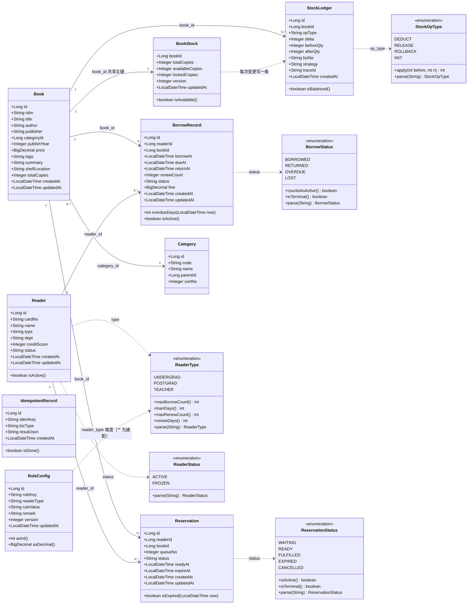

> **枚举存储策略**：全部以**字符串**存库（`varchar(20)`），Java 侧用 `enum` + `parse(String)` 静态方法转换，
> MyBatis 通过 `typeHandler` 或 `EnumTypeHandler` 自动映射。不用 `ordinal`（顺序敏感、不可读）。

### 2.2 实体字段语义与不变量

| 实体 | 不变量（Invariant） | 违反时的表现 | 强制位置 |
|---|---|---|---|
| `Book` | `isbn` 全局唯一；`total_copies >= 0` | 重复编目 | `uk_book_isbn` + `BookMapper#insert` |
| `BookStock` | `available_copies >= 0`；`available_copies + locked_copies <= total_copies` | **超卖** | 条件更新 SQL + `findNegativeStock` 巡检 |
| `Reader` | `0 <= credit_score <= 100` | 信用分越界 | `ReaderMapper#addCreditScore` 用 `least(100, greatest(0, ...))` 夹紧 |
| `BorrowRecord` | `due_at = borrow_at + loanDays`；`renew_count <= max_renew_count` | 期限错乱 | `BorrowService` + `RuleEngine` |
| `Reservation` | 同 `(reader_id, book_id)` 同时最多 1 条 `WAITING/READY` | 一人占多队 | `ReservationMapper#countActiveByReaderAndBook` + 应用层校验 |
| `StockLedger` | `after_qty - before_qty == delta`；`biz_no` 唯一 | 流水不平 | `uk_ledger_biz_no` + `findViolations` 对账 |
| `IdempotentRecord` | `idem_key` 唯一；`result_json` 只写一次 | 重复执行业务 | `uk_idem_key` + `completeResult` 的 `result_json is null` 条件 |
| `RuleConfig` | `(rule_key, reader_type)` 唯一；`reader_type='*'` 为通配兜底 | 规则解析异常 | `uk_rule_key_type` + `RuleConfigMapper#findEffective` |

### 2.3 DTO / record 清单（`com.smartlib.domain.dto`）

| record / 类 | 定义位置 | 字段 | 用途 |
|---|---|---|---|
| `BookView` | `Dtos.java` | `id, isbn, title, author, publisher, categoryName, publishYear, price, tags, summary, shelfLocation, totalCopies, availableCopies` | 书目展示视图（book + book_stock + category 合并）；`available()` 便捷方法 |
| `SearchResult` | `Dtos.java` | `items, total, tookMs, engine, degraded, degradeReason` | 检索出参；`empty(engine, tookMs)` 工厂 |
| `StockView` | `Dtos.java` | `bookId, title, totalCopies, availableCopies, queueLen, shelfLocation` | 库存视图（Agent 的 `get_book_stock` 工具） |
| `StockDeductResult` | `Dtos.java` | `success, strategy, reason, beforeQty, afterQty` | 扣减结果；`ok(...)` / `fail(...)` 工厂 |
| `BorrowResult` | `Dtos.java` | `ok, borrowId, dueAt, reason, strategy, idempotentReplay` | 借书/续借统一结果；`asReplay()` 标记幂等回放 |
| `LoanView` | `Dtos.java` | `borrowId, bookId, title, author, shelfLocation, borrowAt, dueAt, overdueDays, renewCount, renewable, status, fine` | "我的借阅"一条 |
| `LoanRow` | `Dtos.java` | MyBatis 投影（`LoanView` 的查询载体） | `BorrowRecordMapper#listLoanRows` |
| `BookRow` | `Dtos.java` | MyBatis 投影（`BookView` 的查询载体，含 `hotScore`） | `BookMapper.xml` 全部查询的 `resultType` |
| `NamedCount` | `Dtos.java` | `name, cnt` | 分类/作者频次统计 |
| `ReaderProfileView` | `Dtos.java` | `readerId, cardNo, name, readerType, dept, creditScore, borrowedCount, maxBorrowCount, preferredCategories, recentTitles` | 读者画像（Agent 长期记忆） |
| `BorrowRule` | `Dtos.java` | `maxBorrowCount, loanDays, maxRenewCount, renewDays, finePerDay, fineFreeLimit, minCreditScore, reservationHoldDays, maxRenewDays` | `rule_config` 解析出的规则快照 |
| `RecommendItem` | `Dtos.java` | `book, score, reason, source` | 推荐结果（含可解释理由） |
| `BookQuery` | `BookQuery.java` | 可变 POJO：`query, category, publisher, yearFrom, yearTo, availableOnly, sort, page, size` | 检索入参；`normalize()` 归一化 + `offset()` |
| `Result<T>` | `common/Result.java` | `code, msg, data, traceId` | 全局统一响应体 |
| `PageResult<T>` | `common/PageResult.java` | `list, total, page, size` | 分页响应 |

**`BookQuery` 的关键约定**（已落地，新增参数必须遵守）：

| 约定 | 值 | 说明 |
|---|---|---|
| `sort` 白名单 | `relevance` / `year_desc` / `year_asc` / `price_asc` / `price_desc` / `hot` | 非白名单值静默回落 `relevance`（防 ORDER BY 注入） |
| `size` 上限 | `MAX_PAGE_SIZE = 50` | 超出则截断为 50 |
| `query` 长度上限 | 100 字符 | 超出抛 `PARAM_INVALID` |
| `yearFrom > yearTo` | 抛 `PARAM_INVALID` | 早失败 |
| `availableOnly` 默认 | `false` | null 归一化为 false |
| 空串处理 | `query` / `category` / `publisher` 空串归一化为 `null` | 保证 `<if>` 条件不产生恒真子句，不破坏索引选择 |

### 2.4 枚举与状态机

#### `BorrowStatus`（蓝图 §2.3）

| 值 | 计入在借（C-10） | 终态 | 迁移来源 |
|---|---|---|---|
| `BORROWED` | ✅ | ✗ | 借出、续借（`markRenewed` 会把 `OVERDUE` 重置回 `BORROWED`） |
| `OVERDUE` | ✅ | ✗ | `OverdueScanJob` 扫描 `BORROWED AND due_at < now()` |
| `RETURNED` | ✗ | ✅ | `markReturned`（条件 `status in ('BORROWED','OVERDUE')`） |
| `LOST` | ✗ | ✅ | 馆员报失（赔偿流程） |

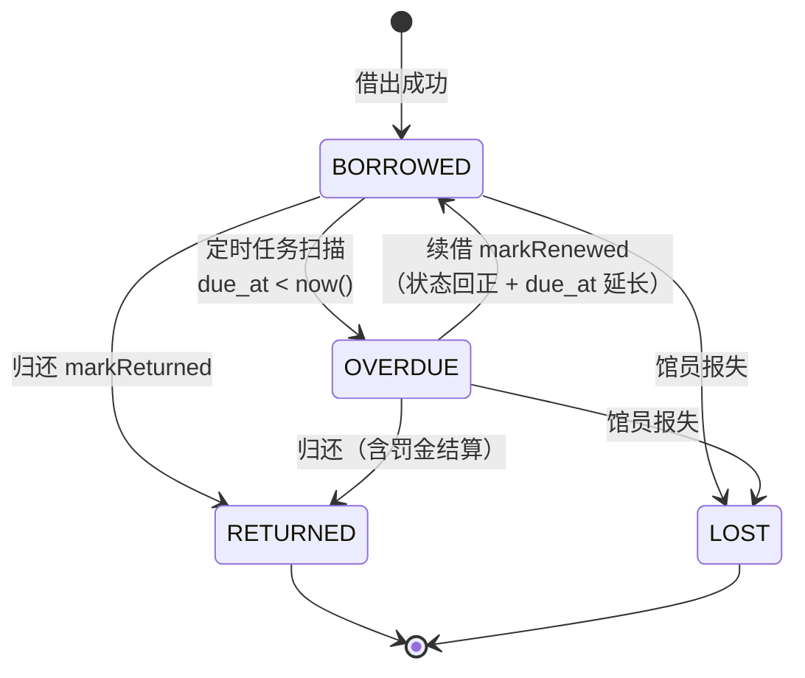

#### `ReservationStatus`（蓝图 §2.3）

| 值 | 活跃 | 终态 | 说明 |
|---|---|---|---|
| `WAITING` | ✅ | ✗ | 排队中，`queue_no` 决定顺序 |
| `READY` | ✅ | ✗ | 到馆保留中，`expire_at = ready_at + reservationHoldDays` |
| `FULFILLED` | ✗ | ✅ | 读者取书完成 |
| `EXPIRED` | ✗ | ✅ | 保留超时（`findExpiredReady` 扫描） |
| `CANCELLED` | ✗ | ✅ | 读者取消 |

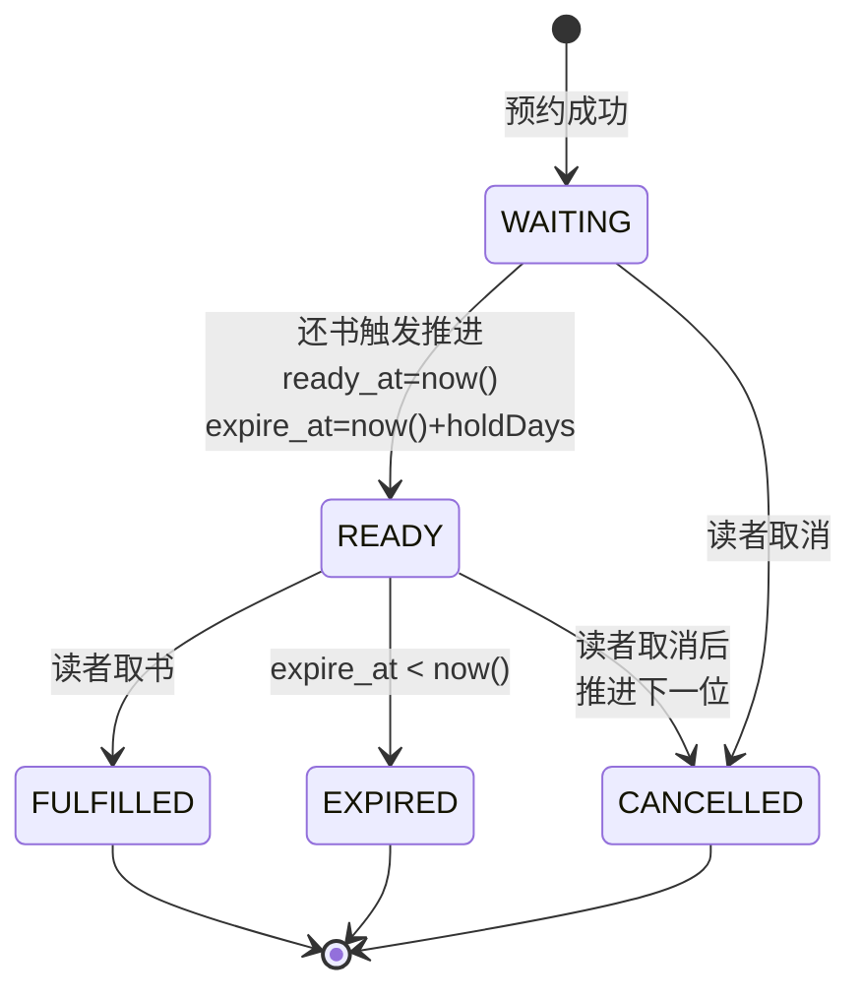

#### `StockOpType`

| 值 | `delta` 方向 | 触发场景 | `apply(before, n)` |
|---|---|---|---|
| `DEDUCT` | 负 | 借出扣减、预约锁定 | `before - n` |
| `RELEASE` | 正 | 归还回补 | `before + n` |
| `ROLLBACK` | 正 | 事务补偿、超时释放 | `before + n` |
| `INIT` | 0 | 初始化/盘点 | `before` |

---

## 3. 核心时序图

### 3.1 借书（`POST /api/borrows`）

#### 3.1.1 时序图

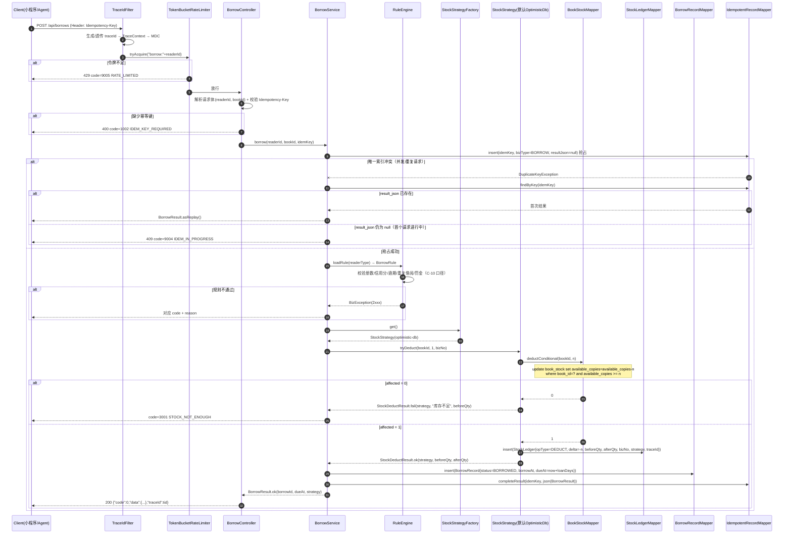

#### 3.1.2 阶段文字说明

| 阶段 | 执行者 | 关键动作 | 失败码 |
|---|---|---|---|
| ① 追踪 | `TraceIdFilter` | Header 无 `X-Trace-Id` 则生成；写入 `TraceContext` 与 MDC | — |
| ② 限流 | `TokenBucketRateLimiter` | 全局桶（`capacity=400`, `refill-per-second=400`）+ 维度桶 | `9005` |
| ③ 参数 | `BorrowController` | 解析 `readerId`/`bookId`；`Idempotency-Key` 必填 | `1001` / `1002` |
| ④ 幂等抢占 | `BorrowService` + `IdempotentRecordMapper` | **先 insert 抢占**，靠 `uk_idem_key` 唯一索引判定 | `9004` |
| ⑤ 规则 | `RuleEngine` | 按 §9.2 顺序短路校验；口径见 C-10 | `2xxx` |
| ⑥ 扣减 | `StockStrategy` | 必须走 `BookStockMapper` 的条件更新（C-01） | `3001` |
| ⑦ 落账 | `StockStrategy` + `BorrowService` | 同一事务写 `stock_ledger` + `borrow_record`，最后回填幂等结果 | `5xxx` |

#### 3.1.3 异常分支（穷举）

| # | 触发条件 | 检测点 | 返回 code | 处理建议 |
|---|---|---|---|---|
| E1 | 参数缺失/格式错 | `GlobalExceptionHandler#handleValidation` | `1001` | 前端修正 |
| E2 | `Idempotency-Key` 缺失 | Controller / `MissingRequestHeaderException` | `1002` | 客户端 SDK 自动补 UUID |
| E3 | `page*size` 超范围 | `BookQuery#normalize` | `1003` | 收敛筛选条件 |
| E4 | 请求了未注册的策略 | `StockStrategyFactory#get` | `1004` | 检查 `smartlib.stock.strategy` 取值 |
| E5 | 读者不存在 | `ReaderMapper#findById` 返回 null | `2001` | 校验 readerId |
| E6 | 图书不存在 | `BookStockMapper#findByBookId` 返回 null | `2002` | 校验 bookId |
| E7 | 同一读者同一书已持有（蓝图 §2.2 规则 5） | `countActiveByReaderAndBook > 0` | `2004` | 引导用"续借" |
| E8 | 在借数达上限 | `countActiveByReader >= maxBorrowCount` | `2005` | 提示上限与已借清单 |
| E9 | 存在逾期 | `countOverdueByReader > 0` | `2006` | 提示先归还 |
| E10 | 信用分 < `min_credit_score`(60) | `reader.creditScore` 校验 | `2007` | 提示恢复方式 |
| E11 | 读者 `status='FROZEN'` | `reader.isActive()` 为 false | `2008` | 联系流通部 |
| E12 | 未缴罚金 ≥ `fine_free_limit`(10 元) | `sumUnpaidFine` | `2014` | 跳缴费 |
| E13 | **库存不足** | `deductConditional` 返回 0 | `3001` | **引导预约**；禁止无限重试 |
| E14 | `bizNo` 重复写流水 | `uk_ledger_biz_no` 冲突 | `3002` | 视为重复请求，查幂等表回放 |
| E15 | Redis 不可用（`redis-lua` 策略） | `RedisConnectionFailureException` | **不返回错误** | 自动降级 `optimistic-db`（§3.6） |
| E16 | 首个请求仍在进行中 | 幂等表 `result_json is null` | `9004` | 50ms 后重试（≤3 次） |
| E17 | 依赖熔断 | `CircuitBreaker#allowRequest=false` | `9006` | 已返回降级结果（HTTP 200） |
| E18 | DB 不可用 | `DataAccessException` | `5002` | 退避重试 |
| E19 | 未捕获异常 | `handleUnknown` | `5001` | 告警 + 上报 |

> **E13 的实现约束（C-01）**：库存不足的判定**只能**来自 `deductConditional` 的返回行数，
> 禁止"先 `findByBookId` 查 `available_copies` 再无条件 `update`"——这正是现状系统 P1 超卖的根因。
> `BookStockMapper` 的每个扣减方法都内嵌了 `available_copies >= #{n}`，这是设计上的强制收敛。

---

### 3.2 还书（`POST /api/borrows/{id}/return`，含预约队列推进）

#### 3.2.1 时序图

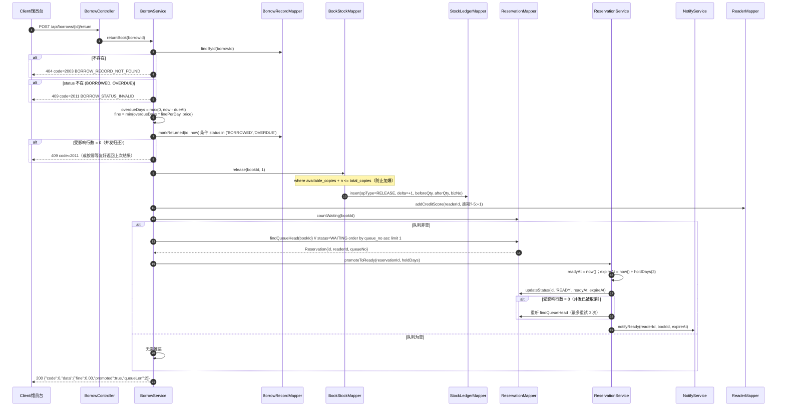

#### 3.2.2 预约推进规则表

| 场景 | 数据来源 | `status` 迁移 | `ready_at` | `expire_at` |
|---|---|---|---|---|
| 归还触发推进 | `findQueueHead`（`status='WAITING'` 最小 `queue_no`） | `WAITING → READY` | `now()` | `now() + rule_config('reservation_hold_days')`，默认 3 天 |
| 到馆保留超时 | `findExpiredReady(now, limit)`：`status='READY' AND expire_at < now()` | `READY → EXPIRED` | 不变 | 不变（历史留痕） |
| 超时后推进下一位 | 再次 `findQueueHead` | `WAITING → READY` | `now()` | `now() + 3d` |
| 读者取书 | 馆员操作 | `READY → FULFILLED` | 不变 | 不变 |
| 读者取消 | `DELETE /api/reservations/{id}` | `WAITING/READY → CANCELLED` | 不变 | 不变；`READY` 取消需推进下一位 |
| 预约到馆未取 | `ReservationExpireJob` | 额外 `addCreditScore(readerId, -3)` | — | — |

#### 3.2.3 异常分支

| # | 条件 | 返回 | 说明 |
|---|---|---|---|
| R1 | `borrowId` 不存在 | `2003` / 404 | — |
| R2 | 已归还（`status='RETURNED'`） | `2011` / 409 | 幂等友好实现：可返回上次结果，并在 `remark` 记录"重复归还请求" |
| R3 | 记录为 `LOST` | `2011` | 走赔偿流程，**不**回补库存 |
| R4 | `book_stock` 行缺失 | `3004` / 500 | 数据不一致，P0 告警 |
| R5 | `release` 受影响行数 = 0（`available + n > total`） | 事务回滚 + P0 告警 | 说明重复归还或漏扣，触发对账（§9.5） |
| R6 | 队首推进被并发抢先 | 重试 3 次后由 `ReservationExpireJob` 兜底 | — |
| R7 | 通知服务不可用 | 业务成功，通知失败仅记录 WARN | 不阻塞主链路 |

---

### 3.3 检索（三级缓存 → 布隆 → 单飞 → DB/倒排 → 回填）

#### 3.3.1 时序图

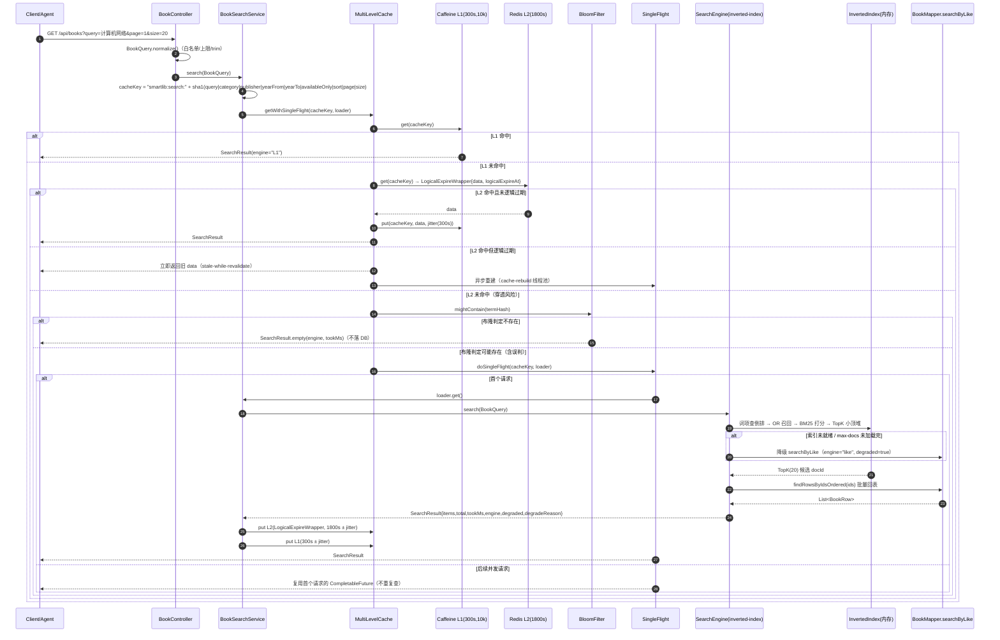

#### 3.3.2 三级缓存职责表

| 层 | 实现 | TTL | 容量 | 配置 key | 命中后动作 |
|---|---|---|---|---|---|
| L1 | Caffeine | 300 s（±10% 抖动） | 10,000 条 | `smartlib.search.cache.l1-ttl-seconds` / `l1-max-size` | 直接返回 |
| L2 | Redis 7 | 1800 s 逻辑过期（物理 2700 s） | 由 Redis `maxmemory-policy` 控制 | `smartlib.search.cache.l2-ttl-seconds` | 回填 L1 |
| L3 | 内存倒排 / MySQL | 永久（随 `Book` 变更重建） | `max-docs=500000` | `smartlib.search.index.max-docs` | 回填 L2 + L1 |

#### 3.3.3 异常分支

| # | 条件 | 行为 | 返回 |
|---|---|---|---|
| S1 | `query` 为空且无 filter | 视为列表浏览，走 `order by b.id asc` | 列表 |
| S2 | `query` 超 100 字符 | `BookQuery#normalize` 抛 `PARAM_INVALID` | `1001` |
| S3 | `yearFrom > yearTo` | 同上 | `1001` |
| S4 | 布隆误判为"存在" | 正常落库查询，返回空结果并写空值缓存 60s | 空列表 |
| S5 | Redis 连接异常 | L2 视为 miss，直接走引擎；`degraded=true` | 结果 |
| S6 | 倒排索引未就绪 | 引擎降级 `searchByLike`，`engine="like"`, `degraded=true` | 结果 |
| S7 | 单飞首个请求超时（>800ms） | 取消等待，返回空结果并打点 | `SearchResult.empty` |
| S8 | `max-docs` 截断 | 只索引前 `max-docs` 条；超出部分仅能被 `like` 引擎命中 | 结果 + `degradeReason` |
| S9 | 引擎返回 > `total` 的截断 | `total` 取自引擎统计，不做全表 count | 结果 |
| S10 | `size` 超 50 | 截断为 50（不报错） | 结果 |

---

### 3.4 续借（`POST /api/borrows/{id}/renew`）

#### 3.4.1 时序图（含"有预约不可续借"分支）

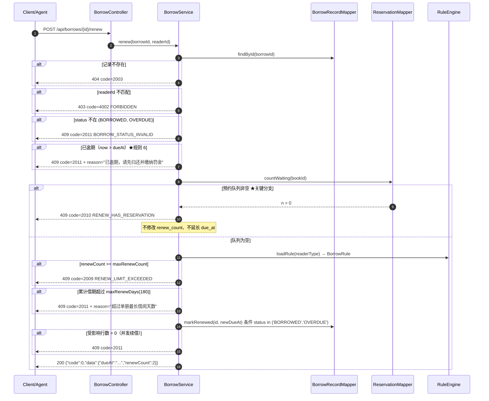

#### 3.4.2 判定顺序（必须按此顺序短路返回）

| 序号 | 判定 | 使用的方法 | 不通过的 code | 设计理由 |
|---|---|---|---|---|
| 1 | 记录存在 | `findById` | `2003` | 参数问题优先 |
| 2 | 归属校验（`readerId` 一致） | 内存比较 | `4002` | 安全优先 |
| 3 | `status in ('BORROWED','OVERDUE')` | 内存比较 | `2011` | 终态不可逆（C-10 口径） |
| 4 | 未逾期 | `now <= dueAt` | `2011` + reason | 逾期需先处理罚金 |
| 5 | **预约队列为空** | `ReservationMapper#countWaiting` | `2010` | 公平性优先于个人便利（蓝图 §2.2 规则 6） |
| 6 | `renewCount < maxRenewCount` | `BorrowRule#maxRenewCount` | `2009` | 次数约束 |
| 7 | 累计借期 ≤ `maxRenewDays` | `BorrowRule#maxRenewDays` | `2011` + reason | 防止无限续借 |
| 8 | 乐观更新成功 | `markRenewed` 返回 1 | `2011` | 并发安全 |

#### 3.4.3 异常分支

| # | 条件 | 处理 |
|---|---|---|
| N1 | 续借时该书刚好被预约 | 以 `countWaiting` 的当前读为准，返回 `2010` |
| N2 | 续借跨过寒暑假 | 由规则扩展决定；当前**不顺延**（`maxRenewDays` 兜底上限） |
| N3 | 同一记录并发两次续借 | `markRenewed` 带 `status` 条件 + `renew_count` 单调递增，第二次 `due_at` 会叠加（应用层加分布式锁或用 `renew_count` 做 CAS 条件，见 §9.2） |
| N4 | 续借后缓存中 `dueAt` 仍为旧值 | 失效 `smartlib:reader:loans:{readerId}` + 逻辑 TTL 兜底 |

---

### 3.5 Agent 一次对话的完整跨进程链路

#### 3.5.1 时序图（SSE 流式）

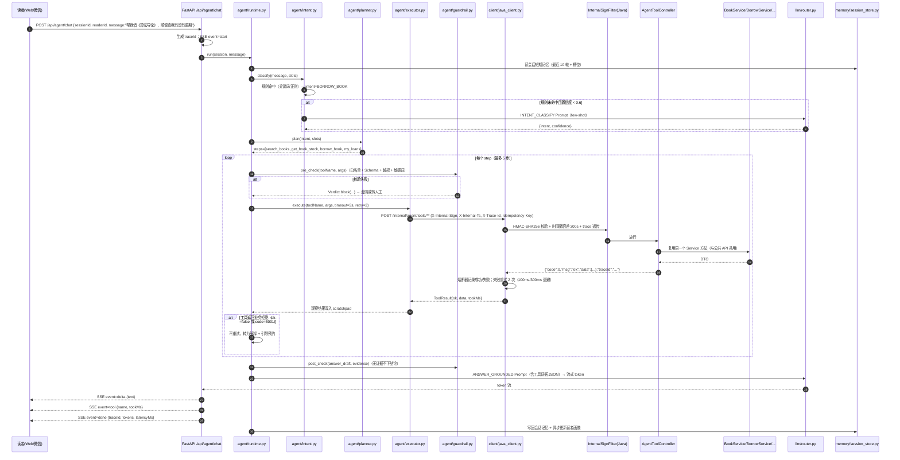

#### 3.5.2 工具调用统一约定（Java 侧 `AgentToolController`）

| 项 | 约定 |
|---|---|
| 路径前缀 | `/internal/agent/tools/**`（蓝图 §8.2） |
| 鉴权 | `X-Internal-Sign = HMAC-SHA256(body + timestamp, smartlib.internal.sign-secret)`；`X-Internal-Ts` 容差 `smartlib.internal.timestamp-tolerance-seconds=300` |
| 追踪 | `X-Trace-Id` 必传，`TraceIdFilter` 优先复用；`AgentToolController` 回填响应 `traceId` |
| 幂等 | `borrow` / `renew` / `reservations` 必须带 `Idempotency-Key`，落入 `idempotent_record` |
| 限流 | 独立于公共 API 的令牌桶：维度 `internal:{toolName}` |
| 超时预算 | Agent 端 3s（`JAVA_TIMEOUT_S`）；Java 端 `mybatis.configuration.default-statement-timeout=5` |
| 出参 | 统一 `{"code":0,"msg":"ok","data":{...},"traceId":"..."}` |
| 业务失败语义 | `data.ok=false` + `data.reason`（**且 code 保持 0**）便于 LLM 理解；写操作直接返回对应错误码 |
| 降级 | 库存查询熔断时返回 `data.degraded=true` + `degradeReason` |

#### 3.5.3 端到端错误处理矩阵

| # | 故障点 | Agent 行为 | 用户可见输出 |
|---|---|---|---|
| A1 | 意图置信度 < 0.6 且 LLM 不可用 | 规则兜底到 `UNKNOWN` | "我没太理解，你是想查书、借书还是查借阅记录？" |
| A2 | 工具超时 3s | 重试 2 次后放弃（100ms/300ms 退避） | "查询服务暂时繁忙，请稍后再试" |
| A3 | 工具熔断 OPEN | 直接用 `DegradeFallback` 数据/文案 | 见 §7.4 |
| A4 | 工具返回业务拒绝（`2004`/`3001`/`2007` 等） | **不重试**，原样解释原因 | "同一本书你已经在借了，可以试试续借" |
| A5 | ReAct 步数达 5 | 终止循环，汇总已有证据 | 部分完成 + 未完成说明 |
| A6 | 无任何工具证据 | `post_check` 拦截事实性结论 | "这项信息我没查到" + 人工入口 |
| A7 | 敏感词命中 | 拦截并转人工 | 标准话术 + 服务台电话 |
| A8 | LLM 输出 > 2000 字 | 截断并标记 | 前 2000 字 + "……" |
| A9 | 循环检测（同工具同参数 3 次） | 强制终止 | "该操作重复未成功，已为你转人工" |
| A10 | Java 返回 5xx | 计入熔断器，返回降级 | 见 §7.4 |
| A11 | `X-Internal-Sign` 校验失败 | Java 返回 `4003` | Agent 侧记录 ERROR 并告警（配置问题，非用户问题） |
| A12 | 幂等键冲突（`9004`） | 等待 50ms 重试（≤3 次） | 正常返回首次结果 |

---

### 3.6 熔断降级

#### 3.6.1 时序图（Redis 不可用 → `redis-lua` 降级 `optimistic-db`；检索降级 `like`）

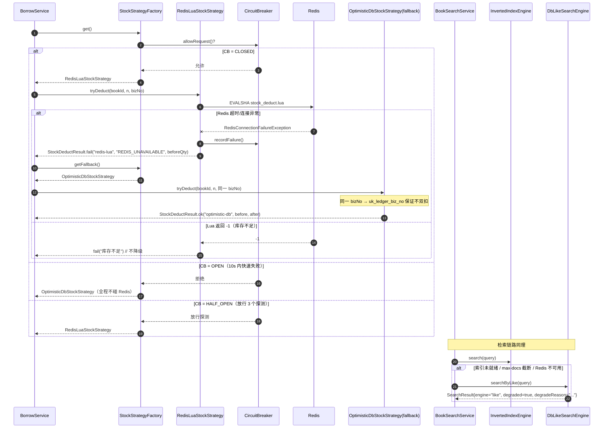

#### 3.6.2 降级触发点与回切条件

| 依赖 | 触发降级的条件 | 降级目标 | 回切条件 | 用户感知 |
|---|---|---|---|---|
| Redis（`redis-lua` 策略） | `RedisConnectionFailureException` / Lua 超时 | `optimistic-db`（`smartlib.stock.strategy` 的兜底值） | 熔断 HALF_OPEN 连续 3 次探测成功 → CLOSED | 借书耗时可能上升，功能不受影响 |
| Redis（L2 缓存） | 连接异常 | 直连 Caffeine + 引擎 | 同上 | 检索 P99 可能上升，`degraded=true` |
| 倒排索引 | 索引未就绪 / `max-docs` 未加载完 | `DbLikeSearchEngine`（`searchByLike`） | 索引构建完成 | `engine="like"` |
| 推荐服务 | 推荐超时 | 热门榜 `BookMapper#findHot` | 连续 3 次成功 | 推荐变热门榜，`source="HOT_FALLBACK"` |
| 库存查询（Agent） | 查询失败 | `StockView` + `degraded=true` + 快照值 | 连续成功 | 文案加"预计可借" |
| 数据库 | 主库不可用 | 只读模式（拒绝写接口） | 主库恢复 + 健康检查通过 | 写接口 503，读接口可用 |

#### 3.6.3 降级时的数据一致性要求

| 要求 | 说明 |
|---|---|
| **同一 `bizNo`** | `RedisLuaStockStrategy` 与 `OptimisticDbStockStrategy` 必须使用同一个 `bizNo = "BORROW:" + readerId + ":" + bookId`，保证「Redis 扣成功但响应丢失、再降级到 DB」时不会双重扣减（`uk_ledger_biz_no` 兜底） |
| `strategy` 落库 | 降级产生的流水 `strategy='optimistic-db'`，便于事后按策略统计 |
| 降级打点 | `smartlib_degrade_total{dependency,target,reason}`，告警规则见 `docs/08-运维监控与迭代规划.md` |
| 对账兜底 | `StockLedgerMapper#findViolations` 每 5 分钟校验守恒，异常即 P0 |

---

## 4. 库存扣减策略详细设计

### 4.1 SPI 接口与结果类型

```java
package com.smartlib.service.stock;

import com.smartlib.domain.dto.StockDeductResult;

/**
 * 库存扣减策略 SPI。
 *
 * <p>实现类一律注册为 Spring Bean，通过 {@link StockStrategyFactory} 获取，
 * 禁止在业务代码中直接 new 具体实现（约束 C-07）。
 *
 * <p><b>所有实现都必须通过 {@code BookStockMapper} 的条件更新完成真实扣减</b>，
 * 不允许出现无 {@code available_copies >= n} 约束的 UPDATE（约束 C-01）。
 */
public interface StockStrategy {

    /** 策略标识，与配置 smartlib.stock.strategy 的取值一一对应（kebab-case）。 */
    String name();

    /**
     * 尝试扣减库存。
     *
     * @param bookId 书目 ID
     * @param n      扣减册数，必须 > 0
     * @param bizNo  业务单号，全局唯一，用于幂等与流水对账（如 BORROW:10001:2001）
     * @return 扣减结果，永不返回 null；失败原因放在 reason 中，不抛业务异常
     */
    StockDeductResult tryDeduct(Long bookId, int n, String bizNo);

    /**
     * 归还 / 预约释放方向的库存回补。默认实现走 {@code BookStockMapper#release}。
     * 特殊策略可覆盖（如 MQ 串行策略需要投递到同一条队列）。
     */
    default StockDeductResult tryRelease(Long bookId, int n, String bizNo) {
        throw new UnsupportedOperationException(name() + " 未实现 tryRelease");
    }

    /** 是否为可降级策略（redis-lua 在 Redis 不可用时降级到 optimistic-db）。 */
    default boolean degradable() {
        return false;
    }
}
```

```java
// 已落地于 com.smartlib.domain.dto.Dtos.StockDeductResult
public record StockDeductResult(
        boolean success,
        String strategy,
        String reason,
        int beforeQty,
        int afterQty) {

    public static StockDeductResult ok(String strategy, int beforeQty, int afterQty) {
        return new StockDeductResult(true, strategy, null, beforeQty, afterQty);
    }

    public static StockDeductResult fail(String strategy, String reason, int beforeQty) {
        return new StockDeductResult(false, strategy, reason, beforeQty, beforeQty);
    }
}
```

**`reason` 取值字典**（策略返回，供上层与日志使用）：

| `reason` | 含义 | 是否可降级 |
|---|---|---|
| `null`（配合 `success=true`） | 成功 | — |
| `INSUFFICIENT_STOCK` | 库存不足（条件更新返回 0） | ✗（正常业务结果） |
| `STOCK_NOT_FOUND` | `book_stock` 无该行 | ✗ |
| `CONFLICT_RETRY_EXHAUSTED` | 乐观锁重试次数用尽 | ✗（可上报） |
| `REDIS_UNAVAILABLE` | Redis 连接/超时/脚本错误 | ✅ |
| `REDIS_NOT_WARMED` | Redis 库存 key 未预热 | ✅ |
| `MQ_REJECTED` | 串行队列满，快速失败 | ✗（保护自身） |
| `TIMEOUT` | 等待串行结果超时 | ✗（由补偿查询兜底） |
| `INTERRUPTED` | 线程被中断 | ✗ |

### 4.2 策略工厂

```java
package com.smartlib.service.stock;

/**
 * 库存策略工厂。
 *
 * <p>启动时把容器内所有 {@link StockStrategy} 按 {@code name()} 注册进 map；
 * 运行时按 {@code smartlib.stock.strategy} 选择主策略，并在主策略标记 degradable
 * 且失败原因为 Redis 相关时返回 {@link #FALLBACK_NAME}。
 */
@Component
public class StockStrategyFactory {

    /** 降级目标：蓝图 §6.1 选型固定为 DB 条件更新。 */
    public static final String FALLBACK_NAME = "optimistic-db";

    private final Map<String, StockStrategy> registry = new LinkedHashMap<>();
    private final StockProperties props;
    private volatile StockStrategy current;

    public StockStrategyFactory(List<StockStrategy> strategies, StockProperties props) {
        this.props = props;
        for (StockStrategy s : strategies) {
            StockStrategy prev = registry.put(s.name(), s);
            if (prev != null) {
                throw new IllegalStateException("库存策略名重复: " + s.name());
            }
        }
        this.current = resolve(props.getStrategy());
    }

    /** 主策略。 */
    public StockStrategy get() {
        return current;
    }

    /** 降级策略（仅当主策略 degradable() 为 true 时才应调用）。 */
    public StockStrategy getFallback() {
        return resolve(FALLBACK_NAME);
    }

    /** 运行时切换（管理台 POST /api/admin/stock/strategy）。 */
    public synchronized void switchTo(String name) {
        this.current = resolve(name);
    }

    /** 当前策略名，用于健康检查与监控标签。 */
    public String currentName() {
        return current.name();
    }

    /** 已注册策略名集合，供 AdminController 展示可选项。 */
    public Set<String> registeredNames() {
        return Set.copyOf(registry.keySet());
    }

    private StockStrategy resolve(String name) {
        StockStrategy s = registry.get(name);
        if (s == null) {
            // 1004 = UNSUPPORTED_STRATEGY
            throw new BizException(ErrorCode.UNSUPPORTED_STRATEGY,
                    "未知库存策略: " + name + "，可选=" + registry.keySet());
        }
        return s;
    }
}
```

**降级判定（`BorrowService` 中的调用形态）**：

```java
StockStrategy primary = factory.get();
StockDeductResult r = primary.tryDeduct(bookId, n, bizNo);
if (!r.success() && primary.degradable() && isRedisReason(r.reason())
        && props.isDegradeOnRedisFailure()) {
    r = factory.getFallback().tryDeduct(bookId, n, bizNo);   // 同一 bizNo，天然幂等
}
```

| 判定项 | 取值 |
|---|---|
| `primary.degradable()` | 仅 `redis-lua` / `mq-serial` 为 true |
| `isRedisReason(reason)` | `reason` ∈ {`REDIS_UNAVAILABLE`, `REDIS_NOT_WARMED`} |
| `props.isDegradeOnRedisFailure()` | `smartlib.stock.degrade-on-redis-failure`，生产**必须**为 true |

### 4.3 六个实现类

#### S1 `LocalLockStockStrategy`（`name()="local-lock"`）

| 项 | 内容 |
|---|---|
| 适用场景 | 单实例开发/演示、单机压测基线；**不用于生产多实例** |
| 优点 | 实现最简单，零额外组件 |
| 缺点 | 多实例部署下 JVM 锁互斥失效 → 必然超卖 |
| 失败语义 | `INSUFFICIENT_STOCK`、`INTERRUPTED`、`STOCK_NOT_FOUND` |

```java
@Component
public class LocalLockStockStrategy implements StockStrategy {

    private static final int SEGMENTS = 64;

    private final ReentrantLock[] locks = new ReentrantLock[SEGMENTS];
    private final BookStockMapper stockMapper;
    private final StockLedgerMapper ledgerMapper;

    public LocalLockStockStrategy(BookStockMapper stockMapper, StockLedgerMapper ledgerMapper) {
        this.stockMapper = stockMapper;
        this.ledgerMapper = ledgerMapper;
        for (int i = 0; i < SEGMENTS; i++) {
            locks[i] = new ReentrantLock();
        }
    }

    @Override
    public String name() {
        return "local-lock";
    }

    @Override
    public StockDeductResult tryDeduct(Long bookId, int n, String bizNo) {
        ReentrantLock lock = locks[(int) (bookId & (SEGMENTS - 1))];
        boolean locked = false;
        try {
            locked = lock.tryLock(500, TimeUnit.MILLISECONDS);
            if (!locked) {
                return StockDeductResult.fail(name(), "INTERRUPTED", -1);
            }
            BookStock snapshot = stockMapper.findByBookId(bookId);
            if (snapshot == null) {
                return StockDeductResult.fail(name(), "STOCK_NOT_FOUND", -1);
            }
            int before = snapshot.getAvailableCopies();
            // 仍然走条件更新：锁只是优化，正确性仍由 SQL 保证（C-01）
            int affected = stockMapper.deductConditional(bookId, n);
            if (affected == 0) {
                return StockDeductResult.fail(name(), "INSUFFICIENT_STOCK", before);
            }
            int after = before - n;
            ledgerMapper.insert(StockLedger.of(bookId, StockOpType.DEDUCT, -n,
                    before, after, bizNo, name(), TraceContext.traceId()));
            return StockDeductResult.ok(name(), before, after);
        } catch (InterruptedException e) {
            Thread.currentThread().interrupt();
            return StockDeductResult.fail(name(), "INTERRUPTED", -1);
        } finally {
            if (locked) {
                lock.unlock();
            }
        }
    }
}
```

#### S2 `OptimisticDbStockStrategy`（`name()="optimistic-db"`，**默认策略**）

| 项 | 内容 |
|---|---|
| 适用场景 | 生产默认（ADR-004）；常规借还，目标 QPS ≥200/实例 |
| 优点 | 无额外组件、天然正确、单条 UPDATE 自带行锁；SQL 是最强防线 |
| 缺点 | 热点书（同一 `book_id`）高并发时行锁排队，P99 上升 |
| 失败语义 | `INSUFFICIENT_STOCK`（`affected=0`）、`STOCK_NOT_FOUND` |

```java
@Component
public class OptimisticDbStockStrategy implements StockStrategy {

    private final BookStockMapper stockMapper;
    private final StockLedgerMapper ledgerMapper;

    @Override
    public String name() {
        return "optimistic-db";
    }

    @Override
    public StockDeductResult tryDeduct(Long bookId, int n, String bizNo) {
        // 1) 先读快照：仅用于流水的 beforeQty 与"行是否存在"判定，不用于判断可借性
        BookStock snapshot = stockMapper.findByBookId(bookId);
        if (snapshot == null) {
            return StockDeductResult.fail(name(), "STOCK_NOT_FOUND", -1);
        }
        // 2) 条件更新：唯一正确性来源（BookStockMapper#deductConditional）
        int affected = stockMapper.deductConditional(bookId, n);
        if (affected == 0) {
            return StockDeductResult.fail(name(), "INSUFFICIENT_STOCK", snapshot.getAvailableCopies());
        }
        // 3) 写流水（同一事务内可见自身修改）
        int before = snapshot.getAvailableCopies();
        int after = before - n;
        ledgerMapper.insert(StockLedger.of(bookId, StockOpType.DEDUCT, -n,
                before, after, bizNo, name(), TraceContext.traceId()));
        return StockDeductResult.ok(name(), before, after);
    }

    @Override
    public StockDeductResult tryRelease(Long bookId, int n, String bizNo) {
        BookStock snapshot = stockMapper.findByBookId(bookId);
        if (snapshot == null) {
            return StockDeductResult.fail(name(), "STOCK_NOT_FOUND", -1);
        }
        int before = snapshot.getAvailableCopies();
        int affected = stockMapper.release(bookId, n);   // where available + n <= total
        if (affected == 0) {
            return StockDeductResult.fail(name(), "RELEASE_OVERFLOW", before);
        }
        int after = before + n;
        ledgerMapper.insert(StockLedger.of(bookId, StockOpType.RELEASE, n,
                before, after, bizNo, name(), TraceContext.traceId()));
        return StockDeductResult.ok(name(), before, after);
    }
}
```

**唯一 SQL 样板（已落地于 `BookStockMapper`，约束 C-01 的强制收敛点）**：

```sql
-- 扣减（借出 / 预约锁定）
UPDATE book_stock
   SET available_copies = available_copies - #{n},
       version          = version + 1,
       updated_at       = now()
 WHERE book_id = #{bookId}
   AND available_copies >= #{n};

-- 回补（归还 / 释放），带上限防"加爆"
UPDATE book_stock
   SET available_copies = available_copies + #{n},
       version          = version + 1,
       updated_at       = now()
 WHERE book_id = #{bookId}
   AND available_copies + #{n} <= total_copies;
```

> 说明：项目统一用 `now()`（而非 `NOW(3)`）以同时兼容 H2 `MODE=MySQL` 与 MySQL 8；
> `updated_at` 列为 `datetime`（秒级），因为本项目的逾期判定粒度为**天**，无需毫秒。

#### S3 `PessimisticDbStockStrategy`（`name()="pessimistic-db"`）

| 项 | 内容 |
|---|---|
| 适用场景 | 强一致且冲突可预期的批处理（馆员批量下架）、需要"先读后判"的复杂规则 |
| 优点 | 语义直观，读到的值绝对准确；可在锁内完成多条规则判定 |
| 缺点 | 持锁时间长（到事务提交才释放），热点书易排队甚至死锁；必须按 `book_id` 升序加锁 |
| 失败语义 | `INSUFFICIENT_STOCK`、`STOCK_NOT_FOUND` |

```java
@Component
public class PessimisticDbStockStrategy implements StockStrategy {

    private final BookStockMapper stockMapper;
    private final StockLedgerMapper ledgerMapper;

    @Override
    public String name() {
        return "pessimistic-db";
    }

    @Override
    @Transactional(propagation = Propagation.MANDATORY)  // 必须在已有事务中调用
    public StockDeductResult tryDeduct(Long bookId, int n, String bizNo) {
        BookStock locked = stockMapper.selectForUpdate(bookId);  // select ... for update
        if (locked == null) {
            return StockDeductResult.fail(name(), "STOCK_NOT_FOUND", -1);
        }
        if (locked.getAvailableCopies() < n) {
            return StockDeductResult.fail(name(), "INSUFFICIENT_STOCK", locked.getAvailableCopies());
        }
        int before = locked.getAvailableCopies();
        // 锁内直接条件更新，语义等价但保持统一入口（C-01）
        int affected = stockMapper.deductConditional(bookId, n);
        if (affected == 0) {
            return StockDeductResult.fail(name(), "INSUFFICIENT_STOCK", before);
        }
        int after = before - n;
        ledgerMapper.insert(StockLedger.of(bookId, StockOpType.DEDUCT, -n,
                before, after, bizNo, name(), TraceContext.traceId()));
        return StockDeductResult.ok(name(), before, after);
    }
}
```

**使用纪律**：加锁与更新之间禁止插入 RPC、发消息、写日志表等耗时操作，否则会把行锁持有时间放大到不可接受。

#### S4 `VersionRetryStockStrategy`（`name()="version-retry"`）

| 项 | 内容 |
|---|---|
| 适用场景 | 写冲突中等、希望避免长事务；也适合 `book` 元数据并发编辑 |
| 优点 | 纯 CAS，无锁等待；冲突时自旋而非阻塞 |
| 缺点 | 冲突率高时重试放大（200 并发抢 10 册可能重试数百次），必须设上限 |
| 失败语义 | `CONFLICT_RETRY_EXHAUSTED`、`INSUFFICIENT_STOCK`、`STOCK_NOT_FOUND` |

```java
@Component
public class VersionRetryStockStrategy implements StockStrategy {

    private static final int MAX_RETRY = 3;
    private static final int BACKOFF_BASE_MS = 5;

    private final BookStockMapper stockMapper;
    private final StockLedgerMapper ledgerMapper;

    @Override
    public String name() {
        return "version-retry";
    }

    @Override
    public StockDeductResult tryDeduct(Long bookId, int n, String bizNo) {
        for (int attempt = 1; attempt <= MAX_RETRY; attempt++) {
            BookStock cur = stockMapper.findByBookId(bookId);
            if (cur == null) {
                return StockDeductResult.fail(name(), "STOCK_NOT_FOUND", -1);
            }
            int before = cur.getAvailableCopies();
            if (before < n) {
                return StockDeductResult.fail(name(), "INSUFFICIENT_STOCK", before);
            }
            // deductWithVersion 同时校验 version 与 available_copies >= n
            int affected = stockMapper.deductWithVersion(bookId, n, cur.getVersion());
            if (affected == 1) {
                int after = before - n;
                ledgerMapper.insert(StockLedger.of(bookId, StockOpType.DEDUCT, -n,
                        before, after, bizNo, name(), TraceContext.traceId()));
                return StockDeductResult.ok(name(), before, after);
            }
            backoff(attempt);   // 指数退避 + 随机抖动，打散自旋
        }
        return StockDeductResult.fail(name(), "CONFLICT_RETRY_EXHAUSTED", -1);
    }

    private void backoff(int attempt) {
        try {
            long jitter = ThreadLocalRandom.current().nextLong(0, BACKOFF_BASE_MS + 1L);
            Thread.sleep((long) BACKOFF_BASE_MS * attempt + jitter);
        } catch (InterruptedException e) {
            Thread.currentThread().interrupt();
        }
    }
}
```

```sql
-- 已落地于 BookStockMapper#deductWithVersion
UPDATE book_stock
   SET available_copies = available_copies - #{n},
       version          = version + 1,
       updated_at       = now()
 WHERE book_id = #{bookId}
   AND version = #{version}
   AND available_copies >= #{n};
```

> **设计细节**：`deductConditional` 也会 `version = version + 1`。
> 这样无论走哪个策略，`version` 始终单调递增，`version-retry` 不会读到"旧但数值相同"的版本号。

#### S5 `RedisLuaStockStrategy`（`name()="redis-lua"`）

| 项 | 内容 |
|---|---|
| 适用场景 | 秒杀式抢书、开学季热门教材；峰值 QPS 远超 DB 承受力 |
| 优点 | 内存原子脚本，抗高并发、削峰；`EVALSHA` 免传输脚本 |
| 缺点 | 一致性风险（Redis 与 DB 可能不一致），需补偿任务；有丢单风险 |
| 失败语义 | `INSUFFICIENT_STOCK`（Lua 返回 -1）、`REDIS_NOT_WARMED`（-2，**可降级**）、`REDIS_UNAVAILABLE`（**可降级**） |

```java
@Component
public class RedisLuaStockStrategy implements StockStrategy {

    /** 返回值：>=0 为扣减后的余量；-1 库存不足；-2 key 未预热。 */
    private static final String SCRIPT = """
            local k = KEYS[1]
            local n = tonumber(ARGV[1])
            local cur = tonumber(redis.call('GET', k) or '-1')
            if cur < 0 then return -2 end
            if cur < n then return -1 end
            redis.call('DECRBY', k, n)
            return cur - n
            """;

    private final StringRedisTemplate redis;
    private final BookStockMapper stockMapper;
    private final StockLedgerMapper ledgerMapper;
    private final CircuitBreaker circuitBreaker;   // name = "redis-stock"

    @Override
    public String name() {
        return "redis-lua";
    }

    @Override
    public boolean degradable() {
        return true;
    }

    @Override
    public StockDeductResult tryDeduct(Long bookId, int n, String bizNo) {
        // 幂等前置：同一 bizNo 已入账则直接返回（Redis 重放/降级重试场景）
        if (ledgerMapper.countByBizNo(bizNo) > 0) {
            BookStock s = stockMapper.findByBookId(bookId);
            int cur = (s == null ? 0 : s.getAvailableCopies());
            return StockDeductResult.ok(name(), cur + n, cur);
        }
        try {
            Long left = redis.execute(new DefaultRedisScript<>(SCRIPT, Long.class),
                    List.of(RedisKeys.stockAtomic(bookId)), String.valueOf(n));
            if (left == null) {
                circuitBreaker.recordFailure();
                return StockDeductResult.fail(name(), "REDIS_UNAVAILABLE", -1);
            }
            if (left == -2L) {
                circuitBreaker.recordFailure();
                return StockDeductResult.fail(name(), "REDIS_NOT_WARMED", -1);
            }
            if (left == -1L) {
                circuitBreaker.recordSuccess();
                return StockDeductResult.fail(name(), "INSUFFICIENT_STOCK", -1);  // 不降级
            }
            circuitBreaker.recordSuccess();
            int after = left.intValue();
            int before = after + n;
            // 异步落库 + 流水；失败进补偿队列（与 budget 一致：最终一致）
            stockSyncQueue.offer(new StockSyncTask(bookId, -n, before, after, bizNo,
                    TraceContext.traceId(), name()));
            return StockDeductResult.ok(name(), before, after);
        } catch (RedisConnectionFailureException | QueryTimeoutException e) {
            circuitBreaker.recordFailure();
            return StockDeductResult.fail(name(), "REDIS_UNAVAILABLE", -1);
        }
    }

    /** 启动预热：把 book_stock.available_copies 灌入 Redis。 */
    @Override
    public void warmUp() {
        for (BookStock s : stockMapper.findAll()) {
            redis.opsForValue().set(RedisKeys.stockAtomic(s.getBookId()),
                    String.valueOf(s.getAvailableCopies()));
        }
    }
}
```

| 补偿与对账项 | 设计 |
|---|---|
| 补偿队列 | `StockSyncQueue`（有界队列 + 单线程消费），失败重试 5 次，指数退避 100ms → 3.2s |
| 死信 | 5 次失败写 `stock_ledger` 的 `op_type='ROLLBACK'` + P0 告警；人工介入 |
| 幂等落库 | 落库走 `BookStockMapper#deductConditional`（可能返回 0，因为 Redis 已扣），此时以**流水为准**补一条 `DEDUCT` 并接受 `available_copies` 的偏差，由对账修正 |
| 对账 | `StockReconcileJob` 每 5 分钟比对 `Redis GET stock:atomic:{id}` 与 `book_stock.available_copies`；差异超阈值以 DB 为准回写 Redis |
| 预热 | `smartlib.stock.redis-lua.warm-up-on-startup=true` 时在 `ApplicationRunner` 中执行 |

#### S6 `MqSerialStockStrategy`（`name()="mq-serial"`）

| 项 | 内容 |
|---|---|
| 适用场景 | 大促需"绝对串行 + 削峰"；本地用单线程 Dispatcher + 有界队列模拟，生产替换为 RocketMQ 顺序消息（按 `book_id` 选队列） |
| 优点 | 彻底串行、可削峰、可重放；DB 压力恒定 |
| 缺点 | 链路长（请求 → 队列 → 消费 → 回写），最终一致，需处理超时未决 |
| 失败语义 | `MQ_REJECTED`（队列满，快速失败保护自身）、`INSUFFICIENT_STOCK`、`TIMEOUT`、`UNKNOWN` |

```java
@Component
public class MqSerialStockStrategy implements StockStrategy {

    private final BlockingQueue<SerialTask> queue;
    private final ExecutorService dispatcher = Executors.newSingleThreadExecutor(
            r -> new Thread(r, "stock-serial-dispatcher"));
    private final BookStockMapper stockMapper;
    private final StockLedgerMapper ledgerMapper;
    private final long timeoutMs;

    public MqSerialStockStrategy(BookStockMapper stockMapper, StockLedgerMapper ledgerMapper,
                                 StockProperties props) {
        this.stockMapper = stockMapper;
        this.ledgerMapper = ledgerMapper;
        this.timeoutMs = props.getMq().getTimeoutMs();
        // 公平队列，避免大 key 饿死小 key
        this.queue = new ArrayBlockingQueue<>(props.getMq().getQueueCapacity(), true);
    }

    @Override
    public String name() {
        return "mq-serial";
    }

    @Override
    public boolean degradable() {
        return true;
    }

    @Override
    public StockDeductResult tryDeduct(Long bookId, int n, String bizNo) {
        CompletableFuture<StockDeductResult> future = new CompletableFuture<>();
        SerialTask task = new SerialTask(bookId, n, bizNo, TraceContext.traceId(), future);
        if (!queue.offer(task)) {
            return StockDeductResult.fail(name(), "MQ_REJECTED", -1);   // 有界队列保护
        }
        try {
            return future.get(timeoutMs, TimeUnit.MILLISECONDS);
        } catch (TimeoutException e) {
            return StockDeductResult.fail(name(), "TIMEOUT", -1);       // 由补偿查询兜底
        } catch (InterruptedException e) {
            Thread.currentThread().interrupt();
            return StockDeductResult.fail(name(), "INTERRUPTED", -1);
        } catch (ExecutionException e) {
            return StockDeductResult.fail(name(), "UNKNOWN", -1);
        }
    }

    @PostConstruct
    void startDispatcher() {
        dispatcher.submit(() -> {
            while (!Thread.currentThread().isInterrupted()) {
                try {
                    SerialTask t = queue.take();
                    t.future().complete(doSerialDeduct(t));
                } catch (InterruptedException e) {
                    Thread.currentThread().interrupt();
                } catch (Exception e) {
                    log.error("串行扣减调度异常", e);
                }
            }
        });
    }

    /** 单线程串行执行，冲突率≈0；仍然走条件更新（C-01）。 */
    private StockDeductResult doSerialDeduct(SerialTask t) {
        BookStock snapshot = stockMapper.findByBookId(t.bookId());
        if (snapshot == null) {
            return StockDeductResult.fail(name(), "STOCK_NOT_FOUND", -1);
        }
        int before = snapshot.getAvailableCopies();
        if (stockMapper.deductConditional(t.bookId(), t.n()) == 0) {
            return StockDeductResult.fail(name(), "INSUFFICIENT_STOCK", before);
        }
        int after = before - t.n();
        ledgerMapper.insert(StockLedger.of(t.bookId(), StockOpType.DEDUCT, -t.n(),
                before, after, t.bizNo(), name(), t.traceId()));
        return StockDeductResult.ok(name(), before, after);
    }
}
```

### 4.4 库存变更操作类型与方向

| `StockOpType` | `delta` | 触发接口 | 影响 `available_copies` | 受影响字段 |
|---|---|---|---|---|
| `DEDUCT` | `-n` | `POST /api/borrows` | 是（减少） | `available_copies -n`、`version +1` |
| `RELEASE` | `+n` | `POST /api/borrows/{id}/return` | 是（增加） | `available_copies +n`、`version +1` |
| `ROLLBACK` | `+n` | 补偿/超时释放 | 是（增加） | 同 `RELEASE` |
| `INIT` | `0` | 初始化/盘点 | 否 | 仅写流水留痕 |

**`locked_copies` 的语义**（`BookStock.lockedCopies`）：即"已预扣未落库"的册数，
`RedisLuaStockStrategy` 与预约到馆保留使用。
`BookStockMapper#increaseLocked` / `#decreaseLocked` 是它唯一的写入口，`decreaseLocked` 带 `locked_copies >= #{n}` 条件。

### 4.5 策略选型矩阵与配置

| 策略 | `smartlib.stock.strategy` 取值 | 并发正确性 | 吞吐（相对） | 额外组件 | 推荐环境 | 失败语义 |
|---|---|---|---|---|---|---|
| S1 单机锁 | `local-lock` | 单机正确 | 中 | 无 | local / 单机演示 | `INSUFFICIENT_STOCK`, `INTERRUPTED` |
| S2 DB 条件更新 | `optimistic-db` | **正确** | 中高 | 无 | **local/prod 默认** | `INSUFFICIENT_STOCK`, `STOCK_NOT_FOUND` |
| S3 DB 悲观锁 | `pessimistic-db` | 正确 | 低（热点排队） | 无 | 批处理 | `INSUFFICIENT_STOCK`, `STOCK_NOT_FOUND` |
| S4 乐观锁重试 | `version-retry` | 正确 | 中（冲突放大） | 无 | 冲突中等 | `CONFLICT_RETRY_EXHAUSTED` |
| S5 Redis+Lua | `redis-lua` | 正确（需补偿） | 高 | Redis | 秒杀/抢书（prod 默认） | `REDIS_NOT_WARMED`/`REDIS_UNAVAILABLE`（**可降级**） |
| S6 MQ 串行 | `mq-serial` | 正确（最终一致） | 高（削峰） | MQ（本地模拟） | 大促 | `MQ_REJECTED`, `TIMEOUT` |

```yaml
# application.yml 已落地片段（默认值权威来源，详见 §12）
smartlib:
  stock:
    strategy: optimistic-db          # local-lock | optimistic-db | pessimistic-db | version-retry | redis-lua | mq-serial
    degrade-on-redis-failure: true
    mq:
      queue-capacity: 20000
      timeout-ms: 3000
```

```yaml
# application-prod.yml：生产默认切换到 Redis + Lua，故障自动降级
smartlib:
  stock:
    strategy: ${SMARTLIB_STOCK_STRATEGY:redis-lua}
    degrade-on-redis-failure: true
```

### 4.6 验收与自测要求

| 用例（`BorrowConcurrencyTest` 等） | 断言 | 对应蓝图 |
|---|---|---|
| 200 线程抢 10 册 | `available_copies == 0`、成功数 == 10、失败数 == 190 | §6.1 验收 |
| `StockLedgerConservationTest` | `StockLedgerMapper#findViolations()` 返回空 | §7「库存流水守恒」 |
| `NegativeStockTest` | `BookStockMapper#findNegativeStock()` 返回空 | §7「超卖数 = 0」 |
| `StrategyDegradeTest` | Mock Redis 抛 `RedisConnectionFailureException` → `success=true` 且 `strategy="optimistic-db"` | §6.1 降级 |
| `IdempotentBorrowTest` | 同 `Idempotency-Key` 调 10 次 → 1 条 `borrow_record`、1 条 `stock_ledger`、第 10 次 `idempotentReplay=true` | §7 幂等 |
| 六策略吞吐对比 | P50/P99/QPS **待实测回填**（`scripts/bench/`） | `docs/06`、`docs/09` |

---

## 5. 检索详细设计

### 5.1 检索引擎 SPI 与五个实现

```java
package com.smartlib.service.search;

/**
 * 检索引擎 SPI。
 * 实现类通过 {@code smartlib.search.engine} 选择，取值见下表。
 */
public interface SearchEngine {

    /** 引擎标识，与配置取值一一对应。 */
    String name();

    /** 索引是否已就绪（未就绪时上层降级到 like）。 */
    boolean ready();

    /** 查询入口。 */
    SearchResult search(BookQuery query);
}
```

| 引擎实现类 | `smartlib.search.engine` | 对应蓝图方案 | 说明 |
|---|---|---|---|
| `DbLikeSearchEngine` | `like` | Q1 | `BookMapper#searchByLike`，`like '%kw%'` 全表扫描；**作为基线与降级目标保留** |
| `PrefixIndexSearchEngine` | `prefix` | Q2 | 前缀索引 + 条件裁剪（`idx_book_title`），召回差 |
| `InvertedIndexEngine` | `inverted-index` | Q3 | **默认**，自研内存倒排 + BM25 + TopK 小顶堆 + 拼音 |
| `MysqlFulltextSearchEngine` | `fulltext` | Q4 | MySQL `FULLTEXT ... WITH PARSER ngram`，仅 `@Profile("!local")` 加载 |
| `ElasticsearchSearchEngine` | `elasticsearch` | Q5 | 走 `smartlib.search.elasticsearch.base-url`；数据量 > 500 万切换 |

> **降级关系**：`InvertedIndexEngine.ready()==false` 时 `BookSearchService` 用 `DbLikeSearchEngine` 兜底，
> `SearchResult.engine="like"`、`degraded=true`、`degradeReason` 说明原因。

### 5.2 倒排索引数据结构

```java
package com.smartlib.service.search;

/**
 * 内存倒排索引。
 *
 * <p>不可变结构：构建完成后整体替换 {@code volatile} 引用发布，读线程全程无锁。
 * docId 直接用 book.id 的 int 化（馆藏 58 万种，远小于 Integer.MAX_VALUE）。
 */
public final class InvertedIndex {

    /** 词项 → 倒排表。docIds 已按升序排列，便于求交/归并。 */
    private final Map<String, PostingList> termIndex;

    /** docId → 文档长度（title + author + tags + publisher + summary 的分词总长度）。 */
    private final int[] docLength;

    /** docId → 各字段长度分解，用于字段加权 BM25。 */
    private final FieldLength[] fieldLengths;

    /** docId → 拼音首字母串，如 "jsjwl"（计算机网络）。 */
    private final String[] pinyinInitials;

    /** 全库平均文档长度 avgdl。 */
    private final double avgDocLength;

    /** 词项 → 文档频率 df（预计算，避免每次 size()）。 */
    private final Map<String, Integer> docFreq;

    /** 单条 posting：docId + 词频 + 命中字段掩码（title=1, author=2, tags=4, publisher=8, summary=16）。 */
    public record Posting(int docId, short tf, short fieldMask) {
    }

    /** 紧凑数组存储的倒排表，避免 N 个小对象。 */
    public record PostingList(int[] docIds, short[] tfs, short[] fieldMasks) {
        public int size() {
            return docIds.length;
        }

        /** 二分定位 docId 对应的下标，未命中返回 -1。 */
        public int indexOf(int docId) {
            int lo = 0;
            int hi = docIds.length - 1;
            while (lo <= hi) {
                int mid = (lo + hi) >>> 1;
                int v = docIds[mid];
                if (v == docId) {
                    return mid;
                }
                if (v < docId) {
                    lo = mid + 1;
                } else {
                    hi = mid - 1;
                }
            }
            return -1;
        }
    }
}
```

**容量与内存估算**（估算值，待实测回填）：

| 项 | 估算方式 | 结果 |
|---|---|---|
| 文档数 N | 蓝图 §1.1 馆藏"58 万种"；`max-docs=500000` 截断 | 500,000 |
| 每文档词项数 | title 平均 10 字 → 9 bigram + 8 trigram ≈ 17；author 2；tags 4；publisher 2 | ≈ 25 term |
| 总 posting 数 | 500,000 × 25 | ≈ 1,250 万条 |
| 单 posting 内存 | `int(4) + short(2) + short(2)` = 8 B（紧凑数组无对象头） | 8 B |
| posting 总内存 | 1,250 万 × 8 B | ≈ 100 MB |
| 词项字典 | 约 150 万唯一词项 × (key + PostingList ≈ 48 B) | ≈ 72 MB |
| docLength/fieldLengths/pinyin | 500,000 × (4 + 4×5 + 平均 12 字符 ×2) | ≈ 26 MB |
| **索引总内存** | 上四项之和 | **≈ 200 MB（估算，待 `jcmd GC.heap_info` 实测回填）** |

> 部署基线：单实例 `-Xmx2g`，按上表留出约 200 MB 给索引。
> 数据量增长到 500 万种时按蓝图 §6.2 切 Q5（Elasticsearch），只需改
> `smartlib.search.engine=elasticsearch`，业务代码不动（SPI）。

### 5.3 ngram 分词算法

#### 5.3.1 算法步骤

1. **归一化**：`trim` → 全角转半角 → 英文小写 → 连续空白折叠为单空格。
2. **字符分类切分**：切成「CJK 连续段」「ASCII 字母数字段」「其他（空格/标点，作为分隔符）」。
3. **CJK 段**：长度 L 的连续汉字段生成 bigram（窗口 2，步长 1）；L ≥ 3 额外补 trigram；L == 1 保留该单字（保证单字查询可召回）。
4. **ASCII 段**：按空格切词，单词直接作为词项；额外生成 2-gram 前缀（拼写容错，默认开）。
5. **停用词过滤**：过滤 30 个中文停用词 + `the/a/an/of/and/or` 等英文停用词。
6. **词项去重并累加 `tf`**。
7. **命中字段掩码**：记录该词项出现在哪些字段（title/author/tags/publisher/summary），供字段加权。

#### 5.3.2 示例："计算机网络" → 词项列表

| 步骤 | 输出 |
|---|---|
| 归一化 | `计算机网络` |
| 字符分类 | CJK 段：`计算机网络`（L=4） |
| bigram（窗口 2） | `计算`、`算机`、`机网`、`网络` |
| trigram（窗口 3） | `计算机`、`算机网`、`机网络` |
| 停用词过滤 | 无命中，全部保留 |
| 拼音首字母 | `jsjwl` |
| **最终词项（8 个）** | `计算`、`算机`、`机网`、`网络`、`计算机`、`算机网`、`机网络`、`jsjwl` |

> 查询侧使用**同一个分词器**。用户输入"计算机网络 谢希仁"会被分解为
> `计算/算机/机网/网络/计算机/算机网/机网络/jsjwl` + `谢希/希仁`，
> 通过"多词项 OR 召回 + BM25 加权"实现部分匹配（只记得"机网络"也能召回）。

#### 5.3.3 拼音首字母提取规则

| 规则 | 说明 | 示例 |
|---|---|---|
| R1 | 只对 CJK 字符提取；非 CJK 原样保留并小写 | `C++ Primer` → `c++primer` |
| R2 | 每字取拼音声母首字母（多音字取常用读音） | `计算机网络` → `jsjwl` |
| R3 | 长度 > 8 的首字母串只保留前 8 位 | — |
| R4 | 连续 3 个以上相同字母折叠为 1 个 | `是是是` → `s` |
| R5 | 单字不生成首字母词项（噪声大） | — |
| R6 | 内置 2 万常用汉字 → 声母映射表，零外部依赖 | — |

```java
package com.smartlib.service.search;

@Component
public class NgramTokenizer {

    private static final int MAX_PINYIN_LEN = 8;
    private static final Set<String> STOP_WORDS = Set.of(
            "的", "了", "和", "是", "在", "我", "有", "就", "不", "人", "都", "一",
            "一个", "上", "也", "很", "到", "说", "要", "去", "你", "会", "着", "没有",
            "看", "好", "自己", "这", "the", "a", "an", "of", "and", "or");

    /** 主入口：返回 词项 → 词频。 */
    public Map<String, Integer> tokenize(String text) {
        Map<String, Integer> terms = new LinkedHashMap<>();
        for (Segment seg : split(normalize(text))) {
            if (seg.cjk()) {
                for (String g : cjkGrams(seg.text())) {
                    addTerm(terms, g);
                }
                String py = PinyinHelper.initials(seg.text(), MAX_PINYIN_LEN);
                if (py.length() > 1) {
                    addTerm(terms, py);
                }
            } else {
                for (String w : seg.text().split("\\s+")) {
                    if (!w.isEmpty()) {
                        addTerm(terms, w);
                    }
                }
            }
        }
        return terms;
    }

    /** CJK 段：bigram + trigram；单字保留 unigram。 */
    List<String> cjkGrams(String s) {
        List<String> out = new ArrayList<>();
        int n = s.length();
        if (n == 1) {
            out.add(s);
            return out;
        }
        for (int i = 0; i + 1 < n; i++) {
            out.add(s.substring(i, i + 2));
        }
        for (int i = 0; i + 2 < n; i++) {
            out.add(s.substring(i, i + 3));
        }
        return out;
    }

    private void addTerm(Map<String, Integer> terms, String term) {
        if (term.isEmpty() || STOP_WORDS.contains(term)) {
            return;
        }
        terms.merge(term, 1, Integer::sum);
    }

    private String normalize(String text) {
        if (text == null) {
            return "";
        }
        return FullHalfConverter.toHalfWidth(text).toLowerCase(Locale.ROOT)
                .trim().replaceAll("\\s+", " ");
    }
}
```

### 5.4 打分公式（BM25 + 字段权重）

#### 5.4.1 完整公式

对查询 Q 与文档 D：

```
Score(Q, D) = Σ            IDF(qi) · Wf(qi, D) · ( tf(qi,D) · (k1 + 1) )
             qi ∈ Q∩D      ──────────────────────────────────────────────
                            ( tf(qi,D) + k1 · ( 1 - b + b · |D| / avgdl ) )

IDF(qi) = ln( 1 + ( N - df(qi) + 0.5 ) / ( df(qi) + 0.5 ) )

字段加权：
                Σ_{f ∈ F} w_f · tf_f(qi, D)
Wf(qi, D) = ────────────────────────────────
                Σ_{f ∈ F} w_f
```

| 符号 | 含义 | 取值 |
|---|---|---|
| `N` | 文档总数 | ≤ `max-docs` = 500,000 |
| `df(qi)` | 包含 qi 的文档数 | `InvertedIndex#docFreq` |
| `tf(qi,D)` | 词项 qi 在 D 中的词频 | `Posting.tf` |
| `tf_f(qi,D)` | qi 在字段 f 中的词频 | 由 `fieldMask` 拆分 |
| `|D|` | D 的分词总长度 | `docLength[docId]` |
| `avgdl` | 全库平均文档长度 | `avgDocLength` |
| `k1` | 词频饱和参数 | **1.2** |
| `b` | 长度归一化强度 | **0.75** |
| `w_title` | 标题权重 | **3.0** |
| `w_author` | 作者权重 | **1.5** |
| `w_tags` | 标签权重 | **1.2** |
| `w_category` | 分类权重 | **1.0** |

#### 5.4.2 参数选取理由

| 参数 | 取值 | 理由 |
|---|---|---|
| `k1 = 1.2` | BM25 经典区间 (1.2, 2.0) 的下界 | 书目文档很短（标题约 10 字、作者 2-3 字），词频极易饱和；`k1` 越小越早趋于平台，符合"标题里出现 1 次与 2 次差别不大"。与 Lucene `BM25Similarity` 默认值一致，便于同 ES 方案（Q5）横向对比 |
| `b = 0.75` | 经典默认 | 书目长度差异主要来自 `summary`；`b=0.75` 既压制"标签/简介堆砌"的长文档刷分，又保留长度优势。`b=1.0` 过度惩罚长文档，`b=0` 会让标签多的书永远排前 |
| `w_title = 3.0` | 最高 | 用户输入"计算机网络"时书名命中是最强信号，标题命中的书必须排前 |
| `w_author = 1.5` | 次高 | 作者是常见第二检索维度（"谢希仁"），但不能压过书名 |
| `w_tags = 1.2` | 中 | `book.tags` 是馆员手工主题标引（`data.sql` 中每本 3-4 个标签），召回价值高但噪声高于标题 |
| `w_category = 1.0` | 基线 | 分类粒度粗（`TP`/`O1`/`I2` 等一级类），区分度低，作为兜底信号 |

> **调参方法（待实测回填）**：用 `docs/06` 的人工标注集（≥200 条 query-doc 对）做网格搜索，
> `k1 ∈ {0.9, 1.2, 1.5, 2.0}` × `b ∈ {0.5, 0.75, 1.0}`，以 NDCG@10 为指标。
> 本文档的 1.2/0.75 是**设计基线**，最终值以实测为准并回填本节。

#### 5.4.3 打分实现

```java
package com.smartlib.service.search;

public final class Bm25Scorer {

    private static final double K1 = 1.2;
    private static final double B = 0.75;
    private static final double W_TITLE = 3.0;
    private static final double W_AUTHOR = 1.5;
    private static final double W_TAGS = 1.2;
    private static final double W_CATEGORY = 1.0;
    private static final double W_SUM = W_TITLE + W_AUTHOR + W_TAGS + W_CATEGORY;

    private static final int F_TITLE = 1;
    private static final int F_AUTHOR = 2;
    private static final int F_TAGS = 4;
    private static final int F_PUBLISHER = 8;
    private static final int F_SUMMARY = 16;

    /**
     * 计算 queryTerms 对某个文档的 BM25 分数。
     * queryTerms 已由 {@link NgramTokenizer} 生成。
     */
    public double score(Map<String, Integer> queryTerms, int docId, InvertedIndex idx) {
        double total = 0.0;
        int dl = idx.docLength()[docId];
        double avgdl = idx.avgDocLength();
        for (String term : queryTerms.keySet()) {
            InvertedIndex.PostingList pl = idx.termIndex().get(term);
            if (pl == null) {
                continue;
            }
            int pos = pl.indexOf(docId);
            if (pos < 0) {
                continue;
            }
            double tf = pl.tfs()[pos];
            int df = idx.docFreq().getOrDefault(term, 0);
            double idf = Math.log(1 + (idx.docCount() - df + 0.5) / (df + 0.5));
            double weightedTf = weightedTf(pl.fieldMasks()[pos], tf);
            double denom = weightedTf + K1 * (1 - B + B * dl / avgdl);
            total += idf * (weightedTf * (K1 + 1)) / denom;
        }
        // 业务微调：可借优先 / 新书微加权（可通过配置关闭，避免污染召回率指标）
        return total * idx.businessBoost(docId);
    }

    private double weightedTf(int fieldMask, double tf) {
        double w = 0.0;
        if ((fieldMask & F_TITLE) != 0) {
            w += W_TITLE;
        }
        if ((fieldMask & F_AUTHOR) != 0) {
            w += W_AUTHOR;
        }
        if ((fieldMask & F_TAGS) != 0) {
            w += W_TAGS;
        }
        if ((fieldMask & F_CATEGORY) != 0) {
            w += W_CATEGORY;
        }
        if ((fieldMask & (F_PUBLISHER | F_SUMMARY)) != 0) {
            w += 1.0;   // 出版社/简介按基线权重参与
        }
        double ratio = W_SUM > 0 ? (w / (W_SUM + 2.0)) : 0.0;
        return tf * Math.max(ratio, 0.05);   // 下限防止除零/零分
    }
}
```

| 业务微调因子 | 规则 | 理由 |
|---|---|---|
| 可借优先 | `available_copies > 0` → ×1.05 | 读者更关心能借到的书（仅排序微调，不改候选集） |
| 新书微加权 | `publish_year >= 当前年 - 3` → ×1.02 | 教材新版本优先 |
| 冷门降权 | 近 1 年 `countBorrowedSince == 0` → ×0.98 | 长期无人借的复本降低曝光 |

> 微调因子必须可开关（`smartlib.search.boost.enabled`），在 `SearchBenchmarkTest` 中做 A/B，
> 避免主观调参污染召回率指标。

### 5.5 TopK 小顶堆实现要点

| 要点 | 设计 | 理由 |
|---|---|---|
| 堆类型 | **小顶堆** `PriorityQueue<Scored>`，`Comparator.comparingDouble(Scored::score)` | 堆顶是当前 TopK 中**最小**分数，新元素只需与堆顶比较 |
| 堆容量 | `K = max(size, 20)` | 与分页 size 解耦，便于业务过滤（`availableOnly`）后有剩余 |
| 淘汰条件 | `size < K → offer`；否则 `score > peek.score → poll + offer` | 严格大于才替换，保证**稳定性**（同分先到的 docId 保留） |
| 复杂度 | 单次 `offer/poll` O(log K)，总计 O(P·log K)，P = 候选 posting 数 | 对比全量排序 O(P·log P)，P ≫ K 时收益显著 |
| 驱动列表 | 从**最短 posting list**（df 最小、IDF 最大）开始遍历 | 减少候选集 P |
| 召回策略 | 多词项 **OR 并集**，按 docId 归并去重并累加分数 | 部分匹配召回优先（用户记不全书名是常态） |
| 早停 | 单 word posting 数 > 100,000 时跳过该词项 | 防"的/我"类高频词拖垮性能 |
| 输出 | `poll()` 到空再 `reverse()` 得到降序 | 小顶堆弹出即升序 |
| 内存 | `Scored` 是 record（`docId` + `score`），不持有文档对象 | 避免加载 50 万实体 |
| 回表 | TopK 定序后**批量** `BookMapper#findRowsByIdsOrdered(ids)`（`IN` 查询 ≤ 20 个） | 避免 N+1；候选阶段零 DB 访问 |
| 总数 | `total` 取自引擎的候选集大小，不做全表 `count` | 避免 `count(*)` 拖慢 P99 |

```java
package com.smartlib.service.search;

/** 泛型小顶堆 TopK 收集器。 */
public final class TopKCollector<T> {

    private final int k;
    private final PriorityQueue<T> heap;
    private final ToDoubleFunction<T> scorer;

    public TopKCollector(int k, ToDoubleFunction<T> scorer) {
        this.k = Math.max(k, 1);
        this.scorer = scorer;
        // 小顶堆：堆顶分数最小
        this.heap = new PriorityQueue<>(this.k + 1, Comparator.comparingDouble(scorer));
    }

    public void offer(T candidate) {
        if (heap.size() < k) {
            heap.offer(candidate);
            return;
        }
        T top = heap.peek();
        // 严格大于才替换 → 同分保留先到的（稳定性）
        if (top != null && scorer.applyAsDouble(candidate) > scorer.applyAsDouble(top)) {
            heap.poll();
            heap.offer(candidate);
        }
    }

    /** 返回降序列表。 */
    public List<T> topKDesc() {
        List<T> out = new ArrayList<>(heap);
        out.sort(Comparator.comparingDouble(scorer).reversed());
        return out;
    }

    public int size() {
        return heap.size();
    }
}
```

### 5.6 缓存与布隆的结合

| 组合方式 | 作用 | 实现要点 |
|---|---|---|
| 布隆 + 空值缓存 | 布隆拦"确定不存在"的词项；布隆误判放行后 DB 返回空，写 `null` 值缓存 60s | 双层防穿透 |
| 布隆粒度 | **两个布隆**：① 词项布隆（检索词是否在索引中）② 书目 ID 布隆（`/api/books/{id}` 防穿透） | 词项布隆随索引重建；ID 布隆随编目增量 `add` |
| 布隆重建 | 索引重建时**旁路构建新布隆**，完成后原子替换 `volatile` 引用 | 避免重建期布隆为空导致穿透洪峰 |
| 不支持删除 | 书目下架时**不删**布隆位（宁可误判放行，不可漏判） | 标准布隆限制；误判仅损失一次 DB 查询 |
| 热词本地缓存 | TopN 热词结果直接进 Caffeine，跳过 Redis | 热 key 优化（蓝图 §6.2） |
| key 一致性 | key 用 `BookQuery#normalize()` 之后的值；布隆用归一化后的词项 | 避免尾空格/大小写产生不同 key |
| 索引构建 | `BookMapper#selectPageForIndex(offset, limit)` 分页拉取（`order by b.id`），避免一次性读 50 万行 | 必须带 `order by` 保证翻页稳定，否则并行构建会漏/重文档 |

---

## 6. 缓存三件套详细设计

### 6.1 布隆过滤器参数估算

**已知**（来自 `application.yml`）：`n = 1200000`（`bloom-expected-insertions`），`p = 0.001`（`bloom-fpp`，0.1%）。

**公式**：

```
最优位数组长度： m = - (n · ln p) / (ln 2)²
最优哈希个数：   k = (m / n) · ln 2
实际误判率：     p' = (1 - e^(-k·n/m))^k
```

**代入计算**（保留 6 位小数，便于复核）：

| 步骤 | 计算 | 结果 |
|---|---|---|
| ① | `ln p = ln 0.001` | `-6.907755` |
| ② | `n · ln p = 1,200,000 × (-6.907755)` | `-8,289,306.28` |
| ③ | `(ln 2)² = 0.693147²` | `0.480453` |
| ④ | `m = 8,289,306.28 / 0.480453` | **`17,253,061.6 bit`**（≈ 2.06 MB） |
| ⑤ | 取整：代码用 `Math.ceil` **向上取整到整数 bit**（`BloomFilter.optimalBitSize`，动态计算，不做 2 的幂对齐） | **`m ≈ 17,253,062 bit`**（即 17.25 M bit，见下"为什么取整"） |
| ⑥ | `k = (m/n) · ln 2 = (17,253,062 / 1,200,000) × 0.693147` | `9.9657` → `Math.round` → **`k = 10`** |
| ⑦ | 反算实际误判率 `p' = (1 - e^(-k·n/m))^k = (1 - e^(-10 × 1,200,000 / 17,253,062))^10` | `≈ 1.0e-3` ✅ 满足 0.1% 目标 |

> **数值口径说明**：`m` 由 `BloomFilter.optimalBitSize(n, p)` 在运行时按 `Math.ceil` 算出，代码实测返回 `m = 17,253,062 bit`（≈ 2.06 MB）、`k = 10`，与上表推导一致（差异仅为浮点求值的最后几位）。文档统一记作 **m = 17,253,062 bit ≈ 17.25 M bit ≈ 2.06 MB**；`docs/00-项目蓝图.md` 与其它文档若写作"17,250,000 bit"属同一取值的近似记法。

**为什么取整**：

| 项 | 取整方式 | 理由 |
|---|---|---|
| `m` | `Math.ceil(-n·ln(p)/(ln2)²)`，**向上取整到整数 bit**（不做 2 的幂对齐） | ① 向上取整保证误判率**不低于**目标（宁可多 1 bit，不可少）；② 本项目用 `BitSet` + `Math.floorMod` 定位，**不依赖位与取模**，因此无需把 `m` 对齐到 2 的幂（对齐到 2^24 = 16,777,216 反而把 `p'` 抬到 ≈ 1.2e-3，**超出 0.1% 目标**） |
| `k` | `Math.round((m/n)·ln2)`，再夹紧到 `[1, 64]` | `k` 必须是整数；四舍五入得到最接近理论最优的哈希个数，落位后反算 `p'` 复核仍满足目标 |

**方案对比与决策**：

| 方案 | `m` | `k` | 实际 `p'` | 内存 | 决策 |
|---|---|---|---|---|---|
| A（2 的幂对齐，精度过剩） | 2^25 = 33,554,432 | 19 | ≈ 4.0e-7 | 4 MB | ❌ 内存翻倍换 3 个数量级精度，无收益 |
| **B（采用：按公式 `ceil`）** | **17,253,062** | **10** | **≈ 1.0e-3** | **≈ 2.06 MB** | ✅ 恰好满足 0.1% 目标且内存最优 |
| C（对齐到 2^24） | 16,777,216 | 10 | ≈ 1.2e-3 | 2 MB | ❌ 误判率超出 0.1% 目标（省 0.06 MB 不值得） |

> **采用方案 B**：`m = 17,253,062 bit ≈ 2,156,633 B ≈ 2.06 MB`，`k = 10`。
> 配置侧通过 `bloom-expected-insertions`（`1200000`）与 `bloom-fpp`（`0.001`）驱动**运行时自动计算** `m`/`k`，
> 方案 B 即 `n = 120 万 / p = 0.1%` 下 `BloomFilter` 的实际计算结果（`bitSize()`/`hashCount()` 返回值）。
> 10 个哈希用 **double hashing**（`h_i = h1 + i·h2 mod m`）实现，一次哈希生成两个 64 位值，避免 10 次完整哈希。
> 两个布隆（词项 + 书目 ID）合计 **≈ 4.1 MB**，可常驻堆内存。

```java
package com.smartlib.cache;

/**
 * 内存布隆过滤器。m、k 由 (expectedInsertions, fpp) 按最优公式计算。
 * 并发策略：写 synchronized（构建期单线程为主），读无锁（只读 final 数组）。
 */
public final class BloomFilter {

    private final long[] bits;
    private final int bitSize;
    private final int k;
    private final LongAdder insertCount = new LongAdder();

    public BloomFilter(long expectedInsertions, double fpp) {
        // m = -(n·ln p) / (ln2)^2，向上取到 2 的幂，便于用位与代替取模
        double mRaw = -(expectedInsertions * Math.log(fpp)) / (Math.log(2) * Math.log(2));
        int pow2 = 1;
        while ((1L << pow2) < (long) Math.ceil(mRaw)) {
            pow2++;
        }
        this.bitSize = 1 << pow2;
        // k = (m/n)·ln2，夹紧到 [1, 64]
        this.k = Math.min(64, Math.max(1,
                (int) Math.round((double) bitSize / expectedInsertions * Math.log(2))));
        this.bits = new long[bitSize >>> 6];
    }

    /** 便于单测直接指定 m、k。 */
    public BloomFilter(int bitsPow2, int k) {
        this.bitSize = 1 << bitsPow2;
        this.k = k;
        this.bits = new long[bitSize >>> 6];
    }

    public synchronized void add(String key) {
        long h1 = Hashing.murmur3_128().hashString(key, UTF_8).asLong();
        long h2 = Long.rotateLeft(h1, 31) | 1L;     // 保证 h2 为奇数
        for (int i = 0; i < k; i++) {
            int idx = (int) ((h1 + (long) i * h2 & Long.MAX_VALUE) % bitSize);
            bits[idx >>> 6] |= (1L << (idx & 63));
        }
        insertCount.increment();
    }

    public boolean mightContain(String key) {
        long h1 = Hashing.murmur3_128().hashString(key, UTF_8).asLong();
        long h2 = Long.rotateLeft(h1, 31) | 1L;
        for (int i = 0; i < k; i++) {
            int idx = (int) ((h1 + (long) i * h2 & Long.MAX_VALUE) % bitSize);
            if ((bits[idx >>> 6] & (1L << (idx & 63))) == 0L) {
                return false;                        // 一定不存在
            }
        }
        return true;                                  // 可能存在（有误判）
    }

    /** 启动时把全部 book.id 灌入（分页读取，避免一次性加载）。 */
    public void loadAll(LongStream ids) {
        ids.forEach(id -> add("book:" + id));
    }

    public int bitSize() {
        return bitSize;
    }

    public int hashCount() {
        return k;
    }

    public long insertCount() {
        return insertCount.sum();
    }
}
```

| 运维要点 | 说明 |
|---|---|
| 不支持删除 | 下架不删位；下架量超 5% 则重建 |
| 重建触发 | 管理台手动 / 索引重建时（`smartlib.search.index.build-on-startup`）/ 误判率监控超阈值 |
| 监控指标 | `smartlib_bloom_hit_total`、`smartlib_bloom_miss_total`、`smartlib_bloom_false_positive_total` |
| 目标 | 误判率 < 0.1%（**待实测回填**：由 `false_positive / (false_positive + true_negative)` 计算） |

### 6.2 逻辑过期结构体

**目的**：解决缓存击穿。物理 TTL 设为逻辑 TTL 的 1.5 倍；逻辑过期后**不删除**，返回旧值 + 异步重建。

```java
package com.smartlib.cache;

/**
 * 逻辑过期包装体。序列化到 Redis 的 JSON：
 * {"data":{...},"logicalExpireAt":1760000000000,"version":12,"source":"DB"}
 */
public record LogicalExpireWrapper<T>(
        T data,
        /** 逻辑过期时间戳（epoch millis）。超过即"需重建但可继续服务"。 */
        long logicalExpireAt,
        /** 数据版本号，配合延迟双删做版本校验。 */
        long version,
        /** 数据来源：DB / L1 / WARMUP。 */
        String source) {

    public static <T> LogicalExpireWrapper<T> of(T data, Duration logicalTtl, long version) {
        return new LogicalExpireWrapper<>(data,
                System.currentTimeMillis() + logicalTtl.toMillis(), version, "DB");
    }

    public boolean logicallyExpired() {
        return System.currentTimeMillis() > logicalExpireAt;
    }

    /** 物理 TTL = 逻辑 TTL × 1.5，保证过期后仍有一段时间可返回 stale 值。 */
    public Duration physicalTtl(Duration logicalTtl) {
        return Duration.ofMillis((long) (logicalTtl.toMillis() * 1.5));
    }
}
```

| 缓存对象 | 逻辑 TTL | 物理 TTL | 配置依据 |
|---|---|---|---|
| 检索结果 | 1800 s | 2700 s | `smartlib.search.cache.l2-ttl-seconds` |
| L1 Caffeine | 300 s | —（Caffeine 自身 expireAfterWrite） | `smartlib.search.cache.l1-ttl-seconds` |
| 书目详情 | 1800 s | 2700 s | 同上 |
| 库存视图 | 30 s | 45 s | **仅展示用，绝不作扣减依据**（C-02） |
| 读者借阅列表 | 300 s | 450 s | 个人数据 |
| 空值缓存 | 60 s | 90 s | 防穿透 |
| 过期后行为 | 返回 stale + 异步重建（stale-while-revalidate） | — | 保证 P99 稳定 |
| 重建失败 | 继续返回 stale，打 WARN，最多到物理 TTL 过期 | — | 退化但不崩 |

### 6.3 单飞（SingleFlight）

```java
package com.smartlib.cache;

/**
 * 单飞：同一 key 的并发重建只放行一个请求，其余复用同一个 CompletableFuture。
 */
@Component
public class SingleFlight {

    private final ConcurrentHashMap<String, CompletableFuture<Object>> inFlight =
            new ConcurrentHashMap<>();

    /**
     * @param key     缓存 key
     * @param loader  真正的加载逻辑
     * @param timeout 跟随者的等待超时（首个请求的执行时间不受此限制）
     */
    @SuppressWarnings("unchecked")
    public <T> T execute(String key, Supplier<T> loader, Duration timeout) {
        CompletableFuture<Object> mine = new CompletableFuture<>();
        CompletableFuture<Object> existing = inFlight.putIfAbsent(key, mine);

        if (existing != null) {
            // 跟随者：复用首个请求的结果
            try {
                return (T) existing.get(timeout.toMillis(), TimeUnit.MILLISECONDS);
            } catch (TimeoutException e) {
                throw new BizException(ErrorCode.EXTERNAL_DEPENDENCY_ERROR, "缓存重建超时");
            } catch (Exception e) {
                // 首个请求失败：跟随者自行回源，避免级联失败
                return loader.get();
            }
        }

        // 首个请求
        try {
            T value = loader.get();
            mine.complete(value);
            return value;
        } catch (Throwable t) {
            mine.completeExceptionally(t);
            throw t;
        } finally {
            // 两参数版移除，防止误删其他请求新放入的 future
            inFlight.remove(key, mine);
        }
    }

    /** 监控：当前在飞的重建请求数。 */
    public int inFlightCount() {
        return inFlight.size();
    }
}
```

| 要点 | 说明 |
|---|---|
| `putIfAbsent` 原子性 | 保证只有一个请求成为"首个" |
| `inFlight.remove(key, mine)` | 两参数版，防误删 |
| `completeExceptionally` | 首个失败立即通知跟随者，跟随者自行回源而非一起挂 |
| 超时 | 跟随者等待 800 ms；超时抛 `EXTERNAL_DEPENDENCY_ERROR`，由上层降级 |
| 内存安全 | `finally` 保证移除；`inFlightCount() > 1000` 告警 |
| 与逻辑过期配合 | 逻辑过期路径下，单飞只用于**异步重建**，主线程已返回 stale，不阻塞 |

### 6.4 TTL 抖动

```java
package com.smartlib.cache;

public final class TtlJitter {

    private TtlJitter() {
    }

    /** 返回 [base×(1-ratio), base×(1+ratio)] 内的随机 TTL。ratio 来自 ttl-jitter-ratio(0.1)。 */
    public static Duration apply(Duration base, double ratio) {
        long ms = base.toMillis();
        long delta = (long) (ms * ratio);
        long jittered = ms + ThreadLocalRandom.current().nextLong(-delta, delta + 1);
        return Duration.ofMillis(Math.max(1000L, jittered));
    }

    /** 秒级抖动，用于 Redis SETEX。 */
    public static long applySeconds(Duration base, double ratio) {
        return Math.max(1L, apply(base, ratio).toSeconds());
    }
}
```

| 场景 | base TTL | 抖动后范围 | 目的 |
|---|---|---|---|
| 检索结果 L2 | 1800 s | 1620 ~ 1980 s | 防雪崩（避免同一时刻批量失效） |
| L1 Caffeine | 300 s | 270 ~ 330 s | 实例间错峰 |
| 空值缓存 | 60 s | 54 ~ 66 s | 防穿透且避免长期脏数据 |
| 书目详情 | 1800 s | 1620 ~ 1980 s | 同上 |
| 布隆/索引重建 | 启动时 | 启动后错峰 | 多实例错峰重建 |

配置项：`smartlib.search.cache.ttl-jitter-ratio: 0.1`（已落地）。

### 6.5 Key 命名规范表

**统一规范**：`smartlib:{业务域}:{对象}:{标识}[:{子标识}]`，全小写，冒号分隔，**总长度 ≤ 128**。

| 业务域 | Key 模板 | 类型 | TTL | 说明 |
|---|---|---|---|---|
| 书目详情 | `smartlib:book:detail:{bookId}` | String(JSON) | 1800 s ± 10% | 逻辑过期 |
| 书目库存视图 | `smartlib:book:stock:{bookId}` | Hash | 30 s ± 10% | **仅展示**，非扣减依据（C-02） |
| 分类列表 | `smartlib:book:list:{categoryCode}:{page}:{size}` | String(JSON) | 600 s | 分类浏览 |
| 热门榜 | `smartlib:book:hot:{period}` | ZSet | 300 s | period ∈ {day, week, month} |
| 相似书 | `smartlib:book:similar:{bookId}` | String(JSON) | 7200 s | 推荐 |
| 检索结果 | `smartlib:search:{sha1(归一化查询+参数)}` | String(JSON) | 1800 s ± 10% | 逻辑过期 |
| 检索热词 | `smartlib:search:hot:terms` | ZSet | 300 s | TopN 热词本地缓存 |
| 在借列表 | `smartlib:reader:loans:{readerId}` | String(JSON) | 300 s ± 10% | 个人数据 |
| 信用分 | `smartlib:reader:credit:{readerId}` | String | 300 s | 权限展示 |
| 读者画像 | `smartlib:reader:profile:{readerId}` | Hash | 86400 s | Agent 长期记忆 |
| 预约队列快照 | `smartlib:reservation:queue:{bookId}` | List | 无（业务数据，DB 为准） | 展示"前面还有 N 人" |
| **库存原子扣减** | `smartlib:stock:atomic:{bookId}` | String(int) | 无（随库同步） | **`redis-lua` 策略专用**（§4.3 S5） |
| 分布式锁 | `smartlib:lock:stock:{bookId}` | String | 10 s | 需 watchdog 续期 |
| 幂等前置缓存 | `smartlib:idem:{bizType}:{idemKey}` | String | 86400 s | Redis 前置，DB 为准 |
| 限流令牌桶 | `smartlib:rl:{dimension}:{id}` | Hash | 60 s | dimension ∈ {ip, reader, internal} |
| 熔断状态（多实例共享，可选） | `smartlib:cb:{name}` | Hash | — | 默认本地状态 |
| Agent 会话 | `smartlib:agent:session:{sessionId}` | String(JSON) | 1800 s（滑动） | 短期记忆 |
| 空值标记 | `smartlib:null:{originKey}` | String("1") | 60 s ± 10% | 防穿透 |

**禁止事项**：

| 禁止 | 原因 |
|---|---|
| key 中包含用户输入原文 | 特殊字符、长度不可控；必须先 hash |
| 使用 `:` 以外的分隔符 | 约定统一；集群版按 `{}` 分槽 |
| 同一份数据用两个不同 key 模板 | 双写不一致 |
| 用 `KEYS` 前缀扫描清理 | 阻塞 Redis；用 SCAN 或精确删 |
| 把库存放进缓存作为扣减依据 | 违反 C-02，会超卖 |

---

## 7. 自研限流与熔断详细设计

### 7.1 令牌桶算法

**已落地的全局配置**（`application.yml`）：

| 参数 | 配置 key | 默认值 |
|---|---|---|
| 总开关 | `smartlib.rate-limit.enabled` | `true` |
| 桶容量（允许突发量） | `smartlib.rate-limit.capacity` | `400` |
| 令牌补充速率（个/秒） | `smartlib.rate-limit.refill-per-second` | `400` |

**维度化限流**（在全局桶之内再按维度细分，维度配置由 `RateLimitProperties` 定义）：

| 维度 | key | 容量 | 速率 | 超限返回 |
|---|---|---|---|---|
| 全局 | `global` | `capacity`(400) | `refill-per-second`(400)/s | `9005` / 429 |
| IP | `ip:{ip}` | 200 | 100/s | `9005` / 429 |
| 读者写操作 | `borrow:{readerId}` | 20 | 5/s | `9005` / 429 |
| 检索 | `search:{readerId}` | 100 | 50/s | `9005` / 429 |
| 内部工具 | `internal:{toolName}` | 100 | 50/s | `9005` / 429 |
| 登录 | `login:{ip}` | 5 | 0.2/s | `9005` / 429 |

**惰性补充算法**（无后台线程，避免 N 个桶 N 个线程）：

```
now = System.nanoTime()
elapsed = now - lastRefillNanos
refill  = elapsed / 1e9 × effectiveRate
tokens  = min(capacity, tokens + refill)
if (tokens >= 1) { tokens -= 1; return ALLOW }
else return REJECT
```

**预热（cold start）**：启动后 `warmupSeconds` 内有效速率为 `rate × min(1, elapsed/warmupSeconds)`，
避免刚启动（缓存还是空的）就被突发流量打垮。

### 7.2 `TokenBucketRateLimiter` 关键代码

```java
package com.smartlib.support;

/**
 * 令牌桶限流器（无锁 CAS + 惰性补充）。
 * 单机维度：每实例独立；如需全局精确配额，可换成 Redis + Lua 版本。
 */
public class TokenBucketRateLimiter {

    private final int capacity;
    private final double ratePerSec;
    private final long warmupNanos;
    private final long startNanos;

    /** 当前令牌数（float 位模式存进 AtomicLong，避免 DoubleAdder 的 CAS 限制）。 */
    private final AtomicLong tokensBits;
    private final AtomicLong lastRefillNanos;
    private final LongAdder rejected = new LongAdder();
    private volatile long lastAccessNanos;

    public TokenBucketRateLimiter(int capacity, double ratePerSec, Duration warmup) {
        this.capacity = capacity;
        this.ratePerSec = ratePerSec;
        this.warmupNanos = warmup.toNanos();
        this.startNanos = System.nanoTime();
        this.tokensBits = new AtomicLong(Double.doubleToRawLongBits(capacity));
        this.lastRefillNanos = new AtomicLong(startNanos);
        this.lastAccessNanos = startNanos;
    }

    /** @return true = 放行；false = 限流 */
    public boolean tryAcquire() {
        for (;;) {
            long now = System.nanoTime();
            lastAccessNanos = now;
            double current = Double.longBitsToDouble(tokensBits.get());
            long last = lastRefillNanos.get();
            long elapsed = Math.max(0L, now - last);

            double effectiveRate = effectiveRate(now);
            double updated = Math.min(capacity, current + elapsed / 1_000_000_000.0 * effectiveRate);
            if (updated < 1.0d) {
                rejected.increment();
                return false;
            }
            updated -= 1.0d;

            if (tokensBits.compareAndSet(Double.doubleToRawLongBits(current),
                    Double.doubleToRawLongBits(updated))) {
                long consumed = (long) (1.0d / effectiveRate * 1_000_000_000.0);
                lastRefillNanos.compareAndSet(last, Math.max(last, now - consumed));
                return true;
            }
            // CAS 失败：自旋重试
        }
    }

    /** 预热期按比例放量。 */
    private double effectiveRate(long now) {
        long elapsed = now - startNanos;
        if (elapsed >= warmupNanos) {
            return ratePerSec;
        }
        double progress = (double) elapsed / warmupNanos;
        return Math.max(0.1d, ratePerSec * progress);
    }

    public long rejected() {
        return rejected.sum();
    }

    public double currentTokens() {
        return Double.longBitsToDouble(tokensBits.get());
    }

    public long lastAccessNanos() {
        return lastAccessNanos;
    }
}
```

```java
package com.smartlib.support;

/** 限流器注册表：按维度懒创建，并定期回收空闲桶。 */
@Component
public class RateLimiterRegistry {

    private final Map<String, TokenBucketRateLimiter> buckets = new ConcurrentHashMap<>();
    private final RateLimitProperties props;

    public RateLimiterRegistry(RateLimitProperties props) {
        this.props = props;
    }

    public TokenBucketRateLimiter get(String dimension, String id) {
        String key = dimension + ":" + id;
        return buckets.computeIfAbsent(key, k -> {
            RateLimitProperties.Bucket cfg = props.bucketOf(dimension);
            return new TokenBucketRateLimiter(cfg.getCapacity(), cfg.getRatePerSec(),
                    Duration.ofSeconds(cfg.getWarmupSeconds()));
        });
    }

    /** 定期清理空闲桶（> 10 min 未访问且已满），防 map 无限增长。 */
    @Scheduled(fixedDelay = 300_000)
    public void evictIdle() {
        long cutoff = System.nanoTime() - Duration.ofMinutes(10).toNanos();
        buckets.entrySet().removeIf(e -> {
            String dim = e.getKey().substring(0, e.getKey().indexOf(':'));
            return e.getValue().lastAccessNanos() < cutoff
                    && e.getValue().currentTokens() >= props.bucketOf(dim).getCapacity() * 0.99;
        });
    }

    public int bucketCount() {
        return buckets.size();
    }
}
```

### 7.3 熔断状态机

#### 7.3.1 状态图

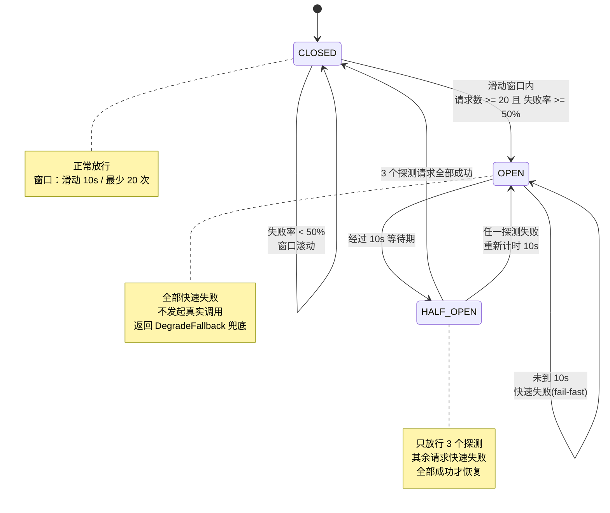

#### 7.3.2 状态迁移条件表

| 当前态 | 事件 | 条件 | 迁移到 | 动作 |
|---|---|---|---|---|
| `CLOSED` | 请求成功 | — | `CLOSED` | 记录成功；窗口滚动 |
| `CLOSED` | 请求失败 | 窗口请求数 ≥ `minimum-calls`(20) **且** 失败率 ≥ `failure-rate-threshold`(0.5) | `OPEN` | `openedAt = now`；打点 + 告警 |
| `CLOSED` | 请求失败 | 请求数 < 20 或 失败率 < 50% | `CLOSED` | 仅记录失败 |
| `OPEN` | 任意请求 | `now - openedAt < open-duration-seconds`(10s) | `OPEN` | **快速失败**，不发起真实调用，返回 `CIRCUIT_OPEN` |
| `OPEN` | 任意请求 | `now - openedAt ≥ 10s` | `HALF_OPEN` | 重置 `probeCount=0`、`halfOpenSuccess=0` |
| `HALF_OPEN` | 探测成功 | 成功数累计 == `half-open-probes`(3) | `CLOSED` | 清空窗口；打点 `circuit_breaker_recovered_total` |
| `HALF_OPEN` | 探测失败 | 任意一次 | `OPEN` | `openedAt = now`（重新计时 10s） |
| `HALF_OPEN` | 新请求到达 | 已有 3 个探测在飞 | `HALF_OPEN` | 快速失败（防探测洪峰） |
| 任意 | 手动强制开 | `POST /api/admin/circuit/{name}/force-open` | `OPEN` | 运维应急 |
| 任意 | 手动重置 | `POST /api/admin/circuit/{name}/reset` | `CLOSED` | 清空统计 |

#### 7.3.3 实现

```java
package com.smartlib.support;

public class CircuitBreaker {

    public enum State { CLOSED, OPEN, HALF_OPEN }

    private final String name;
    private final int windowSeconds;              // smartlib.circuit-breaker.*
    private final int minimumCalls;
    private final float failureRateThreshold;
    private final Duration openDuration;
    private final int halfOpenProbes;

    private final AtomicReference<State> state = new AtomicReference<>(State.CLOSED);
    private volatile long openedAtMillis;
    private final AtomicInteger probes = new AtomicInteger();
    private final AtomicInteger probeSuccess = new AtomicInteger();

    /** 按秒分桶的环形数组：窗口 10s → 10 个桶。 */
    private final WindowBucket[] ring;

    public boolean allowRequest() {
        State s = state.get();
        if (s == State.CLOSED) {
            return true;
        }
        if (s == State.OPEN) {
            if (System.currentTimeMillis() - openedAtMillis >= openDuration.toMillis()) {
                if (state.compareAndSet(State.OPEN, State.HALF_OPEN)) {
                    probes.set(0);
                    probeSuccess.set(0);
                }
                return tryAcquireProbe();
            }
            return false;   // fail-fast
        }
        return tryAcquireProbe();   // HALF_OPEN
    }

    private boolean tryAcquireProbe() {
        return probes.incrementAndGet() <= halfOpenProbes;
    }

    public void recordSuccess() {
        if (state.get() == State.HALF_OPEN) {
            if (probeSuccess.incrementAndGet() >= halfOpenProbes) {
                state.set(State.CLOSED);
                resetWindow();
            }
            return;
        }
        currentBucket().success().increment();
    }

    public void recordFailure() {
        if (state.get() == State.HALF_OPEN) {
            openedAtMillis = System.currentTimeMillis();
            state.set(State.OPEN);
            return;
        }
        currentBucket().failure().increment();
        Snapshot snap = snapshot();
        if (snap.total() >= minimumCalls && snap.failureRate() >= failureRateThreshold) {
            openedAtMillis = System.currentTimeMillis();
            state.set(State.OPEN);
            Metrics.counter("smartlib_circuit_opened_total", "name", name).increment();
        }
    }

    public State state() {
        return state.get();
    }

    public String name() {
        return name;
    }
}
```

**熔断器注册表**：

| 熔断器 `name` | 保护对象 | 窗口 | 最小请求数 | 失败率阈值 | OPEN 时长 | 探测数 |
|---|---|---|---|---|---|---|
| `redis-stock` | `RedisLuaStockStrategy` | 10 s | 20 | 50% | 10 s | 3 |
| `redis-cache` | L2 缓存读写 | 10 s | 20 | 50% | 10 s | 3 |
| `db-write` | 写库操作 | 10 s | 20 | 50% | 10 s | 3 |
| `search-engine` | 倒排索引检索 | 10 s | 20 | 50% | 10 s | 3 |
| `recommend` | 推荐服务 | 10 s | 20 | 50% | 10 s | 3 |
| `java-backend`（Agent 侧） | 调用 Java 后端 | 10 s | 20 | 50% | 10 s | 3 |
| `llm-provider`（Agent 侧） | LLM API | 30 s | 10 | 60% | 30 s | 2 |

**不计入失败率的异常**（防止业务拒绝被当成故障）：

| 异常 | 原因 |
|---|---|
| `BizException` | 业务拒绝是正常流量 |
| `IllegalArgumentException` / `MethodArgumentNotValidException` | 参数错 |
| `CallNotPermittedException`（熔断自身拒绝） | 避免自我放大 |

### 7.4 `DegradeFallback` 兜底返回值表

```java
package com.smartlib.support;

/** 降级兜底。每个方法必须返回"业务上合理、可展示、不误导"的值。 */
@Component
public class DegradeFallback {

    public StockView stockFallback(Long bookId, Throwable cause);

    public SearchResult searchFallback(BookQuery query, Throwable cause);

    public List<RecommendItem> recommendFallback(Long readerId, Throwable cause);

    public String policyAnswerFallback(String topic, Throwable cause);
}
```

| 接口 / 方法 | 依赖故障 | 兜底返回值 | 用户可见文案 | 是否标注 |
|---|---|---|---|---|
| `GET /api/books/{id}` 库存部分 | Redis / DB 库存读失败 | `StockView` + `degraded=true` + 最近快照值 | "预计可借（实时数据暂不可用，以到馆为准）" | ✅ |
| `GET /api/books`（检索） | 索引未就绪 | `BookMapper#searchByLike` 结果，`engine="like"` | 正常展示 | `degraded=true` |
| `GET /api/books`（检索） | DB 也不可用 | `SearchResult.empty()` + 热门榜前 10 | "检索服务繁忙，为你推荐热门书目" | `degradeReason` |
| `GET /api/books/{id}/similar` | 推荐服务故障 | `findHot(since, 10)`（同分类优先） | "同类热门推荐" | `source="HOT_FALLBACK"` |
| `GET /api/books/hot` | 统计服务故障 | `findHot` 近 30 天（退化为全量） | 正常展示 | `degraded=true` |
| `GET /api/readers/{id}/credit` | 读失败 | **不兜底**，直接 503 | "请稍后重试" | 安全考虑：**不猜测权限** |
| `POST /api/borrows` | 库存服务全不可用 | `BorrowResult.fail("系统繁忙，请 30 秒后重试")` | 明确失败，**绝不假装成功** | — |
| `POST /api/borrows/{id}/return` | 回补失败 | `ok=false` + 事务回滚 | "归还失败，请联系服务台" | — |
| `/internal/agent/tools/books/{id}/stock` | 查询故障 | `degraded=true` + `degradeReason` | Agent 用"预计可借"话术 | ✅ |
| `/internal/agent/tools/search-books` | 检索故障 | 空 `items` + `degraded=true` | Agent 说"暂时查不到，我帮你转人工" | ✅ |
| `/internal/agent/tools/readers/{id}/loans` | 读失败 | `ok=false, reason="读取失败"` | Agent 明确告知失败，不编造 | — |
| `POST /internal/agent/tools/borrow` | 写链路故障 | `ok=false, reason="系统繁忙"` | Agent 告知失败并建议稍后重试 | — |
| `/internal/agent/tools/policy` | RAG 不可用 | 静态 FAQ Top5（内置 20 条） | 正常回答 | `source="STATIC_FAQ"` |
| LLM 调用（Agent） | LLM 超时/故障 | `MockLLM` 确定性回答 + 人工入口 | "智能助手暂时不可用，已为你转接服务台" | `degraded=true` |

**兜底三条铁律**：

1. **库存类兜底必须带 `degraded=true` + 原因**：宁可说"预计可借"，绝不承诺"可借"。
2. **写操作（借/还/续借/预约）永不兜底为成功**：失败就是失败，让用户重试。
3. **权限/信用分类兜底一律返回失败**：不允许因故障而放宽借阅权限（安全 > 可用性）。

---

## 8. 幂等设计

### 8.1 `idempotent_record` 表（已落地字段）

| 字段 | 类型 | 说明 |
|---|---|---|
| `id` | `bigint auto_increment PK` | 自增主键 |
| `idem_key` | `varchar(128) not null` | 幂等键，**唯一索引 `uk_idem_key`** |
| `biz_type` | `varchar(32) not null` | `BORROW` / `RETURN` / `RENEW` / `RESERVATION` / `AGENT_BORROW` |
| `result_json` | `varchar(2000)` | 结果快照；**NULL = 占位（进行中）**，非空 = 已完成 |
| `created_at` | `datetime not null` | 创建时间，清理任务的依据 |

> **与蓝图 §5 的差异说明**：蓝图列出 `idem_key, biz_type, result_json, created_at` 四个关键字段，
> 已落地的 DDL 与之一致。设计上**没有** `status` / `expire_at` 列，而是用
> 「`result_json IS NULL` = 进行中，非 NULL = 已完成」表达状态，
> 用 `created_at < ?` 的删除语句表达过期清理——**减少了状态机与两个索引**，
> 代价是失去了"失败码回放"能力（失败时直接抛异常，不写终态）。
> 该取舍已记录于 §9.3 的幂等语义表。

### 8.2 `IdempotencyAspect` 流程

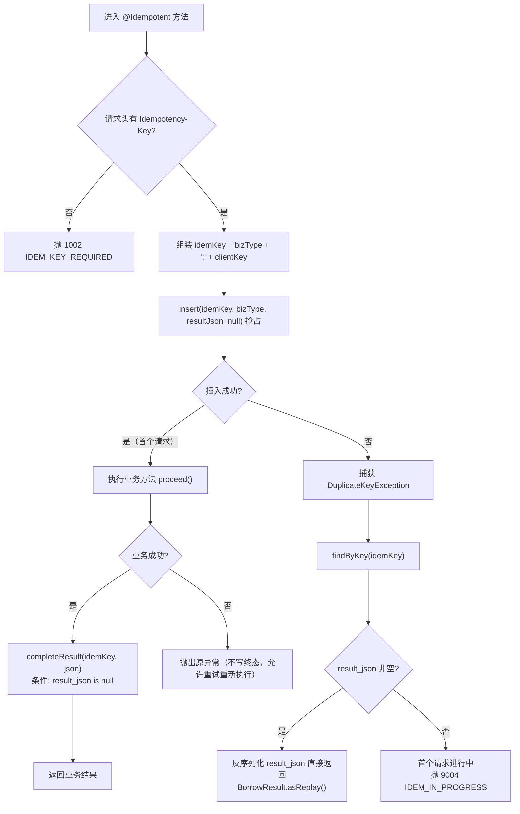

**关键点**：

| 要点 | 设计 | 理由 |
|---|---|---|
| **先 INSERT 抢占** | 用 `uk_idem_key` 唯一索引做去重锁，而非"先查后插" | 后者存在 TOCTOU 竞态：两个并发请求同时查不到、同时执行 |
| 插入冲突不报错 | 捕获 `DuplicateKeyException`，转入"读取已有记录"分支 | 并发重复是预期行为，不是错误 |
| 占位行 | `result_json = null` 表示"进行中" | 无需额外 `status` 列 |
| 结果只写一次 | `completeResult` 带 `result_json is null` 条件 | 防止后来请求覆盖先前的真实结果 |
| 失败不写终态 | 失败直接抛异常，占位行保留 | 允许客户端换新幂等键或同键重试重新执行；代价见 §8.5 |
| 键冲突返回 `9004` | 首个请求仍在进行中时，后来者立即得到明确错误 | 避免长时间阻塞线程 |
| 事务传播 | Aspect 的 insert/complete 与业务方法**不同事务**（`REQUIRES_NEW`） | 业务回滚时幂等占位行需保留，否则"重试"会重新执行 |

### 8.3 并发重复请求的处理（时序）

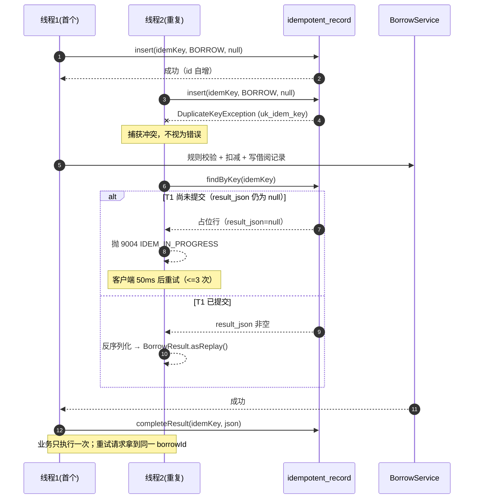

| 场景 | 表现 | 期望结果 |
|---|---|---|
| 用户连点两次"借书"（前端复用同一 key） | T1 抢占成功，T2 冲突 | T2 得到 `asReplay()` 的同一 `borrowId`（若 T1 已完成）或 `9004`（若进行中） |
| 用户重新打开页面再借同一本书（新 key） | 两次都执行 | 第二次被规则 5（重复借阅）拦截 → `2004` |
| Agent 工具网络超时重试（复用同一 key） | 同"连点两次" | 服务端只执行一次 |
| Agent 多轮对话再次确认借书（新 key） | 新幂等键 | 由 `RuleEngine` 拦截重复借阅 |

### 8.4 Key 生成规则

| 层级 | 规则 | 示例 |
|---|---|---|
| 客户端生成（推荐） | `UUID v4` 去横线 | `f47ac10b58cc4372a5670e02b2c3d479` |
| Agent 生成 | `agent-{sessionId}-{stepIndex}-{toolName}` 的 SHA-256 前 32 位 | `a3f51c9e...` |
| 存库 `idem_key` | `{bizType}:{clientKey}`，长度 ≤ 128 | `BORROW:f47ac10b58cc4372a5670e02b2c3d479` |
| Redis 前置 key | `smartlib:idem:{idem_key}` | `smartlib:idem:BORROW:f47ac...` |
| `biz_type` 取值 | `BORROW` / `RETURN` / `RENEW` / `RESERVATION` / `AGENT_BORROW` | — |

### 8.5 过期清理策略

| 项 | 设计 |
|---|---|
| 清理方法 | `IdempotentRecordMapper#deleteCreatedBefore(LocalDateTime before)` |
| 保留时长 | **24 小时**（`before = now - 24h`） |
| 清理任务 | `IdempotentRecordCleanJob`，`@Scheduled(cron = "0 30 3 * * ?")`（避开索引重建） |
| 单次上限 | 通过 `before` 参数天然限量；若单次删除过多，任务内按 1 小时步进分批 |
| 索引依赖 | `uk_idem_key` 服务抢占；清理走 `created_at` 全表条件删除（表极小，可接受） |
| 监控 | `smartlib_idem_dedup_total{biz_type}`（被拦截的重复请求数）、`smartlib_idem_in_progress_total`（返回 9004 的次数） |
| 容量估算 | 日均借还 4000 × 1.2（含重试）≈ 4800 行/天；单行 ≤ 2 KB（`result_json` 上限 2000 字符）→ ≈ 9.6 MB/天；**24h 滚动清理后常驻 < 10 MB** |
| **已知限制** | 失败的业务不留终态，因此"同 key 失败后重试"会重新执行；对写接口这是**期望行为**（用户本就想重试）。副作用是无法区分"失败重放"与"新请求"，如需审计可在 `result_json` 中写入 `{"ok":false,"reason":"..."}` 由业务自行决定 |

---

## 9. 事务与异常设计

### 9.1 事务边界

| 方法 | `@Transactional` | 隔离级别 | 传播行为 | `readOnly` | 超时 | 理由 |
|---|---|---|---|---|---|---|
| `BorrowService#borrow` | 是 | `READ_COMMITTED` | `REQUIRED` | false | 3 s | 写库存 + 写流水 + 写借阅记录必须原子 |
| `BorrowService#returnBook` | 是 | `READ_COMMITTED` | `REQUIRED` | false | 3 s | 还书 + 回补库存 + 预约推进 |
| `BorrowService#renew` | 是 | `READ_COMMITTED` | `REQUIRED` | false | 3 s | 更新 `renew_count`/`due_at` |
| `StockStrategy#tryDeduct`（S1/S2/S4/S5/S6） | 否（由调用方事务包裹） | 跟随调用方 | — | false | — | 策略不自己开事务，避免嵌套 |
| `PessimisticDbStockStrategy#tryDeduct` | 是 | 跟随调用方 | **`MANDATORY`** | false | — | 悲观锁必须在事务内，否则锁立即释放 |
| `ReservationService#promoteToReady` | 是 | `READ_COMMITTED` | `REQUIRES_NEW` | false | 2 s | 预约推进独立提交，不因还书回滚而丢失 |
| `ReservationService#reserve` | 是 | `READ_COMMITTED` | `REQUIRED` | false | 3 s | 取号（`maxQueueNo`）+ 插入必须同事务，否则并发重号 |
| `BookSearchService#search` | 是 | `READ_COMMITTED` | `SUPPORTS` | **true** | 5 s | 只读，`SUPPORTS` 避免无谓事务开销 |
| `BookService#getDetail` | 是 | `READ_COMMITTED` | `SUPPORTS` | true | 3 s | 只读 |
| `RuleEngine#loadRule` / `#validate` | 是 | `READ_COMMITTED` | `MANDATORY` | true | 1 s | 校验与扣减必须看到同一快照 |
| `IdempotencyAspect#around` | 是 | `READ_COMMITTED` | `REQUIRES_NEW` | false | 5 s | 幂等占位行独立提交 |

**为什么用 `READ_COMMITTED` 而非 `REPEATABLE_READ`（MySQL 默认）**：

| 维度 | `READ_COMMITTED` | `REPEATABLE_READ` |
|---|---|---|
| 库存扣减正确性 | 条件 `UPDATE` 是当前读 + 行锁，**两者都正确** | 同左 |
| 间隙锁 | 无间隙锁 | 有间隙锁 → 死锁概率更高 |
| 热点书并发 | 锁范围小，吞吐更高 | 锁范围大，热点书易死锁 |
| 幻读风险 | 在借数量统计可能幻读 | 无幻读 |
| 本项目的兜底 | `uk_ledger_biz_no` + 册数校验 + 对账任务 | — |
| **结论** | ✅ **采用** | ❌ 不采用 |

**一致性的三重保障**：

| 层级 | 机制 | 覆盖的失效场景 |
|---|---|---|
| L1 数据库事务 | 同一事务内 `deductConditional` + `ledgerMapper.insert` + `borrowRecordMapper.insert` | 进程崩溃、异常回滚 |
| L2 唯一约束 | `uk_ledger_biz_no`（同一 `bizNo` 只记一次）、`uk_idem_key`（同一幂等键只执行一次） | 重复提交、重试、降级双写 |
| L3 对账任务 | `StockReconcileJob` 调用 `StockLedgerMapper#findViolations` + `BookStockMapper#findNegativeStock` + `#findTotalCopiesMismatch` | 逻辑漏洞、绕过 Service 的非法写路径 |

```java
@Service
public class BorrowService {

    @Transactional(rollbackFor = Exception.class, timeout = 3,
                   isolation = Isolation.READ_COMMITTED)
    public BorrowResult borrow(Long readerId, Long bookId, String idemKey) {
        // 1) 规则校验（同一事务快照内）
        Reader reader = readerMapper.findById(readerId);
        BorrowRule rule = ruleEngine.loadRule(reader.getType());
        ruleEngine.validateBorrow(reader, bookId, rule);   // 册数/信用分/逾期/重复/罚金

        // 2) 库存扣减（策略内不自己开事务）
        String bizNo = BizNo.of("BORROW", readerId, bookId);
        StockStrategy primary = stockStrategyFactory.get();
        StockDeductResult deduct = primary.tryDeduct(bookId, 1, bizNo);

        // 3) 可降级策略失败 → 用同一 bizNo 走兜底策略，保证幂等
        if (!deduct.success() && primary.degradable()
                && stockProps.isDegradeOnRedisFailure()) {
            deduct = stockStrategyFactory.getFallback().tryDeduct(bookId, 1, bizNo);
        }
        if (!deduct.success()) {
            throw new BizException(ErrorCode.STOCK_NOT_ENOUGH, deduct.reason());
        }

        // 4) 写借阅记录
        BorrowRecord record = BorrowRecord.create(readerId, bookId,
                LocalDateTime.now(), rule.loanDays());
        borrowRecordMapper.insert(record);

        // 5) 提交后失效缓存（注册同步回调，不在事务内删）
        CacheGuard.evictAfterCommit(RedisKeys.bookStock(bookId), RedisKeys.bookDetail(bookId));

        return BorrowResult.ok(record.getId(), record.getDueAt(), deduct.strategy());
    }
}
```

```java
public final class CacheGuard {

    /** 事务提交后再删缓存；无事务时立即删。 */
    public static void evictAfterCommit(String... keys) {
        if (TransactionSynchronizationManager.isSynchronizationActive()) {
            TransactionSynchronizationManager.registerSynchronization(new TransactionSynchronization() {
                @Override
                public void afterCommit() {
                    evictQuietly(keys);
                }
            });
        } else {
            evictQuietly(keys);
        }
    }

    /** 延迟双删：提交后立即删一次，500ms 后再删一次（覆盖并发读回填的旧值）。 */
    private static void evictQuietly(String... keys) {
        try {
            cache.evictAll(keys);
            DELAYED_EVICT_EXECUTOR.schedule(() -> cache.evictAll(keys),
                    500, TimeUnit.MILLISECONDS);
        } catch (Exception e) {
            log.warn("缓存失效失败，退化为依赖 TTL。keys={}", Arrays.toString(keys), e);
        }
    }
}
```

**为什么"先更库后删缓存"而非"先删缓存后更库"**：

| 策略 | 并发问题 | 结论 |
|---|---|---|
| 先删缓存 → 再更库 | 删完后、更库前，另一个读请求回填了**旧值** → 缓存长期脏 | ❌ |
| **先更库 → 提交后删缓存** | 极端情况下"更库前读旧值 + 更库后写缓存" → 短暂脏，由**延迟双删**覆盖 | ✅ 采用 |
| 延迟双删 + 版本号 | 缓存值带 `version`（`LogicalExpireWrapper.version`），写路径 `+1`；读回填前校验版本 | ✅ 叠加使用 |

### 9.2 库存流水与借阅记录的一致性

| 保障层 | 措施 | 验证方式 |
|---|---|---|
| 同事务 | `book_stock` 更新 + `stock_ledger` 插入 + `borrow_record` 插入在同一 `@Transactional` | 单测：故意让 `borrow_record` 插入失败，断言库存与流水均回滚 |
| 同 `bizNo` | `stock_ledger.biz_no` 唯一；`BorrowService` 用 `BizNo.of("BORROW", readerId, bookId)` 生成 | `countByBizNo` 前置幂等检查 |
| 唯一约束 | `uk_ledger_biz_no` 保证同一业务单号只记一次流水 | 并发测试 |
| 方向与自洽 | `after_qty - before_qty == delta`（应用层断言 + 对账 SQL） | `StockLedgerConservationTest` |
| 定时对账 | `StockReconcileJob` 调 `findViolations()` | 对账返回空集合 |
| 落库失败处理 | 流水插入失败 → `DuplicateKeyException` → `3002` | 无"扣了库存没流水"的可能 |

### 9.3 错误码表

**分段规则**（`ErrorCode` 类注释已固化，前端与 Agent 依赖分段做统一处理）：

| 区段 | 语义 | 典型 HTTP |
|---|---|---|
| `1xxx` | 参数与协议错误 | 400 |
| `2xxx` | 业务规则错误 | 403 / 404 / 409 |
| `3xxx` | 库存相关错误 | 409 / 500 |
| `4xxx` | 认证与权限 | 401 / 403 |
| `5xxx` | 系统内部错误 | 500 |
| `9xxx` | 外部依赖与限流降级 | 409 / 429 / 503 |

**完整错误码表**（与 `com.smartlib.common.ErrorCode` 逐条一致）：

| code | 枚举名 | message | HTTP | 触发场景 | 处理建议 |
|---|---|---|---|---|---|
| 1001 | `PARAM_INVALID` | 参数不合法 | 400 | 字段缺失/格式错/`yearFrom>yearTo`/`query` 超 100 字 | 修正参数；不要重试 |
| 1002 | `IDEM_KEY_REQUIRED` | 缺少幂等键 Idempotency-Key | 400 | 写接口未传 `Idempotency-Key` | 补 UUID 后重试 |
| 1003 | `PAGE_OUT_OF_RANGE` | 分页参数超出允许范围 | 400 | `page < 1` 或 `page × size` 超限 | 收敛筛选条件 |
| 1004 | `UNSUPPORTED_STRATEGY` | 不支持的库存扣减策略 | 400 | `smartlib.stock.strategy` 取值未注册 | 检查配置并重启/切换 |
| 2001 | `READER_NOT_FOUND` | 读者不存在 | 404 | `ReaderMapper#findById` 返回 null | 校验 `readerId` |
| 2002 | `BOOK_NOT_FOUND` | 图书不存在 | 404 | 书目或库存行不存在 | 校验 `bookId` |
| 2003 | `BORROW_RECORD_NOT_FOUND` | 借阅记录不存在 | 404 | `findById` 返回 null | 校验 `borrowId` |
| 2004 | `BOOK_ALREADY_BORROWED` | 同一本书不能重复借阅 | 409 | `countActiveByReaderAndBook > 0`（含 `OVERDUE`，C-10） | 引导用"续借" |
| 2005 | `BORROW_LIMIT_EXCEEDED` | 已达到可借册数上限 | 409 | `countActiveByReader >= max_borrow_count` | 提示上限与已借清单 |
| 2006 | `READER_HAS_OVERDUE` | 存在逾期未还图书，请先归还 | 409 | `countOverdueByReader > 0` | 提示先归还 |
| 2007 | `CREDIT_TOO_LOW` | 信用分不足，暂不可借阅 | 403 | `creditScore < min_credit_score`(60) | 提示恢复方式；不要重试 |
| 2008 | `READER_FROZEN` | 读者状态异常，暂不可借阅 | 403 | `reader.status = 'FROZEN'` | 联系流通部 |
| 2009 | `RENEW_LIMIT_EXCEEDED` | 续借次数已用尽 | 409 | `renewCount >= max_renew_count` | 归还后重借 |
| 2010 | `RENEW_HAS_RESERVATION` | 该书已被预约，不可续借 | 409 | `ReservationMapper#countWaiting > 0` | 到期归还（公平性优先） |
| 2011 | `BORROW_STATUS_INVALID` | 当前借阅状态不允许该操作 | 409 | 已归还/已丢失/已逾期（含 `maxRenewDays` 超限） | 查询最新状态 |
| 2012 | `RESERVATION_DUPLICATED` | 已预约该书，请勿重复提交 | 409 | `countActiveByReaderAndBook > 0`（预约维度） | 查看预约状态 |
| 2013 | `RESERVATION_NOT_FOUND` | 预约记录不存在 | 404 | — | 校验 `reservationId` |
| 2014 | `FINE_UNPAID` | 存在未缴清罚金，请先缴纳 | 403 | `sumUnpaidFine >= fine_free_limit`(10 元) | 跳缴费 |
| 3001 | `STOCK_NOT_ENOUGH` | 库存不足 | 409 | `deductConditional` 返回 0 | **引导预约**；禁止无限重试 |
| 3002 | `STOCK_LEDGER_CONFLICT` | 库存流水冲突（bizNo 重复） | 500 | `uk_ledger_biz_no` 冲突 | 视为重复请求，查幂等表回放 |
| 3003 | `STOCK_STRATEGY_UNKNOWN` | 库存策略未注册 | 500 | 工厂未找到策略 Bean | 检查 Spring 装配 |
| 3004 | `STOCK_DATA_INCONSISTENT` | 库存数据不一致 | 500 | 对账不平 / `release` 返回 0 | P0 告警，人工介入 |
| 4001 | `UNAUTHORIZED` | 未认证 | 401 | 无/错 token | 重新登录 |
| 4002 | `FORBIDDEN` | 无权访问 | 403 | 操作他人资源（`readerId` 不匹配） | 不要重试 |
| 4003 | `INTERNAL_SIGN_INVALID` | 内部接口签名校验失败 | 401 | HMAC 不匹配 / 时间戳超 300 s 容差 | 检查密钥与时钟 |
| 5001 | `SYSTEM_ERROR` | 系统繁忙，请稍后重试 | 500 | 未捕获异常 | 退避重试 + 上报 |
| 5002 | `DB_ERROR` | 数据库访问异常 | 500 | `DataAccessException` | 退避重试（1 s/3 s/9 s） |
| 9001 | `EXTERNAL_DEPENDENCY_ERROR` | 外部依赖异常 | 503 | Redis/MQ/LLM 等外部依赖异常（含单飞超时） | 依赖自动降级 |
| 9002 | `REDIS_UNAVAILABLE` | 缓存服务不可用 | 503 | Redis 连接异常 | 自动降级，无需处理 |
| 9003 | `SEARCH_ENGINE_ERROR` | 检索引擎异常 | 503 | 倒排索引/ES 异常 | 降级 DB 直查 |
| 9004 | `IDEM_IN_PROGRESS` | 相同请求正在处理中，请勿重复提交 | 409 | 幂等占位行 `result_json` 仍为 null | 50 ms 后重试（≤3 次） |
| 9005 | `RATE_LIMITED` | 请求过于频繁，请稍后重试 | 429 | 令牌桶不足 | 按 `Retry-After` 重试 |
| 9006 | `CIRCUIT_OPEN` | 依赖已熔断，已返回降级结果 | **200** | 熔断器 `OPEN` | 已返回兜底数据，属正常响应 |

> **`9006` 的 HTTP 状态是 200**：熔断时我们返回的是**可用的降级数据**（满足兜底三铁律），
> 因此不能报 5xx 让前端当作故障。降级信息通过 `data.degraded=true` + `data.degradeReason` 传递。
> **`9001` 与 `9002` 分工**：泛指外部依赖用 `9001`，明确是 Redis 用 `9002`。

### 9.4 全局异常处理（`GlobalExceptionHandler`）

```java
@RestControllerAdvice
public class GlobalExceptionHandler {

    /** 业务失败属于正常流量的一部分，用 WARN 记录关键信息即可。 */
    @ExceptionHandler(BizException.class)
    public ResponseEntity<Result<Void>> handleBiz(BizException e) {
        ErrorCode ec = e.getErrorCode();
        log.warn("业务异常 code={} msg={}", ec.getCode(), e.getMessage());
        return ResponseEntity.status(ec.getHttpStatus())
                .body(Result.fail(ec.getCode(), e.getMessage()));
    }

    /** 参数校验失败统一收敛为 1001，字段级错误拼进 msg，方便前端与 Agent 直接展示。 */
    @ExceptionHandler({MethodArgumentNotValidException.class, BindException.class})
    public ResponseEntity<Result<Void>> handleValidation(BindException e) {
        String detail = e.getBindingResult().getFieldErrors().stream()
                .map(fe -> fe.getField() + ": " + fe.getDefaultMessage())
                .collect(Collectors.joining("; "));
        log.warn("参数校验失败 {}", detail);
        return ResponseEntity.status(400).body(Result.fail(ErrorCode.PARAM_INVALID,
                ErrorCode.PARAM_INVALID.getMessage() + " - " + detail));
    }

    @ExceptionHandler(ConstraintViolationException.class)
    public ResponseEntity<Result<Void>> handleConstraint(ConstraintViolationException e) { /* 同 1001 */ }

    @ExceptionHandler(MissingRequestHeaderException.class)
    public ResponseEntity<Result<Void>> handleMissingHeader(MissingRequestHeaderException e) {
        log.warn("缺少请求头 {}", e.getHeaderName());
        return ResponseEntity.status(400)
                .body(Result.fail(ErrorCode.PARAM_INVALID, "缺少请求头 " + e.getHeaderName()));
    }

    @ExceptionHandler(NoHandlerFoundException.class)
    public ResponseEntity<Result<Void>> handleNotFound(NoHandlerFoundException e) {
        return ResponseEntity.status(404)
                .body(Result.fail(ErrorCode.PARAM_INVALID, "接口不存在: " + e.getRequestURL()));
    }

    /** 未知异常必须带堆栈打 ERROR：这才是需要告警与排查的部分。 */
    @ExceptionHandler(Exception.class)
    public ResponseEntity<Result<Void>> handleUnknown(Exception e) {
        log.error("未捕获异常 type={}", e.getClass().getName(), e);
        return ResponseEntity.status(500).body(Result.fail(ErrorCode.SYSTEM_ERROR));
    }
}
```

| 规则 | 说明 |
|---|---|
| 不把堆栈暴露给客户端 | 统一 `SYSTEM_ERROR`，堆栈只进日志 |
| 业务异常用 `WARN` | 业务拒绝是预期行为，不应污染 ERROR 日志与告警 |
| 未知异常用 `ERROR` + 打点 | 每个未知异常必须可被监控发现 |
| `traceId` 必带 | `Result` 统一携带，便于跨进程排查 |
| 敏感信息脱敏 | 日志中手机号/身份证号必须脱敏（`MaskUtils.mask()`） |

### 9.5 对账与定时任务设计

| 任务 | 频率 | 调用的 Mapper 方法 | 不平时的动作 |
|---|---|---|---|
| `StockReconcileJob` | 5 min | `StockLedgerMapper#findViolations`、`BookStockMapper#findNegativeStock`、`#findTotalCopiesMismatch` | 记录差异 + P0 告警（**不自动改数**） |
| `OverdueScanJob` | 每日 01:00 | `BorrowRecordMapper#findDueBefore(now, limit)` | 置 `OVERDUE`，`addCreditScore(-5)`，发通知 |
| `ReservationExpireJob` | 每 10 min | `ReservationMapper#findExpiredReady(now, limit)` | 置 `EXPIRED`，`addCreditScore(-3)`，推进下一位 |
| `IdempotentRecordCleanJob` | 每日 03:30 | `IdempotentRecordMapper#deleteCreatedBefore(now-24h)` | — |
| `BookIndexRebuildJob` | 每日 03:00（或 `build-on-startup`） | `BookMapper#selectPageForIndex(offset, limit)` | 重建倒排索引 + 布隆 |
| `RedisStockWarmUpJob` | 启动时 + 每 5 min | `BookStockMapper#findAll` | 回写 `smartlib:stock:atomic:*` |

**对账 SQL（`StockLedgerMapper#findViolations`，已落地）**：

```sql
SELECT s.book_id
  FROM book_stock s
  LEFT JOIN (
        SELECT book_id, SUM(delta) AS d
          FROM stock_ledger
         GROUP BY book_id
  ) l ON l.book_id = s.book_id
 WHERE s.available_copies <> s.total_copies + COALESCE(l.d, 0);
-- 期望：返回空集合
```

---

## 10. Agent 侧详细设计

### 10.1 意图分类决策树（规则命中优先级）

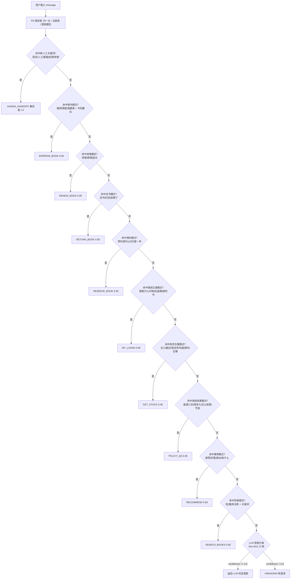

| 优先级 | 规则组 | 匹配方式 | 命中意图 | 置信度 | 理由 |
|---|---|---|---|---|---|
| P0 | 预处理 | 正则 + 词典 | — | — | 槽位提取在分类前完成 |
| R1 | 转人工 | 关键词 `投诉/人工/客服/经理/举报` | `HUMAN_HANDOFF` | 1.0 | 最高优先级，避免 LLM 乱答激化矛盾 |
| R2 | 借书 | `(想|要|帮我|我要)?借(阅)?` + 书名 | `BORROW_BOOK` | 0.95 | 有副作用，规则判断比 LLM 稳 |
| R3 | 续借 | `续借|再借|延长` | `RENEW_BOOK` | 0.95 | 同上 |
| R4 | 还书 | `还书|归还|到期` | `RETURN_BOOK` | 0.90 | 同上 |
| R5 | 预约 | `预约|排队|占位|留一本` | `RESERVE_BOOK` | 0.95 | 同上 |
| R6 | 借阅记录 | `我借|什么时候还|逾期|我的书|借了几本` | `MY_LOANS` | 0.95 | 高频且模式固定 |
| R7 | 库存位置 | `几楼|在馆|还有吗|能借吗|在哪` | `GET_STOCK` | 0.90 | 高频 |
| R8 | 规则政策 | `能借几本|借多久|怎么续借|罚金|规则` | `POLICY_QA` | 0.90 | 高频，直接走 RAG |
| R9 | 推荐 | `推荐|好看|类似|有什么` | `RECOMMEND` | 0.85 | 主观性强，置信度略低 |
| R10 | 检索 | `找|搜|有没有|有吗` + 关键词 | `SEARCH_BOOKS` | 0.85 | 泛化匹配 |
| L1 | LLM 兜底 | few-shot 分类（`temperature=0`） | 任意 | 由模型给出 | 长尾意图 |
| — | 都未命中 | — | `UNKNOWN` | — | 澄清话术 |

### 10.2 Prompt 模板清单（`agent/prompts.py`）

| 模板 ID | 用途 | 输入变量 | 输出格式约束 |
|---|---|---|---|
| `INTENT_CLASSIFY` | 意图分类（兜底路径） | `{history}`, `{message}`, `{intent_list}` | 严格 JSON `{"intent":"...","confidence":0.0-1.0,"slots":{}}`，`temperature=0` |
| `SLOT_EXTRACT` | 槽位抽取（书名/作者/学科） | `{message}`, `{known_books_sample}` | JSON `{"title":null,"author":null,"keyword":null,"bookId":null}` |
| `PLAN_DECOMPOSE` | 多步任务拆解 | `{intent}`, `{slots}`, `{tool_catalog}` | JSON 数组 `[{"tool":"...","args":{...},"why":"..."}]`，最多 5 步 |
| `TOOL_CALL_ARG` | 工具参数补全 | `{tool_schema}`, `{message}`, `{scratchpad}` | 严格匹配工具 JSON Schema；禁止多余字段 |
| `ANSWER_GROUNDED` | 基于证据生成回答 | `{question}`, `{tool_evidence}`, `{reader_profile}` | 自然语言；**禁止编造证据外的数字/位置/日期** |
| `ANSWER_NO_EVIDENCE` | 无证据兜底 | `{question}`, `{failure_reason}` | 说明未能获取数据 + 给人工入口；**禁止猜测** |
| `CLARIFY` | 澄清追问 | `{message}`, `{candidates}` | 2-3 个可选项的单轮提问 |
| `DISAMBIGUATE_BOOK` | 同名书消歧 | `{candidates:[{bookId,title,author,publisher,year}]}` | 列表 + 请用户选择序号 |
| `POLICY_QA` | 规则问答（RAG） | `{question}`, `{retrieved_chunks}` | 只依据 chunks 回答，附 `source` |
| `RECOMMEND_EXPLAIN` | 推荐理由生成 | `{reader_profile}`, `{candidates}` | 每条 1-2 句理由，理由需引用画像字段 |
| `GUARDRAIL_REWRITE` | 护栏改写 | `{draft}`, `{violations}` | 去除违规内容后的安全版本 |
| `SUMMARY_HANDOFF` | 转人工摘要 | `{session}`, `{intent_history}` | ≤200 字结构化摘要 |

**关键 Prompt（`ANSWER_GROUNDED`）**：

```
你是高校图书馆智能助手。请严格依据 <evidence> 中的工具返回数据回答用户问题。

硬性规则：
1. 库存、位置、到期日、罚金等事实性信息必须来自 <evidence>，禁止推测。
2. 若 <evidence> 缺少某项数据，明确说"这项信息我没查到"，不要编造。
3. 若 evidence.degraded=true，必须说明"实时数据暂不可用，以下为预计值"。
4. 回答长度 ≤ 300 字；涉及多步操作时用有序列表。
5. 不要输出 <evidence> 中的内部字段名、ID、traceId。

<evidence>
{tool_evidence}
</evidence>

<用户画像>
{reader_profile}
</用户画像>

用户问题：{question}
```

### 10.3 八个工具的 JSON Schema 表

> 工具名与蓝图 §8.2 的路径一一对应；注册于 `tools/registry.py`。

| # | 工具名 | 对应后端接口 | 参数 | 类型 | 必填 | 校验规则 | 返回字段 |
|---|---|---|---|---|---|---|---|
| 1 | `search_books` | `POST /internal/agent/tools/search-books` | `query` | string | 是 | 1 ≤ len ≤ 100（与 `BookQuery` 一致） | `items[], total, tookMs, engine, degraded` |
| | | | `category` | string | 否 | 长度 ≤ 32；匹配 `category.code` | |
| | | | `publisher` | string | 否 | 长度 ≤ 100 | |
| | | | `yearFrom` / `yearTo` | integer | 否 | 1900 ≤ y ≤ 2100；`yearFrom ≤ yearTo` | |
| | | | `availableOnly` | boolean | 否 | 默认 false | |
| | | | `sort` | enum | 否 | `relevance\|year_desc\|year_asc\|price_asc\|price_desc\|hot` | |
| | | | `page` | integer | 否 | ≥ 1，默认 1 | |
| | | | `size` | integer | 否 | 1 ≤ size ≤ 50，默认 20 | |
| 2 | `get_book_stock` | `GET /internal/agent/tools/books/{id}/stock` | `bookId` | integer | 是 | > 0；存在性由后端校验 | `bookId, title, totalCopies, availableCopies, queueLen, shelfLocation, degraded` |
| 3 | `borrow_book` | `POST /internal/agent/tools/borrow` | `readerId` | integer | 是 | > 0 | `ok, borrowId, dueAt, reason, strategy, idempotentReplay` |
| | | | `bookId` | integer | 是 | > 0 | |
| | | | `idempotencyKey` | string | 是 | len 16-64；`^[A-Za-z0-9\-]+$` | |
| 4 | `renew_book` | `POST /internal/agent/tools/renew` | `readerId` | integer | 是 | > 0 | `ok, dueAt, renewCount, reason` |
| | | | `borrowId` | integer | 是 | > 0；归属校验由后端做 | |
| | | | `idempotencyKey` | string | 是 | 同 `borrow_book` | |
| 5 | `my_loans` | `GET /internal/agent/tools/readers/{id}/loans` | `readerId` | integer | 是 | > 0 | `[{borrowId, bookId, title, author, shelfLocation, borrowAt, dueAt, overdueDays, renewCount, renewable, status, fine}]`（即 `LoanView`） |
| 6 | `reader_profile` | `GET /internal/agent/tools/readers/{id}/profile` | `readerId` | integer | 是 | > 0 | `readerId, cardNo, name, readerType, dept, creditScore, borrowedCount, maxBorrowCount, preferredCategories[], recentTitles[]`（即 `ReaderProfileView`） |
| 7 | `reserve_book` | `POST /internal/agent/tools/reservations` | `readerId` | integer | 是 | > 0 | `ok, queueNo, reason` |
| | | | `bookId` | integer | 是 | > 0 | |
| | | | `idempotencyKey` | string | 是 | 同 `borrow_book` | |
| 8 | `policy_qa` | `GET /internal/agent/tools/policy` | `topic` | string | 是 | 1 ≤ len ≤ 64 | `answer, source` |

```python
# tools/registry.py
from typing import Literal
from pydantic import BaseModel, Field, field_validator

class SearchBooksArgs(BaseModel):
    query: str = Field(min_length=1, max_length=100)
    category: str | None = Field(default=None, max_length=32)
    publisher: str | None = Field(default=None, max_length=100)
    yearFrom: int | None = Field(default=None, ge=1900, le=2100)
    yearTo: int | None = Field(default=None, ge=1900, le=2100)
    availableOnly: bool = False
    sort: Literal["relevance", "year_desc", "year_asc",
                  "price_asc", "price_desc", "hot"] = "relevance"
    page: int = Field(default=1, ge=1)
    size: int = Field(default=20, ge=1, le=50)

    @field_validator("query")
    @classmethod
    def not_blank(cls, v: str) -> str:
        if not v.strip():
            raise ValueError("query 不能为空白")
        return v.strip()

class BorrowBookArgs(BaseModel):
    readerId: int = Field(gt=0)
    bookId: int = Field(gt=0)
    idempotencyKey: str = Field(min_length=16, max_length=64, pattern=r"^[A-Za-z0-9\-]+$")

TOOL_SCHEMAS = {
    "search_books": SearchBooksArgs,
    "get_book_stock": GetBookStockArgs,
    "borrow_book": BorrowBookArgs,
    "renew_book": RenewBookArgs,
    "my_loans": MyLoansArgs,
    "reader_profile": ReaderProfileArgs,
    "reserve_book": ReserveBookArgs,
    "policy_qa": PolicyQaArgs,
}

# 工具白名单（护栏 G1）
TOOL_WHITELIST = frozenset(TOOL_SCHEMAS)
```

### 10.4 ReAct 循环伪代码

```python
MAX_STEPS = 5                  # 最大步数
STEP_TIMEOUT_S = 3.0           # 单工具超时
TOTAL_TIMEOUT_S = 15.0         # 整轮对话预算
MAX_RETRY = 2                  # 工具重试次数（100ms / 300ms 退避）
LOOP_LIMIT = 2                 # 同工具同参数允许的最大重复次数

async def react_loop(session, message) -> AgentResult:
    started = time.monotonic()
    scratchpad: list[Evidence] = []
    steps = 0

    intent, confidence, slots = await classify_intent(message, session.history)
    if confidence < 0.6:
        return await clarify(message, intent)

    plan = await build_plan(intent, slots, session.profile)
    if not plan:
        return await answer_without_tool(message, reason="NO_PLAN")

    call_counter: Counter = Counter()

    while steps < MAX_STEPS:
        if time.monotonic() - started > TOTAL_TIMEOUT_S:
            break                                     # 整轮超时兜底
        if not plan:
            break

        step = plan.pop(0)
        steps += 1
        tool_name, args = step.tool, step.args

        # ---- 护栏：白名单 + 参数 Schema + 越权 + 敏感词 ----
        verdict = guardrail.pre_check(tool_name, args)
        if not verdict.ok:
            if verdict.action == "HANDOFF":
                return await handoff(session, verdict.reason)
            return await clarify(message, verdict.hint)

        # ---- 循环检测 ----
        sig = (tool_name, json.dumps(args, sort_keys=True))
        call_counter[sig] += 1
        if call_counter[sig] > LOOP_LIMIT:
            return await handoff(session, "LOOP_DETECTED")   # G10

        # ---- 执行（超时 + 重试 + 熔断）----
        result, last_error = None, None
        for attempt in range(MAX_RETRY + 1):
            try:
                result = await executor.execute(tool_name, args,
                                                timeout=STEP_TIMEOUT_S,
                                                trace_id=session.trace_id)
                break
            except ToolTimeout as e:
                last_error = "TIMEOUT"
                if attempt < MAX_RETRY:
                    await asyncio.sleep(0.1 * (3 ** attempt))
            except CircuitOpen:
                result = executor.fallback(tool_name, args)   # DegradeFallback
                break

        if result is None:
            scratchpad.append(Evidence(tool_name, args, None, last_error or "FAILED"))
            continue                                   # 该步失败，尝试下一步

        scratchpad.append(Evidence(tool_name, args, result, "OK"))

        # ---- 反馈驱动：业务拒绝不重试，改为解释 ----
        if result.get("ok") is False:
            plan = plan_recover(tool_name, result.get("reason"), plan)

        # ---- 已能回答则提前结束 ----
        if is_sufficient(scratchpad, intent):
            break

    # ---- 无证据兜底（硬约束 G6）----
    if not any(e.result for e in scratchpad):
        return await answer_no_evidence(message, reason="NO_EVIDENCE")

    draft = await llm.generate(ANSWER_GROUNDED,
                               question=message,
                               tool_evidence=[e.to_json() for e in scratchpad],
                               reader_profile=session.profile)

    # ---- 后置护栏 ----
    check = guardrail.post_check(draft, scratchpad)
    if not check.ok:
        draft = await llm.generate(GUARDRAIL_REWRITE, draft=draft, violations=check.violations)
        if not guardrail.post_check(draft, scratchpad).ok:
            return await handoff(session, "GUARDRAIL_BLOCK")

    return AgentResult(text=draft,
                       evidence=scratchpad,
                       steps=steps,
                       degraded=any(e.result and e.result.get("degraded") for e in scratchpad),
                       latency_ms=int((time.monotonic() - started) * 1000))
```

| 保护项 | 阈值 | 超限行为 |
|---|---|---|
| 最大步数 | 5 | 终止循环，用已有证据回答 |
| 单工具超时 | 3 s | 重试 2 次（100 ms、300 ms 退避） |
| 整轮超时 | 15 s | 中断，返回部分结果 + 说明 |
| 工具重试 | 2 | 之后标记该步失败 |
| 同工具同参数 | 3 次 | 判定死循环，转人工 |
| 无证据 | 0 条有效证据 | 走 `ANSWER_NO_EVIDENCE`，**禁止给结论** |
| 首 Token 延迟 | 目标 < 1.5 s（蓝图 §7） | 打点告警；**待实测回填** |

### 10.5 RAG 混合召回与排序公式

**召回阶段（三路并行）**：

| 路 | 方法 | 召回量 | 说明 |
|---|---|---|---|
| R1 稀疏（BM25） | 自研 BM25（`rag/bm25.py`），对 chunk 分词打分 | Top 20 | 主力，关键词精确匹配强 |
| R2 稠密（向量） | 余弦相似度（numpy 内存索引 / Chroma） | Top 20 | 语义泛化；无 API Key 时用哈希嵌入降级 |
| R3 规则直答 | `rule_config` + FAQ 词典精确匹配 | Top 5 | 高频问题零延迟命中 |

**排序融合公式**：

```
final_score = α · norm(bm25_score) + β · norm(vector_score) + γ · rule_hit + δ · recency_boost

norm(x)  = x / max(x in candidates)     归一化到 [0,1]，消除量纲差异
α = 0.5    BM25 权重
β = 0.4    向量权重
γ = 0.1    规则直答命中（命中 = 1.0，否则 0）
δ = 0.05   时效加成（文档 updated 在 90 天内 = 1.0，否则 0）
α + β + γ + δ = 1.05，最后再按 max 归一化到 [0,1]
```

**去重策略**：

| 层级 | 规则 | 目的 |
|---|---|---|
| L1 精确去重 | `chunk_id` 相同 → 保留高分者 | 三路召回重叠 |
| L2 近似去重 | SimHash 汉明距离 ≤ 3 → 视为重复 | 同一规则的多种表述 |
| L3 语义去重 | 向量余弦 > 0.95 → 保留高分者（仅对 Top10 执行） | 同义复述 |
| L4 来源配额 | 同一 `source` 最多占 3 席 | 防止单一文档霸榜 |
| 最终 | 取 TopK=5 作为 LLM 上下文 | 控制 token 与噪声 |

```python
def hybrid_retrieve(query: str, top_k: int = 5) -> list[Chunk]:
    bm25_hits = bm25_index.search(query, top=20)           # R1
    vec_hits = vector_store.search(embed(query), top=20)    # R2
    rule_hits = policy_dict.exact_match(query)[:5]          # R3

    cands: dict[str, Chunk] = {}
    for c in bm25_hits:
        cands.setdefault(c.id, c).bm25 = c.score
    for c in vec_hits:
        cands.setdefault(c.id, c).vector = c.score
    for c in rule_hits:
        cands.setdefault(c.id, c).rule_hit = 1.0

    max_bm25 = max((c.bm25 for c in cands.values()), default=1.0) or 1.0
    max_vec = max((c.vector for c in cands.values()), default=1.0) or 1.0

    for c in cands.values():
        c.final = (0.5 * (c.bm25 / max_bm25)
                   + 0.4 * (c.vector / max_vec)
                   + 0.1 * c.rule_hit
                   + 0.05 * (1.0 if c.is_recent() else 0.0))
        c.final /= 1.05

    ranked = sorted(cands.values(), key=lambda x: x.final, reverse=True)
    ranked = dedup_exact(ranked)
    ranked = dedup_simhash(ranked, hamming=3)
    ranked = dedup_semantic(ranked[:10], cosine=0.95) + ranked[10:]
    ranked = apply_source_quota(ranked, per_source=3)
    return ranked[:top_k]
```

| 参数 | 默认值 | 调整依据（待实测回填） |
|---|---|---|
| `α` BM25 | 0.5 | 规则类问答关键词明确，稀疏检索占主导 |
| `β` 向量 | 0.4 | 语义泛化补充 |
| `γ` 规则直答 | 0.1 | 精确命中的强信号，但覆盖率低 |
| `δ` 时效 | 0.05 | 规则更新后优先新版本 |
| 召回量 | 20/20/5 | 平衡召回率与排序开销 |
| TopK | 5 | LLM 上下文长度与信噪比 |
| 调优方法 | `eval/run_eval.py` 网格搜索 | 以 `recall@5` 与 `answer_accuracy` 为目标 |

### 10.6 记忆结构

#### 10.6.1 会话短期记忆（`memory/session_store.py`）

| 字段 | 类型 | TTL | 说明 |
|---|---|---|---|
| `session_id` | str | 30 min（滑动） | 前端生成 |
| `reader_id` | int | 30 min | 绑定读者 |
| `turns` | list[Turn] | 保留最近 **10** 轮 | 每轮 `{role, text, ts, intent, tool_calls}` |
| `slots` | dict | 30 min | 当前任务槽位：`{title, bookId, author, category, borrowId}` |
| `pending_intent` | str | 5 min | 待确认的意图（"是否确认借这本？"） |
| `candidates` | list | 5 min | 消歧候选书目（等用户选序号） |
| `trace_id` | str | 30 min | 本轮链路 id |
| `degraded` | bool | 30 min | 本轮是否发生降级 |

存储：Redis `smartlib:agent:session:{sessionId}`；本地开发用内存字典。

#### 10.6.2 读者画像长期记忆（`memory/reader_profile.py`）

| 字段 | 类型 | 来源（对应后端字段） | 更新时机 | TTL |
|---|---|---|---|---|
| `readerId` | int | 请求 | — | 24 h |
| `cardNo` / `name` | str | `ReaderProfileView` | 每次拉取 | 24 h |
| `readerType` | enum | `ReaderProfileView.readerType`（`UNDERGRAD`/`POSTGRAD`/`TEACHER`） | 每次拉取 | 24 h |
| `dept` | str | `reader.dept` | 每次拉取 | 24 h |
| `creditScore` | int | `reader.credit_score` | 每次拉取 | **5 min**（变化快） |
| `borrowedCount` | int | `BorrowRecordMapper#countActiveByReader`（含 `OVERDUE`，C-10） | 每次借还后 | 5 min |
| `maxBorrowCount` | int | `rule_config('max_borrow_count', readerType)` | 每次拉取 | 24 h |
| `preferredCategories` | list[str] | `ReaderMapper#findPreferredCategories(readerId, limit)` | 每次对话（缓存）+ 每日刷新 | 24 h |
| `recentTitles` | list[str] | `BorrowRecordMapper#listLoanRows(readerId, 5)` | 每次拉取 | 5 min |
| `tags` | list[str] | 规则生成标签（"考研党" "常借计算机"） | 每日 | 24 h |

```python
class SessionStore:
    TTL = timedelta(minutes=30)
    MAX_TURNS = 10

    async def load(self, session_id: str) -> Session:
        raw = await self.redis.get(f"smartlib:agent:session:{session_id}")
        if raw is None:
            return Session.new(session_id)
        s = Session.model_validate_json(raw)
        s.turns = s.turns[-self.MAX_TURNS:]        # 滑动窗口截断
        return s

    async def save(self, session: Session) -> None:
        session.turns = session.turns[-self.MAX_TURNS:]
        await self.redis.setex(
            f"smartlib:agent:session:{session.session_id}",
            int(self.TTL.total_seconds()),
            session.model_dump_json(),
        )

class ReaderProfileStore:
    """长期记忆：Redis Hash + 每日离线任务刷新。"""

    PROFILE_TTL = timedelta(hours=24)
    CREDIT_TTL = timedelta(minutes=5)              # 信用分单独短 TTL

    async def get_or_build(self, reader_id: int) -> ReaderProfileView:
        key = f"smartlib:reader:profile:{reader_id}"
        cached = await self.redis.hgetall(key)
        if cached and self._fresh(cached):
            return ReaderProfileView.from_hash(cached)
        # 回源：GET /internal/agent/tools/readers/{id}/profile
        profile = await self.java_client.reader_profile(reader_id)
        await self.redis.hset(key, mapping=profile.to_hash())
        await self.redis.expire(key, int(self.PROFILE_TTL.total_seconds()))
        return profile
```

| 记忆类型 | 存储 | TTL | 跨会话 | 隐私 |
|---|---|---|---|---|
| 会话短期 | Redis String(JSON) | 30 min 滑动 | 否 | 含对话原文，落库前必须脱敏 |
| 读者画像长期 | Redis Hash | 24 h（信用分 5 min） | 是 | 只存聚合结果，不存原文 |
| 会话日志（审计，可选） | MySQL `agent_session_log` | 90 d | 是 | 脱敏（手机号/身份证）后归档 |

### 10.7 护栏规则清单（16 条）

| # | 规则 | 触发点 | 检查内容 | 违反行为 |
|---|---|---|---|---|
| G1 | **工具白名单** | `pre_check` | `tool_name ∈ TOOL_WHITELIST`（8 个） | 拒绝执行 + `smartlib_guardrail_violation_total` |
| G2 | **参数 Schema 校验** | `pre_check` | Pydantic 校验类型/范围/正则 | 返回澄清话术（不暴露内部 schema） |
| G3 | **不臆造库存** | `post_check` | 出现"可借/在馆/有几本"时必须有 `get_book_stock` 或 `search_books` 证据 | 重写为"暂无法确认" |
| G4 | **不臆造位置** | `post_check` | 出现"X 楼/第 X 排"必须来自 `shelfLocation` | 删除该句 |
| G5 | **不臆造到期日/罚金** | `post_check` | 日期与金额必须能在 evidence 中精确匹配 | 重写 |
| G6 | **无证据不下结论** | `runtime` | `scratchpad` 有效证据数 == 0 时禁止生成事实性回答 | 走 `ANSWER_NO_EVIDENCE` + 人工入口 |
| G7 | **低置信度转人工** | `intent` / `runtime` | `confidence < 0.6` 且澄清 2 次仍失败 | `HUMAN_HANDOFF` |
| G8 | **敏感词拦截** | `pre_check` + `post_check` | 涉政/涉黄/辱骂/歧视词库（≥500 词，分级） | 拦截 + 标准话术 + 转人工；审计日志 |
| G9 | **长度限制** | `post_check` | 回答 ≤ 2000 字符（目标 ≤ 300） | 截断并加省略号 |
| G10 | **循环检测** | `runtime` | 同 `(tool, args)` 调用 > 2 次 | 终止循环 + 转人工 |
| G11 | **步数限制** | `runtime` | `steps > 5` | 终止，用已有证据回答 |
| G12 | **写操作二次确认** | `runtime` | 意图 ∈ {`BORROW_BOOK`,`RENEW_BOOK`,`RESERVE_BOOK`} 且首次提出 | 追加确认轮，用户确认后才调工具 |
| G13 | **越权检测** | `pre_check` | `args.readerId` 必须等于会话绑定的 `readerId` | 拒绝 + 安全告警 |
| G14 | **PII 脱敏** | `post_check` + 日志 | 手机号/邮箱/身份证脱敏 | 正则替换 `138****1234` |
| G15 | **内部字段泄露防护** | `post_check` | 不得出现 `traceId`、内部错误码、长数字 ID | 正则清理 |
| G16 | **降级标注** | `post_check` | evidence 中 `degraded=true` 时回答必须含"预计/暂不可用" | 追加标注 |

```python
class Guardrail:
    WRITE_INTENTS = {"BORROW_BOOK", "RENEW_BOOK", "RESERVE_BOOK"}
    FACT_CLAIM_PATTERNS = [
        (re.compile(r"(可借|能借|在馆|还有)\s*\d*\s*本?"), "get_book_stock"),
        (re.compile(r"(借到|归还)至?\s*\d{4}-\d{2}-\d{2}"), "my_loans"),
        (re.compile(r"(第?\s*\d+\s*楼|\d+\s*排|\d+\s*架)"), "get_book_stock"),
        (re.compile(r"罚金\s*[\d.]+\s*元"), "my_loans"),
    ]

    def pre_check(self, tool: str, args: dict) -> Verdict:
        if tool not in TOOL_WHITELIST:                                    # G1
            return Verdict.block("TOOL_NOT_ALLOWED", action="HANDOFF")
        try:
            TOOL_SCHEMAS[tool].model_validate(args)                       # G2
        except ValidationError as e:
            return Verdict.block("ARG_INVALID", hint=str(e.errors()[0]["msg"]))
        if args.get("readerId") and args["readerId"] != self.session.reader_id:   # G13
            return Verdict.block("CROSS_READER", action="HANDOFF")
        if self.sensitive_scanner.hit(str(args)):                         # G8
            return Verdict.block("SENSITIVE", action="HANDOFF")
        return Verdict.allow()

    def post_check(self, draft: str, evidence: list[Evidence]) -> Verdict:
        violations = []
        if len(draft) > 2000:                                             # G9
            violations.append("TOO_LONG")
        for pattern, required_tool in self.FACT_CLAIM_PATTERNS:           # G3/G4/G5
            if pattern.search(draft) and not self._has_evidence(evidence, required_tool):
                violations.append(f"NO_EVIDENCE:{required_tool}")
        if self.sensitive_scanner.hit(draft):                             # G8
            violations.append("SENSITIVE")
        if re.search(r"\b[0-9a-f]{32}\b", draft):                         # G15
            violations.append("INTERNAL_LEAK")
        if any(e.result and e.result.get("degraded") for e in evidence) \
                and not re.search(r"(预计|暂不可用|以到馆为准)", draft):    # G16
            violations.append("MISSING_DEGRADE_LABEL")
        return Verdict.of(violations)
```

---

## 11. 关键类与文件清单

### 11.1 后端已落地文件（`backend/src/main/java/com/smartlib/...`）

| # | 文件路径 | 类 / 类型 | 职责 | 关键方法 |
|---|---|---|---|---|
| 1 | `common/ErrorCode.java` | `ErrorCode` | 错误码枚举（6 段，33 个码） | `getCode()`, `getMessage()`, `getHttpStatus()` |
| 2 | `common/BizException.java` | `BizException` | 业务异常（携带 `ErrorCode`） | `getErrorCode()` |
| 3 | `common/Result.java` | `Result<T>` | 统一响应体 `{code,msg,data,traceId}` | `ok(data)`, `fail(code,msg)`, `fail(ErrorCode)` |
| 4 | `common/PageResult.java` | `PageResult<T>` | 分页响应 `{list,total,page,size}` | `of(list,total,page,size)` |
| 5 | `common/GlobalExceptionHandler.java` | `GlobalExceptionHandler` | 全局异常 → 统一响应 | `handleBiz`, `handleValidation`, `handleConstraint`, `handleMissingHeader`, `handleNotFound`, `handleUnknown` |
| 6 | `common/TraceContext.java` | `TraceContext` | traceId 线程上下文 | `traceId()`, `set()`, `clear()` |
| 7 | `common/TraceIdFilter.java` | `TraceIdFilter` | 生成/透传 traceId，写 MDC 与响应头 | `doFilterInternal` |
| 8 | `common/Json.java` | `Json` | JSON 序列化工具（`LocalDateTime` 支持） | `toJson`, `fromJson` |
| 9 | `domain/entity/Book.java` | `Book` | 书目实体 | getter/setter |
| 10 | `domain/entity/BookStock.java` | `BookStock` | 库存实体（唯一事实源） | `isAvailable()` |
| 11 | `domain/entity/Reader.java` | `Reader` | 读者实体 | `isActive()` |
| 12 | `domain/entity/BorrowRecord.java` | `BorrowRecord` | 借阅记录实体 | `create(...)`, `overdueDays(now)`, `isActive()` |
| 13 | `domain/entity/Reservation.java` | `Reservation` | 预约实体 | `isExpired(now)` |
| 14 | `domain/entity/StockLedger.java` | `StockLedger` | 库存流水实体 | `of(...)`, `isBalanced()` |
| 15 | `domain/entity/IdempotentRecord.java` | `IdempotentRecord` | 幂等记录实体 | `isDone()` |
| 16 | `domain/entity/RuleConfig.java` | `RuleConfig` | 规则配置实体 | `asInt()`, `asDecimal()` |
| 17 | `domain/entity/Category.java` | `Category` | 分类字典实体 | getter/setter |
| 18 | `domain/enums/ReaderType.java` | `ReaderType` | 读者类型 + 权限矩阵 | `maxBorrowCount()`, `loanDays()`, `maxRenewCount()`, `renewDays()`, `parse(String)` |
| 19 | `domain/enums/BorrowStatus.java` | `BorrowStatus` | 借阅状态机 | `countsAsActive()`, `isTerminal()`, `parse(String)` |
| 20 | `domain/enums/ReservationStatus.java` | `ReservationStatus` | 预约状态机 | `isActive()`, `isTerminal()`, `parse(String)` |
| 21 | `domain/enums/StockOpType.java` | `StockOpType` | 库存操作类型 | `apply(before,n)`, `parse(String)` |
| 22 | `domain/dto/Dtos.java` | `Dtos` 及嵌套 record | 全部领域 DTO | `BookView`, `SearchResult`, `StockView`, `StockDeductResult`, `BorrowResult`, `LoanView`, `ReaderProfileView`, `BorrowRule`, `RecommendItem`, `BookRow`, `LoanRow`, `NamedCount` |
| 23 | `domain/dto/BookQuery.java` | `BookQuery` | 检索入参（可变 POJO） | `normalize()`, `offset()`, `hasQuery()` |
| 24 | `mapper/BookMapper.java` + `resources/mapper/BookMapper.xml` | `BookMapper` | 书目读（XML 动态 SQL） | `insert`, `findById`, `findRowsByIds`, `searchByLike`, `countByLike`, `selectPageForIndex`, `findHot`, `findSimilar`, `findRowsByIdsOrdered` |
| 25 | `mapper/BookStockMapper.java` | `BookStockMapper` | **库存唯一写入口**（注解 SQL） | `findByBookId`, `findAll`, `insert`, `deductConditional`, `selectForUpdate`, `deductWithVersion`, `release`, `increaseLocked`, `decreaseLocked`, `syncBookTotalCopies`, `findTotalCopiesMismatch`, `findNegativeStock` |
| 26 | `mapper/BorrowRecordMapper.java` | `BorrowRecordMapper` | 借阅流水读写 | `insert`, `findById`, `countActiveByReader`, `countActiveByReaderAndBook`, `countOverdueByReader`, `sumUnpaidFine`, `markReturned`, `markRenewed`, `updateStatusAndFine`, `listByReader`, `findDueBefore`, `listLoanRows`, `countBorrowedSince` |
| 27 | `mapper/ReaderMapper.java` | `ReaderMapper` | 读者读写 | `insert`, `findById`, `findByCardNo`, `addCreditScore`, `selectPage`, `findPreferredCategories` |
| 28 | `mapper/ReservationMapper.java` | `ReservationMapper` | 预约队列 | `insert`, `findById`, `countWaiting`, `maxQueueNo`, `findQueueHead`, `countActiveByReaderAndBook`, `listActiveByReader`, `updateStatus`, `findExpiredReady` |
| 29 | `mapper/StockLedgerMapper.java` | `StockLedgerMapper` | 流水写入与对账 | `insert`, `countByBizNo`, `sumDelta`, `findRecent`, `findViolations` |
| 30 | `mapper/IdempotentRecordMapper.java` | `IdempotentRecordMapper` | 幂等记录 | `insert`, `findByKey`, `completeResult`, `deleteCreatedBefore` |
| 31 | `mapper/RuleConfigMapper.java` | `RuleConfigMapper` | 规则配置 | `findAll`, `findEffective`, `updateValue` |
| 32 | `resources/db/schema.sql` | — | H2/MySQL 双兼容 DDL（9 张表 + 索引） | — |
| 33 | `resources/db/data.sql` | — | 演示数据（分类/读者/书目/库存/借阅/预约/流水/规则） | — |
| 34 | `resources/application.yml` | — | 公共配置 | — |
| 35 | `resources/application-local.yml` | — | H2 + `optimistic-db` + `inverted-index` | — |
| 36 | `resources/application-prod.yml` | — | MySQL + Redis + `redis-lua` | — |
| 37 | `backend/pom.xml` | — | Maven 依赖（Boot 4.1.1 / MyBatis 4.1.0 / Caffeine / springdoc） | — |

### 11.2 后端待建文件（按本文件的设计落地）

| # | 文件路径 | 类 | 职责 | 关键方法 |
|---|---|---|---|---|
| 1 | `SmartLibApplication.java` | `SmartLibApplication` | 启动类 | `main` |
| 2 | `common/Idempotent.java` | `@Idempotent` | 幂等注解（`bizType`, `keyHeader`, `ttlSeconds`） | — |
| 3 | `common/IdempotencyAspect.java` | `IdempotencyAspect` | 幂等切面（先 insert 抢占） | `around(ProceedingJoinPoint, Idempotent)` |
| 4 | `common/InternalSignFilter.java` | `InternalSignFilter` | `/internal/**` HMAC 校验 | `doFilterInternal` |
| 5 | `config/MyBatisConfig.java` | `MyBatisConfig` | Mapper 扫描、驼峰映射 | `sqlSessionFactory` |
| 6 | `config/WebMvcConfig.java` | `WebMvcConfig` | 拦截器、CORS、Jackson | `addInterceptors`, `addCorsMappings` |
| 7 | `config/CacheConfig.java` | `CacheConfig` | Caffeine + Redis 序列化 | `caffeineCacheManager`, `redisTemplate` |
| 8 | `config/OpenApiConfig.java` | `OpenApiConfig` | springdoc 分组 | `publicApi`, `internalApi` |
| 9 | `config/StockStrategyConfig.java` | `StockStrategyConfig` | 策略 Bean 装配与条件开关 | `optimisticDb`, `redisLua`, … |
| 10 | `config/SearchEngineConfig.java` | `SearchEngineConfig` | 检索引擎装配、索引预热 | `invertedIndexEngine`, `warmUpIndex` |
| 11 | `service/BookService.java` | `BookService` | 书目详情/热门/相似 | `getDetail`, `listHot`, `listSimilar` |
| 12 | `service/BookSearchService.java` | `BookSearchService` | 检索编排（缓存+布隆+单飞+引擎） | `search`, `searchWithFallback`, `hotTerms` |
| 13 | `service/BorrowService.java` | `BorrowService` | 借/还/续借主链路 | `borrow`, `returnBook`, `renew`, `listLoans` |
| 14 | `service/ReservationService.java` | `ReservationService` | 预约队列管理 | `reserve`, `cancel`, `promoteToReady`, `expireAndPromote` |
| 15 | `service/ReaderService.java` | `ReaderService` | 读者信息/信用分/画像 | `getCredit`, `applyReturn`, `applyOverdue`, `buildProfile` |
| 16 | `service/RuleEngine.java` | `RuleEngine` | 规则加载与校验 | `loadRule`, `validateBorrow`, `validateRenew`, `reload` |
| 17 | `service/RecommendService.java` | `RecommendService` | 相似书/个性化推荐 | `similar`, `forReader`, `hotFallback` |
| 18 | `service/stock/StockStrategy.java` | `StockStrategy` | **SPI 接口** | `name`, `tryDeduct`, `tryRelease`, `degradable` |
| 19 | `service/stock/StockStrategyFactory.java` | `StockStrategyFactory` | 策略注册/选择/降级/切换 | `get`, `getFallback`, `switchTo`, `registeredNames` |
| 20 | `service/stock/LocalLockStockStrategy.java` | `LocalLockStockStrategy` | S1 单机分段锁 | `tryDeduct` |
| 21 | `service/stock/OptimisticDbStockStrategy.java` | `OptimisticDbStockStrategy` | S2 条件更新（**默认**） | `tryDeduct`, `tryRelease` |
| 22 | `service/stock/PessimisticDbStockStrategy.java` | `PessimisticDbStockStrategy` | S3 悲观锁 | `tryDeduct` |
| 23 | `service/stock/VersionRetryStockStrategy.java` | `VersionRetryStockStrategy` | S4 乐观锁重试 | `tryDeduct`, `backoff` |
| 24 | `service/stock/RedisLuaStockStrategy.java` | `RedisLuaStockStrategy` | S5 Redis+Lua | `tryDeduct`, `warmUp`, `degradable` |
| 25 | `service/stock/MqSerialStockStrategy.java` | `MqSerialStockStrategy` | S6 串行队列 | `tryDeduct`, `startDispatcher`, `doSerialDeduct` |
| 26 | `service/stock/StockProperties.java` | `StockProperties` | `smartlib.stock.*` 绑定 | `getStrategy`, `isDegradeOnRedisFailure`, `getMq()` |
| 27 | `service/search/SearchEngine.java` | `SearchEngine` | **SPI 接口** | `name`, `ready`, `search` |
| 28 | `service/search/InvertedIndexEngine.java` | `InvertedIndexEngine` | Q3 自研倒排（**默认**） | `search`, `rebuildIndex`, `ready` |
| 29 | `service/search/DbLikeSearchEngine.java` | `DbLikeSearchEngine` | Q1 基线 + 降级 | `search` |
| 30 | `service/search/PrefixIndexSearchEngine.java` | `PrefixIndexSearchEngine` | Q2 前缀索引 | `search` |
| 31 | `service/search/MysqlFulltextSearchEngine.java` | `MysqlFulltextSearchEngine` | Q4 ngram 全文索引 | `search` |
| 32 | `service/search/ElasticsearchSearchEngine.java` | `ElasticsearchSearchEngine` | Q5 ES | `search` |
| 33 | `service/search/SearchEngineFactory.java` | `SearchEngineFactory` | 引擎选择与降级 | `get`, `getFallback` |
| 34 | `service/search/NgramTokenizer.java` | `NgramTokenizer` | 分词器 | `tokenize`, `cjkGrams`, `normalize` |
| 35 | `service/search/InvertedIndex.java` | `InvertedIndex` | 倒排数据结构 | `termIndex`, `docLength`, `PostingList#indexOf` |
| 36 | `service/search/Bm25Scorer.java` | `Bm25Scorer` | BM25 打分 | `score` |
| 37 | `service/search/TopKCollector.java` | `TopKCollector<T>` | 小顶堆 TopK | `offer`, `topKDesc` |
| 38 | `service/search/PinyinHelper.java` | `PinyinHelper` | 拼音首字母 | `initials`, `firstLetter` |
| 39 | `cache/MultiLevelCache.java` | `MultiLevelCache` | L1+L2 编排 | `get`, `put`, `evict`, `getWithSingleFlight` |
| 40 | `cache/BloomFilter.java` | `BloomFilter` | 布隆过滤器 | `add`, `mightContain`, `loadAll` |
| 41 | `cache/CacheGuard.java` | `CacheGuard` | 事务后失效 + 延迟双删 | `evictAfterCommit`, `evictQuietly` |
| 42 | `cache/SingleFlight.java` | `SingleFlight` | 单飞 | `execute`, `inFlightCount` |
| 43 | `cache/LogicalExpireWrapper.java` | `LogicalExpireWrapper<T>` | 逻辑过期包装 | `logicallyExpired`, `physicalTtl` |
| 44 | `cache/TtlJitter.java` | `TtlJitter` | TTL 抖动 | `apply`, `applySeconds` |
| 45 | `cache/RedisKeys.java` | `RedisKeys` | key 命名集中管理 | `bookDetail`, `bookStock`, `search`, `stockAtomic`, `idem` |
| 46 | `support/TokenBucketRateLimiter.java` | `TokenBucketRateLimiter` | 令牌桶 | `tryAcquire`, `effectiveRate`, `rejected` |
| 47 | `support/RateLimiterRegistry.java` | `RateLimiterRegistry` | 限流器注册与清理 | `get`, `evictIdle` |
| 48 | `support/RateLimitProperties.java` | `RateLimitProperties` | `smartlib.rate-limit.*` 绑定 | `isEnabled`, `getCapacity`, `bucketOf` |
| 49 | `support/CircuitBreaker.java` | `CircuitBreaker` | 熔断三态机 | `allowRequest`, `recordSuccess`, `recordFailure`, `state` |
| 50 | `support/CircuitBreakerRegistry.java` | `CircuitBreakerRegistry` | 熔断器注册表 | `get`, `forceOpen`, `reset` |
| 51 | `support/DegradeFallback.java` | `DegradeFallback` | 各接口兜底 | `stockFallback`, `searchFallback`, `recommendFallback`, `policyAnswerFallback` |
| 52 | `support/GracefulShutdown.java` | `GracefulShutdown` | 优雅停机（摘流量 → 等在飞 → 关池） | `onShutdown`, `preStop` |
| 53 | `support/StockReconcileJob.java` | `StockReconcileJob` | 库存对账 | `reconcile` |
| 54 | `support/OverdueScanJob.java` | `OverdueScanJob` | 逾期扫描 | `scan` |
| 55 | `support/ReservationExpireJob.java` | `ReservationExpireJob` | 预约过期与推进 | `expireAndPromote` |
| 56 | `support/IdempotentRecordCleanJob.java` | `IdempotentRecordCleanJob` | 幂等表清理 | `clean` |
| 57 | `support/BookIndexRebuildJob.java` | `BookIndexRebuildJob` | 倒排索引 + 布隆重 | `rebuild` |
| 58 | `web/BookController.java` | `BookController` | `/api/books/**` | `list`, `detail`, `hot`, `similar` |
| 59 | `web/BorrowController.java` | `BorrowController` | `/api/borrows/**` | `borrow`, `returnBook`, `renew`, `listLoans` |
| 60 | `web/ReaderController.java` | `ReaderController` | `/api/readers/**` | `loans`, `credit` |
| 61 | `web/ReservationController.java` | `ReservationController` | `/api/reservations/**` | `reserve`, `cancel` |
| 62 | `web/AdminController.java` | `AdminController` | 管理台：规则/策略/熔断/对账 | `updateRule`, `switchStrategy`, `circuitForce`, `triggerReconcile` |
| 63 | `web/AgentToolController.java` | `AgentToolController` | `/internal/agent/tools/**`（8 端点） | `searchBooks`, `getStock`, `borrow`, `renew`, `loans`, `profile`, `reserve`, `policy` |
| 64 | `web/HealthController.java` | `HealthController` | 自定义健康检查（索引/缓存/策略） | `health`, `readiness`, `liveness` |
| 65 | `resources/lua/stock_deduct.lua` | — | S5 原子扣减脚本 | — |
| 66 | `test/.../BorrowConcurrencyTest.java` | `BorrowConcurrencyTest` | 200 线程抢 10 册 | `shouldNotOversell` |
| 67 | `test/.../StockLedgerConservationTest.java` | `StockLedgerConservationTest` | 流水守恒 | `findViolationsEmpty` |
| 68 | `test/.../IdempotentBorrowTest.java` | `IdempotentBorrowTest` | 幂等 | `sameKeyOnlyOnce` |
| 69 | `test/.../CircuitBreakerStateTest.java` | `CircuitBreakerStateTest` | 三态迁移 | `closedToOpen`, `openToHalfOpen`, `halfOpenToClosed` |
| 70 | `test/.../ReservationPromotionTest.java` | `ReservationPromotionTest` | 还书推进预约 | `promoteToReadyWithHoldDays` |

### 11.3 Agent 服务（`agent-service/app/...`）

| # | 文件路径 | 类 / 函数 | 职责 | 关键方法 |
|---|---|---|---|---|
| 1 | `main.py` | `app` (FastAPI) | 入口、路由装配、生命周期（加载索引） | `lifespan`, `create_app` |
| 2 | `config.py` | `Settings` (pydantic-settings) | 配置（LLM/超时/阈值/后端地址） | `llm_provider`, `java_base_url` |
| 3 | `api/chat.py` | `router` | `POST /api/agent/chat`（SSE） | `chat`, `event_stream` |
| 4 | `api/tools.py` | `router` | 工具直调（调试） | `invoke_tool` |
| 5 | `api/recommend.py` | `router` | 推荐接口 | `recommend` |
| 6 | `api/admin.py` | `router` | 评测/统计/健康 | `stats`, `health` |
| 7 | `agent/runtime.py` | `AgentRuntime` | ReAct / Plan-Execute 主循环 | `run`, `react_loop`, `plan_execute` |
| 8 | `agent/intent.py` | `IntentClassifier` | 规则优先 + LLM 兜底 | `classify`, `rule_match`, `llm_classify` |
| 9 | `agent/planner.py` | `Planner` | 多步拆解与失败恢复 | `plan`, `plan_recover` |
| 10 | `agent/executor.py` | `ToolExecutor` | 校验/超时/重试/熔断 | `execute`, `fallback` |
| 11 | `agent/prompts.py` | `PROMPTS` | 全部 Prompt 模板 | `render(template_id, **vars)` |
| 12 | `agent/guardrail.py` | `Guardrail` | 前后置护栏（16 条） | `pre_check`, `post_check` |
| 13 | `agent/schemas.py` | `AgentResult`, `Evidence`, `Verdict` | 内部数据模型 | `to_json` |
| 14 | `llm/base.py` | `LLMClient` (ABC) | LLM 抽象 | `generate`, `stream` |
| 15 | `llm/openai_compat.py` | `OpenAICompatClient` | OpenAI 兼容协议 | `generate`, `stream` |
| 16 | `llm/mock.py` | `MockLLM` | 确定性模拟（无 Key 可跑） | `generate`, `stream` |
| 17 | `llm/router.py` | `LLMRouter` | 多 Provider 路由 + 熔断 | `complete`, `stream`, `current_provider` |
| 18 | `tools/registry.py` | `TOOL_SCHEMAS`, `TOOL_WHITELIST` | 工具注册与 Schema | `get_schema`, `validate` |
| 19 | `tools/search_books.py` | `search_books` | 检索书目 | `run` |
| 20 | `tools/get_stock.py` | `get_book_stock` | 查库存/位置 | `run` |
| 21 | `tools/borrow.py` | `borrow_book` | 借书（写操作） | `run` |
| 22 | `tools/renew.py` | `renew_book` | 续借 | `run` |
| 23 | `tools/my_loans.py` | `my_loans` | 我的借阅 | `run` |
| 24 | `tools/profile.py` | `reader_profile` | 读者画像 | `run` |
| 25 | `tools/reserve.py` | `reserve_book` | 预约 | `run` |
| 26 | `tools/policy_qa.py` | `policy_qa` | 规则问答 | `run` |
| 27 | `rag/loader.py` | `DocumentLoader` | 加载规则/馆藏/学科服务文档 | `load_all` |
| 28 | `rag/splitter.py` | `TextSplitter` | 分块（512 字，重叠 64） | `split` |
| 29 | `rag/bm25.py` | `BM25Index` | 自研 BM25 | `index`, `search` |
| 30 | `rag/vector_store.py` | `VectorStore` | numpy 余弦 / Chroma；哈希嵌入降级 | `add`, `search`, `embed` |
| 31 | `rag/retriever.py` | `HybridRetriever` | 混合召回 + 融合 + 去重 | `retrieve`, `dedup_exact`, `dedup_simhash`, `dedup_semantic` |
| 32 | `memory/session_store.py` | `SessionStore` | 会话短期记忆 | `load`, `save`, `append_turn` |
| 33 | `memory/reader_profile.py` | `ReaderProfileStore` | 读者画像长期记忆 | `get_or_build`, `refresh` |
| 34 | `client/java_client.py` | `JavaClient` | 调后端（HMAC + trace + 熔断重试） | `post`, `get`, `_sign` |
| 35 | `eval/dataset.jsonl` | — | 评测数据集（≥100 条） | — |
| 36 | `eval/run_eval.py` | `run_eval` | 跑评测出指标 | `main` |
| 37 | `eval/metrics.py` | `metrics` | 意图/工具/参数/端到端指标 | `intent_accuracy`, `tool_accuracy`, `e2e_success` |
| 38 | `tests/test_intent.py` | — | 意图分类测试 | `test_rule_priority` |
| 39 | `tests/test_tools.py` | — | 工具参数校验测试 | `test_schema_validation` |
| 40 | `tests/test_rag.py` | — | RAG 召回测试 | `test_hybrid_rank` |
| 41 | `tests/test_agent_e2e.py` | — | 端到端（MockLLM） | `test_borrow_flow` |

---

## 12. 配置项清单

### 12.1 后端 `application.yml`（公共，已落地）

| # | 配置 key | 类型 | 默认值 | 说明 | 环境 |
|---|---|---|---|---|---|
| 1 | `spring.application.name` | string | `smartlib-backend` | 应用名（指标 tag） | all |
| 2 | `spring.profiles.active` | string | `local` | 默认激活 profile | all |
| 3 | `spring.jackson.time-zone` | string | `Asia/Shanghai` | 时区（Boot 4 + Jackson 3 默认 ISO-8601） | all |
| 4 | `server.port` | int | `8080` | 服务端口 | all |
| 5 | `server.shutdown` | enum | `graceful` | 优雅停机 | all |
| 6 | `server.tomcat.threads.max` | int | `200` | 最大工作线程 | all |
| 7 | `server.tomcat.threads.min-spare` | int | `20` | 最小空闲线程 | all |
| 8 | `server.tomcat.accept-count` | int | `200` | 等待队列 | all |
| 9 | `server.tomcat.max-connections` | int | `10000` | 最大连接数 | all |
| 10 | `spring.lifecycle.timeout-per-shutdown-phase` | duration | `20s` | 停机等在飞请求 | all |
| 11 | `mybatis.mapper-locations` | string | `classpath:mapper/*.xml` | XML 映射位置 | all |
| 12 | `mybatis.type-aliases-package` | string | `com.smartlib.domain.entity` | 别名包 | all |
| 13 | `mybatis.configuration.map-underscore-to-camel-case` | bool | `true` | 下划线转驼峰 | all |
| 14 | `mybatis.configuration.default-fetch-size` | int | `100` | 默认 fetch size | all |
| 15 | `mybatis.configuration.default-statement-timeout` | int | `5` | SQL 超时（秒） | all |
| 16 | `smartlib.stock.strategy` | enum | `optimistic-db` | 库存策略（§4.5） | all |
| 17 | `smartlib.stock.degrade-on-redis-failure` | bool | `true` | Redis 故障是否降级到 `optimistic-db` | all |
| 18 | `smartlib.stock.mq.queue-capacity` | int | `20000` | `mq-serial` 队列容量 | all |
| 19 | `smartlib.stock.mq.timeout-ms` | long | `3000` | `mq-serial` 等待超时 | all |
| 20 | `smartlib.search.engine` | enum | `inverted-index` | 检索引擎（`like`/`prefix`/`inverted-index`/`fulltext`/`elasticsearch`） | all |
| 21 | `smartlib.search.index.max-docs` | int | `500000` | 倒排索引最大文档数（0=不限） | all |
| 22 | `smartlib.search.index.build-on-startup` | bool | `true` | 启动时构建索引 | all |
| 23 | `smartlib.search.elasticsearch.base-url` | string | `http://localhost:9200` | ES 地址 | prod（Q5） |
| 24 | `smartlib.search.elasticsearch.index-name` | string | `smartlib_book` | ES 索引名 | prod（Q5） |
| 25 | `smartlib.search.cache.l1-max-size` | long | `10000` | Caffeine 容量 | all |
| 26 | `smartlib.search.cache.l1-ttl-seconds` | long | `300` | L1 TTL（秒） | all |
| 27 | `smartlib.search.cache.l2-ttl-seconds` | long | `1800` | L2 逻辑 TTL（秒） | all |
| 28 | `smartlib.search.cache.ttl-jitter-ratio` | double | `0.1` | TTL 抖动比例（±10%） | all |
| 29 | `smartlib.search.cache.bloom-expected-insertions` | long | `1200000` | 布隆预期元素数 | all |
| 30 | `smartlib.search.cache.bloom-fpp` | double | `0.001` | 布隆目标误判率 | all |
| 31 | `smartlib.rate-limit.enabled` | bool | `true` | 限流总开关 | all |
| 32 | `smartlib.rate-limit.capacity` | int | `400` | 全局令牌桶容量 | all |
| 33 | `smartlib.rate-limit.refill-per-second` | double | `400` | 全局补充速率（个/秒） | all |
| 34 | `smartlib.circuit-breaker.failure-rate-threshold` | double | `0.5` | 失败率阈值（50%） | all |
| 35 | `smartlib.circuit-breaker.minimum-calls` | int | `20` | 窗口最小请求数 | all |
| 36 | `smartlib.circuit-breaker.open-duration-seconds` | int | `10` | OPEN 持续时长 | all |
| 37 | `smartlib.circuit-breaker.half-open-probes` | int | `3` | 半开放行探测数 | all |
| 38 | `smartlib.internal.sign-secret` | string | `${SMARTLIB_INTERNAL_SIGN:dev-internal-secret-please-change}` | HMAC 密钥 | all（prod 必改） |
| 39 | `smartlib.internal.sign-enabled` | bool | `true` | 是否校验内部签名 | all |
| 40 | `smartlib.internal.timestamp-tolerance-seconds` | int | `300` | 时间戳容差 | all |
| 41 | `management.endpoints.web.exposure.include` | string | `health,info,metrics,prometheus` | Actuator 暴露端点 | all |
| 42 | `management.endpoint.health.show-details` | enum | `always` | 健康详情（prod 覆盖为 `when-authorized`） | all |
| 43 | `management.endpoint.health.probes.enabled` | bool | `true` | K8s 探针 | all |
| 44 | `management.metrics.tags.application` | string | `${spring.application.name}` | 指标标签 | all |
| 45 | `springdoc.api-docs.path` | string | `/v3/api-docs` | OpenAPI 文档 | all |
| 46 | `springdoc.swagger-ui.path` | string | `/swagger-ui.html` | Swagger UI | all |
| 47 | `logging.level.root` | enum | `INFO` | 根日志级别 | all |
| 48 | `logging.level.com.smartlib` | enum | `DEBUG` | 业务日志级别 | all |
| 49 | `logging.pattern.console` | string | `"%d{...} [%thread] %-5level [%X{traceId:-}] %logger{36} - %msg%n"` | **traceId 占位符（C-03）** | all |

### 12.2 后端 `application-local.yml`（已落地）

| # | 配置 key | 类型 | 默认值 | 说明 |
|---|---|---|---|---|
| 1 | `spring.datasource.url` | string | `jdbc:h2:mem:smartlib;DB_CLOSE_DELAY=-1;MODE=MySQL;DATABASE_TO_LOWER=TRUE` | H2 内存库（MySQL 模式） |
| 2 | `spring.datasource.driver-class-name` | string | `org.h2.Driver` | H2 驱动 |
| 3 | `spring.datasource.username` / `password` | string | `sa` / `""` | H2 凭据 |
| 4 | `spring.datasource.hikari.maximum-pool-size` | int | `32` | 连接池上限 |
| 5 | `spring.datasource.hikari.minimum-idle` | int | `8` | 最小空闲 |
| 6 | `spring.datasource.hikari.pool-name` | string | `smartlib-hikari` | 池名 |
| 7 | `spring.datasource.hikari.connection-timeout` | ms | `3000` | 获取连接超时 |
| 8 | `spring.h2.console.enabled` / `.path` | bool / string | `true` / `/h2-console` | H2 控制台 |
| 9 | `spring.sql.init.mode` | enum | `always` | 每次启动执行 schema + data |
| 10 | `spring.sql.init.schema-locations` | string | `classpath:db/schema.sql` | DDL（含 `drop table`） |
| 11 | `spring.sql.init.data-locations` | string | `classpath:db/data.sql` | 演示数据 |
| 12 | `spring.sql.init.continue-on-error` | bool | `false` | 初始化出错即失败 |
| 13 | `spring.sql.init.encoding` | string | `UTF-8` | 脚本编码 |
| 14 | `spring.data.redis.host` / `.port` | string / int | `127.0.0.1` / `6379` | 本地无 Redis（Lettuce 懒连接，触发降级演示） |
| 15 | `spring.data.redis.timeout` | duration | `500ms` | 命令超时（快失败） |
| 16 | `spring.data.redis.connect-timeout` | duration | `500ms` | 连接超时 |
| 17 | `smartlib.stock.strategy` | enum | `optimistic-db` | 本地默认；演示降级时改 `redis-lua` |
| 18 | `smartlib.search.engine` | enum | `inverted-index` | 本地默认 |
| 19 | `logging.level.org.springframework.jdbc.datasource.init` | enum | `INFO` | 初始化脚本日志 |

### 12.3 后端 `application-prod.yml`（已落地）

| # | 配置 key | 类型 | 默认值 | 说明 |
|---|---|---|---|---|
| 1 | `spring.datasource.url` | string | `jdbc:mysql://${MYSQL_HOST:mysql}:${MYSQL_PORT:3306}/${MYSQL_DATABASE:smartlib}?useUnicode=true&characterEncoding=utf8&useSSL=false&serverTimezone=Asia/Shanghai&rewriteBatchedStatements=true&allowPublicKeyRetrieval=true` | MySQL 8 |
| 2 | `spring.datasource.driver-class-name` | string | `com.mysql.cj.jdbc.Driver` | MySQL 驱动 |
| 3 | `spring.datasource.username` / `password` | string | `${MYSQL_USER:smartlib}` / `${MYSQL_PASSWORD:smartlib}` | 凭据（环境变量注入） |
| 4 | `spring.datasource.hikari.maximum-pool-size` | int | `50` | 连接池上限 |
| 5 | `spring.datasource.hikari.minimum-idle` | int | `10` | 最小空闲 |
| 6 | `spring.datasource.hikari.max-lifetime` | ms | `1800000` | 连接最长存活（30 min） |
| 7 | `spring.datasource.hikari.pool-name` | string | `smartlib-hikari-prod` | 池名 |
| 8 | `spring.sql.init.mode` | enum | `never` | **不自动建表**（避免生产 `drop table`） |
| 9 | `spring.data.redis.host` / `.port` | string / int | `${REDIS_HOST:redis}` / `${REDIS_PORT:6379}` | Redis 地址 |
| 10 | `spring.data.redis.password` | string | `${REDIS_PASSWORD:}` | Redis 密码 |
| 11 | `spring.data.redis.timeout` | duration | `1000ms` | 命令超时 |
| 12 | `spring.data.redis.lettuce.pool.max-active` | int | `32` | 连接池上限 |
| 13 | `spring.data.redis.lettuce.pool.max-idle` / `min-idle` | int | `16` / `4` | 空闲连接 |
| 14 | `smartlib.stock.strategy` | enum | `${SMARTLIB_STOCK_STRATEGY:redis-lua}` | 生产默认 Redis+Lua |
| 15 | `smartlib.stock.degrade-on-redis-failure` | bool | `true` | Redis 故障自动降级 |
| 16 | `smartlib.search.engine` | enum | `${SMARTLIB_SEARCH_ENGINE:inverted-index}` | 可切 `elasticsearch` |
| 17 | `smartlib.internal.sign-secret` | string | `${SMARTLIB_INTERNAL_SIGN}` | 生产必须注入（无默认值，缺失即启动失败） |
| 18 | `management.endpoint.health.show-details` | enum | `when-authorized` | 生产收敛健康详情 |
| 19 | `logging.level.root` / `logging.level.com.smartlib` | enum | `INFO` / `INFO` | 生产日志级别 |

### 12.4 Agent 服务（`.env` / `config.py`）

| # | 配置 key | 类型 | 默认值 | 说明 |
|---|---|---|---|---|
| 1 | `AGENT_HOST` | string | `0.0.0.0` | 监听地址 |
| 2 | `AGENT_PORT` | int | `8000` | 端口 |
| 3 | `JAVA_BASE_URL` | string | `http://backend:8080` | Java 后端地址 |
| 4 | `JAVA_TIMEOUT_S` | float | `3.0` | 工具调用超时（与 §10.4 一致） |
| 5 | `JAVA_MAX_RETRY` | int | `2` | 工具重试次数 |
| 6 | `JAVA_RETRY_BACKOFF_MS` | string | `100,300` | 退避序列 |
| 7 | `INTERNAL_SIGN_SECRET` | string | `change-me` | **必须与 `smartlib.internal.sign-secret` 一致** |
| 8 | `INTERNAL_SIGN_ENABLED` | bool | `true` | 是否签名 |
| 9 | `TRACE_HEADER` | string | `X-Trace-Id` | 追踪头名 |
| 10 | `LLM_PROVIDER` | enum | `mock` | `openai_compat` / `mock`（蓝图 §3.2） |
| 11 | `LLM_BASE_URL` | string | `""` | OpenAI 兼容地址 |
| 12 | `LLM_API_KEY` | string | `""` | Key（空则自动用 MockLLM） |
| 13 | `LLM_MODEL` | string | `deepseek-chat` | 模型名 |
| 14 | `LLM_TEMPERATURE` | float | `0.2` | 生成温度 |
| 15 | `LLM_MAX_TOKENS` | int | `1024` | 最大输出 |
| 16 | `LLM_TIMEOUT_S` | float | `20.0` | LLM 调用超时 |
| 17 | `INTENT_RULE_CONFIDENCE` | float | `0.85` | 规则命中最低置信度 |
| 18 | `INTENT_LLM_THRESHOLD` | float | `0.60` | 低于此值转澄清 |
| 19 | `MAX_STEPS` | int | `5` | ReAct 最大步数 |
| 20 | `TOTAL_TIMEOUT_S` | float | `15.0` | 整轮预算 |
| 21 | `LOOP_DETECT_THRESHOLD` | int | `2` | 同工具同参数上限 |
| 22 | `ANSWER_MAX_CHARS` | int | `2000` | 回答长度上限 |
| 23 | `ENABLE_WRITE_TOOLS` | bool | `true` | 是否允许借/续借/预约 |
| 24 | `RAG_ALPHA_BM25` | float | `0.5` | 融合权重 |
| 25 | `RAG_BETA_VECTOR` | float | `0.4` | 融合权重 |
| 26 | `RAG_GAMMA_RULE` | float | `0.1` | 融合权重 |
| 27 | `RAG_TOPK` | int | `5` | 送入 LLM 的 chunk 数 |
| 28 | `RAG_RECALL_PER_ROUTE` | int | `20` | 单路召回量 |
| 29 | `VECTOR_STORE` | enum | `memory` | `memory` / `chroma` |
| 30 | `EMBEDDING_DIM` | int | `256` | 哈希嵌入维度（无 Key 降级） |
| 31 | `SESSION_TTL_MIN` | int | `30` | 会话 TTL |
| 32 | `SESSION_MAX_TURNS` | int | `10` | 保留轮数 |
| 33 | `PROFILE_TTL_HOURS` | int | `24` | 画像 TTL |
| 34 | `REDIS_URL` | string | `redis://redis:6379/1` | 记忆存储 |
| 35 | `CIRCUIT_OPEN_DURATION_S` | int | `10` | Agent 侧熔断 OPEN 时长 |
| 36 | `CIRCUIT_FAILURE_RATE` | float | `0.5` | 失败率阈值 |
| 37 | `SENSITIVE_WORD_FILE` | string | `data/sensitive_words.txt` | 敏感词库路径 |
| 38 | `EVAL_DATASET` | string | `eval/dataset.jsonl` | 评测数据集 |
| 39 | `SSE_HEARTBEAT_S` | int | `15` | SSE 心跳间隔 |
| 40 | `METRICS_ENABLED` | bool | `true` | Token/延迟埋点 |

### 12.5 配置变更管理

| 规则 | 说明 |
|---|---|
| 配置即契约 | §12 的 key 一旦被代码引用，改名需同步更新本文与 `docs/07-部署上线手册.md` |
| 敏感配置 | `*secret*` / `*key*` / `*password*` 一律走环境变量（`SMARTLIB_INTERNAL_SIGN`、`MYSQL_PASSWORD`、`REDIS_PASSWORD`），禁止写入 yml 明文 |
| 环境差异 | 只在 `application-{env}.yml` 覆盖差异项，公共项集中在 `application.yml` |
| 动态配置 | `rule_config` 表内的规则支持热加载（5 分钟 `reload`），**改规则不发版**（蓝图 §1.4 目标） |
| 策略热切换 | 库存策略支持 `AdminController` 运行时切换（`StockStrategyFactory#switchTo`），无需重启 |
| 变更留痕 | 影响接口契约或 SLO 的配置变更需在 `docs/11-架构决策记录ADR.md` 记录 |
| 禁止 | 在代码中硬编码 §12 已定义的配置值；必须通过 `@ConfigurationProperties` 或 `@Value` 注入 |

---

## 附录 A：待实测回填清单

> 以下数值本文档只声明目标值或估算值，**实测数据只能由 `scripts/bench/` + `docs/06-测试计划与报告.md` 产出后回填**。

| # | 指标 | 目标值 / 估算值 | 实测值 | 回填位置 |
|---|---|---|---|---|
| 1 | 借阅接口 P99 | < 200 ms（单实例 4C8G） | 待实测回填 | §3.1、§4.6 |
| 2 | 借阅接口 QPS（`optimistic-db`） | ≥ 200/实例 | 待实测回填 | §4.5 |
| 3 | 检索 P99 | < 300 ms（TopK 20） | 待实测回填 | §3.3、§5.5 |
| 4 | 检索召回率 | ≥ 95% | 待实测回填 | §5.4 |
| 5 | 超卖数（200 并发抢 10 册） | 0 | 待实测回填 | §4.6 |
| 6 | 六策略 P50/P99/QPS 对比 | — | 待实测回填 | §4.5、`docs/09` |
| 7 | Q1~Q5 引擎对比（P50/P99/召回） | — | 待实测回填 | §5.1、`docs/09` |
| 8 | 布隆实际误判率 | < 0.1% | 待实测回填 | §6.1 |
| 9 | 倒排索引实际内存占用 | ≈ 200 MB（`max-docs=500000`） | 待实测回填 | §5.2 |
| 10 | 单实例故障恢复时间 | < 30 s，错误率 < 0.1% | 待实测回填 | §3.6、`docs/07` |
| 11 | 意图识别准确率 | ≥ 92% | 待实测回填 | §10.1、`agent/eval` |
| 12 | 工具参数正确率 | ≥ 95% | 待实测回填 | §10.3 |
| 13 | 端到端任务成功率 | ≥ 88% | 待实测回填 | §10.4 |
| 14 | Agent 首 Token 延迟 | < 1.5 s | 待实测回填 | §10.4 |
| 15 | BM25 最优参数（k1/b） | 网格搜索 NDCG@10 | 待实测回填 | §5.4.2 |
| 16 | RAG 融合权重最优值 | recall@5 网格搜索 | 待实测回填 | §10.5 |
| 17 | `idx_book_title` 等索引的真实使用率 | — | 待实测回填（`sys.schema_unused_indexes`） | `docs/04` §5 |

**文档维护约定**：任何实测值回填时必须同时写明「环境（CPU/内存/实例数）、方法（工具/并发数/数据集）、日期」，否则视为无效数据。
