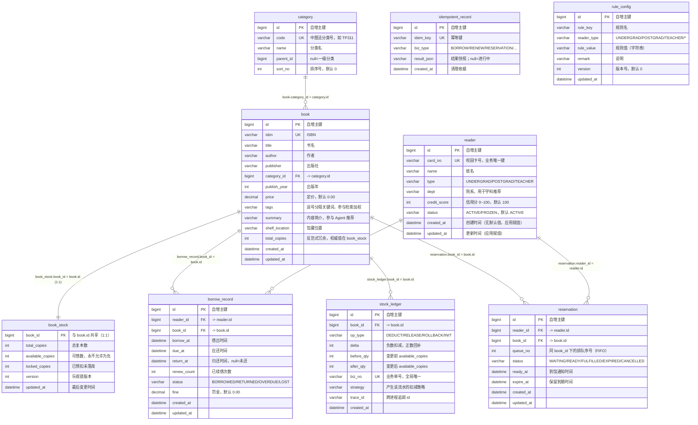
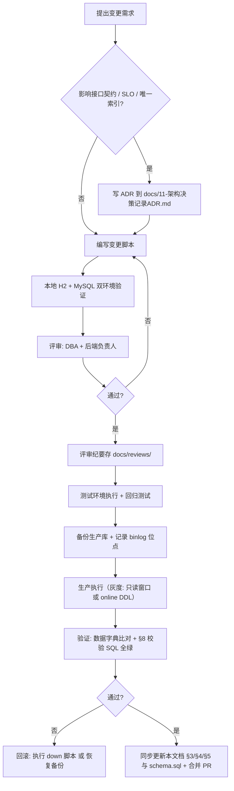

# SmartLib 数据库设计文档

- 项目：**SmartLib** — 高校图书馆智能借阅与推荐平台
- 版本：v1.0.0
- 文档编号：docs/04
- 上游契约：`docs/00-项目蓝图.md` §5 数据模型（**唯一技术契约**）
- **对齐基线（DDL 事实来源）**：
  - `backend/src/main/resources/db/schema.sql` — **权威 DDL**（MySQL 8 与 H2 `MODE=MySQL` 双兼容）
  - `backend/src/main/resources/db/data.sql` — 演示数据（仅 `local` profile / H2）
- 配套生产脚本：`deploy/sql/mysql-production-extras.sql`（README 中声明：ngram 全文索引、分区、账号权限）
- 撰写日期：2026-10-16
- 目标数据库：**MySQL 8.0.x（prod）** / **H2 2.5.252 `MODE=MySQL`（local、demo、测试）**

> **本文档的单一事实来源地位**：所有表名、字段名、索引名以 `schema.sql` 为准，本文档逐条对齐它。
> 代码侧 `domain/entity` 与 `mapper/*.java`（注解 SQL）/`mapper/BookMapper.xml` 必须与本文逐字段一致。
> 变更任何 DDL 需走 `docs/09-变更管理` 的流程并同步本文。
> **凡本文出现的性能/容量数字，除蓝图已声明外，一律标注「估算值 / 待实测回填」。**

---

## 1. 设计原则

### 1.1 核心原则：DDL 同时兼容 MySQL 8 与 H2 `MODE=MySQL`

`schema.sql` 的文件头明确写下了这条约束，它直接决定了本项目的 DDL 写法：

> 目标：同时兼容 MySQL 8.0 与 H2 (MODE=MySQL)，因此只使用两者都支持的语法子集：
> \* 不使用 ENGINE / CHARSET / 行内 COMMENT / UNIQUE KEY 行内约束
> \* 唯一约束与普通索引统一用 `CREATE [UNIQUE] INDEX` 语句创建
> \* 表与字段说明用 `--` 注释表达

| 被舍弃的 MySQL 特性 | 原因 | 替代方案 |
|---|---|---|
| `ENGINE=InnoDB` | H2 不识别 | 省略（MySQL 默认即 InnoDB） |
| `DEFAULT CHARSET=utf8mb4 COLLATE=...` | H2 不识别 | 库级/实例级统一设置（见 §3.2） |
| 行内 `COMMENT '...'` | H2 不识别 | **用 `--` 注释写在列右侧**（本文 §4 数据字典补齐语义） |
| 行内 `UNIQUE KEY uk_x (col)` | H2 不识别 | 独立 `CREATE UNIQUE INDEX uk_x ON t (col)` |
| 行内 `KEY idx_x (col)` | H2 不识别 | 独立 `CREATE INDEX idx_x ON t (col)` |
| `FULLTEXT ... WITH PARSER ngram` | H2 不支持 | 放到 `deploy/sql/mysql-production-extras.sql`（仅 MySQL 执行） |
| `PARTITION BY RANGE` | H2 不支持 | 同上（仅 MySQL，见 §6.3） |

> **这个取舍本身就是设计决策**：它让"面试现场零依赖启动（H2 内存库）"成为可能，
> 代价是失去 MySQL 特有的优化手段。所有 MySQL 专属优化都集中在 `deploy/sql/mysql-production-extras.sql` 一个文件里，
> 保持 `schema.sql` 的纯净可移植。该决策已记录于 `docs/11-架构决策记录ADR.md`。

### 1.2 范式取舍

| 表 | 范式 | 取舍说明 |
|---|---|---|
| `reader` | 3NF | **无派生冗余字段**。早期设计曾考虑存 `borrowed_count` / `unpaid_fine`，最终**放弃**：① 它们可用 `BorrowRecordMapper#countActiveByReader` / `#sumUnpaidFine` 实时算出（单读者在借 ≤20 行，代价可忽略）；② 冗余字段在多写路径下极易不一致，是"对账永远还不清的债" |
| `category` | 3NF | 两级分类，`parent_id` 为 `null` 表示一级分类 |
| `book` | 3NF（`tags` 例外） | `tags` 存逗号分隔字符串而非 `book_tag` 关联表：标签是**仅用于检索的展示字段**（`BookMapper.xml` 里 `b.tags like '%kw%'` 参与匹配），无需按标签做关系查询，拆表徒增 join |
| `book` | **有 1 个反范式字段** | `total_copies` 是 `book_stock.total_copies` 的**冗余镜像**，见 §1.3 |
| `book_stock` | **与 `book` 1:1 分表** | 蓝图 §5 设计要点：书目读多写少（可全量缓存），库存高频写（**不能放缓存当唯一事实源**）。分表后热点行更新不触发 `book` 的缓存失效，行更窄、锁竞争面更小 |
| `borrow_record` | 3NF | 只存 `reader_id` / `book_id`，**不冗余书名/作者**：书名可变，冗余会导致改书名要改 96 万行历史流水。列表查询用 `join book`（`BookMapper.xml#listLoanRows` 已落地一次 join 取书名，避免 N+1） |
| `reservation` | 3NF | `queue_no` 是**业务序号**（同一 `book_id` 内递增），不是主键：队列因取消/过期产生空洞，保留原序号便于展示"你前面还有 N 人" |
| `stock_ledger` | **反范式（宽表快照）** | 刻意冗余 `before_qty` / `after_qty`：对账无需按时间序重放即可定位断点；`strategy` 列存产生该流水的策略名，供压测横向对比 |
| `idempotent_record` | 3NF | 纯 KV + 结果快照，无关系；**用 `result_json IS NULL` 表达"进行中"**，不引入 `status` 列 |
| `rule_config` | **EAV（实体-属性-值）** | 规则是**可配置项**（蓝图 §1.4「改规则不发版」），EAV 是合理选择；代价是类型不安全，由 `RuleConfig#asInt()/asDecimal()` + `RuleEngine` 加载时校验兜底。规则项 < 30 条，EAV 的查询劣势可忽略（全量加载进内存） |

### 1.3 唯一一处反范式的完整取舍

`book.total_copies` 是 `book_stock.total_copies` 的冗余镜像。`schema.sql` 原文注释：

> total_copies 是【反范式冗余字段】：仅用于列表展示，权威值在 book_stock.total_copies，
> 由库存变更事务内同步。冗余的原因：书目列表页 QPS 极高，避免与库存表关联查询。
> 一致性代价与取舍见 docs/09-多种解决方案对比手册.md（P7 节）。

| 维度 | 冗余（**采用**） | 不冗余（每次 join `book_stock`） |
|---|---|---|
| 列表查询 | `select * from book` 即可（无需 join） | 每次列表都要 `left join book_stock` |
| 降级能力 | `book_stock` 不可用时仍能展示总册数 | 整页失败 |
| 一致性成本 | 每次库存变更须同步 `BookMapper` 的 `total_copies`，**可能不一致** | 天然一致 |
| 兜底机制 | `BookStockMapper#syncBookTotalCopies` 在变更事务内同步；`#findTotalCopiesMismatch()` 对账 | — |
| 项目选择 | ✅ 采用（列表页是检索之外的第二大读路径） | ❌ |

> **注意区分两个字段的语义**：
> `available_copies`（可借）**永远**以 `book_stock` 为唯一事实源，**绝不冗余**（冗余它就会超卖）；
> `total_copies`（总册数）**允许**冗余，因为它只在编目/盘点时变化，且不参与扣减判定。

### 1.4 字段命名规范

| 规则 | 示例 | 反例 |
|---|---|---|
| 表名小写 + 下划线，**单数** | `book`, `borrow_record` | ~~`books`~~、~~`BorrowRecord`~~ |
| 普通字段小写下划线 | `available_copies` | ~~`availableCopies`~~ |
| 主键统一 `id bigint auto_increment primary key` | `id` | ~~`book_id` 作主键名~~ |
| 外键命名 `{被引用表单数}_id` | `reader_id`, `book_id`, `category_id` | ~~`rid`~~ |
| 1:1 共享主键用被引用表单数 | `book_stock.book_id` | — |
| 布尔语义用 `is_*` / 动词性形容词 | `return_at is null`（用可空表达） | ~~`flag1`~~ |
| 时间：`{动作}_at`（`datetime`）；纯日期用 `date` | `borrow_at`, `due_at`, `expire_at` | ~~`time1`~~ |
| 金额：`DECIMAL(10,2)`，**不用 FLOAT/DOUBLE** | `price`, `fine` | ~~`price double`~~ |
| 数量：`{对象}_copies` / `{对象}_count` | `available_copies`, `renew_count` | ~~`num`~~ |
| 枚举/状态：`status` / `type` / `op_type`，值用大写下划线字符串 | `BORROWED`, `UNDERGRAD`, `DEDUCT` | ~~`status=1`~~（见 §1.6） |
| 索引命名 | `uk_{表}_{字段}`、`idx_{表}_{字段}` | ~~`index1`~~ |
| 列注释 | 用 `--` 写在列右侧（H2 兼容） | ~~`COMMENT '...'`~~ |

### 1.5 时间与金额类型策略

| 类型选择 | 采用 | 理由 |
|---|---|---|
| 时间戳 | **`datetime`（秒级）** | ① 不用 `TIMESTAMP`：范围止于 2038 且受 `time_zone` 影响；② **秒级精度已足够**：逾期判定粒度为"天"（`due_at < now()`），不需要毫秒；③ `datetime` 在 H2 与 MySQL 行为一致，`datetime(3)` 在两边精度语义有别 |
| 纯日期语义 | 本库**统一用 `datetime`**（不单设 `date` 列） | `due_at` 同时承载"哪天到期"与"精确到秒的逾期判定"，避免"当天 23:59:59 是否算逾期"的歧义。到期日由 `rule_config('loan_days')` 计算得出 |
| 时区 | 存 UTC+8 本地时间，JDBC `serverTimezone=Asia/Shanghai` | 单校区业务，无跨时区需求；不存 epoch 整数以便 DBA 直接读 |
| 时间写入 | 应用层显式传值 **或** SQL 内 `now()` | 参见 §1.7 |
| 金额 | **`DECIMAL(10,2)`** | 罚金 0.2 元/天、封顶书价；`FLOAT` 会产生 `0.19999999` 类误差，导致对账失败 |
| 不采用 | `TIMESTAMP`、`FLOAT`、`DOUBLE`（金额）、`BIGINT` 存时间 | 范围/精度/可读性风险 |

### 1.6 枚举值策略：字符串而非整数

| 维度 | 字符串枚举（**采用**） | 整数枚举 |
|---|---|---|
| 可读性 | `status='BORROWED'` 直接可读，DBA 无需查表 | 需要对照表 |
| 排错 | 慢查询/日志里直接可辨识 | 需查代码常量 |
| H2/MySQL 一致性 | 完全一致 | 一致 |
| 存储成本 | 每行多约 7 字节（`varchar(20)` vs `tinyint`） | 更省 |
| 本项目体量 | `borrow_record` 年增 96 万行 × 7 B ≈ **6.7 MB/年** | 差异可忽略 |
| 结论 | ✅ **采用**（`varchar(20)`） | ❌ |

**本库全部枚举取值**（与 `domain/enums` 一一对应）：

| 列 | 允许值 | Java 枚举 |
|---|---|---|
| `reader.type` | `UNDERGRAD` / `POSTGRAD` / `TEACHER` | `ReaderType` |
| `reader.status` | `ACTIVE` / `FROZEN` | `ReaderStatus`（待建） |
| `borrow_record.status` | `BORROWED` / `RETURNED` / `OVERDUE` / `LOST` | `BorrowStatus` |
| `reservation.status` | `WAITING` / `READY` / `FULFILLED` / `EXPIRED` / `CANCELLED` | `ReservationStatus` |
| `stock_ledger.op_type` | `DEDUCT` / `RELEASE` / `ROLLBACK` / `INIT` | `StockOpType` |
| `rule_config.reader_type` | `UNDERGRAD` / `POSTGRAD` / `TEACHER` / `*`（通配兜底） | `ReaderType` + `"*"` |

> **`reader.status` 的取值是 `ACTIVE`/`FROZEN`，不是 `NORMAL`**。
> `data.sql` 中 12 个读者里 11 个 `ACTIVE`、1 个 `FROZEN`（`2021009`，用于演示冻结拦截）。
> `ReaderMapper#selectPage` 也按 `where status = 'ACTIVE'` 过滤。任何新代码必须用 `ACTIVE`。

### 1.7 时间字段的写入策略（重要一致性细节）

本库的时间写入分为两类，必须遵守，否则会出现"应用时间与 DB 时间不一致"的诡异数据：

| 写入方式 | 使用场景 | 示例 |
|---|---|---|
| **SQL 内 `now()`** | Mapper 注解 SQL 里由 DB 生成 | `BorrowRecordMapper#insert` 的 `values(..., now(), now())`；`BookStockMapper#deductConditional` 的 `updated_at = now()` |
| **应用层显式传参** | 需要精确控制的业务时间 | `BorrowRecord.borrowAt` / `dueAt`（由 `rule_config('loan_days')` 算出）；`Reservation.readyAt` / `expireAt`；`markReturned(id, returnAt)` |

| 规则 | 说明 |
|---|---|
| 表定义中**没有** `DEFAULT CURRENT_TIMESTAMP` | `created_at` / `updated_at` 均为 `not null` 且**无默认值**，必须由应用或 SQL 显式赋值。这避免了"忘了赋值也能插入"的隐蔽 bug |
| 表定义中**没有** `ON UPDATE CURRENT_TIMESTAMP` | `updated_at` 由每条 UPDATE 语句显式 `set updated_at = now()`。好处是行为可预测、H2/MySQL 一致 |
| 唯一例外 | `BookStock.updatedAt` 在 `insert` 时由应用传入，之后每次变更由 `now()` 更新 |

### 1.8 软删除策略

**本库不设 `deleted_at` 列，也不做物理删除业务数据。**

| 表 | 策略 | 理由 |
|---|---|---|
| `reader` | **不删除**，用 `status = 'FROZEN'`（`ACTIVE`/`FROZEN`） | 借阅流水的历史归属必须可查 |
| `book` | **不删除**，用 `status`（`ON_SHELF`/`OFF_SHELF`，见 §3.5 说明） | 历史 `borrow_record` 需 join 出书名 |
| `book_stock` | 不删除（与 `book` 生命周期绑定） | 同上 |
| `borrow_record` | **永不删除**，超期只归档（§6.2） | 审计与罚金追溯 |
| `reservation` | 终态（`FULFILLED`/`EXPIRED`/`CANCELLED`）保留，超期归档 | 队列统计需要 |
| `stock_ledger` | **永不删除**（对账基准） | 蓝图 §5：扣减有据可查 |
| `idempotent_record` | **物理删除**（`deleteCreatedBefore(now-24h)`） | 无审计价值，纯防重放；表极小 |
| `rule_config` | 逻辑失效：改 `rule_value` + `version = version + 1` | 规则变更需可追溯（`RuleConfigMapper#updateValue`） |
| `category` | 不删除（被 `book.category_id` 引用） | — |

> **为什么不用 `deleted_at` 软删**：① 软删字段会污染所有唯一索引（`uk_reader_card_no` 需变成 `(card_no, deleted_at)`）；
> ② 90% 的查询都要带 `deleted_at IS NULL`，容易漏写；
> ③ 用**状态字段**表达生命周期语义更准确、索引更干净。

### 1.9 主键与外键策略

| 项 | 决策 | 理由 |
|---|---|---|
| 主键 | 全部 `bigint auto_increment primary key` | ① 自增保证 InnoDB 聚簇索引顺序插入，避免页分裂；② 不用 UUID 作主键：16 字节随机值导致随机写放大 + 二级索引膨胀 |
| **无 `UNSIGNED`** | 所有 bigint 均**不加** `UNSIGNED` | H2 不支持 `UNSIGNED`（§3.13.2）；应用层不会自增到 2^63 以上，放弃 `UNSIGNED` 无损 |
| 外键 | **不建物理 `FOREIGN KEY` 约束** | ① 高并发写入时外键检查会额外加锁（共享锁在被引用行），增加死锁概率；② 归档/分区时外键是障碍；③ 应用层已有 `countActiveByReaderAndBook` 等校验 + 对账 SQL 兜底 |
| 唯一约束 | **必建**（`uk_reader_card_no`、`uk_book_isbn`、`uk_idem_key`、`uk_ledger_biz_no`、`uk_rule_key_type`） | 唯一索引是数据正确性的最后防线（防重复扣减、防重复编目） |
| 索引创建方式 | **独立 `CREATE [UNIQUE] INDEX` 语句**，不写在 `CREATE TABLE` 内 | H2 兼容（§1.1） |
| 删除顺序 | `schema.sql` 先 `drop` 子表再 `drop` 主表 | 无外键，顺序仅为可读性；实际 `drop table if exists` 任意顺序均可 |

### 1.10 索引设计三原则

1. **每个索引必须能指向一条真实 SQL**（§5 逐条列出），说不出对应 SQL 的索引不建。
2. **写热点表（`book_stock`）索引数量最小化**，能用主键解决的绝不用二级索引。
3. **宁可少建，不可乱建**：多一个索引 = 每次写入多一次 B+Tree 维护 + 更多 buffer pool 占用。

---

## 2. ER 图



### 2.1 关系基数与级联语义

| 关系 | 基数 | 级联语义 | 实现方式 |
|---|---|---|---|
| `category` → `book` | 1 : N | 分类不可删（有引用时）；`book.category_id` 允许 `null` | 应用层 |
| `book` ↔ `book_stock` | **1 : 1** | 新增书目时**必须**同事务插入库存行；`data.sql` 用 `insert ... select from book` 保证 | 应用层 + 对账 SQL（`BookStockMapper#findTotalCopiesMismatch` 只查不一致，孤儿检测见 §8.4） |
| `reader` → `borrow_record` | 1 : N | 读者不可删（`status` 变更） | 应用层 |
| `book` → `borrow_record` | 1 : N | 书目不可物理删 | 应用层 |
| `book` → `reservation` | 1 : N | 书目下架时活跃预约置 `CANCELLED` | 应用层 |
| `book` → `stock_ledger` | 1 : N | **永不删除** | 归档时同批迁移（§6.2） |
| `idempotent_record` | 独立表 | 与业务表无引用关系 | — |
| `rule_config` | 独立表 | 与业务表无引用关系 | — |

### 2.2 核心不变量（Invariant）汇总

| # | 不变量 | 违反表现 | 强制位置 | 校验 SQL |
|---|---|---|---|---|
| INV-1 | `book_stock.available_copies >= 0` | **超卖** | `BookStockMapper#deductConditional` 的 `available_copies >= #{n}` | §8.2 校验 5 |
| INV-2 | `available_copies + locked_copies <= total_copies` | 库存虚高 | `#release` 的 `available_copies + n <= total_copies` | §8.3 校验 6 |
| INV-3 | **`available_copies = total_copies + SUM(stock_ledger.delta)`** | 漏记流水/非法直改库存 | 同事务写入 + `uk_ledger_biz_no` | §8.1 校验 1（`StockLedgerMapper#findViolations`） |
| INV-4 | `stock_ledger.after_qty - before_qty = delta` | 流水自相矛盾 | 应用层 `StockLedger.of(...)` | §8.1 校验 2 |
| INV-5 | `book.total_copies = book_stock.total_copies` | 冗余字段漂移 | `#syncBookTotalCopies` | §8.4 校验 15（`#findTotalCopiesMismatch`） |
| INV-6 | `stock_ledger.biz_no` 全局唯一 | 重复记账 | `uk_ledger_biz_no` | §8.5 校验 20 |
| INV-7 | `idempotent_record.idem_key` 全局唯一 | 重复执行业务 | `uk_idem_key` | §8.5 校验 18 |
| INV-8 | 同一读者同一书目同时最多 1 条 `BORROWED`/`OVERDUE` | 重复借阅 | `BorrowRecordMapper#countActiveByReaderAndBook` | §8.2 校验 8 |
| INV-9 | 「在借」口径 = `status in ('BORROWED','OVERDUE')` | 册数统计偏少 | 全部统计 SQL（C-10） | §8.3 校验 9 |
| INV-10 | 同一读者同一书目活跃预约 ≤ 1 | 一人占多队 | `ReservationMapper#countActiveByReaderAndBook` | §8.4 校验 16 |
| INV-11 | `rule_config(rule_key, reader_type)` 唯一 | 规则二义 | `uk_rule_key_type` | §7.5 断言 6 |
| INV-12 | `book.isbn` 唯一 / `reader.card_no` 唯一 | 重复编目/重复办证 | `uk_book_isbn` / `uk_reader_card_no` | §7.5 断言 |

---

## 3. 全量 DDL（`backend/src/main/resources/db/schema.sql`）

> 执行顺序：先 `drop`（子表 → 主表，仅为可读性），再 `create` 主表 → 子表，最后统一创建索引。
> **本节 DDL 与 `schema.sql` 逐字对齐**，可直接执行。

### 3.1 表删除（脚本开头）

```sql
drop table if exists stock_ledger;
drop table if exists idempotent_record;
drop table if exists reservation;
drop table if exists borrow_record;
drop table if exists book_stock;
drop table if exists book;
drop table if exists category;
drop table if exists reader;
drop table if exists rule_config;
```

> ⚠️ **该 `drop` 序列只允许在 local/H2 环境执行**。
> `application-prod.yml` 中 `spring.sql.init.mode=never`，生产表结构由 `deploy/sql` 手工/流水线执行，**绝不会**跑这个脚本（否则生产被清库）。

### 3.2 `reader` 读者

```sql
-- reader 读者
create table reader (
    id            bigint auto_increment primary key,
    card_no       varchar(32)  not null,           -- 校园卡号，业务唯一键
    name          varchar(64)  not null,
    type          varchar(20)  not null,           -- UNDERGRAD / POSTGRAD / TEACHER
    dept          varchar(64),                     -- 院系，用于学科推荐
    credit_score  int          not null default 100, -- 信用分 0~100
    status        varchar(20)  not null default 'ACTIVE', -- ACTIVE / FROZEN
    created_at    datetime     not null,
    updated_at    datetime     not null
);
```

### 3.3 `category` 图书分类

```sql
-- category 图书分类（两级，parent_id 为 null 表示一级分类）
create table category (
    id         bigint auto_increment primary key,
    code       varchar(32)  not null,              -- 中图法分类号，如 TP311
    name       varchar(64)  not null,
    parent_id  bigint,
    sort_no    int          not null default 0
);
```

### 3.4 `book` 书目

```sql
-- book 书目（一种书一条记录，复本数量在 book_stock）
-- total_copies 是【反范式冗余字段】：仅用于列表展示，权威值在 book_stock.total_copies，
-- 由库存变更事务内同步。冗余的原因：书目列表页 QPS 极高，避免与库存表关联查询。
-- 一致性代价与取舍见 docs/09-多种解决方案对比手册.md（P7 节）。
create table book (
    id              bigint auto_increment primary key,
    isbn            varchar(20)   not null,
    title           varchar(200)  not null,
    author          varchar(100),
    publisher       varchar(100),
    category_id     bigint,
    publish_year    int,
    price           decimal(10,2) not null default 0.00,
    tags            varchar(255),                  -- 逗号分隔关键词，参与检索加权
    summary         varchar(1000),                 -- 内容简介，参与 Agent 推荐
    shelf_location  varchar(64),                   -- 馆藏位置，如 "三楼东区 TP311/1287"
    total_copies    int           not null default 0, -- 冗余展示字段，见上方说明
    created_at      datetime      not null,
    updated_at      datetime      not null
);
```

> **注意**：已落地的 `book` 表**没有** `status`（上/下架）列、没有 `subtitle`/`translator`/`edition`/`language`/`cover_url` 列。
> 若后续需要下架功能，应按 §9 变更流程新增 `status varchar(20) not null default 'ON_SHELF'`，
> 并同步修订 `BookMapper.xml` 的所有查询（加 `and b.status = 'ON_SHELF'`）。

### 3.5 `book_stock` 库存（**唯一事实源**）

```sql
-- book_stock 库存（与 book 一对一）
-- 这是全系统库存的唯一事实源；available_copies 永不允许为负。
-- version 用于乐观锁策略（VersionRetryStockStrategy）。
create table book_stock (
    book_id           bigint primary key,
    total_copies      int      not null default 0,
    available_copies  int      not null default 0,
    locked_copies     int      not null default 0, -- 已预扣未落库（Redis 预扣策略用）
    version           int      not null default 0,
    updated_at        datetime not null
);
```

**库存变更的两条唯一 SQL**（全部落在 `BookStockMapper`，约束 C-01 的强制收敛点）：

```sql
-- 扣减（借出 / 预约锁定）—— 已落地为 BookStockMapper#deductConditional
update book_stock
   set available_copies = available_copies - #{n},
       version = version + 1,
       updated_at = now()
 where book_id = #{bookId}
   and available_copies >= #{n};

-- 回补（归还 / 释放）—— 已落地为 BookStockMapper#release
update book_stock
   set available_copies = available_copies + #{n},
       version = version + 1,
       updated_at = now()
 where book_id = #{bookId}
   and available_copies + #{n} <= total_copies;
```

> **`available_copies >= #{n}` 是本项目 P1 超卖痛点的根因修复**（蓝图 §1.2）。
> 即使 `local-lock`、`pessimistic-db` 等加了锁的策略，**仍然**走这两条 SQL——
> 锁只是减少冲突的优化，正确性由 SQL 保证。这是"不可能超卖"的结构性原因。

### 3.6 `borrow_record` 借阅流水

```sql
-- borrow_record 借阅流水
create table borrow_record (
    id           bigint auto_increment primary key,
    reader_id    bigint      not null,
    book_id      bigint      not null,
    borrow_at    datetime    not null,
    due_at       datetime    not null,
    return_at    datetime,
    renew_count  int         not null default 0,
    status       varchar(20) not null,             -- BORROWED / RETURNED / OVERDUE / LOST
    fine         decimal(10,2) not null default 0.00,
    created_at   datetime    not null,
    updated_at   datetime    not null
);
```

> **注意**：已落地的 `borrow_record` **没有** `biz_no` / `due_date` / `fine_paid` / `operator` / `channel` / `remark` / `trace_id` 列。
> 幂等锚点放在 `idempotent_record.idem_key` 与 `stock_ledger.biz_no` 上：
> `BorrowService` 先用幂等表抢占，再用同一个 `bizNo` 写库存流水，因此**不需要**在 `borrow_record` 上再存 `biz_no`。

### 3.7 `reservation` 预约队列

```sql
-- reservation 预约队列
-- queue_no 为同一 book_id 下的排队序号，用于 FIFO 出队。
create table reservation (
    id          bigint auto_increment primary key,
    reader_id   bigint      not null,
    book_id     bigint      not null,
    queue_no    int         not null,
    status      varchar(20) not null,              -- WAITING / READY / FULFILLED / EXPIRED / CANCELLED
    ready_at    datetime,
    expire_at   datetime,
    created_at  datetime    not null,
    updated_at  datetime    not null
);
```

> **注意**：`reservation` 表**没有** `active_flag` 列（本项目**不采用**"部分唯一索引"技巧）。
> 重复预约的防护由**应用层**承担：`ReservationMapper#countActiveByReaderAndBook(readerId, bookId)`
> 统计 `status in ('WAITING','READY')` 的条数，>0 则返回 `2012 RESERVATION_DUPLICATED`。
> 并发下的极端窗口（两个请求同时通过校验）由 §8.4 校验 16 的对账任务发现并告警。
> 若未来要加 DB 层强约束，按 §9 流程新增 `active_flag` 并建唯一索引。

### 3.8 `stock_ledger` 库存流水

```sql
-- stock_ledger 库存流水（审计与对账的唯一依据）
-- 不变式：对同一 book_id，sum(delta) 等于 available_copies 的累计变化量。
-- biz_no 全局唯一，保证同一次业务操作不会重复写流水。
create table stock_ledger (
    id          bigint auto_increment primary key,
    book_id     bigint      not null,
    op_type     varchar(20) not null,              -- DEDUCT / RELEASE / ROLLBACK / INIT
    delta       int         not null,              -- 负数表示扣减，正数表示归还/回补
    before_qty  int         not null,
    after_qty   int         not null,
    biz_no      varchar(64) not null,
    strategy    varchar(32),                       -- 产生该流水的扣减策略，便于压测对比
    trace_id    varchar(64),
    created_at  datetime    not null
);
```

**`op_type` 与 `delta` 的对应关系**：

| `op_type` | `delta` 方向 | 触发场景 | `after_qty` |
|---|---|---|---|
| `DEDUCT` | 负 | 借出扣减、预约锁定 | `before_qty + delta` |
| `RELEASE` | 正 | 归还回补 | `before_qty + delta` |
| `ROLLBACK` | 正 | 事务补偿、超时释放 | `before_qty + delta` |
| `INIT` | 0 | 初始化/盘点留痕（`data.sql` 中使用 `strategy='INIT'`） | `before_qty` |

**`strategy` 列取值**：`optimistic-db` / `local-lock` / `pessimistic-db` / `version-retry` / `redis-lua` / `mq-serial` / `INIT`。
该列的价值：`docs/09-多种解决方案对比手册.md` 的压测对比直接 `group by strategy` 即可产出各方案的流水条数与扣减总量。

### 3.9 `idempotent_record` 幂等记录

```sql
-- idempotent_record 幂等记录
-- 借书/续借/预约等写操作必须带幂等键；重复请求直接返回首次结果。
create table idempotent_record (
    id          bigint auto_increment primary key,
    idem_key    varchar(128) not null,
    biz_type    varchar(32)  not null,
    result_json varchar(2000),
    created_at  datetime     not null
);
```

> **状态语义（重要）**：本表**没有 `status` 列**，用 `result_json` 的可空性表达状态：
>
> | `result_json` | 含义 | 语义 |
> |---|---|---|
> | `null` | 占位行，业务进行中 | 后来者收到 `9004 IDEM_IN_PROGRESS` |
> | 非空（JSON） | 业务已完成 | 后来者反序列化回放，`BorrowResult.idempotentReplay=true` |
>
> `IdempotentRecordMapper#completeResult` 带 `and result_json is null` 条件，
> 保证"结果只被写一次"，防止后来请求覆盖先前的真实结果。
> 代价：失败的业务不写终态（直接抛异常），因此"同键失败后重试"会重新执行——对写接口这是期望行为。

### 3.10 `rule_config` 借阅规则配置

```sql
-- rule_config 借阅规则配置
-- 目标：改规则不发版。reader_type 为 '*' 表示对所有读者类型生效。
create table rule_config (
    id          bigint auto_increment primary key,
    rule_key    varchar(64)  not null,
    reader_type varchar(20)  not null default '*',
    rule_value  varchar(255) not null,
    remark      varchar(255),
    version     int          not null default 0,
    updated_at  datetime     not null
);
```

> **注意**：`reader_type` 的默认值是 `'*'`（通配），**不是** `'ALL'`。
> `RuleConfigMapper#findEffective` 用 `reader_type in (#{readerType}, '*')` +
> `order by case when reader_type = '*' then 1 else 0 end asc` 让"精确匹配优先于通配"，
> 一次查询即可拿到优先级正确的规则（避免 Java 侧两轮查询）。

### 3.11 索引 DDL（脚本后半部分）

```sql
-- =============================================================================
-- 索引
-- =============================================================================

-- reader
create unique index uk_reader_card_no on reader (card_no);

-- category
create unique index uk_category_code on category (code);

-- book
create unique index uk_book_isbn on book (isbn);
create index idx_book_category on book (category_id, publish_year);
create index idx_book_publisher on book (publisher);
create index idx_book_title on book (title);

-- book_stock：available_copies 索引服务"仅看可借"筛选
create index idx_stock_available on book_stock (available_copies);

-- borrow_record
create index idx_borrow_reader_status on borrow_record (reader_id, status);
create index idx_borrow_book_status on borrow_record (book_id, status);
create index idx_borrow_due_status on borrow_record (due_at, status);

-- reservation
create index idx_reservation_book_status on reservation (book_id, status, queue_no);
create index idx_reservation_reader on reservation (reader_id, status);

-- stock_ledger
create unique index uk_ledger_biz_no on stock_ledger (biz_no);
create index idx_ledger_book_time on stock_ledger (book_id, created_at);

-- idempotent_record
create unique index uk_idem_key on idempotent_record (idem_key);

-- rule_config
create unique index uk_rule_key_type on rule_config (rule_key, reader_type);
```

### 3.12 索引总览

| 表 | 索引名 | 类型 | 列 | 覆盖场景 |
|---|---|---|---|---|
| `reader` | `PRIMARY` | 聚簇 | `id` | 主键查 |
| `reader` | `uk_reader_card_no` | 唯一 | `card_no` | 登录、办证查重、馆员按卡号查 |
| `category` | `PRIMARY` | 聚簇 | `id` | 主键查 |
| `category` | `uk_category_code` | 唯一 | `code` | 按中图法类号查（`BookMapper.xml` 用 `c.code = #{category}`） |
| `book` | `PRIMARY` | 聚簇 | `id` | `findById`、`findRowsByIds(Ordered)` |
| `book` | `uk_book_isbn` | 唯一 | `isbn` | 编目查重、扫码入藏、`b.isbn = #{query}` |
| `book` | `idx_book_category` | 复合 | `category_id, publish_year` | 分类浏览 + 年份筛选（**一次索引同时服务两个条件**） |
| `book` | `idx_book_publisher` | 普通 | `publisher` | `findSimilar`/出版社筛选 |
| `book` | `idx_book_title` | 普通 | `title` | `title like '%kw%'`（Q1 基线）+ 前缀场景 |
| `book_stock` | `PRIMARY` | 聚簇 | `book_id` | **扣减（主键定位，最快路径）** |
| `book_stock` | `idx_stock_available` | 普通 | `available_copies` | `availableOnly=true` 筛选、低库存巡检 |
| `borrow_record` | `idx_borrow_reader_status` | 复合 | `reader_id, status` | 我的借阅、在借数统计（**借书主链路最高频索引**） |
| `borrow_record` | `idx_borrow_book_status` | 复合 | `book_id, status` | 同书在借数、复本核对 |
| `borrow_record` | `idx_borrow_due_status` | 复合 | `due_at, status` | 逾期扫描任务（`findDueBefore`） |
| `reservation` | `idx_reservation_book_status` | 复合 | `book_id, status, queue_no` | **还书时推进队首**（`findQueueHead`，无 filesort） |
| `reservation` | `idx_reservation_reader` | 复合 | `reader_id, status` | 我的预约（`listActiveByReader`） |
| `stock_ledger` | `uk_ledger_biz_no` | 唯一 | `biz_no` | **幂等双保险**（`countByBizNo`）+ 对账 join |
| `stock_ledger` | `idx_ledger_book_time` | 复合 | `book_id, created_at` | **对账**（`sumDelta`）、单书流水明细（`findRecent`） |
| `idempotent_record` | `uk_idem_key` | 唯一 | `idem_key` | **去重锁**（`insert` 抢占 + `findByKey` 回放） |
| `rule_config` | `uk_rule_key_type` | 唯一 | `rule_key, reader_type` | 规则唯一性 + `findEffective` 最左前缀 |

### 3.13 H2 `MODE=MySQL` 兼容性

**目标**：同一套 DDL 与业务 SQL 在 H2（local/demo/测试）与 MySQL 8（prod）上都能跑，
避免"本地能跑、线上报错"。

#### 3.13.1 兼容性配置（`application-local.yml` 已落地）

```yaml
spring:
  datasource:
    url: jdbc:h2:mem:smartlib;DB_CLOSE_DELAY=-1;MODE=MySQL;DATABASE_TO_LOWER=TRUE
    driver-class-name: org.h2.Driver
    username: sa
    password: ""
    hikari:
      maximum-pool-size: 32
      minimum-idle: 8
      pool-name: smartlib-hikari
      connection-timeout: 3000
  h2:
    console:
      enabled: true
      path: /h2-console
  sql:
    init:
      mode: always
      schema-locations: classpath:db/schema.sql
      data-locations: classpath:db/data.sql
      continue-on-error: false
      encoding: UTF-8
```

| 参数 | 作用 |
|---|---|
| `MODE=MySQL` | 启用 MySQL 方言兼容（`auto_increment`、反引号、`limit/offset`） |
| `DATABASE_TO_LOWER=TRUE` | 标识符统一小写，与 MySQL 行为一致（避免 `Book` vs `book` 大小写歧义） |
| `DB_CLOSE_DELAY=-1` | JVM 关闭前不销毁内存库（多测试类共享同一库） |
| `continue-on-error: false` | 初始化脚本任何一句失败立即启动失败（**早失败优于带病启动**） |
| `spring.h2.console.enabled` | 面试现场可直接看表数据 |

#### 3.13.2 H2 2.x `MODE=MySQL` 与 MySQL 8 差异清单

| # | 特性 | MySQL 8 | H2 2.x `MODE=MySQL` | 处理方式 |
|---|---|---|---|---|
| 1 | `ENGINE=InnoDB` | 支持 | **不支持** | `schema.sql` 中**已删除** |
| 2 | `DEFAULT CHARSET` / `COLLATE` | 支持 | **不支持** | 已删除；MySQL 侧由库级设置（见下） |
| 3 | 行内列 `COMMENT '...'` | 支持 | **不支持** | 已删除；改用 `--` 注释（§3.2~§3.10 可见） |
| 4 | 表级 `COMMENT = '...'` | 支持 | **不支持** | 已删除 |
| 5 | 行内 `UNIQUE KEY uk_x (col)` | 支持 | **不支持** | **已改为独立 `create unique index`** |
| 6 | 行内 `KEY idx_x (col)` | 支持 | **不支持** | **已改为独立 `create index`** |
| 7 | `BIGINT UNSIGNED` | 支持 | **不支持 `UNSIGNED`** | **全部不用 `UNSIGNED`**（§1.9） |
| 8 | `ON UPDATE CURRENT_TIMESTAMP` | 支持 | 部分支持 | **全部不用**；由每条 UPDATE 显式 `set updated_at = now()`（§1.7） |
| 9 | `DEFAULT CURRENT_TIMESTAMP` | 支持 | 支持 | **本库未使用**（时间列均无默认值，§1.7） |
| 10 | `TINYINT(1)` 显示宽度 | 支持（弃用警告） | 不支持 `(1)` | **全部不用 `TINYINT`**；布尔语义用 `varchar(20)` 状态列表达 |
| 11 | `DATETIME(3)` 毫秒精度 | 支持 | 支持 `TIMESTAMP(3)`，但语义与 MySQL `datetime(3)` 有差异 | **统一 `datetime`（秒级）**；业务粒度到天，无需毫秒 |
| 12 | `FULLTEXT ... WITH PARSER ngram` | 支持 | **不支持** | 放 `deploy/sql/mysql-production-extras.sql`（仅 MySQL） |
| 13 | `PARTITION BY RANGE` | 支持 | **不支持** | 同上（§6.3） |
| 14 | `SELECT ... FOR UPDATE` | 支持 | 支持（`MODE=MySQL`） | `BookStockMapper#selectForUpdate` 可用；并发行为差异记录在 `docs/06` |
| 15 | `least(a, b)` / `greatest(a, b)` | 支持 | 支持 | `ReaderMapper#addCreditScore` 使用，两边一致 ✅ |
| 16 | `concat('%', #{x}, '%')` | 支持 | 支持 | `BookMapper.xml` 使用 ✅ |
| 17 | `coalesce(a, b)` / `sum` / `count` / `max` | 支持 | 支持 | 全部 Mapper 使用 ✅ |
| 18 | `limit #{n} offset #{m}` | 支持 | 支持 | 统一写法（不用 `limit m, n`）✅ |
| 19 | `drop table if exists` | 支持 | 支持 | 使用 ✅ |
| 20 | `left join` + 子查询聚合 | 支持 | 支持 | `findHot` / `findViolations` 使用 ✅ |
| 21 | `case when ... then ... end`（含在 `order by` 中） | 支持 | 支持 | `BorrowRecordMapper#listLoanRows` / `RuleConfigMapper#findEffective` ✅ |
| 22 | `dateadd('DAY', n, ts)` | **不支持** | **仅 H2 支持** | `data.sql` 使用（仅 local 加载）；MySQL 生产初始化数据需改写为 `date_add(now(), interval -5 day)` |
| 23 | `'SEED-' \|\| isbn` 字符串拼接 | 默认 `\|\|` 是逻辑或（除非 `PIPES_AS_CONCAT`） | 支持 `\|\|` 作拼接 | `data.sql` 使用（仅 local）；MySQL 需改为 `concat('SEED-', isbn)` |
| 24 | `GROUP BY` 后选非聚合列 | 默认禁止（`ONLY_FULL_GROUP_BY`） | 宽松 | **所有 SQL 必须写全 `GROUP BY` 列**（`findViolations` / `findHot` 已遵守） |
| 25 | 隐式类型转换（字符串↔数字） | 宽松（但导致索引失效） | 较严格 | 由 MyBatis `#{}` 保证参数类型一致 |
| 26 | 中文排序 | 取决于 collation | 默认 Unicode 排序 | **业务不做 DB 层中文排序**（排序在倒排索引/应用层完成） |
| 27 | `information_schema` 字段 | 标准 | 子集 | 运维脚本只在 MySQL 执行 |
| 28 | `CREATE INDEX` 中 `IF NOT EXISTS` | **不支持** | 支持 | 两边都不用；靠"先 drop table 再建表"保证幂等 |

#### 3.13.3 双环境维护策略

| 项 | 说明 |
|---|---|
| 单一事实来源 | **`schema.sql` 是唯一 DDL 文件**，不做 MySQL/H2 两份脚本来回同步 |
| 可移植子集 | 只用 §3.13.2 中"两边都支持"的语法 |
| MySQL 专属优化 | 全部集中在 `deploy/sql/mysql-production-extras.sql`（ngram 全文索引、分区、账号权限），H2 环境不执行 |
| 数据脚本分环境 | `db/data.sql` **仅 local 加载**（含 H2 的 `dateadd` 与 `\|\|`）；MySQL 生产初始化数据放 `deploy/sql/`（`README` 已声明"生产环境初始化数据见 deploy/sql/，由发布流程执行"） |
| MySQL 库级设置 | 由 DBA 在实例/库级设置 `CHARACTER SET utf8mb4 COLLATE utf8mb4_0900_ai_ci`，补偿 DDL 中无法声明的部分 |
| CI 校验 | `mvn test` 会启动 H2 并执行 `schema.sql` + `data.sql` + 全部 Mapper SQL；任何方言不兼容立即失败 |
| 禁止 | 在 `schema.sql` 中加入 MySQL 专有语法（`ENGINE`/`CHARSET`/行内 `COMMENT`/`FULLTEXT`/`PARTITION`/`UNSIGNED`） |

---

## 4. 数据字典

> 符号：`PK` 主键，`UK` 唯一索引，`FK` 逻辑外键（无物理约束），`AI` auto_increment。
> 所有表**无列级 `DEFAULT CURRENT_TIMESTAMP`**：`created_at` / `updated_at` 必须显式赋值（§1.7）。

### 4.1 `reader`（读者）

| 字段 | 类型 | 可空 | 默认 | 说明 | 示例值 |
|---|---|---|---|---|---|
| `id` | `bigint` | 否 | AI | PK | `1` |
| `card_no` | `varchar(32)` | 否 | — | UK，校园卡号（业务唯一键） | `2021001` |
| `name` | `varchar(64)` | 否 | — | 姓名 | `陈嘉禾` |
| `type` | `varchar(20)` | 否 | — | `UNDERGRAD` / `POSTGRAD` / `TEACHER` | `UNDERGRAD` |
| `dept` | `varchar(64)` | 是 | NULL | 院系，用于学科推荐 | `计算机科学与技术学院` |
| `credit_score` | `int` | 否 | `100` | 信用分 0~100 | `95` |
| `status` | `varchar(20)` | 否 | `'ACTIVE'` | `ACTIVE` / `FROZEN` | `ACTIVE` |
| `created_at` | `datetime` | 否 | 无（应用赋值） | 创建时间 | `2026-10-16 09:00:00` |
| `updated_at` | `datetime` | 否 | 无（应用赋值） | 更新时间 | `2026-10-16 09:00:00` |

**索引**：`PRIMARY(id)`、`uk_reader_card_no(card_no)`。

**无派生冗余字段的说明**：本表**没有** `borrowed_count` / `unpaid_fine` / `deposit` / `email` / `phone` / `expire_at`。
在借册数与未缴罚金由以下两个查询实时计算：

```sql
-- 在借册数（含 OVERDUE，见不变量 INV-9 / C-10）
select count(1) from borrow_record
 where reader_id = #{readerId} and status in ('BORROWED', 'OVERDUE');

-- 未缴罚金
select coalesce(sum(fine), 0) from borrow_record
 where reader_id = #{readerId} and status = 'OVERDUE';
```

### 4.2 `category`（图书分类）

| 字段 | 类型 | 可空 | 默认 | 说明 | 示例值 |
|---|---|---|---|---|---|
| `id` | `bigint` | 否 | AI | PK | `1` |
| `code` | `varchar(32)` | 否 | — | UK，中图法分类号 | `TP` |
| `name` | `varchar(64)` | 否 | — | 分类名 | `计算机与信息技术` |
| `parent_id` | `bigint` | 是 | NULL | 父分类 id；**`null` = 一级分类** | `NULL` |
| `sort_no` | `int` | 否 | `0` | 排序号 | `1` |

**索引**：`PRIMARY(id)`、`uk_category_code(code)`。

### 4.3 `book`（书目）

| 字段 | 类型 | 可空 | 默认 | 说明 | 示例值 |
|---|---|---|---|---|---|
| `id` | `bigint` | 否 | AI | PK | `3` |
| `isbn` | `varchar(20)` | 否 | — | UK，ISBN | `9787115428028` |
| `title` | `varchar(200)` | 否 | — | 书名 | `计算机网络：自顶向下方法` |
| `author` | `varchar(100)` | 是 | NULL | 作者（多作者用 `/` 或 `;` 分隔） | `James F. Kurose` |
| `publisher` | `varchar(100)` | 是 | NULL | 出版社 | `人民邮电出版社` |
| `category_id` | `bigint` | 是 | NULL | FK → `category.id` | `1` |
| `publish_year` | `int` | 是 | NULL | 出版年 | `2018` |
| `price` | `decimal(10,2)` | 否 | `0.00` | 定价（罚金封顶值） | `128.00` |
| `tags` | `varchar(255)` | 是 | NULL | 逗号分隔关键词，**参与检索加权** | `计算机网络,网络协议,自顶向下,TCP` |
| `summary` | `varchar(1000)` | 是 | NULL | 内容简介，**参与 Agent 推荐** | `以应用层为起点自顶向下讲解网络原理，配套实验丰富。` |
| `shelf_location` | `varchar(64)` | 是 | NULL | 馆藏位置 | `三楼东区 TP393/771` |
| `total_copies` | `int` | 否 | `0` | **反范式冗余**（权威值在 `book_stock`），列表展示用 | `6` |
| `created_at` | `datetime` | 否 | 无（应用赋值） | 创建时间 | `2026-10-16 09:00:00` |
| `updated_at` | `datetime` | 否 | 无（应用赋值） | 更新时间 | `2026-10-16 09:00:00` |

**索引**：`PRIMARY(id)`、`uk_book_isbn(isbn)`、`idx_book_category(category_id, publish_year)`、`idx_book_publisher(publisher)`、`idx_book_title(title)`。

### 4.4 `book_stock`（库存）

| 字段 | 类型 | 可空 | 默认 | 说明 | 示例值 |
|---|---|---|---|---|---|
| `book_id` | `bigint` | 否 | — | PK，FK → `book.id`（1:1 共享主键） | `3` |
| `total_copies` | `int` | 否 | `0` | 总复本数 | `6` |
| `available_copies` | `int` | 否 | `0` | **可借数，永不允许为负（INV-1）** | `6` |
| `locked_copies` | `int` | 否 | `0` | 已预扣未落库（Redis 预扣策略用） | `0` |
| `version` | `int` | 否 | `0` | 乐观锁版本（`version-retry` 策略用） | `0` |
| `updated_at` | `datetime` | 否 | 无（应用赋值） | 最后变更时间（对账窗口用） | `2026-10-16 09:00:00` |

**索引**：`PRIMARY(book_id)`、`idx_stock_available(available_copies)`。

### 4.5 `borrow_record`（借阅流水）

| 字段 | 类型 | 可空 | 默认 | 说明 | 示例值 |
|---|---|---|---|---|---|
| `id` | `bigint` | 否 | AI | PK | `1` |
| `reader_id` | `bigint` | 否 | — | FK → `reader.id` | `1` |
| `book_id` | `bigint` | 否 | — | FK → `book.id` | `1` |
| `borrow_at` | `datetime` | 否 | — | 借出时间 | `2026-10-11 10:31:02` |
| `due_at` | `datetime` | 否 | — | 应还时间（= `borrow_at` + `loan_days` 天） | `2026-11-10 10:31:02` |
| `return_at` | `datetime` | 是 | NULL | 归还时间；**`null` = 未还** | `NULL` |
| `renew_count` | `int` | 否 | `0` | 已续借次数 | `1` |
| `status` | `varchar(20)` | 否 | — | `BORROWED` / `RETURNED` / `OVERDUE` / `LOST` | `BORROWED` |
| `fine` | `decimal(10,2)` | 否 | `0.00` | 罚金（元），封顶为 `book.price` | `0.00` |
| `created_at` | `datetime` | 否 | 无（应用赋值） | 创建时间（Mapper 内 `now()`） | `2026-10-11 10:31:02` |
| `updated_at` | `datetime` | 否 | 无（应用赋值） | 更新时间 | `2026-10-11 10:31:02` |

**索引**：`PRIMARY(id)`、`idx_borrow_reader_status(reader_id, status)`、`idx_borrow_book_status(book_id, status)`、`idx_borrow_due_status(due_at, status)`。

**示例数据语义**（来自 `data.sql`，用于演示各分支）：

| 读者 | 书 | `status` | `renew_count` | `fine` | 演示目的 |
|---|---|---|---|---|---|
| `陈嘉禾`(2021001) | 深入理解Java虚拟机 | `BORROWED` | 0 | 0.00 | 正常在借 |
| `陈嘉禾`(2021001) | Java并发编程实战 | `BORROWED` | 1 | 0.00 | 已续借 1 次 |
| `林思远`(2021002) | 计算机网络：自顶向下方法 | `OVERDUE` | 0 | 8.00 | 逾期 + 罚金 + 阻断借阅 |
| `周雨桐`(2021003) | 活着 | `RETURNED` | 0 | 0.00 | 历史记录 |

### 4.6 `reservation`（预约队列）

| 字段 | 类型 | 可空 | 默认 | 说明 | 示例值 |
|---|---|---|---|---|---|
| `id` | `bigint` | 否 | AI | PK | `1` |
| `reader_id` | `bigint` | 否 | — | FK → `reader.id` | `7` |
| `book_id` | `bigint` | 否 | — | FK → `book.id` | `5` |
| `queue_no` | `int` | 否 | — | 同 `book_id` 下的排队序号（FIFO） | `1` |
| `status` | `varchar(20)` | 否 | — | `WAITING` / `READY` / `FULFILLED` / `EXPIRED` / `CANCELLED` | `WAITING` |
| `ready_at` | `datetime` | 是 | NULL | 到馆通知时间 | `NULL` |
| `expire_at` | `datetime` | 是 | NULL | 保留到期时间（= `ready_at` + `reservation_hold_days`） | `NULL` |
| `created_at` | `datetime` | 否 | 无（应用赋值） | 创建时间 | `2026-10-16 09:00:00` |
| `updated_at` | `datetime` | 否 | 无（应用赋值） | 更新时间 | `2026-10-16 09:00:00` |

**索引**：`PRIMARY(id)`、`idx_reservation_book_status(book_id, status, queue_no)`、`idx_reservation_reader(reader_id, status)`。

### 4.7 `stock_ledger`（库存流水）

| 字段 | 类型 | 可空 | 默认 | 说明 | 示例值 |
|---|---|---|---|---|---|
| `id` | `bigint` | 否 | AI | PK | `1` |
| `book_id` | `bigint` | 否 | — | FK → `book.id` | `1` |
| `op_type` | `varchar(20)` | 否 | — | `DEDUCT` / `RELEASE` / `ROLLBACK` / `INIT` | `DEDUCT` |
| `delta` | `int` | 否 | — | 变化量（负=扣减，正=回补） | `-1` |
| `before_qty` | `int` | 否 | — | 变更前 `available_copies` | `5` |
| `after_qty` | `int` | 否 | — | 变更后 `available_copies` | `4` |
| `biz_no` | `varchar(64)` | 否 | — | UK，业务单号（全局唯一，幂等锚点） | `SEED-9787111213826` |
| `strategy` | `varchar(32)` | 是 | NULL | 产生该流水的扣减策略 | `optimistic-db` / `INIT` |
| `trace_id` | `varchar(64)` | 是 | NULL | 跨进程追踪 id | `seed` / `9f2c1e7a4b6d48c1a3e5f7089b2d4c61` |
| `created_at` | `datetime` | 否 | 无（应用赋值） | 创建时间（Mapper 内 `now()`） | `2026-10-16 09:00:00` |

**索引**：`PRIMARY(id)`、`uk_ledger_biz_no(biz_no)`、`idx_ledger_book_time(book_id, created_at)`。

### 4.8 `idempotent_record`（幂等记录）

| 字段 | 类型 | 可空 | 默认 | 说明 | 示例值 |
|---|---|---|---|---|---|
| `id` | `bigint` | 否 | AI | PK | `1` |
| `idem_key` | `varchar(128)` | 否 | — | UK，幂等键 = `{bizType}:{clientKey}` | `BORROW:f47ac10b58cc4372a5670e02b2c3d479` |
| `biz_type` | `varchar(32)` | 否 | — | 业务类型 | `BORROW` / `RENEW` / `RESERVATION` / `AGENT_BORROW` |
| `result_json` | `varchar(2000)` | 是 | NULL | 结果快照；**`null` = 进行中** | `{"ok":true,"borrowId":1,"dueAt":"2026-11-15T10:00:00"}` |
| `created_at` | `datetime` | 否 | 无（应用赋值） | 创建时间（Mapper 内 `now()`），清理依据 | `2026-10-16 10:31:02` |

**索引**：`PRIMARY(id)`、`uk_idem_key(idem_key)`。

> **`result_json` 长度约束**：`varchar(2000)`。`BorrowResult` 序列化后约 150 字节，余量充足。
> 若未来回放体变大（如返回推荐列表），需按 §9 流程扩为 `varchar(4000)` 或 `text`。

### 4.9 `rule_config`（借阅规则配置）

| 字段 | 类型 | 可空 | 默认 | 说明 | 示例值 |
|---|---|---|---|---|---|
| `id` | `bigint` | 否 | AI | PK | `1` |
| `rule_key` | `varchar(64)` | 否 | — | 规则名 | `max_borrow_count` |
| `reader_type` | `varchar(20)` | 否 | `'*'` | `UNDERGRAD` / `POSTGRAD` / `TEACHER` / `*`（通配） | `UNDERGRAD` |
| `rule_value` | `varchar(255)` | 否 | — | 规则值（字符串，由 `RuleConfig#asInt/asDecimal` 转型） | `10` |
| `remark` | `varchar(255)` | 是 | NULL | 说明（建议含单位） | `本科生可借册数` |
| `version` | `int` | 否 | `0` | 版本号（每次改 +1） | `0` |
| `updated_at` | `datetime` | 否 | 无（应用赋值） | 更新时间 | `2026-10-16 09:00:00` |

**索引**：`PRIMARY(id)`、`uk_rule_key_type(rule_key, reader_type)`。

**为什么没有 `created_at` 与 `enabled`**：
规则配置是低频变更的字典表，`version` + `updated_at` 已足够追溯；
"失效"通过直接修改 `rule_value` 表达（配置项本身就是活数据，无需软删）。

---

## 5. 索引设计与依据

### 5.1 逐索引分析

#### I-01 `uk_reader_card_no (card_no)`

| 项 | 内容 |
|---|---|
| 对应 SQL | `select * from reader where card_no = #{cardNo}`（`ReaderMapper#findByCardNo`） |
| 查询场景 | ① 校园卡登录 ② 新办证查重 ③ 馆员按卡号查读者 |
| 选择性 | **1.0（唯一）**，`data.sql` 12 行 → 每值 1 行；生产 3.2 万行同样唯一 |
| 索引类型 | 唯一 B+Tree |
| 是否覆盖 | 否（`select *` 需回表 1 次，代价可忽略） |
| 为什么不加更多 | 无需。读者表 3.2 万行，全表扫描也在毫秒级；其他查询（按院系统计）是离线报表，全表扫描可接受 |

#### I-02 `uk_category_code (code)`

| 项 | 内容 |
|---|---|
| 对应 SQL | `BookMapper.xml` 的 `and c.code = #{q.category}`（分类检索） |
| 查询场景 | 分类浏览 `/api/books?category=TP` |
| 选择性 | **1.0（唯一）**，分类表 < 100 行 |
| 说明 | 分类表极小，这个索引的唯一价值是**唯一性约束**与让 join 走索引而非全表扫 |

#### I-03 `uk_book_isbn (isbn)`

| 项 | 内容 |
|---|---|
| 对应 SQL | ① `b.isbn = #{q.query}`（`BookMapper.xml#likeWhere` 的精确 ISBN 命中） ② `uk_book_isbn` 冲突检测（编目查重） ③ `data.sql` 的 `insert ... select ... where b.isbn = '...'` |
| 查询场景 | 扫码入藏、编目查重、读者扫 ISBN 检索 |
| 选择性 | **1.0（唯一）** |
| 是否覆盖 | 否 |
| 附加价值 | 唯一约束防止重复编目（数据质量） |

#### I-04 `idx_book_category (category_id, publish_year)`

| 项 | 内容 |
|---|---|
| 对应 SQL | `BookMapper.xml#likeWhere`：`and c.code = #{q.category}` + `and b.publish_year >= #{q.yearFrom}` |
| 查询场景 | 分类浏览 + 年份筛选（`/api/books?category=TP&yearFrom=2015`） |
| 选择性 | `category_id` 约 6-25 个值 → 单值命中 `500000/25 ≈ 20000` 行，选择性低（**5e-5**）；叠加 `publish_year` 后范围收窄 |
| **设计亮点** | 把 `category_id` 与 `publish_year` 做成**一个复合索引**：`category_id` 等值 + `publish_year` 范围是经典的"等值前缀 + 范围后缀"组合，**一个索引同时服务两个条件**，避免 MySQL 只能选一个索引导致的回表过滤 |
| 列顺序依据 | `category_id` 必须在左：等值条件列放在范围条件列之前，才能让范围列走索引 |
| 是否覆盖 | 否（需回表取 `title/author` 等） |

#### I-05 `idx_book_publisher (publisher)`

| 项 | 内容 |
|---|---|
| 对应 SQL | `and b.publisher like concat('%', #{q.publisher}, '%')`（出版社筛选）；`findSimilar` 同分类推荐 |
| 查询场景 | `/api/books?publisher=机械工业` |
| 选择性 | 出版社约 100+ 个 → 单值约 5000 行，选择性 **1e-4**（低） |
| **局限（诚实说明）** | 该查询用 `like '%x%'`（中缀匹配），**索引实际上无法用于过滤**，只能用于覆盖扫描。保留它的价值在于：`publisher` 作为二级索引，在"仅查 publisher 列 + 计数"时可用作覆盖索引 |
| 是否可删 | 若 `sys.schema_unused_indexes` 显示长期未用，可按 §9 流程删除（**不影响主链路**） |

#### I-06 `idx_book_title (title)`

| 项 | 内容 |
|---|---|
| 对应 SQL | `and b.title like concat('%', #{q.query}, '%')`（Q1 基线全表扫描路径） |
| 查询场景 | ① Q1 基线（`DbLikeSearchEngine`）② 前缀匹配场景（`title like '计算机网络%'` 可走索引） |
| 选择性 | 全列索引，前缀匹配时选择性高；中缀匹配（`%x%`）**无法使用** |
| **为什么建全列而不是前缀索引** | H2 不支持 `title(16)` 前缀索引语法（§3.13.2 #6/#7 同源），为保持单份 DDL 可移植，建全列索引 |
| 体积代价 | `varchar(200)` 全列索引，50 万行约 `500000 × (200×0.4 + 6) ≈ 43 MB`（估算，待实测回填） |
| 保留理由 | ① 支撑 Q1 方案的演示与对比（`docs/09` P2 节）② 前缀查询真实受益 ③ `title` 是检索最重要的字段，值得一个索引 |

#### I-07 `idx_stock_available (available_copies)`

| 项 | 内容 |
|---|---|
| 对应 SQL | `BookMapper.xml#likeWhere` 的 `and s.available_copies > 0`（`availableOnly=true` 筛选） |
| 查询场景 | ① "只看可借"筛选（读者/Agent 高频） ② 低库存巡检告警 |
| 选择性 | 大部分书可借 → 整体选择性低（~0.5）；但 `available_copies = 0`（不可借）是少数，该方向查询有效 |
| 更重要的用途 | 巡检：`where available_copies <= 2 and total_copies >= 10`（热门书补货预警），选择性较好 |
| **写放大权衡** | `available_copies` 是高频更新列，**每次借还都会维护这个二级索引**。这是 `book_stock` 表唯一的二级索引，属"用一次索引维护换可借筛选能力"的显式取舍 |
| 备选方案 | 若实测发现扣减 P99 因索引维护成为瓶颈，可按 §9 删除该索引，"仅看可借"退化为 join 后过滤（**待实测回填结论**） |

#### I-08 `idx_borrow_reader_status (reader_id, status)`

| 项 | 内容 |
|---|---|
| 对应 SQL | ① `select count(1) from borrow_record where reader_id = ? and status in ('BORROWED','OVERDUE')`（`countActiveByReader`，**每次借书必查**） ② `... and book_id = ?`（`countActiveByReaderAndBook`） ③ `... and status = 'OVERDUE'`（`countOverdueByReader`） ④ `... and status = 'OVERDUE'` 求 `sum(fine)`（`sumUnpaidFine`） ⑤ `where reader_id = ? order by borrow_at desc limit ?`（`listByReader`，可走 `reader_id` 前缀） ⑥ `listLoanRows` 的 join 主表 |
| 查询场景 | **"我的借阅"列表 + 借书前四项规则校验 + 未缴罚金计算** |
| 选择性 | `reader_id` 3.2 万值 × `status` 4 值；单读者年约 30 行、在借 ≤20 行 → 组合命中 ≤20 行，选择性 **~2e-5**（即 96 万行里命中几十行） |
| 是否覆盖 | 否，但回表行数极少（≤20），代价可忽略 |
| 优化点 | 借书校验只要 `count(1)`，可扩为 `(reader_id, status, id)` 覆盖索引避免回表；**当前不加**，因为 ≤20 行的回表成本可忽略 |
| **关键性** | **这是借书主链路上最高频的索引**（每次借书 4 次规则校验都命中它），不可移除 |

#### I-09 `idx_borrow_book_status (book_id, status)`

| 项 | 内容 |
|---|---|
| 对应 SQL | ① `countBorrowedSince(bookId, since)`：`where book_id = ? and borrow_at >= ?`（走 `book_id` 前缀） ② `findHot` / `findSimilar` 的聚合子查询：`where br.borrow_at >= ? group by br.book_id` |
| 查询场景 | ① 书目详情的"在借册数" ② **热门榜/相似推荐**的热度统计 ③ 与 `book_stock` 交叉校验（§8.3） |
| 选择性 | 热门书复本 ≤25 → 组合命中 ≤25 行，选择性高（**~2.6e-5**） |
| 使用频率 | 中高（详情页 + 热门榜 + 对账任务） |

#### I-10 `idx_borrow_due_status (due_at, status)`

| 项 | 内容 |
|---|---|
| 对应 SQL | `select * from borrow_record where status = 'BORROWED' and due_at < #{now} order by due_at asc limit #{limit}`（`findDueBefore`） |
| 查询场景 | **逾期扫描任务 `OverdueScanJob`**（每日 01:00）、逾期数量看板 |
| 选择性 | `due_at < now()` 且 `status='BORROWED'`，`data.sql` 中命中 0 行（`OVERDUE` 已被置态）；生产每日约几百行（96 万行中 0.05%） |
| **列顺序的取舍** | 当前是 `(due_at, status)`：`due_at` 是范围条件，`status` 是等值条件。范围列在前 → `due_at` 可做范围扫描，`status` 退化为回表过滤（命中行少，可接受）。**备选** `(status, due_at)`：`status='BORROWED'` 等值 + `due_at` 范围，两列都能用索引，理论上更优。**当前保留 `(due_at, status)`** 原因是它同时服务"按到期时间排序取前 N"的语义（`order by due_at asc limit ?` 无 filesort）。若实测 `EXPLAIN` 显示扫描行数过多，按 §9 流程改为 `(status, due_at)`（**待实测回填**） |

#### I-11 `idx_reservation_book_status (book_id, status, queue_no)`

| 项 | 内容 |
|---|---|
| 对应 SQL | ① `countWaiting(bookId)`：`where book_id = ? and status = 'WAITING'` ② `findQueueHead(bookId)`：`where book_id = ? and status = 'WAITING' order by queue_no asc limit 1` ③ `maxQueueNo(bookId)`：`select coalesce(max(queue_no), 0) where book_id = ?`（走 `book_id` 前缀） |
| 查询场景 | **还书时推进队首**（`BorrowService#returnBook`）、**续借前的"有预约不可续借"判定**（`countWaiting`） |
| 选择性 | `book_id` 58 万值 → 单书队列 0-5 人，命中 ≤5 行，选择性极高 |
| **列顺序设计** | `book_id` 等值 → `status` 等值 → `queue_no` 排序，**完美匹配"最左前缀等值 + 第三列排序"**，`findQueueHead` 无需 filesort |
| **关键性** | 每次还书必用；若缺此索引，还书会在 96 万行预约表上 filesort |

#### I-12 `idx_reservation_reader (reader_id, status)`

| 项 | 内容 |
|---|---|
| 对应 SQL | `countActiveByReaderAndBook(readerId, bookId)`：`where reader_id = ? and book_id = ? and status in ('WAITING','READY')`；`listActiveByReader(readerId)`：`where reader_id = ? and status in ('WAITING','READY') order by created_at desc` |
| 查询场景 | ① **防重复预约校验** ② 我的预约列表 |
| 选择性 | 单读者活跃预约 ≤5 条，极高 |
| 顺序说明 | `reader_id` 等值前缀已足够；`status` 帮助收窄 |

#### I-13 `uk_ledger_biz_no (biz_no)`

| 项 | 内容 |
|---|---|
| 对应 SQL | ① `insert into stock_ledger(...)` 靠唯一约束拒绝重复记账 ② `countByBizNo(bizNo)`（`RedisLuaStockStrategy` 的幂等前置检查） |
| 查询场景 | **幂等双保险**（"Redis 扣成功但响应丢失后重试"）、降级重试同 `bizNo` 去重、压测对比 `group by strategy` |
| 选择性 | **1.0（唯一）** |
| **关键性** | 这是"库存降级不双扣"的最终防线（§3.6.3），**不可移除** |
| 写入代价 | 每次库存变更多一次唯一索引维护；流水表年增 96 万行，成本可控 |

#### I-14 `idx_ledger_book_time (book_id, created_at)`

| 项 | 内容 |
|---|---|
| 对应 SQL | ① **对账** `sumDelta(bookId)`：`select coalesce(sum(delta),0) where book_id = ?` ② **全局对账** `findViolations()` 的聚合子查询：`select book_id, sum(delta) from stock_ledger group by book_id` ③ 流水明细 `findRecent(bookId, limit)`：`where book_id = ? order by id desc limit ?` |
| 查询场景 | ① **`StockReconcileJob` 对账任务**（每 5 分钟） ② 单书库存变更审计 |
| 选择性 | 单书平均 `960000/580000 ≈ 1.7` 行/年，极高 |
| 列顺序设计 | `book_id` 等值 + `created_at` 范围/排序，完美 |
| 说明 | `sumDelta` 与 `findViolations` 的子查询都能用该索引做松散索引扫描（loose index scan），避免全表扫 |

#### I-15 `uk_idem_key (idem_key)`

| 项 | 内容 |
|---|---|
| 对应 SQL | ① `insert into idempotent_record(...)` 靠唯一约束做**去重锁** ② `findByKey(idemKey)` 回放 ③ `completeResult` 的 `where idem_key = ?` |
| 查询场景 | **所有写接口**（借/还/续借/预约）的幂等抢占与回放 |
| 选择性 | **1.0（唯一）** |
| **关键性** | 幂等的实现基础；缺此索引则"先查后插"会出现 TOCTOU 竞态（§8.3） |

#### I-16 `uk_rule_key_type (rule_key, reader_type)`

| 项 | 内容 |
|---|---|
| 对应 SQL | ① `findEffective(ruleKey, readerType)`：`where rule_key = ? and reader_type in (?, '*') order by case when reader_type = '*' then 1 else 0 end asc` ② `updateValue(ruleKey, readerType, ...)` 的 `where` |
| 查询场景 | 规则读取（`RuleEngine` 热加载）+ 管理台改规则 |
| 选择性 | **1.0（唯一）**（`rule_key` 与 `reader_type` 组合唯一） |
| 说明 | `findEffective` 的最左前缀 `rule_key` 等值 + `reader_type IN (?, '*')` 两值 → 索引范围扫 2 行，`order by case when` 在 2 行上排序，代价可忽略 |
| 附加价值 | 唯一约束防止同一 `(rule_key, reader_type)` 出现二义规则（INV-11） |

### 5.2 索引数量与写放大权衡

| 表 | 索引数（含 PK） | 每次 INSERT 的索引维护次数 | 评估 |
|---|---|---|---|
| `reader` | 2 | 2 | 低写入（3.2 万行），无压力 |
| `category` | 2 | 2 | 几乎不写 |
| `book` | 5 | 5 | 低写入（58 万行，日增量少），可接受 |
| `book_stock` | **2** | 2（UPDATE 时维护 `idx_stock_available`） | **高频写**；索引数已最小化到 2 |
| `borrow_record` | 4 | 4 | 年增 96 万行 → 每日约 2600 次 INSERT × 4 = 1 万次索引写入，可接受 |
| `reservation` | 3 | 3 | 低写入 |
| `stock_ledger` | 3 | 3 | 与借还同频（每日约 2600 次），可接受 |
| `idempotent_record` | 2 | 2 | 与写接口同频，可接受 |
| `rule_config` | 2 | 2 | 几乎不写 |

**`book_stock` 的特别说明（最重要的写放大取舍）**：
`idx_stock_available (available_copies)` 会在**每次库存变更**时被更新——
每次借书/还书都有一次二级索引页修改，是热点行的额外开销。

| 选项 | 权衡 | 决策 |
|---|---|---|
| A. 保留 `idx_stock_available` | "仅看可借"筛选可用；每次扣减 +1 次索引维护 | ✅ **保留**（扣减走 PK 是最快路径，索引维护是常量开销；可借筛选对 Agent 的"有哪些书能借"很有用） |
| B. 删除该索引 | 扣减更快；`availableOnly` 筛选退化为 join 后过滤（58 万行全表扫） | ⚪ 待实测：若扣减 P99 因索引维护成为瓶颈，按 §9 流程删除并记录（**待实测回填**） |

### 5.3 为什么不加更多索引

| 候选索引 | 为什么**不加** |
|---|---|
| `book(title)` 全文索引（Q4 方案） | 只在 `deploy/sql/mysql-production-extras.sql` 中按需创建。默认不建：① 写放大严重（每次编目要重建全文索引）② 与自研倒排索引功能重叠 ③ 只在方案对比实验时需要 |
| `book(summary)` 索引 | `varchar(1000)` 长文本，索引价值低；检索由 `tags`/`title` 与倒排索引承担 |
| `book(status)` | 已落地的 `book` 表**没有** `status` 列，无此需求（若新增下架功能再评估） |
| `borrow_record(status)` 单列 | 选择性极低（`BORROWED` 占多数），且已有 3 个含 `status` 的复合索引覆盖所有查询 |
| `borrow_record(reader_id, book_id, status)` 三列 | 规则 5（同一读者同一书最多 1 册）的校验用 `idx_borrow_reader_status` 已足够（单读者 ≤20 行，内存过滤 `book_id` 成本可忽略） |
| `book_stock(available_copies, total_copies)` 复合 | 巡检 SQL 的 `available_copies <= 2` 选择性已够；复合索引徒增写放大 |
| `reservation(book_id, status, queue_no, reader_id)` 覆盖 | 队首推进只回表 1 次，覆盖索引收益 < 维护成本 |
| `idempotent_record(created_at)` | 表极小（估算常驻 < 10 MB），清理任务的 `where created_at < ?` 全表扫可接受。**且清理是每日一次的低频操作** |
| `reader(dept)` | 仅离线院系统计报表使用，3.2 万行全表扫描可接受 |
| `reader(credit_score)` | 信用分是"读单行后判断"的场景（已按 `id`/`card_no` 定位），无需范围查 |
| `stock_ledger(reader_id)` | 已落地表结构**没有** `reader_id` 列；读者维度的审计通过 `borrow_record` join |
| `stock_ledger(trace_id)` | 已落地表结构有 `trace_id` 但**未建索引**：全链路排障可通过 `book_id` 定位到书再筛 `trace_id`（单书流水行数极少）；若排障频次上升，按 §9 流程加 `idx_ledger_trace` |
| `stock_ledger(op_type)` | 操作类型只有 4 个值，选择性极低；统计类查询可接受全表扫 |
| `rule_config(rule_key)` 单列 | `uk_rule_key_type` 的最左前缀已覆盖 |
| 任何 JSON 列索引 | `idempotent_record.result_json` 是 `varchar(2000)`，只做存取、不查询 |

### 5.4 慢查询监控与索引巡检

| 项 | 配置/方法 |
|---|---|
| `slow_query_log` | `ON` |
| `long_query_time` | `0.2`（与 SLO「借阅 P99 < 200ms」对齐） |
| `log_queries_not_using_indexes` | 生产慎用；压测环境开启 |
| 巡检 SQL | `select * from sys.schema_unused_indexes where object_schema='smartlib'` |
| 巡检频率 | 每月一次；连续 2 个月未使用且非唯一约束的索引 → 按 §9 流程删除（`idx_book_publisher`、`idx_stock_available` 是首要候选） |
| 执行计划存档 | 关键 SQL 的 `EXPLAIN` 输出存档到 `docs/reviews/`，索引变更时对比 |
| 索引命中率 | `sys.schema_index_statistics` 观察 `rows_selected` / `rows_inserted` 比值 |

---

## 6. 容量估算与归档策略

### 6.1 `borrow_record` 年增 96 万行的存储估算

**输入**（蓝图 §1.1）：年借阅量 960,000 次；日均借还约 4,000 次。

#### 6.1.1 数据行宽计算

| 列 | 类型 | 字节（估算） | 说明 |
|---|---|---|---|
| `id` | `bigint` | 8 | |
| `reader_id` | `bigint` | 8 | |
| `book_id` | `bigint` | 8 | |
| `borrow_at` | `datetime` | 5 | MySQL 8 `datetime`（秒级）= 5 B |
| `due_at` | `datetime` | 5 | |
| `return_at` | `datetime` | 5 | 可空（NULL 位图另计） |
| `renew_count` | `int` | 4 | |
| `status` | `varchar(20)` | 1 + 8 = 9 | 变长长度前缀 1 B + `BORROWED` 实际 8 字符 |
| `fine` | `decimal(10,2)` | 5 | |
| `created_at` | `datetime` | 5 | |
| `updated_at` | `datetime` | 5 | |
| NULL 位图 | — | 1 | 11 列 → 1 B（`return_at` 可空） |
| 变长列开销 | — | 0 | 仅 `status`（已计入） |
| InnoDB 隐藏列 | — | 13 | 6 B `DB_TRX_ID` + 7 B `DB_ROLL_PTR`（本表有 PK，无 `DB_ROW_ID`） |
| **行宽合计** | | **≈ 76 字节** | |

#### 6.1.2 聚簇索引（主键索引）容量

| 项 | 计算 | 结果 |
|---|---|---|
| 单行净数据 | — | 76 B |
| 页内填充率 | InnoDB 随机插入实际约 **70%** 稳定填充 | ÷ 0.7 |
| 单行实际占用 | 76 / 0.7 | ≈ **109 B** |
| 年增行数 | 960,000 | — |
| **年增数据量** | 960,000 × 109 B | **≈ 100 MB** |
| 3 年累计 | × 3 | ≈ 300 MB |
| 5 年累计 | × 5 | ≈ 500 MB |

> 行宽估算的不确定性：`status` 与 `renew_count` 的实际长度分布会影响结果；
> 上表为**估算值，待实测回填**（用 `select table_name, round(data_length/1024/1024,2) from information_schema.tables` 校准）。

#### 6.1.3 二级索引容量

| 索引 | 键宽 | 指针 | 单条目 | 年增条目 | 年增容量 |
|---|---|---|---|---|---|
| `PRIMARY`（聚簇） | 8 B | — | 76 B | 960,000 | ≈ 100 MB |
| `idx_borrow_reader_status` | 8 + 9 = 17 B | 6 B | 23 B / 0.8 ≈ 29 B | 960,000 | ≈ 28 MB |
| `idx_borrow_book_status` | 17 B | 6 B | 29 B | 960,000 | ≈ 28 MB |
| `idx_borrow_due_status` | 5 + 9 = 14 B | 6 B | 25 B | 960,000 | ≈ 24 MB |
| **二级索引小计** | | | | | **≈ 80 MB/年** |

> 索引页填充率比聚簇索引高（顺序写入），取 80%。

#### 6.1.4 总容量估算

| 项 | 1 年 | 3 年 | 5 年 |
|---|---|---|---|
| 聚簇索引 | ≈ 100 MB | ≈ 300 MB | ≈ 500 MB |
| 二级索引 | ≈ 80 MB | ≈ 240 MB | ≈ 400 MB |
| **合计** | **≈ 180 MB** | **≈ 540 MB** | **≈ 900 MB** |
| 加 undo/redo/碎片余量（+30%） | ≈ 234 MB | ≈ 702 MB | ≈ 1.17 GB |

**全库（9 张表）容量估算**：

| 表 | 1 年增量 | 稳态总容量（3 年） | 说明 |
|---|---|---|---|
| `borrow_record` | ≈ 180 MB | ≈ 540 MB | 主增长源 |
| `stock_ledger` | 行宽 ≈ 60 B（`id`8+`book_id`8+`op_type`9+`delta`4+`before`4+`after`4+`biz_no`4+45=49+`strategy`4+15+`trace_id`4+33+`created_at`5+位图+13 ≈ 165 B）→ 96 万 × 165/0.7 ≈ **226 MB**；+3 索引 ≈ 70 MB → **≈ 296 MB** | ≈ 888 MB | 与借还同频 |
| `book` | 存量为主：58 万行 × (约 300 B 数据 + 索引) ≈ **290 MB**（其中 `idx_book_title` ≈ 43 MB） | ≈ 300 MB | 存量为主 |
| `book_stock` | 58 万 × (44 B 数据 + 2 索引) ≈ **35 MB** | ≈ 35 MB | 行很窄 |
| `reader` | 3.2 万 × 80 B + 索引 ≈ **7 MB** | ≈ 7 MB | |
| `category` | — | **< 1 MB** | |
| `reservation` | 约 10 万行/年 × (100 B + 3 索引) ≈ **16 MB** | ≈ 48 MB | |
| `idempotent_record` | 峰值 ≈ 9.6 MB（每日清理） | **< 10 MB** | 常驻极小 |
| `rule_config` | — | **< 1 MB** | |
| **合计** | — | **≈ 1.8 GB** | 单实例 MySQL 8 GB 内存充裕（Buffer Pool 建议 4-5 GB） |

> 所有容量数字为**估算值**，上线后需用以下 SQL 实测回填至 `docs/06-测试计划与报告.md`：
> ```sql
> select table_name,
>        round(data_length / 1024 / 1024, 2)  as data_mb,
>        round(index_length / 1024 / 1024, 2) as idx_mb,
>        table_rows
>   from information_schema.tables
>  where table_schema = 'smartlib'
>  order by data_length + index_length desc;
> ```

### 6.2 归档策略

| 项 | 设计 |
|---|---|
| 在线保留窗口 | `borrow_record`：**滚动 25 个月**（覆盖 2 个完整学年 + 当前学年，支持同比分析） |
| 归档目标 | `borrow_record_archive`（同结构，仅保留 `PRIMARY` + `idx_archive_created`） |
| 归档触发 | `ArchiveJob`，每月 1 日 02:00（错开逾期扫描 01:00 与索引重建 03:00） |
| 归档方式 | **分批迁移**：`insert ... select ... limit 5000` → 校验行数 → `delete ... limit 5000`，循环直到无数据 |
| 批次间隔 | 每批 `sleep 100ms`（降低主从延迟） |
| 单次上限 | 单次任务最多迁移 200,000 行（超限下次继续） |
| 归档校验 | 迁移后 `select count(1)` 比对源表/归档表；不一致则告警并停止（**不删源数据**） |
| `stock_ledger` | 与 `borrow_record` 同步归档到 `stock_ledger_archive`（**保留全部**，因对账需要长期比对） |
| `idempotent_record` | 直接删除（`deleteCreatedBefore(now - 24h)`），无归档价值 |
| `reservation` 终态 | 保留 90 天后删除（统计已落报表） |
| 归档表访问 | 只读；通过 `AdminController` 的报表接口查询 |

**归档 SQL 模板**：

```sql
-- 步骤 1：迁移一批（记录本批 id 边界）
insert into borrow_record_archive
select * from borrow_record
 where created_at < date_sub(curdate(), interval 25 month)
 order by id
 limit 5000;

-- 步骤 2：校验（用 id 区间精确比对）
select count(1) from borrow_record_archive where id between ? and ?;

-- 步骤 3：删除源表同一批（用 id 范围而非时间，避免边界重复/遗漏）
delete from borrow_record
 where id between ? and ?
   and created_at < date_sub(curdate(), interval 25 month);
```

> **为什么用 `id` 范围而不是重复时间条件**：时间边界上可能有同一秒的数据，
> 两次执行会重复迁移或遗漏。用 id 区间（首批的 `min(id)`/`max(id)`）可精确圈定，实现"至多一次"。

### 6.3 分区方案（备选，仅在容量触发时启用）

| 触发条件 | 方案 |
|---|---|
| `borrow_record` > 2000 万行 **或** 单表 > 8 GB | 启用 `RANGE` 分区 |
| 分区键 | `created_at`（**必须**包含在所有唯一索引中，否则 MySQL 报 `A PRIMARY KEY must include all columns in the table's partitioning function`） |
| 分区粒度 | 按月 |
| 分区数 | 27 个（25 个月 + 1 个 `pmax` 兜底） |
| 维护 | 每月月初 `alter table ... add partition` + `alter table ... drop partition p_old`（秒级，替代批量 DELETE） |
| 代价 | ① 若无唯一索引约束则无额外代价；本项目 `borrow_record` **无唯一索引**，因此分区**无阻碍**（这是 §1.9 不建 `biz_no` 唯一索引的一个意外收益）② 跨分区查询（"某读者全部历史"）会扫多个分区 ③ DDL 变复杂 |
| 决策 | **当前不启用**（3 年约 288 万行，未达 2000 万阈值）；方案记录于此，触发时按 §9 走 ADR |
| 落地位置 | `deploy/sql/mysql-production-extras.sql`（H2 不支持，见 §3.13.2 #13） |

```sql
-- 分区 DDL（仅 MySQL）
alter table borrow_record
partition by range (to_days(created_at)) (
    partition p202601 values less than (to_days('2026-02-01')),
    partition p202602 values less than (to_days('2026-03-01')),
    -- ... 按月展开至 p202812 ...
    partition p202812 values less than (to_days('2029-01-01')),
    partition pmax    values less than maxvalue
);
```

### 6.4 深分页优化建议

**问题**：`select * from borrow_record order by id limit 1000000, 20` 需要扫描并丢弃 100 万行。

| 方案 | SQL | 适用场景 | 本项目采用 |
|---|---|---|---|
| A. 限制深分页 | `BookQuery.normalize()` 已把 `size` 截断到 50；`page` 上限由 Controller 校验（超出 `1003 PAGE_OUT_OF_RANGE`） | 面向读者的列表 | ✅ **默认** |
| B. 游标分页（Keyset） | `where reader_id = ? and id < #{lastId} order by id desc limit 20` | 无限滚动、Agent 翻页 | ✅ **推荐** |
| C. 延迟关联 | 先只查 PK 再 join 回表 | 必须跳页 | ⚪ 备用 |
| D. 覆盖索引 + 子查询 | 同上 | 同上 | ⚪ 备用 |
| E. 分区裁剪 | 带 `created_at` 条件让优化器只扫相关分区 | 已有分区时 | ⚪ 备用 |

```sql
-- 方案 B：游标分页（推荐，Agent 与小程序共用）
-- 第一页
select id, reader_id, book_id, borrow_at, due_at, return_at, renew_count, status, fine
  from borrow_record
 where reader_id = #{readerId}
 order by id desc
 limit #{size};

-- 后续页（lastId = 上一页最后一条的 id）
select id, reader_id, book_id, borrow_at, due_at, return_at, renew_count, status, fine
  from borrow_record
 where reader_id = #{readerId}
   and id < #{lastId}
 order by id desc
 limit #{size};

-- 方案 C：延迟关联（馆员后台必须跳页时）
select b.*
  from borrow_record b
  join (
        select id from borrow_record
         where reader_id = #{readerId}
         order by id
         limit #{offset}, #{size}
       ) t on b.id = t.id;

-- 反向验证：期望 type=ref, key=idx_borrow_reader_status, rows 很小, Extra 无 filesort
explain select * from borrow_record where reader_id = 1 order by id desc limit 20;
```

| 场景 | 分页策略 | 上限 |
|---|---|---|
| 我的借阅（`listLoanRows`） | 固定 `limit #{limit}`（当前实现返回前 N 条）；如需翻页用游标 | 单次 ≤ 50 |
| 检索 `/api/books` | 内存倒排 TopK + `size ≤ 50` | `size ≤ 50` |
| 馆员后台借阅流水查询 | 延迟关联 + **强制时间范围**（≤31 天） | — |
| Agent 工具翻页 | 只返回前 20 条，提示"优化关键词" | 无翻页 |
| 报表导出 | 走归档表 + 流式读取（`fetchSize=1000`） | 单次 ≤ 50 万行 |

---

## 7. 初始化数据（`backend/src/main/resources/db/data.sql`）

> 该脚本**仅 `local` profile 加载**（文件头声明："仅 local profile / H2 使用"）。
> 生产初始化数据由 `deploy/sql/` 在发布流程执行。
> 脚本为**一次性灌入**（配合 `schema.sql` 的 `drop table`），**不需要幂等**（每次都重建）。

### 7.1 分类（6 条）

```sql
insert into category (code, name, parent_id, sort_no) values
 ('TP', '计算机与信息技术', null, 1),
 ('O1', '数学', null, 2),
 ('F2', '经济管理', null, 3),
 ('I2', '中国文学', null, 4),
 ('B0', '哲学宗教', null, 5),
 ('H3', '外语', null, 6);
```

> **注意**：`data.sql` 的 6 个分类 **`code` 是 `O1`/`F2`/`I2`/`B0`/`H3`，不是 `TP311` 这类细分类号**，
> 且全部是**一级分类**（`parent_id` 全为 `null`）。
> `BookMapper.xml` 的 `and c.code = #{q.category}` 匹配的是这些 code，因此
> `/api/books?category=TP` 是有效请求，`/api/books?category=TP311` 返回空。

### 7.2 读者（12 条）

```sql
insert into reader (card_no, name, type, dept, credit_score, status, created_at, updated_at) values
 ('2021001', '陈嘉禾', 'UNDERGRAD', '计算机科学与技术学院', 100, 'ACTIVE', current_timestamp, current_timestamp),
 ('2021002', '林思远', 'UNDERGRAD', '计算机科学与技术学院', 95,  'ACTIVE', current_timestamp, current_timestamp),
 ('2021003', '周雨桐', 'UNDERGRAD', '外国语学院',             88,  'ACTIVE', current_timestamp, current_timestamp),
 ('2022004', '赵明轩', 'UNDERGRAD', '数学学院',               100, 'ACTIVE', current_timestamp, current_timestamp),
 ('2022005', '孙一诺', 'UNDERGRAD', '经济管理学院',           55,  'ACTIVE', current_timestamp, current_timestamp),
 ('2023006', '吴子涵', 'POSTGRAD',  '计算机科学与技术学院',   100, 'ACTIVE', current_timestamp, current_timestamp),
 ('2023007', '郑清越', 'POSTGRAD',  '数学学院',               100, 'ACTIVE', current_timestamp, current_timestamp),
 ('2024008', '何书言', 'POSTGRAD',  '中国语言文学系',         92,  'ACTIVE', current_timestamp, current_timestamp),
 ('T001001', '王建国', 'TEACHER',   '计算机科学与技术学院',   100, 'ACTIVE', current_timestamp, current_timestamp),
 ('T001002', '李文博', 'TEACHER',   '数学学院',               100, 'ACTIVE', current_timestamp, current_timestamp),
 ('T001003', '张慧敏', 'TEACHER',   '经济管理学院',           100, 'ACTIVE', current_timestamp, current_timestamp),
 ('2021009', '钱defaults', 'UNDERGRAD', '计算机科学与技术学院', 100, 'FROZEN', current_timestamp, current_timestamp);
```

| 数据设计意图 | 覆盖的分支 |
|---|---|
| `2022005` 信用分 **55**（< 60） | `2007 CREDIT_TOO_LOW` 信用分不足 |
| `2021009` 状态 **FROZEN** | `2008 READER_FROZEN` 冻结账号 |
| 三种 `type` 各 4 人 | 借阅册数/期限/续借次数的差异化规则 |
| 多院系 | `ReaderMapper#findPreferredCategories` 的学科推荐演示 |

> ⚠️ `2021009` 的姓名 `'钱defaults'` 疑似占位/误输入（正常应为中文姓名）。
> 若用于对外演示，建议按 §9 流程修正为正常姓名并同步 `docs/reviews/` 记录。

### 7.3 书目与库存（24 种）

```sql
insert into book (isbn, title, author, publisher, category_id, publish_year, price, tags, summary, shelf_location, total_copies, created_at, updated_at) values
 ('9787111213826', '深入理解Java虚拟机', '周志明', '机械工业出版社', (select id from category where code='TP'), 2019, 129.00, 'Java,JVM,性能调优,虚拟机', '...', '三楼东区 TP312/1287', 5, ...),
 ('9787111544937', 'Java并发编程实战', 'Brian Goetz', '机械工业出版社', (select id from category where code='TP'), 2017, 89.00, 'Java,并发,多线程,线程安全', '...', '三楼东区 TP312/1321', 4, ...),
 ('9787115428028', '计算机网络：自顶向下方法', 'James F. Kurose', '人民邮电出版社', (select id from category where code='TP'), 2018, 128.00, '计算机网络,网络协议,自顶向下,TCP', '...', '三楼东区 TP393/771', 6, ...),
 ('9787111213827', '数据库系统概念', 'Abraham Silberschatz', '机械工业出版社', (select id from category where code='TP'), 2021, 138.00, '数据库,SQL,事务,索引', '...', '三楼东区 TP311/552', 3, ...),
 ('9787111602583', '算法导论', 'Thomas H. Cormen', '机械工业出版社', (select id from category where code='TP'), 2013, 158.00, '算法,数据结构,动态规划,图论', '...', '三楼东区 TP301/233', 4, ...),
 ('9787111558422', '设计模式：可复用面向对象软件的基础', 'Erich Gamma', '机械工业出版社', (select id from category where code='TP'), 2019, 79.00, '设计模式,面向对象,重构,架构', '...', '三楼东区 TP311/566', 3, ...),
 ('9787111641247', '重构：改善既有代码的设计', 'Martin Fowler', '机械工业出版社', (select id from category where code='TP'), 2019, 118.00, '重构,代码质量,设计模式,单元测试', '...', '三楼东区 TP311/571', 3, ...),
 ('9787115546081', '深入理解计算机系统', 'Randal E. Bryant', '机械工业出版社', (select id from category where code='TP'), 2016, 139.00, '计算机系统,汇编,缓存,链接', '...', '三楼东区 TP303/214', 4, ...),
 ('9787121362842', 'Elasticsearch实战', 'Radu Gheorghe', '电子工业出版社', (select id from category where code='TP'), 2020, 99.00, 'Elasticsearch,全文检索,倒排索引,搜索引擎', '...', '三楼东区 TP391/88', 2, ...),
 ('9787115473899', 'Redis设计与实现', '黄健宏', '机械工业出版社', (select id from category where code='TP'), 2018, 89.00, 'Redis,缓存,数据结构,持久化', '...', '三楼东区 TP311/580', 5, ...),
 ('9787111407010', '高性能MySQL', 'Baron Schwartz', '机械工业出版社', (select id from category where code='TP'), 2013, 128.00, 'MySQL,索引优化,慢查询,分库分表', '...', '三楼东区 TP311/490', 3, ...),
 ('9787115293800', 'Spring实战', 'Craig Walls', '人民邮电出版社', (select id from category where code='TP'), 2020, 108.00, 'Spring,SpringBoot,IoC,AOP', '...', '三楼东区 TP312/1402', 5, ...),
 ('9787115476272', '数学分析新讲', '张筑生', '北京大学出版社', (select id from category where code='O1'), 2018, 68.00, '数学分析,极限,微积分,级数', '...', '四楼西区 O17/312', 6, ...),
 ('9787040396638', '高等代数', '北京大学数学系', '高等教育出版社', (select id from category where code='O1'), 2019, 45.00, '高等代数,线性代数,矩阵,多项式', '...', '四楼西区 O15/206', 8, ...),
 ('9787040238969', '概率论与数理统计', '盛骤', '高等教育出版社', (select id from category where code='O1'), 2018, 42.00, '概率论,数理统计,随机变量,假设检验', '...', '四楼西区 O21/188', 10, ...),
 ('9787115473898', '离散数学及其应用', 'Kenneth H. Rosen', '机械工业出版社', (select id from category where code='O1'), 2019, 99.00, '离散数学,图论,数理逻辑,组合数学', '...', '四楼西区 O158/97', 4, ...),
 ('9787111631170', '经济学原理', 'N. Gregory Mankiw', '机械工业出版社', (select id from category where code='F2'), 2020, 128.00, '经济学,微观经济,宏观经济,供需', '...', '二楼南区 F0/433', 5, ...),
 ('9787300287651', '管理学原理', '斯蒂芬·罗宾斯', '中国人民大学出版社', (select id from category where code='F2'), 2019, 79.00, '管理学,组织行为,决策,领导力', '...', '二楼南区 C93/288', 4, ...),
 ('9787020002207', '红楼梦', '曹雪芹', '人民文学出版社', (select id from category where code='I2'), 2018, 59.70, '古典文学,小说,四大名著,清代', '...', '五楼北区 I242/77', 10, ...),
 ('9787020008735', '平凡的世界', '路遥', '人民文学出版社', (select id from category where code='I2'), 2017, 108.00, '当代文学,长篇小说,现实主义,茅盾文学奖', '...', '五楼北区 I247/1929', 6, ...),
 ('9787506365437', '活着', '余华', '作家出版社', (select id from category where code='I2'), 2012, 35.00, '当代文学,小说,人生,苦难', '...', '五楼北区 I247/1688', 8, ...),
 ('9787108009821', '万历十五年', '黄仁宇', '生活·读书·新知三联书店', (select id from category where code='I2'), 2015, 45.00, '历史,明史,大历史观,传记', '...', '五楼北区 K248/120', 4, ...),
 ('9787100006668', '西方哲学史', '伯特兰·罗素', '商务印书馆', (select id from category where code='B0'), 2016, 88.00, '哲学,哲学史,西方思想,认识论', '...', '六楼东区 B5/64', 3, ...),
 ('9787544766333', '新概念英语', 'L.G. Alexander', '外语教学与研究出版社', (select id from category where code='H3'), 2018, 69.00, '英语,外语学习,语法,词汇', '...', '五楼南区 H31/1024', 12, ...);
```

> 上表为 24 条的**结构化摘要**（`summary` 与时间戳用 `...` 省略）。
> 完整可执行脚本见 `backend/src/main/resources/db/data.sql` 第 34-58 行。
> **不写死自增 `id`**：脚本用 `insert ... select ... from category where code='TP'` 关联分类，
> 理由（文件头声明）："避免不同数据库自增序列行为差异"。

**库存初始化（关键：用 `insert ... select` 从 `book` 派生）**：

```sql
-- 库存初始化：初始可借数 = 总复本数。全部通过 book 表关联，避免写死 id。
insert into book_stock (book_id, total_copies, available_copies, locked_copies, version, updated_at)
select id, total_copies, total_copies, 0, 0, current_timestamp from book;
```

| 设计要点 | 说明 |
|---|---|
| `available_copies = total_copies` | 初始全部可借 |
| `locked_copies = 0`、`version = 0` | 初始无预扣、无版本 |
| **保证 1:1 完整** | 24 条 `book` → 24 条 `book_stock`，无孤儿、无缺失（§7.5 断言 2/3/4） |
| **保证 INV-5** | `book.total_copies = book_stock.total_copies` 天然成立 |

**书目分类分布**：

| 分类 `code` | 册数 | 书目数 |
|---|---|---|
| `TP` 计算机与信息技术 | 12 种 | 12 |
| `O1` 数学 | 4 种 | 4 |
| `F2` 经济管理 | 2 种 | 2 |
| `I2` 中国文学 | 4 种 | 4 |
| `B0` 哲学宗教 | 1 种 | 1 |
| `H3` 外语 | 1 种 | 1 |
| **合计** | **24 种** | 总复本 `5+4+6+3+4+3+3+4+2+5+3+5+6+8+10+4+5+4+10+6+8+4+3+12 = 129` 册 |

### 7.4 借阅/预约/流水演示数据

```sql
-- 陈嘉禾：正常在借 2 册（其中 1 册已续借 1 次）
-- 林思远：逾期未还 1 册（fine=8.00，用于演示逾期限制与罚金）
-- 周雨桐：已归还 1 册（历史记录）
-- 郑清越预约《算法导论》（status=WAITING，queue_no=1）

-- 逾期与在借导致的库存占用：把对应书的可借数扣掉，保证库存与流水一致
update book_stock set available_copies = available_copies - 1, updated_at = current_timestamp
 where book_id in (select id from book where isbn in
       ('9787111213826', '9787111544937', '9787115428028'));

-- 对应 3 条 DEDUCT 流水（biz_no = 'SEED-' || isbn 等）
insert into stock_ledger (book_id, op_type, delta, before_qty, after_qty, biz_no, strategy, trace_id, created_at)
select b.id, 'DEDUCT', -1, b.total_copies, b.total_copies - 1, 'SEED-' || b.isbn, 'INIT', 'seed', current_timestamp
  from book b where b.isbn = '9787111213826';
-- （另两条同理，biz_no 为 'SEED2-' / 'SEED3-'）
```

| 设计要点 | 说明 |
|---|---|
| **库存与流水严格守恒** | 3 次扣减 → 3 条 `DEDUCT` 流水，`sum(delta) = -3`，恰好等于 3 本书的 `available_copies` 减少量 → **INV-3 成立**，`StockLedgerMapper#findViolations` 返回空 |
| `strategy='INIT'` | 初始化流水的策略标记，便于 `group by strategy` 时区分种子数据与真实扣减 |
| `trace_id='seed'` | 便于排障时识别演示数据 |
| `fine=8.00` | 8.00 = 逾期 40 天 × 0.20 元/天，与 `rule_config('fine_per_day')=0.20` 一致 |
| 预约数据 | 郑清越预约《算法导论》时该书**仍有库存**（`available_copies=4`），注释说明"此数据仅用于展示队列结构"，不违反业务规则 |

### 7.5 借阅规则（17 条）

```sql
insert into rule_config (rule_key, reader_type, rule_value, remark, version, updated_at) values
 ('max_borrow_count', 'UNDERGRAD', '10',   '本科生可借册数',        0, current_timestamp),
 ('max_borrow_count', 'POSTGRAD',  '15',   '研究生可借册数',        0, current_timestamp),
 ('max_borrow_count', 'TEACHER',   '20',   '教师可借册数',          0, current_timestamp),
 ('loan_days',        'UNDERGRAD', '30',   '本科生借期(天)',        0, current_timestamp),
 ('loan_days',        'POSTGRAD',  '60',   '研究生借期(天)',        0, current_timestamp),
 ('loan_days',        'TEACHER',   '90',   '教师借期(天)',          0, current_timestamp),
 ('max_renew_count',  'UNDERGRAD', '2',    '本科生可续借次数',      0, current_timestamp),
 ('max_renew_count',  'POSTGRAD',  '3',    '研究生可续借次数',      0, current_timestamp),
 ('max_renew_count',  'TEACHER',   '3',    '教师可续借次数',        0, current_timestamp),
 ('renew_days',       'UNDERGRAD', '30',   '本科生单次续借天数',    0, current_timestamp),
 ('renew_days',       'POSTGRAD',  '60',   '研究生单次续借天数',    0, current_timestamp),
 ('renew_days',       'TEACHER',   '90',   '教师单次续借天数',      0, current_timestamp),
 ('fine_per_day',     '*',         '0.20', '逾期罚金(元/天/册)',    0, current_timestamp),
 ('fine_free_limit',  '*',         '10.00','欠费超过该金额禁止借阅', 0, current_timestamp),
 ('min_credit_score', '*',         '60',   '低于该信用分禁止借阅',  0, current_timestamp),
 ('reservation_hold_days', '*',    '3',    '预约到馆保留天数',      0, current_timestamp),
 ('max_renew_days',   '*',         '180',  '单册最长借阅天数上限',  0, current_timestamp);
```

**规则字典**（与 `Dtos.BorrowRule` 字段一一对应）：

| `rule_key` | `reader_type` | 值 | `BorrowRule` 字段 | 对应蓝图规则 |
|---|---|---|---|---|
| `max_borrow_count` | `UNDERGRAD`/`POSTGRAD`/`TEACHER` | 10 / 15 / 20 | `maxBorrowCount` | §2.1 可借册数 |
| `loan_days` | 同上 | 30 / 60 / 90 | `loanDays` | §2.1 借期 |
| `max_renew_count` | 同上 | 2 / 3 / 3 | `maxRenewCount` | §2.1 可续借次数 |
| `renew_days` | 同上 | 30 / 60 / 90 | `renewDays` | §2.1 单次续借天数 |
| `fine_per_day` | `*` | 0.20 | `finePerDay` | §2.2 规则 8 罚金 |
| `fine_free_limit` | `*` | 10.00 | `fineFreeLimit` | §2.2 规则 8 罚金阈值 |
| `min_credit_score` | `*` | 60 | `minCreditScore` | §2.2 规则 3 信用分 |
| `reservation_hold_days` | `*` | 3 | `reservationHoldDays` | §2.2 规则 7 到馆保留 |
| `max_renew_days` | `*` | 180 | `maxRenewDays` | 项目自加的续借总上限（防无限续借） |

> **规则查找优先级**：`RuleConfigMapper#findEffective(ruleKey, readerType)` 用
> `where rule_key = ? and reader_type in (?, '*') order by case when reader_type = '*' then 1 else 0 end asc`，
> 因此"精确匹配（如 `UNDERGRAD`）优先于通配 `*`"，一次查询即可拿到生效值。

### 7.6 初始化数据的验收断言

| # | 断言 SQL | 期望结果 |
|---|---|---|
| 1 | `select count(1) from category` | `6` |
| 2 | `select count(1) from reader` | `12` |
| 3 | `select count(1) from book` | `24` |
| 4 | `select count(1) from book_stock` | `24` |
| 5 | `select b.id from book b left join book_stock s on s.book_id = b.id where s.book_id is null` | 0 行 |
| 6 | `select s.book_id from book_stock s left join book b on b.id = s.book_id where b.id is null` | 0 行 |
| 7 | `select b.id from book b join book_stock s on s.book_id = b.id where b.total_copies <> s.total_copies` | 0 行（INV-5） |
| 8 | `select count(1) from borrow_record` | `4` |
| 9 | `select count(1) from borrow_record where status = 'OVERDUE'` | `1`（林思远） |
| 10 | `select count(1) from reservation` | `1` |
| 11 | `select count(1) from stock_ledger` | `3` |
| 12 | `select count(1) from rule_config` | `17` |
| 13 | `select count(1) from rule_config where rule_key = 'max_borrow_count'` | `3` |
| 14 | `select rule_key from rule_config where rule_value not regexp '^-?[0-9]+(\\.[0-9]+)?$'` | 0 行（全部可转型） |
| 15 | **库存守恒（最关键的断言）**：见 §8.1 校验 1 | 0 行 |
| 16 | `select sum(delta) from stock_ledger` | `-3` |
| 17 | `select count(1) from book_stock where available_copies < 0` | `0` |

---

## 8. 数据一致性校验 SQL

> 全部 SQL **可直接执行**（H2 与 MySQL 8 均可）。
> 约定：所有"期望 0 行"的校验接入 Prometheus 指标 `smartlib_data_integrity_violation_total{check="..."}`。
> 已落地的三个方法可直接复用：`StockLedgerMapper#findViolations`、`BookStockMapper#findNegativeStock`、`BookStockMapper#findTotalCopiesMismatch`。

### 8.1 对账一：库存 vs `stock_ledger`（**核心对账，INV-3**）

**语义**：`book_stock.available_copies` 应当等于 `total_copies + SUM(stock_ledger.delta)`。
（推导：初始化时 `available = total`；此后每次变更 `delta` 同步作用于 `available` 与流水，故 `available = total + Σdelta`。）

```sql
-- 【校验 1】按书对账：找出 available_copies 与流水推导值不一致的书（= StockLedgerMapper#findViolations）
select s.book_id,
       b.title,
       s.total_copies                                       as stock_total,
       s.available_copies                                   as stock_available,
       coalesce(l.d, 0)                                     as ledger_delta,
       s.total_copies + coalesce(l.d, 0)                    as ledger_derived,
       s.available_copies - (s.total_copies + coalesce(l.d, 0)) as diff,
       s.updated_at                                         as last_stock_change
  from book_stock s
  join book b on b.id = s.book_id
  left join (
        select book_id, sum(delta) as d
          from stock_ledger
         group by book_id
  ) l on l.book_id = s.book_id
 where s.available_copies <> s.total_copies + coalesce(l.d, 0)
 order by abs(s.available_copies - (s.total_copies + coalesce(l.d, 0))) desc;
-- 期望：0 行
```

```sql
-- 【校验 2】流水自洽：after_qty - before_qty 是否等于 delta（INV-4）
select id, book_id, op_type, delta, before_qty, after_qty, biz_no, created_at
  from stock_ledger
 where after_qty - before_qty <> delta
 order by id desc
 limit 100;
-- 期望：0 行（应用层 StockLedger.of(...) 保证；保留作为回归探针）
```

```sql
-- 【校验 3】流水链断裂检测：同一 book_id 内按 id 排序，后一条的 before_qty 应等于前一条的 after_qty
-- 用窗口函数（H2 2.x 与 MySQL 8 均支持）
select id, book_id, op_type, before_qty, prev_after, created_at,
       before_qty - prev_after as gap
  from (
        select id, book_id, op_type, before_qty, after_qty, created_at,
               lag(after_qty) over (partition by book_id order by id) as prev_after
          from stock_ledger
  ) t
 where prev_after is not null
   and before_qty <> prev_after;
-- 期望：0 行；出现即说明有"扣了库存没写流水"或"流水顺序错乱"
```

```sql
-- 【校验 4】缺口定位（人工排查用，非断言）：两次变更间隔异常大的书
select l.book_id, l.created_at, l.op_type, l.delta,
       timestampdiff(hour, lag(l.created_at) over (partition by l.book_id order by l.id), l.created_at) as gap_hours
  from stock_ledger l
 where l.created_at >= date_sub(now(), interval 7 day)
 order by gap_hours desc
 limit 20;
```

### 8.2 对账二：超卖检测（INV-1、INV-8）

```sql
-- 【校验 5】超卖：available_copies 为负（= BookStockMapper#findNegativeStock）
select s.book_id, b.title, s.total_copies, s.available_copies, s.locked_copies, s.updated_at
  from book_stock s
  join book b on b.id = s.book_id
 where s.available_copies < 0;
-- 期望：0 行；出现即为 P0 事故（蓝图 §7「超卖数 = 0」）
```

```sql
-- 【校验 6】复合不变量：available + locked <= total（INV-2）
select s.book_id, b.title, s.total_copies, s.available_copies, s.locked_copies,
       (s.available_copies + s.locked_copies) as sum_copies,
       (s.available_copies + s.locked_copies) - s.total_copies as overflow
  from book_stock s
  join book b on b.id = s.book_id
 where s.available_copies + s.locked_copies > s.total_copies;
-- 期望：0 行
```

```sql
-- 【校验 7】实际在借数超过总复本数（超借，比负库存更隐蔽）
select r.book_id, b.title, r.borrowing, s.total_copies, s.available_copies
  from (
        select book_id, count(1) as borrowing
          from borrow_record
         where status in ('BORROWED', 'OVERDUE')
         group by book_id
  ) r
  join book_stock s on s.book_id = r.book_id
  join book b       on b.id = r.book_id
 where r.borrowing > s.total_copies;
-- 期望：0 行；出现说明有"借出但没扣库存"的漏扣
```

```sql
-- 【校验 8】同一读者对同一书目持有超过 1 册（INV-8 / 业务规则 5 的 DB 侧探针）
select reader_id, book_id, count(1) as holding
  from borrow_record
 where status in ('BORROWED', 'OVERDUE')
 group by reader_id, book_id
having count(1) > 1;
-- 期望：0 行
```

### 8.3 对账三：在借册数与 `available_copies` 交叉校验（INV-9）

**语义**：`total_copies - 在借册数 - 锁定册数 == available_copies`
（若所有借出都从 `available` 扣减、所有归还都回补，则此式恒成立。）

```sql
-- 【校验 9】交叉校验：在借数 + 锁定数 + 可借数 是否等于总复本
select s.book_id,
       b.title,
       s.total_copies                        as total,
       s.available_copies                    as available,
       s.locked_copies                       as locked,
       coalesce(br.borrowing, 0)             as borrowing,
       s.available_copies + s.locked_copies + coalesce(br.borrowing, 0) as computed_total,
       s.total_copies - (s.available_copies + s.locked_copies + coalesce(br.borrowing, 0)) as diff
  from book_stock s
  join book b on b.id = s.book_id
  left join (
        select book_id, count(1) as borrowing
          from borrow_record
         where status in ('BORROWED', 'OVERDUE')
         group by book_id
  ) br on br.book_id = s.book_id
 where s.total_copies <> s.available_copies + s.locked_copies + coalesce(br.borrowing, 0)
 order by abs(s.total_copies - (s.available_copies + s.locked_copies + coalesce(br.borrowing, 0))) desc;
-- 期望：0 行
-- 注意：LOST 状态的记录已从总复本中核销（若实现赔偿流程），需单独核对
```

```sql
-- 【校验 10】预约占位与 locked_copies 的一致性（到馆保留应有 locked 占用）
select r.book_id, count(1) as ready_cnt, coalesce(s.locked_copies, 0) as locked
  from reservation r
  left join book_stock s on s.book_id = r.book_id
 where r.status = 'READY'
 group by r.book_id, s.locked_copies
having count(1) > coalesce(s.locked_copies, 0);
-- 期望：0 行；出现过说明"到馆保留未占用 locked_copies"（当前实现细节可能不同，按实际策略调整）
```

```sql
-- 【校验 11】逾期未置状态：应还时间已过但 status 仍为 BORROWED
select id, reader_id, book_id, due_at, status, timestampdiff(day, due_at, now()) as overdue_days
  from borrow_record
 where status = 'BORROWED'
   and due_at < now()
 order by overdue_days desc
 limit 100;
-- 期望：0 行（OverdueScanJob 每日 01:00 处理后应为空；非空说明任务失败）
```

```sql
-- 【校验 12】已归还但 return_at 为空，或未归还但 return_at 非空（状态与时间字段矛盾）
select id, reader_id, book_id, status, borrow_at, due_at, return_at
  from borrow_record
 where (status = 'RETURNED' and return_at is null)
    or (status in ('BORROWED', 'OVERDUE') and return_at is not null);
-- 期望：0 行
```

### 8.4 对账四：孤儿与引用完整性（替代物理外键，INV-5、INV-10）

```sql
-- 【校验 13】孤儿借阅记录：book_id / reader_id 在主表不存在
select 'book' as orphan_type, br.id as record_id, br.book_id as missing_id
  from borrow_record br
  left join book b on b.id = br.book_id
 where b.id is null
union all
select 'reader', br.id, br.reader_id
  from borrow_record br
  left join reader r on r.id = br.reader_id
 where r.id is null;
-- 期望：0 行；出现说明有人绕过应用层直连 DB 写数据
```

```sql
-- 【校验 14】孤儿库存行 / 缺库存行的书目
select 'stock_without_book' as issue, s.book_id as id
  from book_stock s
  left join book b on b.id = s.book_id
 where b.id is null
union all
select 'book_without_stock', b.id
  from book b
  left join book_stock s on s.book_id = b.id
 where s.book_id is null;
-- 期望：0 行（当前 data.sql 用 insert ... select 保证 1:1 完整）
```

```sql
-- 【校验 15】book.total_copies 冗余字段与 book_stock.total_copies 不一致（INV-5，= BookStockMapper#findTotalCopiesMismatch）
select b.id, b.title, b.total_copies as book_derived, s.total_copies as stock_actual,
       b.total_copies - s.total_copies as diff
  from book b
  join book_stock s on s.book_id = b.id
 where b.total_copies <> s.total_copies;
-- 期望：0 行
```

```sql
-- 【校验 16】同一读者对同一书目的活跃预约 > 1（INV-10）
select reader_id, book_id, count(1) as cnt
  from reservation
 where status in ('WAITING', 'READY')
 group by reader_id, book_id
having count(1) > 1;
-- 期望：0 行；出现说明应用层校验被并发绕过
```

```sql
-- 【校验 17】预约队列序号重复（同一 book_id 内活跃预约 queue_no 应唯一）
select book_id, queue_no, count(1) as cnt
  from reservation
 where status in ('WAITING', 'READY')
 group by book_id, queue_no
having count(1) > 1;
-- 期望：0 行；出现说明 maxQueueNo 取号与插入不在同一事务内
```

```sql
-- 【校验 18】孤儿流水：book_id 不存在
select l.id, l.book_id, l.op_type, l.biz_no, l.created_at
  from stock_ledger l
  left join book b on b.id = l.book_id
 where b.id is null;
-- 期望：0 行
```

```sql
-- 【校验 19】孤儿预约：book_id / reader_id 不存在
select 'book' as orphan_type, r.id as record_id, r.book_id as missing_id
  from reservation r
  left join book b on b.id = r.book_id
 where b.id is null
union all
select 'reader', r.id, r.reader_id
  from reservation r
  left join reader rd on rd.id = r.reader_id
 where rd.id is null;
-- 期望：0 行
```

### 8.5 对账五：幂等与唯一约束（INV-6、INV-7、INV-11）

```sql
-- 【校验 20】同一 bizNo 重复流水（INV-6，探针）
select biz_no, count(1) as cnt
  from stock_ledger
 group by biz_no
having count(1) > 1;
-- 期望：0 行（uk_ledger_biz_no 保证；保留作为约束生效性检查）
```

```sql
-- 【校验 21】同一 idem_key 重复（INV-7，探针）
select idem_key, count(1) as cnt
  from idempotent_record
 group by idem_key
having count(1) > 1;
-- 期望：0 行
```

```sql
-- 【校验 22】僵尸幂等占位行：result_json 为空且创建时间超过 24 小时
-- （正常应由 IdempotentRecordCleanJob 清理；非空说明清理任务未跑）
select id, idem_key, biz_type, created_at,
       timestampdiff(hour, created_at, now()) as stuck_hours
  from idempotent_record
 where result_json is null
   and created_at < date_sub(now(), interval 24 hour);
-- 期望：0 行
```

```sql
-- 【校验 23】规则二义：同一 (rule_key, reader_type) 多行（INV-11，探针）
select rule_key, reader_type, count(1) as cnt
  from rule_config
 group by rule_key, reader_type
having count(1) > 1;
-- 期望：0 行
```

```sql
-- 【校验 24】规则值无法解析为目标类型（RuleEngine 加载时也会校验）
select id, rule_key, reader_type, rule_value
  from rule_config
 where rule_value is null
    or trim(rule_value) = '';

-- 【校验 25】reader_type 取值合法性
select id, rule_key, reader_type
  from rule_config
 where reader_type not in ('*', 'UNDERGRAD', 'POSTGRAD', 'TEACHER');
-- 期望：0 行
```

### 8.6 校验结果的处理约定

| 校验编号 | 严重级别 | 自动化动作 | 人工动作 |
|---|---|---|---|
| **1、3、5、7** | **P0** | 立即告警（电话）；可配置暂停借书写接口（`smartlib.integrity.fail-fast`） | 30 分钟内介入，先定位再修复 |
| 2、4、6、9、11、12、20、21 | P1 | 告警（IM） | 当日处理 |
| 8、10、13~19、22~25 | P1 | 告警（IM） | 当日处理；**用修复脚本而非自动改数** |
| 所有校验 | — | 结果写入 `reconcile_report` 日志表（`check_no`、`violation_count`、`sample_json`、`run_at`） | 保留 90 天 |

**绝对禁止**：任何对账任务**自动修改** `book_stock.available_copies`。
原因：自动改数会掩盖根因（如某策略重复扣减），且可能把"少扣"改成"多扣"。
正确做法：告警 → 定位 → 出具修复 SQL → DBA 审核后执行 → 在 `stock_ledger` 中补 `ROLLBACK`/`INIT` 流水留痕。

**对账任务的落地形态**（对应 `docs/03` §9.5）：

| 任务 | 频率 | 调用的已落地方法 |
|---|---|---|
| `StockReconcileJob` | 5 min | `StockLedgerMapper#findViolations`、`BookStockMapper#findNegativeStock`、`#findTotalCopiesMismatch` |
| `OverdueScanJob` | 每日 01:00 | `BorrowRecordMapper#findDueBefore(now, limit)` |
| `ReservationExpireJob` | 每 10 min | `ReservationMapper#findExpiredReady(now, limit)` |
| `IdempotentRecordCleanJob` | 每日 03:30 | `IdempotentRecordMapper#deleteCreatedBefore(now - 24h)` |

---

## 9. 变更管理

### 9.1 DDL 变更流程



### 9.2 变更原则

| # | 原则 | 说明 |
|---|---|---|
| 1 | **`schema.sql` 必须保持双兼容** | 任何新增 DDL 都要满足 §3.13.2 的可移植子集；MySQL 专属特性只能加进 `deploy/sql/mysql-production-extras.sql` |
| 2 | **先加后删** | 新增列给 `DEFAULT` 或允许 NULL；删列分两步（先标记废弃 → 观察 1 个版本 → 再删） |
| 3 | **禁止直接改列类型/改名** | 类型收窄（如 `varchar(255)` → `varchar(64)`）会截断数据；应"加新列 → 双写 → 回填 → 切读 → 删旧列" |
| 4 | **索引变更用 `ALGORITHM=INPLACE, LOCK=NONE`** | 避免锁表；不满足时用 `gh-ost` / `pt-online-schema-change`（**待实测选型**） |
| 5 | **大表变更避开业务高峰** | 借还高峰 08:00-22:00；变更窗口 00:00-06:00（避开 01:00 逾期扫描、03:00 索引重建、03:30 幂等清理） |
| 6 | **每个变更必须有 down 脚本** | 与 up 脚本同目录同名（`V2026_10_16__add_x.sql` / `U2026_10_16__add_x.sql`） |
| 7 | **H2 与 MySQL 双验证** | 本地 `mvn test`（H2）通过 + 测试环境 MySQL 执行通过，缺一不可 |
| 8 | **本文档必须同步更新** | DDL / 索引 / 数据字典变更后，PR 中必须同时修改 `docs/04-数据库设计.md` |
| 9 | **时间列不得引入 DB 默认值** | 保持"显式赋值"策略（§1.7），否则 H2/MySQL 行为差异会带来诡异数据 |
| 10 | **禁止在变更脚本里写业务逻辑** | 脚本只做 DDL 与必要的数据回填；业务逻辑变更走代码 |
| 11 | **`data.sql` 与 `schema.sql` 必须同批修改** | 新增非空列后，`data.sql` 的 `insert` 必须同步补值，否则 `continue-on-error: false` 会让启动直接失败 |

### 9.3 迁移脚本命名规范

采用 Flyway 约定（未用 Flyway 时同样遵守，用于人工顺序执行）：

```
deploy/sql/migration/
├── V1__init_schema.sql                        # 基线 = backend/src/main/resources/db/schema.sql
├── V2__init_rule_config.sql                   # 17 条规则（MySQL 版，改写 dateadd/|| 为 MySQL 语法）
├── V3__init_category_and_books.sql            # 6 分类 + 24 书目 + 库存（insert ... select）
├── V4__add_book_status.sql                    # 示例：新增上下架字段
├── V5__add_ledger_trace_index.sql             # 示例：新增 trace_id 索引
├── R__mysql_production_extras.sql             # 可重复执行：ngram 全文索引 / 分区 / 账号权限
└── undo/
    ├── U4__drop_book_status.sql
    └── U5__drop_ledger_trace_index.sql
```

| 规则 | 说明 |
|---|---|
| 前缀 | `V{序号}__`（版本化，顺序执行，**不可重复执行**）；`R__`（可重复执行，校验和变化即重跑） |
| 序号 | 连续整数，**一旦合并到主干不得修改**（改了会导致 Flyway 校验和不匹配） |
| 分隔符 | **双下划线 `__`** |
| 描述 | 小写下划线，动词开头：`add_` / `drop_` / `modify_` / `create_` / `backfill_` |
| 编码 | UTF-8 无 BOM；脚本内显式 `set names utf8mb4;` |
| 事务 | DDL 在 MySQL 中隐式提交，**每个脚本只做一件事**，便于失败定位 |
| Down 脚本 | 放 `undo/` 子目录，前缀 `U{同序号}__`，命名与 up 对应 |
| 校验和 | Flyway `flyway_schema_history` 记录；生产禁止 `flyway repair` 除非走变更流程 |
| 大表 DDL | 单独目录 `deploy/sql/migration/online/`，用 gh-ost 执行，脚本内注明预估耗时 |

### 9.4 上线前备份与回滚

#### 9.4.1 备份

| 项 | 方案 |
|---|---|
| 触发 | **每个 DDL 变更前必做**；另有每日 02:00 全量定时备份 |
| 工具 | `mysqldump --single-transaction --routines --triggers --set-gtid-purged=OFF`（InnoDB 一致性快照，不锁表） |
| 范围 | `smartlib` 库全量（含 Flyway `flyway_schema_history`） |
| 存放 | 本地 `/backup/smartlib_{yyyyMMdd_HHmmss}.sql.gz` + 异地对象存储（保留 30 天） |
| 校验 | 备份后 `gzip -t` + 记录文件大小与关键表行数（`select count(1)`） |
| 位点记录 | 同时记录 `show master status`（binlog 文件名 + position），用于点对点恢复 |
| 恢复演练 | 每季度一次，在预发环境完整恢复并跑 §8 全部校验 SQL |

```bash
#!/usr/bin/env bash
# deploy/scripts/backup-before-ddl.sh
set -euo pipefail
TS=$(date +%Y%m%d_%H%M%S)
OUT="/backup/smartlib_${TS}.sql.gz"
mysqldump --single-transaction --routines --triggers --set-gtid-purged=OFF \
  -h "${DB_HOST}" -u "${DB_USER}" -p"${DB_PASS}" smartlib | gzip > "${OUT}"
gzip -t "${OUT}"
mysql -h "${DB_HOST}" -u "${DB_USER}" -p"${DB_PASS}" -e "show master status\G" \
  | tee "/backup/master_status_${TS}.txt"
echo "backup ok: ${OUT} ($(du -h "${OUT}" | cut -f1))"
```

#### 9.4.2 回滚决策矩阵

| 变更类型 | 回滚方式 | 耗时（估算/待实测） | 数据风险 |
|---|---|---|---|
| 新增列（可空/有默认） | `alter table ... drop column` | 秒级（小表）/ 分钟级（大表） | 无（该列数据丢失，但新功能未依赖） |
| 新增索引 | `alter table ... drop index` | 秒级 | 无 |
| 新增表 | `drop table` | 秒级 | 表内数据丢失（若已写入需备份恢复） |
| 改列类型（收窄） | `alter table ... modify` 改回 + 从备份恢复被截断数据 | 分钟级 | **高**（截断不可逆）→ 禁止直接做 |
| 删列 | 从备份恢复该列数据（`update ... join 备份表`） | 分钟级 ~ 小时级 | 中 |
| 数据回填出错 | 用备份表反向回填 / binlog 闪回（`binlog2sql`） | 分钟级 | 中 |
| 严重不一致（多表） | 全库恢复 + binlog 重放到故障前 | 30 分钟 ~ 2 小时 | 高（期间数据丢失） |

#### 9.4.3 回滚检查清单

| # | 检查项 | 通过标准 |
|---|---|---|
| 1 | 变更脚本执行成功（Flyway `success=1`） | 是 |
| 2 | 已记录变更前的 binlog 位点 | 是 |
| 3 | 已确认备份文件可用（`gzip -t` + 大小合理 + 关键表行数匹配） | 是 |
| 4 | 回滚脚本已准备并在测试环境演练过 | 是 |
| 5 | 回滚后应用代码与新 schema 兼容（向前兼容 1 个版本） | 是 |
| 6 | 回滚后跑通 §8 全部校验 SQL | 0 行 |
| 7 | 回滚后跑通冒烟用例（借书 / 还书 / 检索 / 续借） | 全部通过 |
| 8 | 已在 `docs/reviews/` 记录变更与回滚原因 | 是 |
| 9 | `schema.sql` 与本文档已同步回退 | 是 |

### 9.5 变更记录表（模板）

| 版本 | 日期 | 变更内容 | 影响表 | 是否需 ADR | 执行人 | 回滚脚本 | 结果 |
|---|---|---|---|---|---|---|---|
| V1 | 2026-10-16 | 基线：9 张表 + 20 个索引 | 全部 | 否（= `schema.sql`） | 待填 | — | 待填 |
| V4 | 待定 | 新增 `book.status`（上下架） | `book` | 是（影响 `BookMapper.xml` 全部查询） | 待填 | `U4` | 待定 |
| V5 | 待定 | 新增 `stock_ledger.trace_id` 索引 | `stock_ledger` | 否 | 待填 | `U5` | 待定 |
| V6 | 待定 | `borrow_record` 按 `created_at` 分区（触发条件见 §6.3） | `borrow_record` | 是 | 待填 | 待定 | 待定 |
| V7 | 待定 | 删除 `idx_book_publisher` / `idx_stock_available`（若巡检确认未使用） | `book` / `book_stock` | 否 | 待填 | `U7` | 待定 |
| V8 | 待定 | `reservation` 新增 `active_flag` + 唯一索引（DB 层防重复预约） | `reservation` | 是 | 待填 | `U8` | 待定 |
| V9 | 待定 | 修正 `data.sql` 中 `2021009` 的占位姓名 | `reader`（仅 local） | 否 | 待填 | — | 待定 |

---

## 附录 A：待实测回填清单（数据库侧）

| # | 项 | 估算 / 目标值 | 实测值 | 回填位置 |
|---|---|---|---|---|
| 1 | `borrow_record` 单行实际平均长度 | ≈ 76 B | 待实测回填 | §6.1.1 |
| 2 | `borrow_record` 年增容量 | ≈ 180 MB（含索引） | 待实测回填 | §6.1.4 |
| 3 | 全库 3 年容量 | ≈ 1.8 GB | 待实测回填 | §6.1.4 |
| 4 | `idx_stock_available` 对扣减 P99 的影响 | 常量开销 | 待实测回填 | §5.1 I-07、§5.2 |
| 5 | `idx_book_title` 实际体积与命中率 | ≈ 43 MB | 待实测回填 | §5.1 I-06 |
| 6 | `idx_borrow_due_status` 列顺序最优解 | `(due_at, status)` vs `(status, due_at)` | 待实测回填（`explain` 对比） | §5.1 I-10 |
| 7 | `idx_book_publisher` 是否值得保留 | 疑似未使用（中缀 `like` 无法用索引） | 待实测回填（`sys.schema_unused_indexes`） | §5.1 I-05、§5.3 |
| 8 | MySQL 全库实测大小（`information_schema`） | ≈ 1.8 GB | 待实测回填 | §6.1.4 |
| 9 | 分区切换阈值验证（2000 万行） | 2000 万行 | 待实测回填 | §6.3 |
| 10 | 大表 online DDL 实际耗时 | — | 待实测回填 | §9.2 原则 4 |
| 11 | 备份 / 恢复实际耗时 | — | 待实测回填 | §9.4.2 |
| 12 | H2 与 MySQL 执行计划差异 | — | 待实测回填 | §3.13.2 |
| 13 | 深分页（游标）与 `limit offset` 的 P99 对比 | — | 待实测回填 | §6.4 |

**回填要求**：每次回填必须同时写明「环境（MySQL 版本 / 规格 / 数据量）、方法（SQL / 工具 / 时间窗口）、日期」。
**禁止编造**：本文件所有数字均标注"估算"，未经实测不得改写为确定值。
