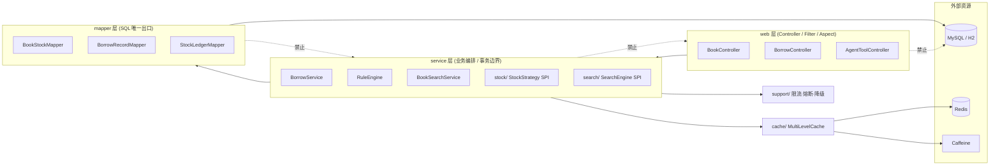
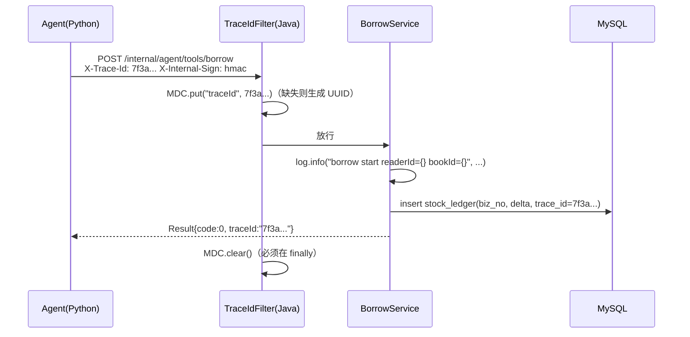
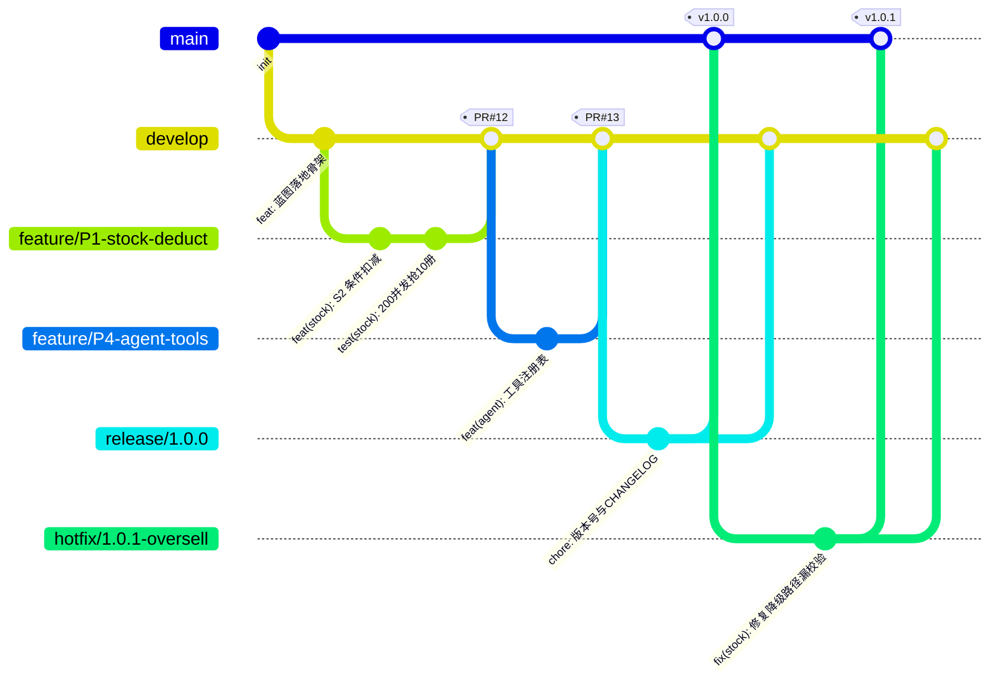
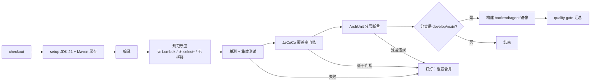

# SmartLib 编码规范与工程实践

> 依据：`docs/00-项目蓝图.md`（唯一技术契约）。本文所有包名、类名、表名、接口路径、版本号均与蓝图一致；
> 与蓝图冲突时以蓝图为准，并提 ADR 变更（见 `docs/11-架构决策记录ADR.md`）。
>
> 适用范围：`backend/`（Java 21 语法基线，本地 JDK 25 运行）、`agent-service/`（Python 3.12）、`scripts/`、`deploy/`。

---

## 1. 编码规范总则

### 1.1 三条最高优先级原则

| 原则 | 含义 | 在本项目中的具体化 |
|---|---|---|
| **可读性优先** | 代码是写给人看的，顺便让机器执行 | 方法不超过 50 行；一个方法只做一件事；嵌套不超过 3 层 |
| **简单优先** | 能用一个 `if` 解决的，不引入设计模式 | 不为了"看起来高级"引入抽象；SPI 只用在真正需要多方案切换的地方（`StockStrategy`/`SearchEngine`） |
| **显式优于隐式** | 依赖、行为、副作用全部写在脸上 | 不用 Lombok 生成代码；不用字段注入；HTTP 调用超时必须显式写出；事务边界显式标注 |

### 1.2 补充约定

1. **一致性 > 个人偏好**：同一件事在本仓库只有一种写法。发现两种写法时，改掉少数派，并把结论写进本文档。
2. **失败要响**：任何被吞掉的异常、任何被忽略的返回值，都是潜在的线上事故（见 §4、§9）。
3. **可测试性是设计目标**：写不出单元测试的类，通常是职责没拆干净。时间、随机数、外部 IO 必须可注入（`Clock`、`IdGenerator`、`JavaClient`）。
4. **性能假设必须可验证**：任何"这样更快"的写法，要么有 `scripts/bench` 数据，要么标记为「待回填」，禁止在文档里写没有出处的数字。
5. **规范可被机器检查**：能落进 Checkstyle / SpotBugs / ruff / ArchUnit 的规则，就不靠 Code Review 人肉记忆（见 §12、§15）。

### 1.3 违反规范的处理

| 情况 | 处理 |
|---|---|
| CI 能拦住的（格式、未使用 import、覆盖率下降） | 直接构建失败，无例外 |
| CI 拦不住的（分层违规、SQL 无索引条件） | Code Review 阻塞项，必须改完再合并 |
| 紧急故障修复（hotfix） | 允许临时豁免，但 PR 描述必须写 `HOTFIX-EXEMPT: <原因>`，并在 48h 内补还技术债 issue |

---

## 2. 命名规范

### 2.1 总表（正反例对照）

| 对象 | 规则 | ✅ 正例 | ❌ 反例 | 说明 |
|---|---|---|---|---|
| 包名 | 全小写，单数，无下划线 | `com.smartlib.service.stock` | `com.smartlib.Services.Stock_Impl` | 与蓝图 §4.2 完全一致 |
| 类名 | 大驼峰，名词 | `BorrowService`、`TokenBucketRateLimiter` | `BorrowManager`、`DoBorrow`、`BorrowUtil` | 避免 `Manager`/`Helper`/`Util` 这类无信息量后缀 |
| 接口名 | 大驼峰，能力名词，**不加 `I` 前缀** | `StockStrategy`、`SearchEngine` | `IStockStrategy`、`StockStrategyInterface` | SPI 接口名即能力名 |
| 接口实现 | 实现语义 + 接口名 | `OptimisticDbStockStrategy`、`RedisLuaStockStrategy` | `StockStrategyImpl1`、`MyStrategy` | 见蓝图 §6.1 六个实现 |
| 抽象基类 | `Abstract` 前缀 | `AbstractCacheGuard` | `BaseCacheGuard`、`CacheGuardBase` | |
| 测试类 | 被测类名 + `Test` | `BorrowConcurrencyTest`、`RuleEngineTest` | `TestBorrow`、`BorrowTests2` | 蓝图 §6.1 指定 `BorrowConcurrencyTest` |
| 方法名 | 小驼峰，动词开头 | `deductStock`、`isRenewable`、`findByCardNo` | `stock()`、`renewFlag()`、`data()` | 布尔方法用 `is/has/can/should` |
| 变量名 | 小驼峰，名词，可搜索 | `availableCopies`、`readerId`、`retryTimes` | `a`、`tmp`、`flag`、`list2`、`dataMap` | 作用域越大名字越长；循环 3 行内可用 `i` |
| 常量 | 全大写下划线，`static final` | `MAX_RENEW_COUNT`、`DEFAULT_TIMEOUT_MILLIS` | `maxRenewCount`、`TIMEOUT` | 魔法数字必须提取（`0.2` 罚金单价、`3` 天保留期） |
| 枚举类型 | 大驼峰单数 | `ReaderType`、`BorrowStatus`、`StockOpType` | `ReaderTypes`、`BorrowStatusEnum` | 与蓝图 §4.2 `domain/enums` 一致 |
| 枚举值 | 全大写下划线 | `UNDERGRAD`、`READY`、`HALF_OPEN` | `undergrad`、`Ready` | 与蓝图 §2.1、§2.3、§6.3 完全一致，**不得改写** |
| DTO（record） | 名词 + 用途后缀 | `BookQuery`、`BorrowCommand`、`BorrowResult` | `BookQueryDTO`、`BorrowReqVO` | 蓝图 §4.2：`dto/` 下全部为 record |
| Entity | 与表名一一对应的单数名词 | `Book`、`BookStock`、`BorrowRecord`、`StockLedger` | `BookStockDO`、`TBook` | 蓝图 §4.2 `domain/entity` |
| VO（对外响应） | 名词 + `VO` | `BorrowResultVO`、`StockViewVO` | `BorrowResultData`、`Resp` | 只在 `web` 层出现 |
| Mapper 接口 | 实体名 + `Mapper` | `BookStockMapper`、`BorrowRecordMapper` | `BookStockDao`、`StockRepository` | 蓝图 §4.2，统一用 MyBatis，不引入 `Dao`/`Repository` |
| Mapper XML | 与接口同名同路径 | `resources/mapper/BookStockMapper.xml` | `mapper/stock.xml` | namespace 必须是接口全限定名 |
| 表名 | 小写下划线，单数 | `reader`、`book_stock`、`borrow_record`、`stock_ledger`、`idempotent_record`、`rule_config` | `readers`、`t_book_stock`、`BookStock` | 蓝图 §5，**不得改名** |
| 字段名 | 小写下划线 | `available_copies`、`due_at`、`credit_score` | `availableCopies`、`dueDate` | 蓝图 §5；Java 侧靠 `map-underscore-to-camel-case: true` 映射 |
| 索引/约束 | `uk_` / `idx_` / `fk_` + 字段 | `uk_card_no`、`idx_due_at_status` | `index1`、`cardIndex` | 蓝图 §5 关键索引 |
| 接口路径 | 小写中划线，资源复数 | `/api/books`、`/internal/agent/tools/search-books` | `/api/getBookList`、`/internal/agent/search_books` | 蓝图 §8，Agent 侧内部路径用中划线 |
| 请求头 | `X-` + 中划线大驼峰 | `Idempotency-Key`、`X-Internal-Sign`、`X-Trace-Id` | `idempotencyKey`、`traceId` | 蓝图 §8.1、§8.2 |
| 配置项 | `smartlib.` 前缀，中划线分词 | `smartlib.stock.strategy`、`server.shutdown=graceful` | `stockStrategy`、`SMARTLIB_STOCK` | 蓝图 §6.1、§6.3 |
| Python 模块/函数 | 模块小写下划线，函数 `snake_case` | `bm25.py`、`get_stock()`、`run_eval.py` | `BM25.py`、`getStock()` | 蓝图 §4.3 |
| Python 类 | 大驼峰 | `MockLLM`、`ToolExecutor` | `mock_llm`、`ToolExecutorImpl` | 蓝图 §3.2、§4.3 |
| 环境变量 | 全大写下划线 | `LLM_PROVIDER`、`JAVA_BASE_URL` | `llmProvider` | 蓝图 §3.2 |

### 2.2 禁止的缩写与命名反模式

| 反模式 | 为什么禁止 | 改成 |
|---|---|---|
| `getBorrowRecordInfoDataList()` | 名词堆叠，信息量为零 | `listByReader(readerId)` |
| `process()`、`handle()`、`doIt()` | 无法表达语义，且大概率是"上帝方法" | 按动作命名，超过 50 行必须拆 |
| `isFlag`、`status2`、`tempValue` | 无法搜索，无法理解 | `isRenewable`、`stockStrategyName`、`retryBackoffMillis` |
| 拼音命名 `jieyue()` | 团队不可读 | `borrow()` |
| 单字母常量 `int N = 10` | 不知道是什么的 10 | `MAX_BORROW_COPIES_UNDERGRAD`（值从 `rule_config` 读，此项仅作兜底默认值） |
| 中英混排类名 `BookServiceManager` | 无信息量的 `Manager` | `BookService`（蓝图已定义，不要新增 Manager 层） |

---

## 3. 分层职责与依赖规则

### 3.1 单向依赖（蓝图 §4.1）



规则：

1.**只允许上行→下行**：`web → service → mapper → DB`。反向调用（`service` 注入 `Controller`、`mapper` 调 `Service`）一律阻塞合并。
2. **禁止跨层**：`Controller` 不得注入 `Mapper`；`Mapper` 不得注入 `Cache`。`AgentToolController` 调 `BorrowService`，不直接碰库存 SQL。
3. **同层可组合，但不得成环**：`BorrowService` 可调 `RuleEngine`；`RuleEngine` 不得回调 `BorrowService`（需要反向通知时用接口 + 事件，禁止构造器循环依赖）。
4. **横切能力放在 `support/` 与 `common/`**：限流、熔断、幂等切面属于横切，不写进 `service` 业务方法体内。
5. **`config/` 只做装配**：`@Configuration` 类里不写业务判断（`StockStrategyConfig` 只负责按 `smartlib.stock.strategy` 选实现，不做库存校验）。

### 3.2 各层职责与禁区

| 层 | 必须做 | 禁止做 | 依赖谁 |
|---|---|---|---|
| `web` | 参数校验（`@Valid`）、DTO↔VO 转换、组装 `Result`、鉴权与内部签名校验 | 写业务规则、开事务、直接调 Mapper、拼 SQL | `service`、`common` |
| `service` | 业务编排、事务边界（`@Transactional`）、调用 RuleEngine 判定、组装领域结果 | 感知 `HttpServletRequest`、返回 `Result`、写 SSE | `mapper`、`cache`、`support`、`common` |
| `mapper` | SQL 执行、`resultMap` 映射、动态 SQL 条件拼接 | 写 if-else 业务规则、调用其他 Mapper 组成业务事务、在 XML 里做金额/册数计算 | DB（仅此） |
| `domain` | 纯数据与领域枚举，可有极薄的自身校验（`BookStock#isAvailable()`） | 注入任何 Spring Bean、访问 DB/Redis | 无 |
| `cache` | L1/L2 读写、布隆过滤、逻辑过期与单飞重建 | 私自变更库存事实值（**库存唯一事实源是 `book_stock` 表**，蓝图 §6.5） | Redis、Caffeine |
| `support` | 限流、熔断三态、降级兜底、优雅停机 | 持有业务状态、依赖具体 Service | `common` |
| `common` | `Result`、`PageResult`、`BizException`、`ErrorCode`、`GlobalExceptionHandler`、`TraceIdFilter`、`IdempotencyAspect` | 依赖任何业务包 | 无 |

### 3.3 DTO / Entity / VO 边界

| 类型 | 出现位置 | 生命周期 | 允许的注解 | 是否可跨层 |
|---|---|---|---|---|
| `Entity`（`domain/entity`） | `mapper` ↔ `service` | 与表结构一致，可携带 `version` 等乐观锁字段 | MyBatis 无、Jackson 无 | 只允许在 `mapper`/`service` 内。**禁止直接作为 HTTP 响应体返回** |
| `DTO`（`domain/dto`，record） | `web` → `service`；`service` → `support` | 入参/内部结果，不可变 | `@Valid` 相关（record 组件上） | 可跨 `web`/`service` |
| `VO`（`web/vo`） | `web` 出口 | 面向前端，字段裁剪，脱敏 | Jackson | 不出 `web` 层 |

三条硬规则：

1. **数据库字段变化不得直接泄漏给前端**：`Reader.credit_score` 要在 VO 里明确成 `creditScore` + `canBorrow` 两个语义化字段。
2. **Entity 不得出现在 Controller 方法签名里**（含 `@RequestBody` 与返回值），由 ArchUnit 规则 `noEntityInWebLayer()` 在 CI 拦截。
3. **禁止用一个"大 DTO"贯穿全链路**（如 `BookAllDTO` 同时当入参、实体、响应），这是分层失效的最常见起点。

### 3.4 依赖违规的识别方法

| 方法 | 工具/命令 | 能发现什么 | 何时跑 |
|---|---|---|---|
| 静态依赖断言 | **ArchUnit** 测试（推荐，见下方代码） | 分层反向依赖、跨层调用、Entity 进 web 层、`service` 依赖 `web` | 每次 `mvn test` |
| 编译期 | 把 `web` 依赖从 `service` 模块可见性上移除（多模块）或 code review | 明显的反向 import | 编译 |
| 依赖可视化 | `mvn dependency:tree`、IDEA Diagrams → Show Dependencies | 循环依赖、意外传递依赖 | 设计变更时 |
| Spring 启动期 | 构造器注入 + 无 `@Lazy`：循环依赖会直接启动失败 | 运行时循环依赖 | 每次启动/集成测试 |
| 代码搜索 | `grep -rn "import com.smartlib.web" backend/src/main/java/com/smartlib/service` | 关键词级别的越界 | Code Review 前 |
| 评审清单 | §11 Code Review 清单第 7~10 条 | 人肉眼能看出的越界 | 每个 PR |

```java
// backend/src/test/java/com/smartlib/arch/LayerDependencyTest.java
package com.smartlib.arch;

import static com.tngtech.archunit.lang.syntax.ArchRuleDefinition.noClasses;

import com.tngtech.archunit.core.domain.JavaClasses;
import com.tngtech.archunit.core.importer.ClassFileImporter;
import com.tngtech.archunit.core.importer.ImportOption;
import org.junit.jupiter.api.BeforeAll;
import org.junit.jupiter.api.Test;

class LayerDependencyTest {

    private static JavaClasses classes;

    @BeforeAll
    static void importClasses() {
        classes = new ClassFileImporter()
                .withImportOption(ImportOption.Predefined.DO_NOT_INCLUDE_TESTS)
                .importPackages("com.smartlib");
    }

    @Test
    void serviceMustNotDependOnWeb() {
        noClasses().that().resideInAPackage("..service..")
                .should().dependOnClassesThat().resideInAPackage("..web..")
                .check(classes);
    }

    @Test
    void mapperMustNotDependOnService() {
        noClasses().that().resideInAPackage("..mapper..")
                .should().dependOnClassesThat().resideInAPackage("..service..")
                .check(classes);
    }

    @Test
    void controllersMustNotTouchMappersDirectly() {
        noClasses().that().resideInAPackage("..web..")
                .should().dependOnClassesThat().resideInAPackage("..mapper..")
                .check(classes);
    }

    @Test
    void entitiesMustNotBeUsedInWebSignatures() {
        noClasses().that().resideInAPackage("..web..")
                .should().dependOnClassesThat().resideInAPackage("..domain.entity..")
                .check(classes);
    }

    @Test
    void domainMustBeFrameworkFree() {
        noClasses().that().resideInAPackage("..domain..")
                .should().dependOnClassesThat().resideInAnyPackage("org.springframework..", "org.apache.ibatis..")
                .check(classes);
    }
}
```

> 例外白名单必须写在测试里并附注释原因（例如 `AgentToolController` 需要读 `ReaderType` 枚举时，把 `domain.enums` 从 `domain.entity` 规则中排除），**不允许用 `@ArchIgnore` 静默跳过**。

---

## 4. 异常与错误处理规范

### 4.1 受检 vs 非受检的取舍

| 场景 | 选择 | 理由 |
|---|---|---|
| 业务规则不满足（库存不足、信用分 < 60、有逾期） | **非受检** `BizException(ErrorCode)` | 是"预期内的业务分支"，不应污染全链路签名 |
| 参数非法（`readerId` 为空、`pageSize > 100`） | 非受检（`@Valid` / `BizException(PARAM_INVALID)`） | 同上，且 `GlobalExceptionHandler` 统一转 400 |
| 外部依赖失败（Redis 超时、Agent 调 Java 超时、DB 连接断） | 非受检，但在**降级边界**必须捕获并转降级路径 | 不能让基础设施抖动直接变成 500；见 §6.3 的 `DegradeFallback` |
| 幂等键重复提交 | **不抛异常**，返回首次结果 | 幂等语义要求"重复请求得到相同结果"（蓝图 §7 安全指标） |
| 编程错误（`null` 传入不可空参数、状态机非法迁移） | 非受检 + 明确错误码，视为 bug 需修 | 用 `Objects.requireNonNull` / 状态校验直接失败，不静默容忍 |

**结论：本项目业务异常一律非受检**（继承 `RuntimeException`），只有极少数底层工具方法（如 `JsonUtils`）允许受检并立即在调用点转换。理由：受检异常在 `service` 与 `web` 之间会污染签名，而事务回滚默认只看 `RuntimeException`（Spring 默认回滚规则），非受检更符合"异常即回滚"的预期。

### 4.2 `BizException` 与错误码

```java
// common/ErrorCode.java —— 错误码集中定义，禁止在业务代码里写裸数字
package com.smartlib.common;

public enum ErrorCode {

    OK(0, "ok"),
    PARAM_INVALID(40001, "参数非法"),
    UNAUTHORIZED(40101, "未认证"),
    FORBIDDEN(40301, "无权限"),
    NOT_FOUND(40401, "资源不存在"),

    STOCK_NOT_ENOUGH(40901, "库存不足"),
    BORROW_LIMIT_EXCEEDED(40902, "已达可借册数上限"),
    CREDIT_TOO_LOW(40903, "信用分不足，暂不可借阅"),
    HAS_OVERDUE(40904, "存在逾期未还记录"),
    DUPLICATE_BORROW(40905, "同一书目已持有 1 册"),
    RENEW_NOT_ALLOWED(40906, "当前状态不可续借"),
    RENEW_LIMIT_EXCEEDED(40907, "续借次数已用尽"),
    RESERVATION_EXISTS(40908, "已在预约队列中"),
    FINE_UNPAID(40909, "罚金未缴清"),

    IDEMPOTENT_CONFLICT(40920, "幂等键冲突：请求内容不一致"),
    RATE_LIMITED(42901, "请求过于频繁，请稍后重试"),
    CIRCUIT_OPEN(50301, "依赖服务熔断中，已降级"),
    INTERNAL_ERROR(50000, "系统繁忙，请稍后重试");

    private final int code;
    private final String msg;
    // 构造器 + getter 手写（见 §7）
}
```

```java
// common/BizException.java
package com.smartlib.common;

public class BizException extends RuntimeException {

    private final ErrorCode errorCode;

    public BizException(ErrorCode errorCode) {
        super(errorCode.getMsg());
        this.errorCode = errorCode;
    }

    /** 仅用于把日志需要的定位信息带上，不允许把用户输入直接拼进 msg 返回前端。 */
    public BizException(ErrorCode errorCode, String internalDetail) {
        super(errorCode.getMsg() + " | " + internalDetail);
        this.errorCode = errorCode;
    }

    public ErrorCode getErrorCode() {
        return errorCode;
    }
}
```

使用规则：

1. **错误码必须来自 `ErrorCode` 枚举**，禁止 `throw new BizException("库存不足")` 这类无码异常。
2. **一个错误码只表示一种语义**：`STOCK_NOT_ENOUGH` 不得复用于"预约队列已满"。
3. **不得用异常做正常流程控制**：查询类方法返回 `Optional`/空集合，不用"抛异常表示没查到"。
4. **`GlobalExceptionHandler` 是唯一出口**（蓝图 §4.2）：

```java
package com.smartlib.common;

import jakarta.servlet.http.HttpServletRequest;
import org.slf4j.Logger;
import org.slf4j.LoggerFactory;
import org.springframework.http.HttpStatus;
import org.springframework.web.bind.MethodArgumentNotValidException;
import org.springframework.web.bind.annotation.ExceptionHandler;
import org.springframework.web.bind.annotation.ResponseStatus;
import org.springframework.web.bind.annotation.RestControllerAdvice;

@RestControllerAdvice
public class GlobalExceptionHandler {

    private static final Logger log = LoggerFactory.getLogger(GlobalExceptionHandler.class);

    /** 业务异常：预期内分支，只记 warn，不打堆栈（避免日志噪音）。 */
    @ExceptionHandler(BizException.class)
    public Result<Void> handleBiz(BizException ex, HttpServletRequest request) {
        log.warn("biz error code={} path={} detail={}",
                ex.getErrorCode().getCode(), request.getRequestURI(), ex.getMessage());
        return Result.fail(ex.getErrorCode());
    }

    /** 参数校验失败：属于调用方错误，不外泄内部字段结构。 */
    @ExceptionHandler(MethodArgumentNotValidException.class)
    @ResponseStatus(HttpStatus.BAD_REQUEST)
    public Result<Void> handleInvalid(MethodArgumentNotValidException ex) {
        String field = ex.getBindingResult().getFieldError() == null
                ? "unknown" : ex.getBindingResult().getFieldError().getField();
        log.warn("param invalid field={}", field);
        return Result.fail(ErrorCode.PARAM_INVALID);
    }

    /** 兜底：非预期异常必须 error 级别 + 完整堆栈，并附 traceId 便于定位。 */
    @ExceptionHandler(Exception.class)
    @ResponseStatus(HttpStatus.INTERNAL_SERVER_ERROR)
    public Result<Void> handleUnknown(Exception ex, HttpServletRequest request) {
        log.error("unhandled exception path={}", request.getRequestURI(), ex);
        return Result.fail(ErrorCode.INTERNAL_ERROR);
    }
}
```

5. **对外消息与内部细节分离**：返回前端的 `msg` 只能是 `ErrorCode.msg`（可读、不泄露实现），内部细节只进日志。

### 4.3 禁止吞异常（硬红线）

| 反模式 | 为什么危险 | 正确写法 |
|---|---|---|
| `catch (Exception e) { }` | 故障静默，排查时没有任何线索 | 至少 `log.warn/error` + 明确恢复动作 |
| `catch (Exception e) { return null; }` | 调用方拿 `null` 继续跑，NPE 出现在更远的地方，根因丢失 | 抛 `BizException` 或返回 `Result.fail` |
| `catch (Exception e) { throw new RuntimeException("error"); }` | 丢失原始堆栈与原因链 | `throw new BizException(code, e)`，保留 cause |
| `catch (Exception e) { log.error(e.getMessage()); }` | 只有一行消息，没有堆栈，等于没记 | `log.error("...", e)`，异常对象作为最后一个参数 |
| 空 `finally` 里 `close()` 异常被忽略 | 资源泄漏不易发现 | try-with-resources，或 `log.warn` 后忽略并注释原因 |
| 用 `e.printStackTrace()` | 输出到 stdout，不进日志采集 | 一律走 SLF4J |

```java
// ❌ 反例：吞掉库存扣减失败
try {
    stockMapper.deduct(bookId, n);
} catch (Exception e) {
    // 什么都不做
}

// ✅ 正例：可恢复的降级 + 不可恢复的上抛
try {
    redisLuaStockStrategy.deduct(bookId, n, traceId);
} catch (RedisConnectionFailureException ex) {
    // 明确降级到 DB 条件更新（蓝图 §6.1 降级要求），并留痕
    log.warn("redis unavailable, degrade to db strategy bookId={} traceId={}", bookId, TraceContext.get(), ex);
    fallback.markDegraded(bookId);
    optimisticDbStockStrategy.deduct(bookId, n, traceId);
}
```

### 4.4 异常与日志的关系

| 异常类型 | 日志级别 | 是否打堆栈 | 原因 |
|---|---|---|---|
| `BizException`（业务规则拒绝） | `WARN` | 否 | 预期内，量大，打堆栈会淹没日志 |
| 参数校验失败 | `WARN` | 否 | 调用方错误，只记字段名 |
| 熔断打开 / 限流触发 | `WARN` | 否 | 有指标埋点，日志只作补充 |
| 幂等命中（重复请求） | `INFO` | 否 | 正常行为，需可观测 |
| 降级触发（Redis 不可用、检索降级 DB 直查） | `WARN` | 是（首次）/ 否（后续） | 首次需堆栈定位，后续只计数避免刷屏 |
| 未预期异常 / 兜底 | `ERROR` | 是 | 必须能定位到行 |
| 事务回滚 | `ERROR` + 业务上下文（`bizNo`、`readerId`、`bookId`） | 是 | |

---

## 5. 日志规范

### 5.1 级别选择标准

| 级别 | 使用标准 | 本项目典型场景 | 生产是否常开 |
|---|---|---|---|
| `ERROR` | 需要人介入 / 影响用户可用性 / 数据可能不一致 | 未捕获异常、`stock_ledger` 与 `available_copies` 对账不平、补偿任务连续失败 | 是 |
| `WARN` | 异常但已自愈或已降级，需要趋势观察 | 熔断打开、限流触发、Redis 降级 S2、缓存穿透空值兜底、`BizException` | 是 |
| `INFO` | 关键业务状态变更与链路里程碑（**低频、可审计**） | 借阅成功/归还成功（含 `bizNo`）、预约状态迁移、Agent 会话结束（含 token 与延迟） | 是 |
| `DEBUG` | 开发排查用的细粒度上下文 | 单飞锁竞争、倒排索引打分明细、SQL 参数（脱敏后） | 仅 dev/临时排障 |
| `TRACE` | 本项目**不使用** | — | 否 |

判断口诀：**没有异常也不影响你睡觉的 = INFO；有异常但系统扛住了 = WARN；有异常且需要你起床的 = ERROR。**

### 5.2 必须记录的内容

1. **链路标识**：`traceId`（Java 侧由 `TraceIdFilter` 从 `X-Trace-Id` 或生成，写入 MDC；Python 侧由 `java_client.py` 透传，蓝图 §6.4）。
2. **业务主键**：`readerId`、`bookId`、`borrowId`、`bizNo`（`stock_ledger.biz_no` 唯一键对应的业务单号）。
3. **结果与耗时**：成功/失败、`costMs`（关键链路必带）。
4. **数量变化**：库存操作必须记 `beforeQty → afterQty`（与 `stock_ledger` 对账口径一致）。
5. **降级与限流事件**：`degraded=true`、限流命中的 `key` 与 `limit`。

### 5.3 禁止记录的内容

| 禁止项 | 原因 | 处理 |
|---|---|---|
| 密码、JWT 全文、`X-Internal-Sign` 签名值 | 凭据泄漏 | 只记前 8 位掩码或长度 |
| 读者姓名 / 学号 / 手机号 / 身份证 | 个人信息保护 | 只记 `readerId` 与 `card_no` 的哈希前缀 |
| 完整请求体 / 响应体（含书单、借阅历史） | 日志体积与隐私 | 只记字段名与条目数 |
| `LLM_API_KEY` / `DEEPSEEK_API_KEY` | 密钥泄漏 | 配置项打印时统一 `mask()` |
| 大对象 `toString()`（集合、`byte[]`） | 日志爆炸 + 阻塞线程 | 只记 `size()` |
| 循环体内的 `INFO` | 刷屏，掩盖真正异常 | 降到 `DEBUG`，或聚合后循环外记一次 |
| 用户输入直接拼进日志（未转义 `\n`） | 日志注入伪造行 | 用参数化占位符 `{}`，不字符串拼接 |

### 5.4 trace_id 透传



### 5.5 示例代码

```java
// common/TraceContext.java —— ThreadLocal 必须在 filter 的 finally 中清理（见 §9.3）
package com.smartlib.common;

import org.slf4j.MDC;

public final class TraceContext {

    public static final String TRACE_ID = "traceId";
    public static final String HEADER = "X-Trace-Id";

    private TraceContext() {
    }

    public static void set(String traceId) {
        MDC.put(TRACE_ID, traceId);
    }

    public static String get() {
        return MDC.get(TRACE_ID);
    }

    public static void clear() {
        MDC.remove(TRACE_ID);
    }
}
```

```java
// common/TraceIdFilter.java
package com.smartlib.common;

import jakarta.servlet.FilterChain;
import jakarta.servlet.ServletException;
import jakarta.servlet.http.HttpServletRequest;
import jakarta.servlet.http.HttpServletResponse;
import java.io.IOException;
import java.util.UUID;
import org.springframework.core.Ordered;
import org.springframework.core.annotation.Order;
import org.springframework.stereotype.Component;
import org.springframework.web.filter.OncePerRequestFilter;

@Component
@Order(Ordered.HIGHEST_PRECEDENCE)
public class TraceIdFilter extends OncePerRequestFilter {

    @Override
    protected void doFilterInternal(HttpServletRequest request, HttpServletResponse response, FilterChain chain)
            throws ServletException, IOException {
        String traceId = request.getHeader(TraceContext.HEADER);
        if (traceId == null || traceId.isBlank() || traceId.length() > 64) {
            traceId = UUID.randomUUID().toString().replace("-", "");
        }
        try {
            TraceContext.set(traceId);
            response.setHeader(TraceContext.HEADER, traceId);
            chain.doFilter(request, response);
        } finally {
            TraceContext.clear();
        }
    }
}
```

```java
// service/stock/OptimisticDbStockStrategy.java —— 关键日志示例（注意：无敏感信息，带数量变化与耗时）
private static final Logger log = LoggerFactory.getLogger(OptimisticDbStockStrategy.class);

@Override
public void deduct(long bookId, int copies, String bizNo) {
    long start = System.nanoTime();
    int affected = stockMapper.deductIfEnough(bookId, copies);
    long costMs = (System.nanoTime() - start) / 1_000_000;

    if (affected == 0) {
        log.warn("stock deduct rejected bookId={} copies={} bizNo={} costMs={}",
                bookId, copies, bizNo, costMs);
        throw new BizException(ErrorCode.STOCK_NOT_ENOUGH);
    }
    log.info("stock deducted bookId={} copies={} bizNo={} costMs={}",
            bookId, copies, bizNo, costMs);
}
```

Python 侧（`agent-service/app/client/java_client.py`）同样必须透传：

```python
async def call_tool(self, path: str, payload: dict, trace_id: str) -> dict:
    headers = {
        "X-Trace-Id": trace_id,                      # 全链路同一个 id
        "X-Internal-Sign": self._sign(payload),      # HMAC，不落日志
        "Content-Type": "application/json",
    }
    started = time.perf_counter()
    resp = await self._client.post(f"{self._base_url}{path}", json=payload, headers=headers)
    cost_ms = (time.perf_counter() - started) * 1000
    logger.info("tool call path=%s status=%s cost_ms=%.1f trace_id=%s",
                path, resp.status_code, cost_ms, trace_id)   # 禁止记录 payload 原文
    resp.raise_for_status()
    return resp.json()
```

---

## 6. 注释与文档规范

### 6.1 类注释模板（强制）

```java
/**
 * 库存扣减策略：数据库条件更新（蓝图 §6.1 S2，默认策略）。
 *
 * <p>正确性依赖 SQL 中的 {@code available_copies >= #{copies}} 条件，
 * 受影响行数为 0 即表示库存不足，绝不允许无约束 update。
 *
 * <p>选型理由：相比 Redis Lua 方案组件更少、无最终一致性问题；
 * 相比悲观锁持锁时间更短。实测对比见 {@code docs/09-多种解决方案对比手册.md}。
 *
 * @author smartlib
 * @since 1.0.0
 */
```

模板要素（缺一不可）：**它是什么 → 为什么这么设计 → 依赖的前置约束 → 相关文档位置**。第 2、3 项是多数人漏掉的，也正是最有价值的部分。

### 6.2 什么必须注释

| 必须注释的场景 | 说明 |
|---|---|
| 任何非直观的算法（BM25 打分、拼音首字母映射、TopK 堆） | 写清楚公式来源与复杂度 |
| 并发与锁的边界（为什么锁这个粒度、为什么锁内不做 IO） | 见 §9 |
| 事务与一致性取舍（延迟双删、为什么先更库后删缓存） | 引用 `docs/09` 对应小节 |
| 降级与兜底分支（什么条件下走兜底、兜底后语义变化） | 必须写"降级后返回什么" |
| 魔法数字的来源（`0.2 元/天/册`、`3 天保留`、`10 元阈值`） | 标注来自蓝图 §2.2 第 8 条 |
| `TODO` / `FIXME` | 格式：`// TODO(owner, JIRA-123, 2025-06-01): 具体事项`，无 owner 与日期的 TODO 不允许合并 |
| 刻意为之的"反常"写法 | 例如"这里不用缓存，因为库存必须读主库" |

### 6.3 注释写"为什么"，不写"是什么"

```java
// ❌ 反例：注释复述代码，等于噪音
// 如果可用库存小于 1 就返回 false
if (availableCopies < 1) {
    return false;
}

// ✅ 正例：解释约束来源与后果
// 蓝图 §2.2 第 1 条：严格不允许负库存。可用库存为 0 时前端仍需展示"可预约"，
// 所以这里不能抛异常，只能返回不可借，由上层决定是否引导预约。
if (availableCopies < 1) {
    return false;
}
```

```java
// ❌ 反例：过期注释（代码已改成 Redis Lua，注释还写着 synchronized）
// 用 synchronized 保证单机并发安全
public void deduct(long bookId, int copies) { ... }

// ✅ 正例：注释与策略实现同步演进，且指向真正的实现在哪
// 实现在 RedisLuaStockStrategy（蓝图 §6.1 S5）：Redis 不可用时由 DegradeFallback 自动切 S2，
// 因此本方法本身不加任何 JVM 锁 —— 多实例部署下 JVM 锁是无效的。
```

**禁止过期注释**的执行手段：注释里出现的类名/方法名/配置项，PR 里若被重命名，Review 必须检查（§11 第 26 条）；CI 上可用 `checkstyle` + 自定义 grep 检查引用不存在类的注释关键词。

### 6.4 文档与注释的分工

- 代码里的注释：回答"**为什么这行是这样**"（局部）。
- `docs/` 里的文档：回答"**为什么这个方案**"（全局）。两者不重复：文档写取舍与数据，代码注释只写约束与指针。

---

## 7. 为什么不用 Lombok

### 7.1 结论

**本项目全仓库禁用 Lombok**，包括 `backend/` 与 `spike/`。`pom.xml` 中不得出现 `org.projectlombok:lombok` 依赖，`mvn dependency:tree` 不得出现 `lombok` 节点（CI 检查，见 §12）。

### 7.2 三条理由

| # | 理由 | 具体风险 | 本项目的证据/应对 |
|---|---|---|---|
| 1 | **Java 25 环境兼容性风险** | 本机验证为 OpenJDK **25**（`java.version=21` 仅决定字节码目标）。Lombok 通过注解处理器直接改写 javac 的 AST，依赖 JDK 内部 API，每个新 JDK 版本都需要 Lombok 跟进适配；JDK 25 下存在注解处理器报错/告警、`--add-opens` 需求、以及"能编译但生成代码异常"的隐性风险。一旦升级失败，全仓库编译阻塞，且**故障点在构建工具链而非业务代码**，排查成本极高 | 蓝图 §3.1 已要求"MyBatis 不用 JPA，避免字节码增强风险"，Lombok 属同类风险，标准保持一致；本机 JDK 25 已验证无 Lombok 的正常编译路径 |
| 2 | **编译期隐式行为** | `@Data` 一次生成 getter/setter/`equals`/`hashCode`/`toString`；`@Builder`/`@AllArgsConstructor` 改变构造契约；`@Slf4j` 注入字段。IDE 索引、静态分析、`grep` 都看不到真实方法，**读代码时必须靠"脑内展开"**；`@Data` 落在实体上还会因可变字段生成 `hashCode`，在 `HashSet` 中放入后修改字段会静默丢元素 | 见 §1.1"显式优于隐式"；本项目的 `BookStock` 有 `version`、`availableCopies` 等可变字段，手写访问器能强制作者思考哪一个是业务字段 |
| 3 | **可读性与调试成本** | 断点只能打在生成方法上（反编译视图）；`toString()` 自动拼接全部字段，容易把敏感字段（`card_no`、`credit_score`）打进日志（违反 §5.3）；新人 review 时无法从源文件判断"这个方法究竟在哪" | 手写 `toString()` 可以只输出 `id` 与关键状态字段，天然满足脱敏要求 |

> 补充说明：以上第 1 条是**风险判断**，依据是 Lombok 依赖 JDK 内部 API 的实现方式与本机 JDK 25 环境，尚未做"装 Lombok 后编译失败"的对照实验。若后续要做 ADR 定论，应在 `spike/` 里加 Lombok 依赖跑一次 `mvn -q compile` 并记录结果，再回填结论。

### 7.3 替代写法一：DTO / VO 用 `record`

蓝图 §4.2 已明确 `domain/dto` 下的 `BookQuery`、`BorrowCommand`、`BorrowResult`、`StockView`、`ReaderProfile` 为 record。

```java
// domain/dto/BorrowCommand.java —— 不可变入参，天然线程安全，无需 Lombok
package com.smartlib.domain.dto;

import jakarta.validation.constraints.NotNull;
import jakarta.validation.constraints.Positive;

public record BorrowCommand(
        @NotNull Long readerId,
        @NotNull Long bookId,
        @Positive Integer copies,
        String idempotencyKey) {

    /** 紧凑构造器用于归一化，而不是用 Lombok 的 @Builder 拼装。 */
    public BorrowCommand {
        if (copies == null) {
            copies = 1;
        }
        if (idempotencyKey == null || idempotencyKey.isBlank()) {
            throw new IllegalArgumentException("idempotencyKey must not be blank");
        }
    }
}
```

```java
// domain/dto/BorrowResult.java
public record BorrowResult(
        boolean ok,
        Long borrowId,
        java.time.LocalDate dueDate,
        String reason) {

    public static BorrowResult success(Long borrowId, java.time.LocalDate dueDate) {
        return new BorrowResult(true, borrowId, dueDate, null);
    }

    public static BorrowResult fail(String reason) {
        return new BorrowResult(false, null, null, reason);
    }
}
```

record 带来的额外好处：编译器生成 `equals`/`hashCode`/`toString`（无需 Lombok）、字段 `final`（不会被误改）、构造即校验（紧凑构造器）。`toString` 会打印全部组件，所以**含敏感字段的 DTO 必须显式覆写 `toString()`**。

### 7.4 替代写法二：Entity 手写 getter/setter

```java
// domain/entity/BookStock.java —— 与 book_stock 表 1:1，MyBatis 需要无参构造 + setter
package com.smartlib.domain.entity;

public class BookStock {

    private Long bookId;
    private Integer totalCopies;
    private Integer availableCopies;
    private Integer lockedCopies;
    private Integer version;
    private java.time.LocalDateTime updatedAt;

    public BookStock() {
        // MyBatis 反射实例化所需
    }

    public Long getBookId() {
        return bookId;
    }

    public void setBookId(Long bookId) {
        this.bookId = bookId;
    }

    public Integer getAvailableCopies() {
        return availableCopies;
    }

    public void setAvailableCopies(Integer availableCopies) {
        this.availableCopies = availableCopies;
    }

    /** 领域行为：可借 == 可用库存 > 0（蓝图 §2.2 第 1 条）。避免各处重复写 availableCopies > 0。 */
    public boolean isAvailable() {
        return availableCopies != null && availableCopies > 0;
    }

    /** 只输出定位字段：禁止把整行实体 dump 进日志（§5.3）。 */
    @Override
    public String toString() {
        return "BookStock{bookId=" + bookId
                + ", availableCopies=" + availableCopies
                + ", version=" + version + '}';
    }
    // 其余字段访问器略（手写，IDE 生成一次即可，6 个字段约 40 行，可接受）
}
```

手写成本控制：

| 手段 | 说明 |
|---|---|
| IDE 一次性生成 | IntelliJ `Alt+Insert → Getter and Setter`，生成后不再改动；不写 `equals`/`hashCode`（实体按主键比较的需求用 `Objects.equals(a.getBookId(), b.getBookId())` 显式表达） |
| 字段收敛 | 实体只放表里真实存在的列，派生值（如 `overdueDays`）放 DTO 计算，字段少 → 手写量少 |
| 模板统一 | `toString()` 只含 `id` + 状态字段；`@Override` 必写 |
| 只读场景用 record | 查询结果若不需要 setter，直接建 record 由 MyBatis 构造器映射（`<constructor>`），彻底免写访问器 |

---

## 8. SQL 与 MyBatis 规范

### 8.1 硬性规则

| # | 规则 | 原因 | 校验方式 |
|---|---|---|---|
| 1 | **禁止 `select *`**，必须显式列名 | 表加字段会静默改变内存与网络开销；覆盖索引失效；H2/MySQL 行为差异 | XML 扫描 + Review |
| 2 | **`available_copies` 的每次扣减必须带 `available_copies >= #{copies}`** | 蓝图 §5"任何方案都不允许无约束 update"，这是零超卖的最后防线 | Review 阻塞项 + 压测 TC 验证 |
| 3 | **查询必须能走索引**：`book_stock` 按 `pk(book_id)`/`idx(available_copies)`；`borrow_record` 按 `idx(reader_id,status)`、`idx(book_id,status)`、`idx(due_at,status)` | 蓝图 §5 | `EXPLAIN` 贴进 PR（涉及新查询时） |
| 4 | 禁止在 `where` 中对索引列做函数/运算（`where date(return_at) = ...`） | 索引失效 | Review + `EXPLAIN` |
| 5 | 禁止 `like '%kw%'` 作为主力检索路径 | 蓝图 §6.2 Q1 已明确这是需要被替换的基线（2.8s） | 只有 `LikeSearchEngine`（对比基线 Q1）允许，且必须标注 |
| 6 | 分页必须有 `order by` 且排序键唯一或包含主键 | 避免翻页重复/漏数据 | Review |
| 7 | 单次 `in (...)` 参数不超过 500 | 避免超长 SQL 与解析开销 | Review |
| 8 | 禁止在 XML 里写业务逻辑（`if` 判断册数上限、金额计算） | SQL 层不可单测、业务规则必须集中在 `RuleEngine` | Review 阻塞项 |
| 9 | 写操作必须显式列名 + 显式 `values`，不用 `insert into t values(...)` | 表结构变更即报错而非静默错位 | Review |
| 10 | 每个 Mapper 方法必须有对应 `resultMap` 或明确 `resultType` + 开启 `map-underscore-to-camel-case` | 蓝图 spike 已验证该配置可用 | 配置 + Review |
| 11 | 批量写用 `foreach` 且控制批大小（默认 500） | 避免超长 SQL 与锁范围过大 | Review |
| 12 | 不允许 `select` 出 `select count(*)` 以外的大结果集再在 Java 里 `filter` | 网络与内存浪费 | Review |

### 8.2 resultMap 约定

```xml
<!-- resources/mapper/BookStockMapper.xml -->
<?xml version="1.0" encoding="UTF-8"?>
<!DOCTYPE mapper PUBLIC "-//mybatis.org//DTD Mapper 3.0//EN"
        "https://mybatis.org/dtd/mybatis-3-mapper.dtd">
<mapper namespace="com.smartlib.mapper.BookStockMapper">

    <!-- 约定：id 固定为 "BaseResultMap"；列名显式写出，不依赖 * -->
    <resultMap id="BaseResultMap" type="com.smartlib.domain.entity.BookStock">
        <id     column="book_id"          property="bookId"/>
        <result column="total_copies"     property="totalCopies"/>
        <result column="available_copies" property="availableCopies"/>
        <result column="locked_copies"    property="lockedCopies"/>
        <result column="version"          property="version"/>
        <result column="updated_at"       property="updatedAt"/>
    </resultMap>

    <!-- 复用列清单，避免每处手写列名导致漏字段 -->
    <sql id="BaseColumns">
        book_id, total_copies, available_copies, locked_copies, version, updated_at
    </sql>

    <!-- 【核心】条件扣减：唯一入口，任何策略最终都必须落到这条语义上（蓝图 §5、§6.1 S2） -->
    <update id="deductIfEnough">
        update book_stock
           set available_copies = available_copies - #{copies},
               version          = version + 1,
               updated_at       = now()
         where book_id = #{bookId}
           and available_copies &gt;= #{copies}
    </update>

    <select id="findByBookId" resultMap="BaseResultMap">
        select <include refid="BaseColumns"/>
          from book_stock
         where book_id = #{bookId}
    </select>
</mapper>
```

约定汇总：

| 项 | 约定 |
|---|---|
| `resultMap` id | 基础映射统一叫 `BaseResultMap`；扩展映射用 `XxxWithBookMap` 这类能表达差异的名字 |
| 主键 | 必须用 `<id>` 而非 `<result>`（MyBatis 需要它做缓存与嵌套映射的标识） |
| 列清单 | 抽 `<sql id="BaseColumns">` 复用；**不允许 `select *`** |
| 表别名 | 多表 join 用表名首字母或短名（`b`、`bs`、`br`），并在 XML 顶部注释说明 |
| `<`、`>` | XML 中必须转义为 `&lt;`、`&gt;`（H2/MySQL 通用，避免 `CDATA` 混用风格） |
| 参数 | 单参数用 `#{bookId}`（`@Param` 显式命名）；**禁止 `${}` 拼接**（SQL 注入），排序字段白名单除外且必须枚举校验 |
| 时间 | 用 `now()` 由 DB 统一时钟，避免应用实例时钟漂移 |

### 8.3 动态 SQL 写法

```xml
<!-- ✅ 正例：可选的查询条件，每个条件都能命中索引；排序字段走白名单 -->
<select id="search" resultMap="BaseResultMap">
    select <include refid="BaseColumns"/>
      from book
     <where>
        <if test="query != null and query != ''">
            and (title like concat(#{queryPrefix}, '%') or author = #{query})
        </if>
        <if test="categoryId != null">
            and category_id = #{categoryId}
        </if>
        <if test="yearFrom != null">
            and publish_year &gt;= #{yearFrom}
        </if>
        <if test="yearTo != null">
            and publish_year &lt;= #{yearTo}
        </if>
        <if test="availableOnly">
            and exists (select 1 from book_stock bs
                         where bs.book_id = book.id and bs.available_copies &gt; 0)
        </if>
     </where>
     order by
     <choose>
        <when test="sortBy == 'publishYear'">publish_year desc, id desc</when>
        <when test="sortBy == 'hot'">borrow_count desc, id desc</when>
        <otherwise>id desc</otherwise>
     </choose>
     limit #{offset}, #{size}
</select>
```

```xml
<!-- ❌ 反例：ORDER BY 用 ${} 直接拼接入参（SQL 注入），且 %kw% 全表扫描 -->
<select id="searchBad" resultType="map">
    select * from book
     where title like '%${query}%'
     order by ${sortBy} ${order}
</select>
```

`sortBy`/`order` 必须在 Java 侧用枚举白名单校验后再传入（若确需动态列名，只允许 `choose/when` 硬编码列名，如上一个正例）。

### 8.4 批量与事务

```java
// service/BorrowService.java —— 事务边界在 service，绝不在 mapper 或 web
@Transactional(rollbackFor = Exception.class)
public BorrowResult borrow(BorrowCommand command, String traceId) {
    // 1) 幂等前置：命中直接返回首次结果（IdempotencyAspect 已在外层兜底，这里做二次确认）
    // 2) 规则校验：RuleEngine.check(reader, book) —— 册数/信用分/逾期/重复借阅
    // 3) 库存扣减：StockStrategy.deduct(...)
    // 4) 写借阅流水 + 库存流水(stock_ledger, biz_no 唯一)
    // 5) 事务提交后再删缓存（延迟双删，蓝图 §6.5）
}
```

| 规则 | 说明 |
|---|---|
| 事务只加在 `service` 公有方法 | 自调用（`this.other()`）不生效，必须拆类或注入自身代理 |
| `rollbackFor = Exception.class` | 显式声明，避免受检异常不回滚的坑 |
| 事务内禁止远程调用 | Agent 服务 HTTP 调用、LLM 调用必须在事务外，否则长事务拖垮连接池 |
| 事务内禁止 `Thread.sleep`/重试自旋 | 持锁时间不可控 |
| 批量插入在事务内但需控制数量 | 每批 ≤ 500 |
| `stock_ledger` 与 `book_stock` 同事务 | 保证"每一次扣减都有据可查"与守恒断言成立（蓝图 §7 正确性指标） |

---

## 9. 并发编程规范

### 9.1 锁粒度

| 规则 | 正确做法 | 反例 |
|---|---|---|
| 锁对象必须是 `private final` 专用对象 | `private final Object lock = new Object();` | `synchronized (this)`（外部可争抢）、`synchronized (BookService.class)`（锁住全类） |
| 锁范围最小化 | 只包住共享状态读写 | 把整个 `borrow()` 方法 `synchronized` |
| 高并发场景不用 JVM 锁 | 多实例部署必须用 DB 条件更新（S2）/Redis Lua（S5）；`LocalLockStockStrategy`（S1）**只用于单机演示与对比** | 用 `synchronized` 当生产方案（蓝图 §6.1 已指出"多实例失效"） |
| 加锁顺序固定 | 需要多把锁时定义全局序（如按 `bookId` 升序） | 先锁 A 再锁 B 与先锁 B 再锁 A 混用 → 死锁 |
| 禁止锁升级/锁内嵌套不同粒度的锁 | 统一粒度 | 单条记录锁嵌套表级锁 |
| Redis 分布式锁必须带过期与唯一值 | `SET key uuid NX PX 3000`，释放用 Lua 校验 uuid | `SETNX` 无过期 → 宕机后永久死锁 |

### 9.2 禁止锁内做 IO

```java
// ❌ 反例：持锁做 HTTP + DB，锁时间不可控
synchronized (lock) {
    Book book = bookMapper.findById(bookId);        // DB IO
    String resp = javaClient.policy(topic);         // 远程 IO（毫秒级不可控）
    Thread.sleep(50);                               // 更糟
}

// ✅ 正例：锁内只做内存计算与状态判定，IO 全部在锁外，且用"先算后写"避免持锁写库
DataSnapshot snapshot = loadSnapshot(bookId);        // 锁外 IO
if (!snapshot.hasChanged()) {
    return snapshot.result();
}
synchronized (lock) {
    if (cache.get(key) == null) {                    // 双检：锁内只读内存
        cache.put(key, snapshot);
    }
}
recordAudit(snapshot);                               // 锁外写库
```

| 场景 | 规定 |
|---|---|
| 锁内允许 | 内存字段读写、`AtomicLong` 更新、`Map` 查找、简单的条件判断 |
| 锁内禁止 | DB/Redis 访问、HTTP/RPC、文件 IO、`Thread.sleep`、`CompletableFuture.join()`、日志中触发同步 appender 的大对象序列化 |
| 例外 | `RedisLuaStockStrategy` 的原子预扣本身是"锁内 IO"（Redis 单线程执行 Lua），但它是**委托给 Redis 的原子操作**，不是 JVM 锁内 IO；调 Redis 的超时必须配置（默认 200ms）并在文档标注 |

### 9.3 ThreadLocal 必须清理

| 规则 | 说明 |
|---|---|
| 所有 `ThreadLocal` 使用点必须在 `finally` 中 `remove()` | Tomcat 线程池复用线程，不清理会导致内存泄漏 + 串号（A 用户的 `traceId` 出现在 B 的日志里） |
| 优先用 `MDC` 而非自定义 `ThreadLocal` | MDC 与日志框架集成，`clear()` 语义明确 |
| 线程池任务开头重新 `set`，结束 `remove` | 不要假设父线程的 ThreadLocal 会传入（`InheritableThreadLocal` 在池化场景不可靠） |
| 异步任务传播上下文必须显式传递 | 用 `CompletableFuture` + 参数显式传 `traceId`，不用 `TransmittableThreadLocal` 这类额外依赖（与 §1.1 简单优先一致） |

```java
// ✅ 正例：过滤器中必然清理（§5.5 TraceIdFilter 已示范）；线程池任务同理
executor.execute(() -> {
    try {
        TraceContext.set(traceId);       // 显式设置，不依赖继承
        doAsyncWork();
    } finally {
        TraceContext.clear();            // 必须
    }
});
```

### 9.4 线程池必须命名与配置拒绝策略

| 要求 | 规定 |
|---|---|
| 必须用 `ThreadFactoryBuilder` 或自定义 `ThreadFactory` 命名 | 线程名格式 `smartlib-<用途>-<序号>`，如 `smartlib-stock-fallback-1`；便于 `jstack` 与监控定位 |
| 必须显式指定拒绝策略 | 默认 `AbortPolicy` 要写出来；对账/通知类可用 `CallerRunsPolicy`（回压），**禁止 `DiscardPolicy`/`DiscardOldestPolicy` 静默丢任务**（库存与流水相关任务丢一个就是数据不一致） |
| 必须显式设置核心/最大线程数与队列容量 | 禁止只用 `Executors.newFixedThreadPool`（无界队列 → OOM 风险） |
| 必须有可观测指标 | 注册 `Micrometer` 的队列深度、活跃线程数、拒绝计数 |
| 必须支持优雅停机 | 与 `server.shutdown=graceful`（蓝图 §6.3 A6）配合，`@PreDestroy` 中 `shutdown()` + `awaitTermination(30s)`，超时再 `shutdownNow()` |

```java
// support/StockFallbackExecutor.java
package com.smartlib.support;

import java.util.concurrent.ArrayBlockingQueue;
import java.util.concurrent.ThreadFactory;
import java.util.concurrent.ThreadPoolExecutor;
import java.util.concurrent.TimeUnit;
import java.util.concurrent.atomic.AtomicInteger;

public final class NamedThreadFactory implements ThreadFactory {

    private final String prefix;
    private final AtomicInteger seq = new AtomicInteger(1);

    public NamedThreadFactory(String prefix) {
        this.prefix = prefix;
    }

    @Override
    public Thread newThread(Runnable r) {
        Thread t = new Thread(r, prefix + "-" + seq.getAndIncrement());
        t.setDaemon(false);
        t.setUncaughtExceptionHandler((thread, ex) ->
                System.err.println("uncaught in " + thread.getName() + ": " + ex));
        return t;
    }
}
```

```java
// 装配：所有参数显式（有界队列 + 明确拒绝策略）
ThreadPoolExecutor executor = new ThreadPoolExecutor(
        4, 8, 60L, TimeUnit.SECONDS,
        new ArrayBlockingQueue<>(1_000),                 // 有界，禁止无界队列
        new NamedThreadFactory("smartlib-stock-fallback"),
        new ThreadPoolExecutor.CallerRunsPolicy());      // 明确策略：回压，不丢任务
executor.allowCoreThreadTimeOut(true);
```

```java
// 优雅停机
@PreDestroy
void shutdown() {
    executor.shutdown();
    try {
        if (!executor.awaitTermination(30, TimeUnit.SECONDS)) {
            log.warn("executor not terminated in 30s, forcing shutdownNow");
            executor.shutdownNow();
        }
    } catch (InterruptedException ex) {
        Thread.currentThread().interrupt();     // 恢复中断标记，禁止吞掉
        executor.shutdownNow();
    }
}
```

### 9.5 并发工具选择

| 场景 | 用法 | 禁止 |
|---|---|---|
| 计数/统计 | `LongAdder` | `AtomicLong` 高频累加（伪共享竞争更差） |
| 单次初始化 | `AtomicReference` CAS 或 `ConcurrentHashMap.computeIfAbsent` | 双重检查锁 + 非 `volatile` 字段 |
| 缓存重建单飞 | `ConcurrentHashMap.computeIfAbsent`（key 级互斥，蓝图 §6.2 单飞） | 全局锁重建所有 key |
| 并发集合 | `ConcurrentHashMap`、`CopyOnWriteArrayList`（读多写极少） | `Collections.synchronizedMap` + 遍历手动同步 |
| 延迟任务（预约过期、逾期扫描） | `ScheduledExecutorService`（命名线程池） | `Timer`（单线程、异常即死） |

### 9.6 CompletableFuture 异常处理

```java
// ❌ 反例：异常被吞，future 永远"成功"
CompletableFuture.runAsync(() -> stockStrategy.deduct(bookId, 1, bizNo));

// ❌ 反例：get() 无超时，异常被包成 ExecutionException 且需手动解包
try {
    future.get();
} catch (Exception ex) {
    log.warn("failed");     // 丢失根因，且可能永久阻塞
}

// ✅ 正例：显式超时 + 显式异常处理 + 降级路径 + 上下文传递
CompletableFuture<Boolean> f = CompletableFuture
        .supplyAsync(() -> {
            try {
                TraceContext.set(traceId);              // §9.3：异步任务显式传递上下文
                stockStrategy.deduct(bookId, copies, bizNo);
                return true;
            } finally {
                TraceContext.clear();
            }
        }, executor)
        .orTimeout(500, TimeUnit.MILLISECONDS)          // 必须有超时，禁止无限等待
        .exceptionally(ex -> {
            log.warn("async deduct failed, degrade to sync path bookId={} bizNo={}", bookId, bizNo, ex);
            return false;                               // 明确降级结果，而不是抛 null
        });

boolean ok = f.join();                                  // join 前已有 orTimeout 兜底
if (!ok) {
    fallbackToDbDeduct(bookId, copies, bizNo);
}
```

| 规则 | 说明 |
|---|---|
| 每个 `CompletableFuture` 链必须有 `orTimeout`/`completeOnTimeout` | 否则慢依赖会耗光线程池 |
| 必须有 `exceptionally`/`handle`/`whenComplete` 之一 | 否则异常静默丢失 |
| 禁止 `future.get()` 不带超时 | 用 `get(500, MILLISECONDS)` 或 `join()`（前提是链上已有超时） |
| `CompletableFuture.allOf` 后必须逐个 `exceptionally` 处理或统一 `handle` | `allOf` 只报第一个异常 |
| 禁止在 `commonPool` 上跑阻塞 IO | 必须传入业务命名线程池 |
| 并发测试中的 `CountDownLatch` 只用于"同时起跑"，不用于替代断言 | 断言仍以 DB 最终状态为准（见 §14.5） |

---

## 10. Git 工作流

### 10.1 简化 Git Flow 分支模型



| 分支 | 来源 | 合并去向 | 用途 | 生命周期 |
|---|---|---|---|---|
| `main` | — | — | 只放可发布版本，每次合并打 tag | 永久 |
| `develop` | `main` | `release/*` | 集成分支，CI 全量跑 | 永久 |
| `feature/<痛点或模块>-<简述>` | `develop` | `develop` | 功能开发 | 合并即删 |
| `release/<version>` | `develop` | `main` + `develop` | 封版、只允许 bugfix 与版本号 | 发布后删 |
| `hotfix/<version>-<简述>` | `main` | `main` + `develop` | 线上故障紧急修复 | 合并后删 |
| `docs/<主题>` | `develop` | `develop` | 纯文档（如本两份文档） | 合并即删 |
| `spike/<主题>` | `develop` | 不合并（结论入 ADR） | 技术验证（如 `spike/` 下的 Boot 4.1.1 验证） | 保留分支备查 |

### 10.2 分支命名规范

```
<type>/<scope>-<short-desc-用中划线>
feature/P1-stock-deduct-strategy
feature/P2-inverted-index-search
feature/P4-agent-tool-registry
feature/P5-cache-penetration
fix/P1-rollback-stock-ledger
hotfix/1.0.1-oversell-degrade
docs/05-coding-standard
spike/spring-boot-4-mybatis-4
```

规则：全小写、中划线分词、不使用中文与下划线、`scope` 尽量对齐蓝图痛点编号（P1~P5）或模块名（`stock`/`search`/`agent`/`cache`）。

### 10.3 提交信息（Conventional Commits）

格式：

```
<type>(<scope>): <subject>

<body：为什么这么改、有什么取舍>

<footer：Closes #12 / BREAKING CHANGE: ...>
```

| type | 用途 |
|---|---|
| `feat` | 新功能 |
| `fix` | 缺陷修复 |
| `refactor` | 重构（不改行为） |
| `perf` | 性能优化 |
| `test` | 测试相关 |
| `docs` | 文档 |
| `build` | 构建/依赖 |
| `ci` | CI 配置 |
| `chore` | 杂项 |
| `revert` | 回滚 |

**中文示例（5 条）**

```
feat(stock): 新增 Redis Lua 原子预扣策略并支持降级到 S2
fix(borrow): 修复并发下 stock_ledger 与 available_copies 不一致
test(stock): 补充 200 并发抢 10 册的超卖与流水守恒断言
docs(05): 补充禁用 Lombok 的理由与 record 替代写法
perf(search): 倒排索引 TopK 改为小顶堆，降低大结果集内存占用
```

**English examples (5)**

```
feat(agent): add rule-first intent router with LLM fallback
fix(search): escape user keyword before passing to ngram tokenizer
test(cache): cover bloom-filter false positive fallback to DB
ci: cache maven repo and run archunit layer checks on every push
refactor(rule): load borrow limits from rule_config instead of constants
```

提交信息红线：

| 反例 | 为什么不行 |
|---|---|
| `update` / `fix bug` / `123` | 无法生成 CHANGELOG，无法追溯 |
| `fix: 修了一堆问题` | 一个提交做多件事，无法回滚 |
| `WIP` 直接推到 `develop` | 破坏集成分支可构建性（应留在 feature 分支） |
| 一次提交 2000 行混合格式化与逻辑改动 | Review 无法分辨真实改动 |

### 10.4 PR 模板（`.github/pull_request_template.md`）

```markdown
## 变更类型
- [ ] feat  - [ ] fix  - [ ] refactor  - [ ] perf  - [ ] docs  - [ ] test  - [ ] ci

## 关联
- 关联需求/用例：`REQ-xxx` / `TC-xxx`（见 docs/01、docs/06）
- 关联蓝图条款：§__（包结构/表名/接口/SLO）

## 改了什么（Why 优先）
<!-- 一句话说清动机；贴关键 diff 说明，不要贴整段代码 -->

## 怎么验证的
- [ ] `./mvnw -q test` 全绿（贴摘要）
- [ ] 新增/修改的测试：`___Test#___`
- [ ] 涉及 SQL：附 `EXPLAIN` 结果（新查询必填）
- [ ] 涉及并发：附并发测试结果（超卖数 / 流水守恒）
- [ ] 涉及性能：附 `scripts/bench` 输出（否则标「待回填」）

## 风险与回滚
- 风险点：
- 回滚方式：（配置开关 / revert commit / 数据修复脚本）

## Checklist
- [ ] 无 `select *`、无 `${}` 拼接
- [ ] 错误码来自 `ErrorCode`，无吞异常
- [ ] 无新增 Lombok 依赖
- [ ] 分层未越界（ArchUnit 通过）
- [ ] 无敏感信息进日志
- [ ] 文档/CHANGELOG 已同步
```

### 10.5 合并策略

| 目标分支 | 策略 | 原因 |
|---|---|---|
| `feature/*` → `develop` | **Squash and merge** | 保持 `develop` 一个功能一个提交，便于 `git bisect` 与回滚 |
| `release/*` → `main` | **Merge commit（--no-ff）** | 保留发布边界，tag 指向明确的合并点 |
| `release/*` → `develop` | Merge commit | 保留同步痕迹 |
| `hotfix/*` → `main` | Merge commit + 立即 tag | 故障时间线可追溯 |
| `docs/*` → `develop` | Squash | 同上 |

附加保护规则（GitHub Branch protection）：

1. `main`、`develop` 禁止直接 push，禁止 force push。
2. 必须至少 **1 名 reviewer** 批准（库存/幂等/支付相关改动要求 **2 名**）。
3. CI 必须全绿（编译 + 单测 + 覆盖率门槛 + ArchUnit + lint）。
4. 分支必须与目标分支同步（`Require branches to be up to date`）。
5. 提交必须签名（`Require signed commits`）或至少校验提交者邮箱。

---

## 11. Code Review 清单

> 使用方式：Reviewer 逐条过；标注 ⛔ 的为**阻塞项**，必须修复才能合并。放在 PR 描述里勾选，或在评审工具里作为 checklist 模板。

| # | 类别 | 检查项 | 为什么 | 如何验证 |
|---|---|---|---|---|
| 1 | 正确性 ⛔ | 业务规则是否与蓝图 §2.2 逐条对齐（册数/信用分/逾期/重复/续借/预约/罚金） | 规则是本项目的核心领域逻辑，错一条就是线上事故 | 对照 §2.2 表格逐条读；确认规则值来自 `rule_config` 而非硬编码 |
| 2 | 正确性 ⛔ | 库存扣减 SQL 是否带 `available_copies >= #{n}` | 无约束 update 必然超卖 | 打开 XML 看 where 条件；压测用例 TC-001~TC-012 |
| 3 | 正确性 ⛔ | 是否存在无约束 `update ... set available_copies = -1` 或先查后减的检查-使用竞态 | 典型超卖来源 | 搜索 `available_copies` 的所有 update 语句 |
| 4 | 正确性 ⛔ | 是否每次都写 `stock_ledger`（含 `biz_no`、`before_qty`、`after_qty`、`trace_id`） | 守恒断言与审计的兜底手段 | 看 service 事务内是否有 ledger 插入；跑守恒断言 |
| 5 | 正确性 | 状态机迁移是否合法（`BORROWED→RETURNED/OVERDUE/LOST`、`WAITING→READY→FULFILLED/EXPIRED/CANCELLED`） | 非法迁移会造成数据不可解释 | 看状态赋值处是否有前置校验 |
| 6 | 正确性 | 金额/罚金计算是否用 `BigDecimal` 且明确舍入模式 | 浮点误差在金额上是 bug | 搜索 `double`/`float` 参与金额计算 |
| 7 | 分层 ⛔ | Controller 是否直接注入 Mapper | 破坏分层，业务散落 | ArchUnit `controllersMustNotTouchMappersDirectly` |
| 8 | 分层 ⛔ | Entity 是否出现在 web 层签名 | 泄露存储结构 + 越权字段暴露 | ArchUnit `entitiesMustNotBeUsedInWebSignatures` |
| 9 | 分层 ⛔ | service 是否依赖 web（反向依赖） | 架构腐化起点 | ArchUnit `serviceMustNotDependOnWeb` |
| 10 | 分层 | 是否新增了 `Manager`/`Util` 万能类 | 无边界类最终变成上帝类 | 看新增类名与职责 |
| 11 | 事务 ⛔ | 事务边界是否在 service，且 `rollbackFor = Exception.class` | 受检异常不回滚 → 数据半提交 | 看注解；集成测试故意抛异常验证回滚 |
| 12 | 事务 ⛔ | 事务内是否有远程调用/LLM 调用/`Thread.sleep` | 长事务拖垮连接池，锁持有时间不可控 | 通读 `@Transactional` 方法体 |
| 13 | 事务 | 事务方法是否被自调用（`this.xxx()`） | 代理失效，事务不生效的经典坑 | 搜索同类内调用带事务注解的方法 |
| 14 | 并发 ⛔ | 锁对象是否 `private final` 且粒度最小 | 锁 `this`/类对象导致无关请求互相阻塞 | 看 `synchronized` 与 `Lock` 的目标对象 |
| 15 | 并发 ⛔ | 锁内是否做 IO（DB/Redis/HTTP/文件） | 锁时间不可控 → 吞吐塌陷 | 通读同步块内容 |
| 16 | 并发 ⛔ | ThreadLocal/MDC 是否在 `finally` 中清理 | 线程池复用导致内存泄漏与日志串号 | 看 `set` 处是否有对应 `clear` |
| 17 | 并发 ⛔ | 线程池是否有名字、有界队列、显式拒绝策略 | 无界队列 OOM；静默丢弃任务导致数据不一致 | 看线程池构造参数 |
| 18 | 并发 | `CompletableFuture` 是否有超时与异常处理 | 慢依赖耗尽线程池，异常静默丢失 | 搜索 `.supplyAsync` 是否链了 `orTimeout` + `exceptionally` |
| 19 | 并发 | 并发集合使用是否正确（避免 `HashMap` 共享写） | 数据损坏甚至死循环（JDK7 场景）/丢更新 | 搜索共享可变集合 |
| 20 | SQL ⛔ | 是否出现 `select *` | 加字段即静默变化，覆盖索引失效 | grep `select *`（大小写不敏感） |
| 21 | SQL ⛔ | 是否出现 `${}` 拼接 | SQL 注入 | grep `\$\{` 于 `resources/mapper/*.xml` |
| 22 | SQL ⛔ | XML 中是否有业务逻辑（if 判断册数/金额计算/循环调服务） | SQL 不可单测、规则分散 | 通读 XML，只允许条件拼接与排序白名单 |
| 23 | SQL | 新查询是否有可用索引，是否附 `EXPLAIN` | 120 万行表上的全扫就是 2.8s 的复现 | 看 PR 是否附 `EXPLAIN`；检查 `type`/`key`/`rows` |
| 24 | SQL | 分页是否有稳定 `order by` | 翻页重复/漏数据 | 看 `limit` 前是否有唯一排序键 |
| 25 | 异常 | 是否有空 `catch` 块或 `catch` 后 `return null` | 故障静默，根因丢失 | grep `catch` 后跟空块/return null |
| 26 | 异常 | 错误码是否来自 `ErrorCode`，是否复用语义不符的码 | 前端无法精确处理，监控无法分类 | 看所有 `BizException` 构造点 |
| 27 | 异常 | 是否有 `e.printStackTrace()` | 日志采集不到 | grep `printStackTrace` |
| 28 | 日志 ⛔ | 是否记录敏感信息（姓名/学号/密钥/签名/完整请求体） | 隐私与凭据泄漏 | 看新增日志的占位符参数 |
| 29 | 日志 | 级别选择是否正确（预期内业务拒绝用 WARN 不打堆栈；未预期用 ERROR 打堆栈） | 日志噪音与漏报 | 看新增日志级别 |
| 30 | 日志 | 关键链路是否带 `traceId`、`bizNo`、`costMs` | 跨 Java/Python 排查依赖 traceId | 看借阅/检索/Agent 调用日志 |
| 31 | 日志 | 循环体内是否打 INFO | 刷屏淹没真实异常 | 看循环内日志级别 |
| 32 | 注释 | 复杂逻辑是否解释"为什么"（算法、并发、降级、魔法数字来源） | 半年后无人能改 | 读新增的算法与降级分支 |
| 33 | 注释 | 是否存在过期注释（提到的类/方法/配置已改名或行为已变） | 误导比没有注释更糟 | 对照注释里的类名/配置项是否仍存在 |
| 34 | 注释 | `TODO` 是否有 owner + issue + 日期 | 无主 TODO 永不清理 | grep `TODO` |
| 35 | 依赖 ⛔ | 是否新增 Lombok 或其他注解处理器 | Java 25 兼容性风险（§7） | 看 `pom.xml` diff；`mvn dependency:tree` 无 `lombok` |
| 36 | 依赖 | 新增三方依赖是否有必要、版本是否显式、是否有 CVE | 供应链风险与版本漂移 | 看 diff + `mvn dependency:tree`；检查是否可用已有能力替代 |
| 37 | 测试 ⛔ | 新增业务逻辑是否有对应测试（正向 + 边界 + 异常） | 没有测试的规则等于没实现 | 看测试文件 diff 与覆盖率报告 |
| 38 | 测试 ⛔ | 并发相关改动是否有并发测试（200 并发抢 10 册 + 守恒断言） | 并发 bug 只能靠并发测试暴露 | 看是否有 `BorrowConcurrencyTest` 的对应用例 |
| 39 | 测试 | 测试是否真的在断言（而非只调用不校验） | 假绿测试制造安全幻觉 | 看是否有 `assertThat`；禁止只 `verify` 无断言 |
| 40 | 测试 | 测试是否独立可重复（无跨用例顺序依赖、无固定端口冲突、无外部 Key 依赖） | 随机失败会让人忽略 CI 红灯 | 单独跑该用例；确认用 MockLLM/H2 |
| 41 | 测试 | 是否使用 `Thread.sleep` 做同步 | 制造不稳定测试 | grep `Thread.sleep`，应改为 `CountDownLatch`/`Awaitility` |
| 42 | 安全 ⛔ | `/internal/agent/**` 是否校验 `X-Internal-Sign`（HMAC）且使用常量时间比较 | 内部接口裸奔可被外部直接借书 | 看 filter/interceptor；确认非 `equals` 比较 |
| 43 | 安全 ⛔ | 是否存在越权（用请求里的 `readerId` 直接操作他人数据而不校验归属） | 水平越权，最严重的安全问题 | 检查每个以 `readerId` 为入参的接口是否有归属校验 |
| 44 | 安全 | 限流 key 是否基于用户/IP + 接口维度 | 限流失效或误伤 | 看 `TokenBucketRateLimiter` 的 key 构造 |
| 45 | 安全 | 幂等键是否服务端唯一约束兜底（`uk(idem_key)`），且内容不一致时明确报错 | 仅靠应用层判重会在并发下失效 | 看 `idempotent_record` 表使用与 `IdempotencyAspect` |
| 46 | 性能 | 是否引入 N+1 查询（循环内查库） | 接口 P99 直接爆掉 | 看循环体内的 mapper 调用 |
| 47 | 性能 | 是否在热路径做无意义的对象拷贝/大集合排序/全量序列化 | 吞吐下降 | 看热路径方法（`deduct`/`search`） |
| 48 | 性能 | 缓存是否只用于查询展示、库存事实源仍在 DB | 违反蓝图 §6.5 一致性设计 | 看缓存读写范围 |
| 49 | 可维护性 | 方法是否 ≤ 50 行、嵌套 ≤ 3 层、圈复杂度 ≤ 15 | 复杂度是 bug 的主要预测因子 | Checkstyle/PMD 报告 + 目测 |
| 50 | 可维护性 | 是否有重复代码（同一规则在两处实现） | 改一处漏一处 | 看是否已有 `RuleEngine` 覆盖，避免重复实现 |
| 51 | 可维护性 | 命名是否符合 §2（动宾方法名、无缩写、无 `Manager`） | 可读性 | 对照 §2.1 表 |
| 52 | 文档 | 是否同步更新了受影响文档（`docs/09` 方案对比、`docs/04` DDL、ADR） | 文档与代码失配后文档即废弃 | 看 PR 是否包含 docs diff |
| 53 | 兼容性 | 接口变更是否向后兼容（新增字段可，改语义/删字段不可） | 前端与 Agent 服务同时在线 | 看 §8 契约 diff；破坏性变更需 ADR + 版本号 |
| 54 | 兼容性 | 配置项是否给了默认值（`application-local` 可零依赖启动） | 破坏 H2/无 Key 的本地零依赖体验 | 看新配置是否有默认值；跑一次本地启动 |
| 55 | 可观测性 | 新增关键路径是否有指标埋点（Micrometer） | 出问题无法定位 | 看是否注册了 counter/timer |
| 56 | 回滚 | 变更是否可回滚（开关/兼容/数据修复脚本） | 上线后故障需要分钟级回滚 | 看 PR"风险与回滚"节 |

---

## 12. 持续集成流水线

### 12.1 完整 GitHub Actions YAML

```yaml
# .github/workflows/ci.yml
name: CI

on:
  push:
    branches: [main, develop, 'feature/**', 'hotfix/**']
  pull_request:
    branches: [main, develop]

# 同一分支的新推送取消旧的运行，节省 CI 额度
concurrency:
  group: ci-${{ github.ref }}
  cancel-in-progress: true

env:
  MAVEN_ARGS: "-B -ntp -Dstyle.color=always"
  # 本地仓库隔离在项目内（与 .tools/settings.xml 约定一致），便于缓存
  MAVEN_OPTS: "-Xmx1g"

jobs:
  # ---------- Java 侧 ----------
  backend:
    name: backend (JDK 21)
    runs-on: ubuntu-latest
    timeout-minutes: 25
    defaults:
      run:
        working-directory: backend
    steps:
      - uses: actions/checkout@v4

      - name: Set up JDK 21
        uses: actions/setup-java@v4
        with:
          distribution: temurin
          java-version: '21'          # 字节码基线：语言级别 21，与 pom 的 java.version 一致
          cache: maven

      - name: Show toolchain
        run: |
          java -version
          ./mvnw -v

      - name: Compile (fail fast)
        run: ./mvnw $MAVEN_ARGS -DskipTests clean compile

      - name: Guard - no Lombok allowed
        run: |
          if ./mvnw $MAVEN_ARGS -q dependency:tree -Dincludes=org.projectlombok:lombok | grep -q lombok; then
            echo "::error::Lombok is banned in this project (see docs/05 §7)"
            exit 1
          fi

      - name: Guard - no select * and no ${} in mappers
        run: |
          if grep -rniE 'select[[:space:]]+\*' src/main/resources/mapper/ ; then
            echo "::error::select * is forbidden (docs/05 §8.1)"
            exit 1
          fi
          if grep -rn '\${' src/main/resources/mapper/ ; then
            echo "::error::String substitution \${} in mapper XML is forbidden (SQL injection)"
            exit 1
          fi

      - name: Unit + integration tests
        run: ./mvnw $MAVEN_ARGS test

      - name: Coverage report + gate
        run: ./mvnw $MAVEN_ARGS -DskipTests verify -Pcoverage
        # jacoco:check 在 pom 中配置，行覆盖 < 70% 时构建失败（见 §15）

      - name: Upload test & coverage reports
        if: always()
        uses: actions/upload-artifact@v4
        with:
          name: backend-reports
          path: |
            backend/target/surefire-reports/**
            backend/target/site/jacoco/**

      - name: Summarize test results
        if: always()
        run: |
          echo "### Backend test summary" >> $GITHUB_STEP_SUMMARY
          grep -hE "Tests run" target/surefire-reports/*.txt 2>/dev/null | tail -20 >> $GITHUB_STEP_SUMMARY || true

  # ---------- 分层依赖静态断言（独立 job，失败信息更清晰） ----------
  architecture:
    name: architecture rules (ArchUnit)
    runs-on: ubuntu-latest
    timeout-minutes: 15
    needs: backend
    defaults:
      run:
        working-directory: backend
    steps:
      - uses: actions/checkout@v4
      - uses: actions/setup-java@v4
        with:
          distribution: temurin
          java-version: '21'
          cache: maven
      - name: Run layer dependency tests only
        run: ./mvnw $MAVEN_ARGS test -Dtest=LayerDependencyTest -DfailIfNoTests=true

  # ---------- Python Agent 侧 ----------
  agent:
    name: agent-service (Python 3.12)
    runs-on: ubuntu-latest
    timeout-minutes: 20
    defaults:
      run:
        working-directory: agent-service
    steps:
      - uses: actions/checkout@v4

      - uses: actions/setup-python@v5
        with:
          python-version: '3.12'
          cache: pip
          cache-dependency-path: agent-service/requirements*.txt

      - name: Install deps
        run: |
          python -m pip install --upgrade pip
          pip install -r requirements.txt -r requirements-dev.txt

      - name: Lint (ruff)
        run: |
          ruff check app tests
          ruff format --check app tests

      - name: Type check (mypy, optional but recommended)
        run: mypy app --ignore-missing-imports
        continue-on-error: true

      - name: Unit tests (pytest, MockLLM - no API key required)
        env:
          LLM_PROVIDER: mock            # 零 Key 运行，见蓝图 §3.2
        run: pytest -q --junitxml=reports/junit.xml --cov=app --cov-report=term-missing --cov-report=xml

      - name: Coverage gate
        run: coverage report --fail-under=70 || true   # 未达门槛记录但不阻塞首版，M3 后转为阻塞

      - name: Upload agent reports
        if: always()
        uses: actions/upload-artifact@v4
        with:
          name: agent-reports
          path: |
            agent-service/reports/**
            agent-service/coverage.xml

  # ---------- 镜像构建（仅 develop/main 且测试全绿） ----------
  image:
    name: build docker images
    runs-on: ubuntu-latest
    timeout-minutes: 30
    needs: [backend, architecture, agent]
    if: github.event_name == 'push' && (github.ref == 'refs/heads/develop' || github.ref == 'refs/heads/main')
    steps:
      - uses: actions/checkout@v4

      - uses: docker/setup-buildx-action@v3

      - name: Build backend image (no push)
        uses: docker/build-push-action@v6
        with:
          context: ./backend
          file: ./deploy/docker/Dockerfile.backend
          push: false
          tags: smartlib-backend:${{ github.sha }}
          cache-from: type=gha
          cache-to: type=gha,mode=max

      - name: Build agent image (no push)
        uses: docker/build-push-action@v6
        with:
          context: ./agent-service
          file: ./deploy/docker/Dockerfile.agent
          push: false
          tags: smartlib-agent:${{ github.sha }}
          cache-from: type=gha
          cache-to: type=gha,mode=max

  # ---------- 准出汇总 ----------
  gate:
    name: quality gate
    runs-on: ubuntu-latest
    needs: [backend, architecture, agent]
    steps:
      - name: All required checks passed
        run: echo "backend + ArchUnit + agent + coverage gates passed"
```

### 12.2 流水线阶段与失败条件



| 阶段 | 失败条件 | 是否阻塞合并 |
|---|---|---|
| 编译 | 任何编译错误/警告升级为错误（`-Werror` 可选） | 是 |
| 规范守卫 | 出现 Lombok 依赖、`select *`、`${}` 拼接 | 是 |
| 单测/集成测试 | 任一用例失败（含 flaky 重跑仍失败） | 是 |
| 覆盖率 | `backend` 行覆盖 < 70% 或新增代码行覆盖 < 80% | 是（M3 后） |
| ArchUnit | 分层/Entity/web 越界 | 是 |
| ruff | 任何 lint 错误 | 是 |
| pytest | 任一用例失败 | 是 |
| 覆盖率（Python） | < 70% | 首版仅告警，M3 后阻塞 |
| 镜像构建 | 构建失败 | 仅 develop/main 阻塞发布 |

---

## 13. 本地开发环境搭建

### 13.1 前置工具（本机已验证）

| 工具 | 版本 | 位置/说明 |
|---|---|---|
| JDK | **25**（运行）；字节码目标 **21** | `java -version` → `25+37-LTS` |
| Maven | **3.9.9** | `.tools/apache-maven-3.9.9`，本地仓库隔离在 `.tools/m2repo`（`.tools/settings.xml`） |
| Node（可选，文档站点） | 见 `docs/` 需要时 | 非必需 |
| Python | **3.12** | Agent 服务 |
| Docker | 可选 | 只有跑 Compose 全栈时才需要 |

### 13.2 后端：H2 零依赖启动（不需要 MySQL/Redis）

```yaml
# backend/src/main/resources/application-local.yml
spring:
  application:
    name: smartlib-backend
  datasource:
    url: jdbc:h2:mem:smartlib;DB_CLOSE_DELAY=-1;MODE=MySQL   # MODE=MySQL 保证与 prod SQL 兼容
    driver-class-name: org.h2.Driver
    username: sa
    password: ""
  sql:
    init:
      mode: always
      schema-locations: classpath:db/schema-h2.sql
      data-locations: classpath:db/data-demo.sql
  cache:
    type: caffeine

mybatis:
  configuration:
    map-underscore-to-camel-case: true
  mapper-locations: classpath:mapper/*.xml

smartlib:
  stock:
    strategy: optimistic-db        # S2 默认（蓝图 §6.1）
  search:
    engine: inverted-index         # Q3 默认（蓝图 §6.2）
  cache:
    redis:
      enabled: false               # 本地零依赖：不开 Redis，L2 自动跳过
  resilience:
    rate-limit:
      enabled: true
      qps: 5000
    circuit-breaker:
      enabled: true

management:
  endpoints:
    web:
      exposure:
        include: health,info,prometheus,metrics
```

```powershell
# 零依赖启动（无需 MySQL / Redis / API Key）
cd backend
..\.tools\apache-maven-3.9.9\bin\mvn.cmd -s ..\.tools\settings.xml spring-boot:run "-Dspring-boot.run.profiles=local"
# 或先打包再跑（更接近生产）
..\.tools\apache-maven-3.9.9\bin\mvn.cmd -s ..\.tools\settings.xml -DskipTests package
java -jar target\smartlib-backend-1.0.0.jar --spring.profiles.active=local
```

启动后自检：

| 检查项 | 地址 | 期望 |
|---|---|---|
| 健康检查 | `http://localhost:8080/actuator/health` | `{"status":"UP"}` |
| 指标 | `http://localhost:8080/actuator/prometheus` | 出现 `http_server_requests_seconds` 等 |
| 接口文档 | `http://localhost:8080/swagger-ui.html` | 蓝图 §8 的接口全部可见 |
| 书目检索 | `GET /api/books?query=计算机网络` | `code=0`，返回 demo 数据 |
| 借书（幂等） | `POST /api/borrows` + `Idempotency-Key` | 首次 `code=0`；同 key 重放返回同一 `borrowId` |

### 13.3 Agent 服务：MockLLM 零 Key 启动

```env
# agent-service/.env.example（提交进仓库，真实 .env 不提交）
LLM_PROVIDER=mock                 # mock | openai_compat ；mock 为确定性规则模拟，无需任何 Key
LLM_MODEL=mock-deterministic
LLM_BASE_URL=                     # openai_compat 时才需要
LLM_API_KEY=                      # 绝不提交真实 Key
JAVA_BASE_URL=http://localhost:8080
INTERNAL_SIGN_SECRET=dev-only-secret-change-me
REQUEST_TIMEOUT_MS=3000
RAG_ENABLED=true
```

```powershell
cd agent-service
python -m venv .venv
.\.venv\Scripts\Activate.ps1
pip install -r requirements.txt -r requirements-dev.txt
# 1) 先确认 MockLLM 路径可用（离线、确定性、可评测）
$env:LLM_PROVIDER = "mock"
uvicorn app.main:app --reload --port 8000
# 2) 验证
#    GET  http://localhost:8000/docs                  → OpenAPI
#    POST http://localhost:8000/api/agent/chat        → SSE 流式回答
# 3) 跑评测（产出指标用于 docs/06 §7，数值必须来自真实运行）
python -m app.eval.run_eval --dataset app/eval/dataset.jsonl --provider mock --out reports/eval-mock.json
```

| 场景 | 配置 | 说明 |
|---|---|---|
| 零依赖演示 | `LLM_PROVIDER=mock` | 意图/工具/参数全部走确定性规则，可离线跑全部测试与评测 |
| 真实 LLM 对比 | `LLM_PROVIDER=openai_compat` + Key | 用于 MockLLM 与真实 LLM 一致性对比（见 `docs/06` Agent 用例 TC-5xx） |
| 无 Redis | `smartlib.cache.redis.enabled=false` | 触发降级路径，正好用于验证 `DegradeFallback` |

### 13.4 常用命令表

| 目的 | 命令 |
|---|---|
| 编译（跳过测试） | `.tools\apache-maven-3.9.9\bin\mvn.cmd -s .tools\settings.xml -DskipTests clean compile` |
| 全量测试 | `.tools\apache-maven-3.9.9\bin\mvn.cmd -s .tools\settings.xml test` |
| 只跑并发测试 | `mvn test -Dtest=BorrowConcurrencyTest` |
| 只跑分层断言 | `mvn test -Dtest=LayerDependencyTest` |
| 覆盖率报告 | `mvn verify -Pcoverage` → `backend/target/site/jacoco/index.html` |
| 本地启动（H2） | `mvn spring-boot:run "-Dspring-boot.run.profiles=local"` |
| 打包 | `mvn -DskipTests package` |
| Agent 测试 | `pytest -q` |
| Agent lint | `ruff check app tests && ruff format --check app tests` |
| Agent 评测 | `python -m app.eval.run_eval --dataset app/eval/dataset.jsonl --provider mock` |
| 压测（Python） | `python scripts/bench/run_bench.py --scenario stock --concurrency 200` |
| 全栈本地起 | `docker compose -f deploy/docker-compose.yml up -d` |
| 查看容器日志 | `docker compose -f deploy/docker-compose.yml logs -f backend1` |
| 库表重建（本地） | 删除 `target/`，H2 内存库随启动重建；或跑 `deploy/sql/01-schema.sql` |

---

## 14. 测试编写规范

### 14.1 命名

| 对象 | 规范 | 示例 |
|---|---|---|
| 测试类 | `<被测类>Test`；场景化测试用 `<场景>Test` | `RuleEngineTest`、`BorrowConcurrencyTest`、`MultiLevelCacheTest` |
| 测试方法 | `should_<预期行为>_when_<条件>` 或 `<动作>_<条件>_<预期>` | `should_reject_when_credit_below_60`、`deduct_200threads_10copies_neverOversell` |
| 测试类包路径 | 与生产代码同包 | `src/test/java/com/smartlib/service/RuleEngineTest.java` |
| 参数化用例名 | `@ParameterizedTest(name = "...")` 显式命名 | `name = "readerType={0} maxCopies={1}"` |

### 14.2 Given-When-Then 结构

```java
@Test
void should_rejectBorrow_when_creditScoreBelow60() {
    // given —— 读者信用分 55，库存充足（蓝图 §2.2 第 3 条）
    Reader reader = readerFixture.withCreditScore(55);
    readerMapper.insert(reader);
    BookStock stock = stockFixture.withAvailable(3);
    stockMapper.insert(stock);

    // when
    Executable act = () -> borrowService.borrow(
            new BorrowCommand(reader.getId(), stock.getBookId(), 1, "idem-1"), TRACE);

    // then
    assertThatThrownBy(act)
            .isInstanceOf(BizException.class)
            .extracting(e -> ((BizException) e).getErrorCode())
            .isEqualTo(ErrorCode.CREDIT_TOO_LOW);
    assertThat(stockMapper.findByBookId(stock.getBookId()).getAvailableCopies()).isEqualTo(3); // 库存未动
}
```

要求：

1. 三段用注释显式分隔（`// given` / `// when` / `// then`），便于 review 判断是否遗漏边界。
2. 一个测试方法只验证一个行为（可以有多个断言，但必须都属于同一行为）。
3. 失败时断言消息要能自解释：`assertThat(available).as("库存应被扣减为 0").isZero();`
4. 禁止在测试里 `try/catch` 断言异常 —— 用 AssertJ 的 `assertThatThrownBy`（否则异常发生位置丢失）。

### 14.3 断言库

| 库 | 用途 | 约定 |
|---|---|---|
| **AssertJ**（首选） | 所有断言 | `assertThat(...)` 链式；集合用 `containsExactlyInAnyOrder` 等语义化方法 |
| JUnit 5 `Assertions` | 仅在断言简单到 AssertJ 无增益时（如 `assertDoesNotThrow`） | 不要混用两种风格的等价断言 |
| Awaitility | 异步/最终一致场景等待 | 替代 `Thread.sleep`：`await().atMost(3, SECONDS).until(...)` |
| TestRestTemplate / MockMvc | HTTP 层断言 | 集成测试用 `@SpringBootTest(webEnvironment = RANDOM_PORT)`（与 spike 一致） |
| pytest + httpx.AsyncClient | Agent 侧 | `@pytest.mark.asyncio`；用 `respx` mock 后端 HTTP |
| 数据库断言 | 直连 mapper 查询 | 禁止用"接口返回值"代替"库内最终状态"断言（尤其并发场景） |

### 14.4 测试数据隔离

| 手段 | 用法 | 说明 |
|---|---|---|
| H2 内存库 + `MODE=MySQL` | `jdbc:h2:mem:test-<随机>;DB_CLOSE_DELAY=-1;MODE=MySQL` | 每个测试类独立库名，避免相互污染 |
| `@Sql` 初始化 | 类级 `@Sql("/db/schema-h2.sql")`，方法级 `@Sql(scripts=..., executionPhase=BEFORE_TEST_METHOD)` | 结构一次性，数据每例重置 |
| `@Transactional` 回滚 | 仅用于**非并发**、非多线程的测试 | ⚠️ 并发测试禁用：事务在测试线程上，工作线程看不到未提交数据，且回滚不生效 |
| Fixture Builder | `BookFixture`、`ReaderFixture`、`StockFixture` | 显式构造测试数据，禁止依赖 `data-demo.sql` 的具体内容做断言 |
| 唯一键随机化 | `isbn = "978-7-" + UUID.randomUUID()` | 避免唯一约束冲突导致 flaky |
| 端口随机 | `webEnvironment = RANDOM_PORT` | 禁止硬编码 8080 |
| 外部依赖替身 | H2 代替 MySQL，`mock` LLM 代替真实 LLM，内嵌 Redis 或禁用 | 保证 CI 与本地一致、无 Key |

### 14.5 并发测试写法示例（本项目核心）

```java
// src/test/java/com/smartlib/service/stock/BorrowConcurrencyTest.java
package com.smartlib.service.stock;

import static org.assertj.core.api.Assertions.assertThat;

import com.smartlib.domain.dto.BorrowCommand;
import com.smartlib.service.BorrowService;
import java.util.ArrayList;
import java.util.List;
import java.util.concurrent.Callable;
import java.util.concurrent.CountDownLatch;
import java.util.concurrent.ExecutorService;
import java.util.concurrent.Executors;
import java.util.concurrent.Future;
import java.util.concurrent.TimeUnit;
import java.util.concurrent.atomic.AtomicInteger;
import org.junit.jupiter.api.DisplayName;
import org.junit.jupiter.api.Test;
import org.springframework.beans.factory.annotation.Autowired;
import org.springframework.boot.test.context.SpringBootTest;

/**
 * 蓝图 §6.1 验收用例：200 线程抢 10 册。
 * 断言三件事：可用库存归零、成功借出数 == 10、stock_ledger 流水守恒。
 * 注意：本测试 **不加 @Transactional** —— 事务在测试线程，工作线程读不到数据（§14.4）。
 */
@SpringBootTest(webEnvironment = SpringBootTest.WebEnvironment.NONE)
class BorrowConcurrencyTest {

    private static final int THREADS = 200;
    private static final int COPIES = 10;

    @Autowired
    private BorrowService borrowService;

    @Autowired
    private BookStockMapper stockMapper;

    @Autowired
    private StockLedgerMapper ledgerMapper;

    @Test
    @DisplayName("200 并发抢 10 册：零超卖 + 成功数==10 + 流水守恒")
    void deduct_200threads_10copies_neverOversell() throws Exception {
        // given
        long bookId = seedBookWithStock(COPIES);
        List<Long> readerIds = seedReaders(THREADS);        // 每个线程一个读者，避免册数上限干扰
        CountDownLatch startGate = new CountDownLatch(1);
        CountDownLatch doneGate = new CountDownLatch(THREADS);
        AtomicInteger success = new AtomicInteger();
        AtomicInteger stockNotEnough = new AtomicInteger();
        List<String> unexpected = new ArrayList<>();

        ExecutorService pool = Executors.newFixedThreadPool(
                THREADS, new NamedThreadFactory("concurrency-test"));

        try {
            // when
            List<Future<?>> futures = new ArrayList<>(THREADS);
            for (int i = 0; i < THREADS; i++) {
                long readerId = readerIds.get(i);
                int idx = i;
                futures.add(pool.submit((Callable<Void>) () -> {
                    startGate.await();                       // 所有线程同时起跑，最大化竞争
                    try {
                        borrowService.borrow(
                                new BorrowCommand(readerId, bookId, 1, "idem-" + idx), "trace-" + idx);
                        success.incrementAndGet();
                    } catch (BizException ex) {
                        if (ex.getErrorCode() == ErrorCode.STOCK_NOT_ENOUGH) {
                            stockNotEnough.incrementAndGet();
                        } else {
                            synchronized (unexpected) {
                                unexpected.add(ex.getErrorCode() + ":" + ex.getMessage());
                            }
                        }
                    } finally {
                        doneGate.countDown();
                    }
                    return null;
                }));
            }
            startGate.countDown();
            assertThat(doneGate.await(60, TimeUnit.SECONDS)).as("所有线程应在 60s 内结束").isTrue();
            for (Future<?> f : futures) {
                f.get(10, TimeUnit.SECONDS);                 // 传播线程内未捕获异常
            }

            // then 1：零超卖 —— 可用库存必须正好为 0，绝不为负
            int available = stockMapper.findByBookId(bookId).getAvailableCopies();
            assertThat(available).as("可用库存应归零且不为负").isZero();

            // then 2：成功借出数恰好等于复本数
            assertThat(success.get()).as("成功借出数应等于复本数").isEqualTo(COPIES);

            // then 3：失败原因必须全部是库存不足（不允许出现其他异常）
            assertThat(unexpected).as("不应出现预期外的错误码").isEmpty();
            assertThat(stockNotEnough.get()).isEqualTo(THREADS - COPIES);

            // then 4：流水守恒 sum(stock_ledger.delta) == available_copies 的变化量（蓝图 §7）
            int ledgerSum = ledgerMapper.sumDeltaByBookId(bookId);
            assertThat(ledgerSum)
                    .as("库存流水守恒：sum(delta) 必须等于初始库存 - 当前可用库存")
                    .isEqualTo(-COPIES);

            // then 5：借阅流水条数与成功数一致
            assertThat(borrowRecordMapper.countByBookIdAndStatus(bookId, BorrowStatus.BORROWED))
                    .isEqualTo(COPIES);
        } finally {
            pool.shutdownNow();
        }
    }
}
```

并发测试的通用约定：

| 约定 | 说明 |
|---|---|
| 用 `CountDownLatch` 做"同时起跑"，不用 `Thread.sleep` 碰运气 | 保证真实竞争窗口 |
| 断言 **数据库最终状态**，不断言线程内局部变量 | 并发 bug 的判据是数据，不是日志 |
| 必须断言"失败原因全部合理" | 只断言成功数会漏掉"因别的原因失败"的假绿 |
| 必须断言守恒等式 | 这是能发现"丢流水"的唯一手段（蓝图 §7） |
| 超时保护（`await(60s)`、`future.get(10s)`） | 防止 CI 卡死 |
| 每种策略（S1~S6）都跑同一套断言，只换 Spring profile/配置 | 保证方案对比的判据一致 |
| 禁止在并发测试上用 `@Transactional`、`@DirtiesContext` 滥用 | 前者无效，后者拖慢 CI 且掩盖隔离问题 |

```python
# agent-service/tests/test_agent_e2e.py —— Agent 侧并发与超时降级
import asyncio
import httpx
import pytest
from app.agent.runtime import AgentRuntime
from app.llm.mock import MockLLM

@pytest.mark.asyncio
async def test_concurrent_chat_isolated_by_session():
    """并发会话不得互相污染（memory/session_store 隔离），且 trace_id 各自独立。"""
    runtime = AgentRuntime(llm=MockLLM(), java_client=FakeJavaClient())

    async def one(i: int):
        return await runtime.chat(session_id=f"s-{i}", message="《算法导论》能借吗")

    results = await asyncio.gather(*(one(i) for i in range(50)), return_exceptions=True)
    assert all(not isinstance(r, Exception) for r in results), results
    assert len({r.trace_id for r in results}) == 50      # 无串号
```

---

## 15. 代码质量度量与红线

### 15.1 度量目标

| 类别 | 指标 | 目标 | 工具 | 阶段 |
|---|---|---|---|---|
| 覆盖率 | 整体行覆盖 | ≥ 70% | JaCoCo | M3 起阻塞 |
| 覆盖率 | 新增代码行覆盖（增量） | ≥ 80% | JaCoCo + diff 比对 | M4 起阻塞 |
| 覆盖率 | 核心模块（`service.stock`、`service.RuleEngine`、`support`） | ≥ 85% | JaCoCo（包级门槛） | M4 起阻塞 |
| 覆盖率 | 分支覆盖（核心模块） | ≥ 75% | JaCoCo | M4 起阻塞 |
| 复杂度 | 单方法圈复杂度 | ≤ 15（超过必须拆） | PMD `CyclomaticComplexity` | 阻塞 |
| 复杂度 | 单类复杂度（WMC） | ≤ 200 | PMD `CyclomaticComplexity` | 告警 |
| 规模 | 单方法行数 | ≤ 50 | Checkstyle | 告警 |
| 规模 | 单文件行数 | ≤ 800 | Checkstyle | 告警 |
| 嵌套 | 方法嵌套深度 | ≤ 3 层 | PMD | 阻塞 |
| 重复率 | 重复代码块占比 | ≤ 3% | PMD CPD（`minimumTokens=100`） | 告警 |
| 静态缺陷 | SpotBugs 高危（`High`） | 0 | SpotBugs | 阻塞 |
| 静态缺陷 | SpotBugs 中危（`Medium`） | 逐条评审并记录豁免原因 | SpotBugs | 告警 |
| 架构 | ArchUnit 分层断言 | 全部通过 | ArchUnit | 阻塞 |
| 规范 | Checkstyle 错误数 | 0 | Checkstyle | 阻塞 |
| Python | ruff 错误数 | 0 | ruff | 阻塞 |
| Python | mypy 错误数 | 逐步收敛（当前告警） | mypy | 告警 |

> 说明：上表是**质量目标值（Gate）**，不是实测结果。实测覆盖率与复杂度数据必须在 `docs/06-测试计划与报告.md` 中回填。

### 15.2 构建失败（红线）条件

以下任意一条命中，CI 直接失败，禁止合并 / 禁止发布：

1. 编译失败，或存在任何 `ERROR` 级 Checkstyle/PMD/SpotBugs 问题。
2. 任一单元测试或集成测试失败（含 `LayerDependencyTest`）。
3. 整体行覆盖 < 70%，或核心模块行覆盖 < 85%。
4. 架构断言失败：`service→web`、`mapper→service`、`web→mapper`、`web→entity`、`domain→Spring/MyBatis`。
5. 依赖中出现 `org.projectlombok:lombok`，或 `pom.xml` 新增未评审的第 3 方依赖。
6. Mapper XML 中出现 `select *` 或 `${}` 字符串拼接。
7. 发现未加 `available_copies >= #{n}` 条件的库存扣减 update。
8. 存在空 `catch` 块、`printStackTrace()`、或 `@SuppressWarnings` 无理由豁免。
9. 单方法圈复杂度 > 15 或嵌套深度 > 3。
10. Agent 侧 pytest 失败、ruff 报错，或存在未 mock 的真实 LLM 调用（CI 中 `LLM_PROVIDER` 必须为 `mock`）。
11. 并发测试出现超卖（`available_copies < 0`）或流水不守恒。
12. 提交信息不符合 Conventional Commits（由 commitlint 校验，见下）。

```javascript
// commitlint.config.js —— 提交信息规范由机器强制
export default {
  rules: {
    'type-enum': [2, 'always',
      ['feat', 'fix', 'refactor', 'perf', 'test', 'docs', 'build', 'ci', 'chore', 'revert']],
    'scope-empty': [2, 'never'],
    'subject-empty': [2, 'never'],
    'subject-max-length': [2, 'always', 72],
    'header-max-length': [2, 'always', 100],
  },
};
```

### 15.3 质量趋势记录

| 期次 | 整体行覆盖 | 核心模块覆盖 | 重复率 | 高危静态缺陷 | 记录位置 |
|---|---|---|---|---|---|
| M3 编码完成 | 待回填 | 待回填 | 待回填 | 待回填 | `docs/06-测试计划与报告.md` §10 |
| M4 测试完成 | 待回填 | 待回填 | 待回填 | 待回填 | 同上 |
| M5 上线前 | 待回填 | 待回填 | 待回填 | 待回填 | 同上 |

---

## 16. 文档与知识沉淀规范

### 16.1 文档矩阵与责任人

| 文档 | 内容 | 何时必须更新 |
|---|---|---|
| `docs/00-项目蓝图.md` | 唯一技术契约 | 契约变更（需 ADR） |
| `docs/01-需求分析.md` | 需求与用户故事 | 需求新增/变更 |
| `docs/02-概要设计.md` | 架构与接口契约 | 架构/接口变更 |
| `docs/03-详细设计.md` | 时序/类图/算法/并发 | 核心流程变更 |
| `docs/04-数据库设计.md` | DDL/索引/数据字典 | **任何表结构变更（同一 PR 内必须同步）** |
| `docs/05`（本文） | 编码规范与工程实践 | 规范新增/修订 |
| `docs/06-测试计划与报告.md` | 测试计划与实测数据 | 每次测试执行后回填 |
| `docs/07-部署上线手册.md` | 环境/配置/发布/回滚 | 新增配置项或部署变更 |
| `docs/08-运维监控与迭代规划.md` | 监控/告警/SLO | 新增指标或告警 |
| `docs/09-多种解决方案对比手册.md` | 方案对比与**实测数据** | 任何 bench 运行后 |
| `docs/11-架构决策记录ADR.md` | ADR-001~010 | 任何"选 A 不选 B"的决定 |
| `docs/12-项目复盘与维护手册.md` | 复盘/FAQ | 里程碑结束 |
| `docs/reviews/*` | 各类评审纪要 | 阶段门评审后 |
| `README.md` | 5 分钟跑起来 | 启动方式变更 |

### 16.2 什么时候必须写 ADR

| 触发条件 | 例子 |
|---|---|
| 选型二选一且不可逆成本高 | MyBatis vs JPA；自研限流 vs Resilience4j |
| 引入新的外部组件 | 加 Elasticsearch、加 MQ |
| 破坏性接口变更 | 修改 `/api/borrows` 的幂等语义 |
| 与蓝图不一致的偏离 | 禁用 Lombok（本题）、某个 SLO 不达标后的方案调整 |
| 安全相关决策 | 内部签名算法、限流算法选择 |

ADR 模板（放 `docs/11-架构决策记录ADR.md`）：

```markdown
## ADR-00X：<决策标题>

- 状态：提议 / 已接受 / 已废弃（被 ADR-00Y 取代）
- 日期：YYYY-MM-DD
- 决策者：
- 关联：蓝图 §__、docs/05 §__、issue #

### 背景
<!-- 现象与约束，带数据 -->

### 候选方案
| 方案 | 优点 | 缺点 | 备注 |
|---|---|---|---|

### 决策
<!-- 选了什么，一句话说清 -->

### 理由
<!-- 为什么；与蓝图/SLO 的对应关系 -->

### 后果
- 正面：
- 负面（接受的代价）：
- 需要跟进的 TODO：

### 验证方式
<!-- 怎么证明这个决策是对的：单测/压测/评测脚本 + 指标 -->
```

### 16.3 数据与结论的诚实性要求（硬约束）

1. **禁止编造实测数据**。所有性能/准确率数字只能是两类：**目标值**（SLO，注明出自蓝图 §7）或 **「待回填」**（占位，注明由哪个脚本产出）。
2. 数据必须可复现：每条实测数据要带 `运行脚本 + 提交 SHA + 机器规格 + 运行时参数`。
3. 未达标就写未达标 + 差距原因 + 处理计划，**不允许改小目标值来"达标"**（蓝图 §7 末尾已明确）。
4. 文档中的表格结构先行，数据后补；占位符统一使用 `待回填`（避免 `TBD`/`N/A` 混用导致无法自动检查）。

### 16.4 知识沉淀

| 载体 | 内容 | 时机 |
|---|---|---|
| `docs/12` 复盘 | 做得好 / 待改进 / 踩过的坑 | 每个里程碑结束 |
| 故障复盘纪要（`docs/reviews/`） | 时间线 / 根因 / 影响面 / 改进项与 owner | 每次 P0/P1 故障后 48h 内 |
| 术语表（蓝图 §11） | 新增领域术语 | 出现新术语时 |
| 代码注释 | 局部"为什么" | 随代码 |
| PR 描述 | 变更动机与验证方式 | 每个 PR |

---

## 附录 A：本规范与蓝图条款对照速查

| 本文条款 | 对应蓝图位置 |
|---|---|
| §3 包结构与分层 | §4.2 后端包结构、§4.1 分层图 |
| §2 命名（表名/字段/枚举） | §5 数据模型、§2.1 读者类型、§2.3 状态机 |
| §8 SQL 与 MyBatis | §5 设计要点（禁止无约束 update）、§6.2 检索方案 |
| §9 并发 | §6.1 库存方案 S1~S6、§9.3 锁与线程池 |
| §7 禁用 Lombok | §3.1 技术栈（避免字节码增强风险） |
| §12 CI | §3.3 部署、§10 里程碑 M3 |
| §13 本地环境 | §3.1（H2 MODE=MySQL）、§3.2（MockLLM 零 Key） |
| §15 质量红线 | §10 M3 通过标准（`mvn test`、`pytest` 全绿） |
| §16 文档规范 | §9 文档矩阵、§10 阶段门 |
