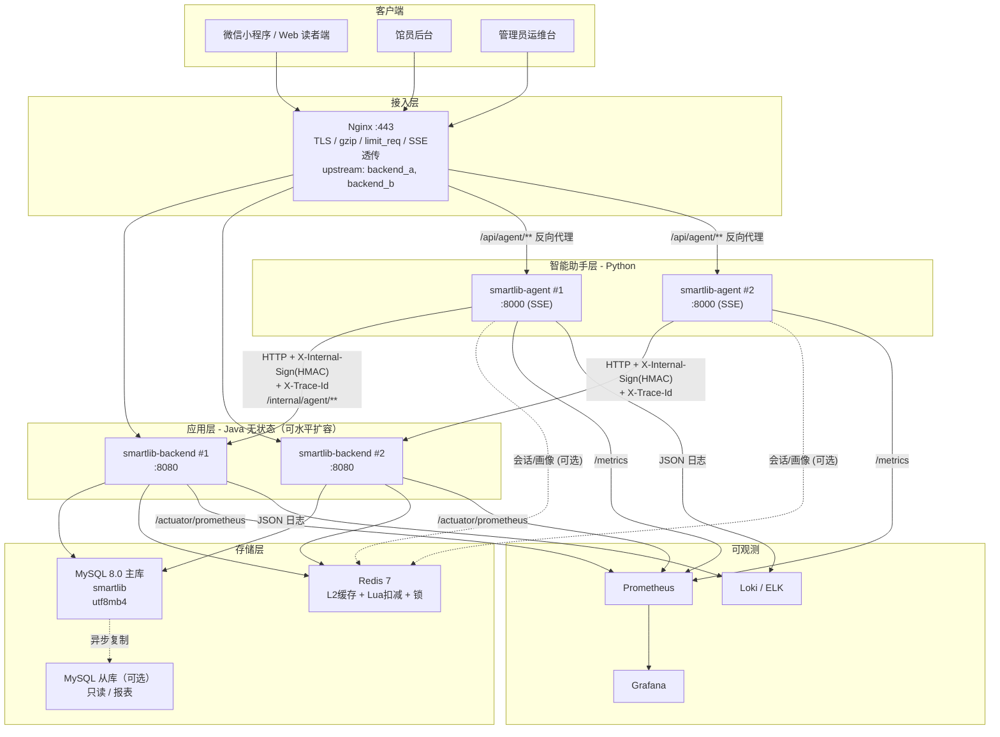
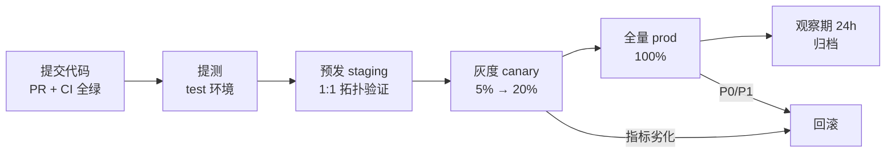

# 07 - SmartLib 部署上线手册

| 项目 | 内容 |
|---|---|
| 项目代号 | **SmartLib**（高校图书馆智能借阅与推荐平台） |
| 文档版本 | v1.0.0（对齐 `docs/00-项目蓝图.md` v1.0.0） |
| 文档定位 | 阶段门 **M5（上线）** 的主交付物；覆盖环境矩阵、配置、Compose/K8s 部署、灰度回滚、上线 checklist、应急预案、容量与安全 |
| 上游契约 | `docs/00-项目蓝图.md`（技术栈版本、模块、接口、SLO、6 大解决方案、里程碑 M1~M6） |
| 下游依赖 | `deploy/`（Compose、K8s、Nginx、SQL）、`scripts/`（初始化与校验脚本） |
| 读者角色 | DevOps / SRE 工程师、后端开发、Agent 开发、上线评审人 |
| 数据诚信声明 | 本手册中所有**演练结果、压测数值、实际耗时**一律标注「待实测回填」或「目标值」。**未实测的数据不得写成实测值。** |

> **对齐声明**：本手册的组件版本、接口路径、模块划分、SLO 阈值全部来自 `docs/00-项目蓝图.md`。
> 若发现不一致，以蓝图为准，并走 ADR（`docs/11-架构决策记录ADR.md`）变更——不允许在本手册中私自改版本或改接口。

---

## 1. 部署总览与架构图

### 1.1 部署拓扑说明

| 层 | 组件 | 实例数（prod） | 说明 |
|---|---|---|---|
| 接入层 | Nginx（或 K8s Ingress） | 2（主备/LB 前置） | TLS 终止、静态资源、上游负载、限流、SSE 透传 |
| 应用层（Java） | `smartlib-backend` | **2**（蓝图 §3.3 明确 backend×2） | 无状态，JWT 鉴权，会话外置，可水平扩容 |
| 应用层（Python） | `smartlib-agent` | **2** | FastAPI + Uvicorn，SSE 流式，无状态（会话在 Redis） |
| 存储层 | MySQL 8.0 | 1 主（+1 从，可选） | 唯一事实源；库存条件更新落在这里 |
| 缓存层 | Redis 7 | 1（+哨兵/Cluster 可选） | L2 缓存 + Lua 原子预扣 + 分布式锁；**可降级** |
| 可观测 | Prometheus + Grafana + Loki（或 ELK） | 1 套 | 指标 / 日志 / 链路三层 |

### 1.2 架构图（Mermaid）



### 1.3 关键部署约束（来自蓝图）

| 约束 | 来源 | 部署含义 |
|---|---|---|
| 后端必须无状态 | 蓝图 §6.3 A1 | 禁止本地磁盘存业务状态；JWT + Redis 会话 |
| 库存扣减是唯一入口，必须在 DB 条件更新 | 蓝图 §5 | MySQL 是唯一事实源；Redis 只做预扣与降级 |
| Redis 不可用时必须能降级 S2 | 蓝图 §6.1 | 部署时必须保留 `smartlib.stock.strategy=optimistic-db` 兜底开关 |
| Agent 使用 SSE 流式输出 | 蓝图 §6.4、§8.1 | Nginx **必须** `proxy_buffering off`，否则流式被缓冲 |
| 内部接口 `/internal/agent/**` 需 HMAC 签名 | 蓝图 §8.2 | Secret 走 K8s Secret / Compose env，禁止入库入 Git |
| 单实例故障恢复 < 30s，可用性 99.9% | 蓝图 §7 | 需要 readiness/liveness + PDB + 优雅停机 |

---

## 2. 环境矩阵

| 维度 | dev（开发） | test（测试/CI） | staging（预发） | prod（生产） |
|---|---|---|---|---|
| 用途 | 本地开发自测 | 自动化测试与压测 | 上线前最终验证、灰度演练 | 面向真实读者 7×24 |
| 部署形态 | 单进程 + H2 内存库 | Compose 或 CI Service Containers | 1:1 对齐 prod 拓扑（缩容） | Compose / K8s 集群 |
| 计算规格（后端） | 1 实例 2C4G | 1 实例 2C4G | 2 实例 4C8G | **2 实例 4C8G**（可 HPA 到 6） |
| 计算规格（Agent） | 1 实例 2C4G | 1 实例 2C4G | 2 实例 2C4G | **2 实例 4C8G** |
| MySQL | 不使用（H2 2.5.252 `MODE=MySQL`） | MySQL 8.0 单实例 2C4G | MySQL 8.0 单实例 4C8G | MySQL 8.0 主 8C32G（+可选从库） |
| Redis | 不使用（本地 Caffeine 单级） | Redis 7 单实例 1C2G | Redis 7 单实例 2C4G | Redis 7 2C4G（maxmemory 2GB） |
| Nginx | 不使用（直连 8080） | 1 实例 | 1 实例 | 2 实例 |
| 数据规模（book） | 约 200 条种子数据 | 约 5,000 条 | **58 万种 / 120 万册（脱敏抽样 20%）** | **58 万种 / 120 万册** |
| 数据规模（reader） | 约 20 条 | 约 1,000 条 | 约 6,400 条（20%） | **32,000 人** |
| 数据规模（borrow_record） | 约 50 条 | 约 1 万条 | 约 19 万条（年 96 万的 20%） | **年 96 万次（含历史约 300 万行）** |
| LLM | MockLLM（零 Key） | MockLLM + 可选真实模型抽样 | 真实模型（DeepSeek/通义），小配额 | 真实模型（主）+ 备用供应商 |
| 域名 | localhost | test.smartlib.local | staging.smartlib.local | lib.example.edu.cn |
| 数据脱敏 | 无真实数据 | 合成数据 | **生产脱敏抽样** | 真实 |
| 变更权限 | 开发者本人 | CI 自动 | 研发负责人 + SRE | 上线评审会批准 |
| 可用性要求 | 无 | 无 | 尽力 | **99.9%** |
| 回滚要求 | 无 | 无 | 必须演练 | 5 分钟内可回滚 |
| 用户规模 | 1 | 自动化 | 内部 20 人内测 | 32,000 师生 |

### 2.1 版本基线（与蓝图 §3 一致）

| 组件 | 版本 | 校验方式 |
|---|---|---|
| JDK | Java 21（字节码）/ 运行 25 | `java -version` |
| Spring Boot | 4.1.1 | `backend/pom.xml` parent |
| MyBatis Starter | 4.1.0 | `backend/pom.xml` 显式版本 |
| H2 | 2.5.252（`MODE=MySQL`） | `jdbc:h2:mem:smartlib;MODE=MySQL` |
| MySQL | 8.0.x | `SELECT VERSION();` |
| Redis | 7.x | `redis-cli INFO server \| grep redis_version` |
| Caffeine | 3.3.1 | `backend/pom.xml` |
| springdoc-openapi | 3.1.1 | `/swagger-ui.html` 可访问 |
| Maven | 3.9.9（`mvnw`）+ 本地仓库 `.tools/m2repo` | `./mvnw -v` |
| Python | 3.12 | `python -V` |
| FastAPI / Uvicorn / Pydantic v2 / httpx | 见 `agent-service/requirements.txt` | `pip freeze` |
| Nginx | 1.27（stable） | `nginx -v` |
| MySQL 镜像 | `mysql:8.0` | `docker images` |
| Redis 镜像 | `redis:7-alpine` | `docker images` |

> 依赖版本以 `backend/pom.xml` 与 `agent-service/requirements.txt` 显式声明为准；本表是设计基线。

---

## 3. 配置项清单

### 3.1 加载优先级（Spring Boot）

```
命令行参数  >  环境变量  >  application-{profile}.yml  >  application.yml  >  代码默认值
```

生产环境**只允许**通过 `application-prod.yml` + 环境变量注入，禁止把生产密码写进 Git。

### 3.2 后端配置项

| key | 含义 | 默认值 | prod 值 | 敏感 | 可热更新 | 落点 |
|---|---|---|---|---|---|---|
| `server.port` | HTTP 端口 | `8080` | `8080` | 否 | 否 | `application.yml` |
| `server.shutdown` | 优雅停机 | `graceful` | `graceful` | 否 | 否 | `application.yml` |
| `spring.lifecycle.timeout-per-shutdown-phase` | 停机等待 | `30s` | `30s` | 否 | 否 | `application.yml` |
| `spring.profiles.active` | 激活环境 | `local` | `prod` | 否 | 否 | 启动参数/环境变量 `SPRING_PROFILES_ACTIVE` |
| `spring.datasource.url` | JDBC URL | `jdbc:h2:mem:smartlib;DB_CLOSE_DELAY=-1;MODE=MySQL` | `jdbc:mysql://mysql:3306/smartlib?useUnicode=true&characterEncoding=utf8&serverTimezone=Asia/Shanghai&rewriteBatchedStatements=true` | 否 | 否 | `application-prod.yml` / `DB_URL` |
| `spring.datasource.username` | DB 账号 | `sa` | `smartlib_app` | 是 | 否 | 环境变量 `DB_USERNAME` |
| `spring.datasource.password` | DB 密码 | ``（空） | 由密钥管理下发 | 是 | 否 | 环境变量 `DB_PASSWORD` / K8s Secret |
| `spring.datasource.hikari.maximum-pool-size` | 连接池上限 | `10` | `30`（4C8G 单实例） | 否 | 否 | `application-prod.yml` |
| `spring.datasource.hikari.minimum-idle` | 最小空闲连接 | `5` | `10` | 否 | 否 | `application-prod.yml` |
| `spring.datasource.hikari.connection-timeout` | 取连接超时 | `30000` | `3000` | 否 | 否 | `application-prod.yml` |
| `spring.datasource.hikari.leak-detection-threshold` | 连接泄漏检测 | `0` | `20000` | 否 | 否 | `application-prod.yml` |
| `spring.sql.init.mode` | 是否执行 schema.sql | `always`（local） | `never` | 否 | 否 | `application.yml` / `application-prod.yml` |
| `spring.data.redis.host` | Redis 地址 | `localhost` | `redis` | 否 | 否 | 环境变量 `REDIS_HOST` |
| `spring.data.redis.port` | Redis 端口 | `6379` | `6379` | 否 | 否 | 环境变量 `REDIS_PORT` |
| `spring.data.redis.password` | Redis 密码 | 空 | 由密钥管理下发 | 是 | 否 | 环境变量 `REDIS_PASSWORD` |
| `spring.data.redis.timeout` | Redis 命令超时 | `2000ms` | `300ms`（快速失败降级） | 否 | 否 | `application-prod.yml` |
| `smartlib.stock.strategy` | 库存扣减策略 SPI | `optimistic-db`（S2） | `optimistic-db`（S2；秒杀活动切 `redis-lua`） | 否 | **是**（配置中心/`rule_config`） | `application.yml` |
| `smartlib.stock.redis-lua.fallback` | Redis 不可用降级 | `true` | `true` | 否 | 是 | `application.yml` |
| `smartlib.stock.retry.max` | 乐观锁自旋次数 | `3` | `5` | 否 | 是 | `application.yml` |
| `smartlib.search.engine` | 检索引擎 SPI | `inverted-index`（Q3） | `inverted-index`（Q3，>500 万切 `elasticsearch`） | 否 | **是** | `application.yml` |
| `smartlib.search.topk` | 返回条数上限 | `20` | `20` | 否 | 是 | `application.yml` |
| `smartlib.search.index.rebuild-cron` | 倒排索引重建 | `0 30 3 * * ?` | `0 30 3 * * ?` | 否 | 是 | `application.yml` |
| `smartlib.cache.l1.ttl-seconds` | Caffeine L1 TTL | `300` | `300` | 否 | 是 | `application.yml` |
| `smartlib.cache.l1.max-size` | L1 条目上限 | `10000` | `10000` | 否 | 是 | `application.yml` |
| `smartlib.cache.l2.ttl-seconds` | Redis L2 TTL | `1800` | `1800`（±10% 抖动） | 否 | 是 | `application.yml` |
| `smartlib.cache.jitter-percent` | TTL 抖动比例 | `10` | `10` | 否 | 是 | `application.yml` |
| `smartlib.search.cache.bloom-expected-insertions` | 布隆过滤器预期元素数 `n` | `1200000` | `1200000` | 否 | 否（重启生效） | `application.yml` |
| `smartlib.search.cache.bloom-fpp` | 布隆目标误判率 `p` | `0.001` | `0.001` | 否 | 否 | `application.yml` |
| `smartlib.limiter.public.qps` | 公共 API 单实例令牌桶 | `500` | `500` | 否 | 是 | `application.yml` |
| `smartlib.limiter.public.burst` | 突发容量 | `1000` | `1000` | 否 | 是 | `application.yml` |
| `smartlib.limiter.internal.qps` | 内部 Agent 接口限流（隔离） | `200` | `200` | 否 | 是 | `application.yml` |
| `smartlib.circuit.sliding-window-size` | 熔断统计窗口 | `20` | `20` | 否 | 是 | `application.yml` |
| `smartlib.circuit.failure-rate-threshold` | 失败率阈值(%) | `50` | `50` | 否 | 是 | `application.yml` |
| `smartlib.circuit.open-state-seconds` | OPEN 持续时长 | `10` | `10` | 否 | 是 | `application.yml` |
| `smartlib.circuit.half-open-permits` | 半开探测请求数 | `3` | `3` | 否 | 是 | `application.yml` |
| `smartlib.internal.hmac.secret` | 内部接口 HMAC 密钥 | `dev-secret-change-me` | 32 字节随机串 | **是** | 否（双 Key 轮转） | 环境变量 `INTERNAL_SIGN_SECRET` |
| `smartlib.internal.hmac.tolerance-seconds` | 签名时间窗 | `60` | `60` | 否 | 是 | `application.yml` |
| `smartlib.idempotent.ttl-hours` | 幂等记录保留 | `24` | `24` | 否 | 是 | `application.yml` |
| `smartlib.rules.cache-seconds` | 借阅规则缓存 | `60` | `60` | 否 | 是 | `application.yml` |
| `management.endpoints.web.exposure.include` | 暴露的 Actuator 端点 | `health,info,metrics,prometheus` | `health,prometheus` | 否 | 否 | `application-prod.yml` |
| `management.server.port` | 管理端口（与业务隔离） | 与业务同端口 | `8081` | 否 | 否 | `application-prod.yml` |
| `management.metrics.tags.application` | 指标全局标签 | `smartlib-backend` | `smartlib-backend` | 否 | 否 | `application.yml` |
| `logging.level.root` | 根日志级别 | `INFO` | `INFO` | 否 | **是**（Actuator loggers） | `application-prod.yml` |
| `smartlib.log.mask.enabled` | 日志脱敏 | `true` | `true` | 否 | 否 | `application.yml` |

### 3.3 Agent 服务配置项（Pydantic Settings，环境变量优先）

| key（环境变量） | 含义 | 默认值 | prod 值 | 敏感 | 可热更新 |
|---|---|---|---|---|---|
| `LLM_PROVIDER` | LLM 供应商 | `mock` | `openai_compat` | 否 | 否 |
| `LLM_BASE_URL` | OpenAI 兼容端点 | `""` | `https://api.deepseek.com/v1` | 否 | 否 |
| `LLM_API_KEY` | API Key | `""` | 由密钥管理下发 | **是** | 否 |
| `LLM_MODEL` | 模型名 | `mock-deterministic` | `deepseek-chat` | 否 | 是 |
| `LLM_TEMPERATURE` | 采样温度 | `0.2` | `0.2` | 否 | 是 |
| `LLM_TIMEOUT_MS` | 单次 LLM 超时 | `20000` | `20000` | 否 | 是 |
| `AGENT_MAX_STEPS` | ReAct 最大步数 | `6` | `6` | 否 | 是 |
| `AGENT_TOOL_TIMEOUT_MS` | 工具调用超时 | `3000` | `3000` | 否 | 是 |
| `AGENT_TOOL_RETRY` | 工具重试次数 | `2` | `2` | 否 | 是 |
| `AGENT_SESSION_TTL_SECONDS` | 会话 TTL | `1800` | `1800` | 否 | 是 |
| `AGENT_GUARDRAIL_MIN_CONFIDENCE` | 转人工置信度阈值 | `0.55` | `0.55` | 否 | 是 |
| `AGENT_SSE_HEARTBEAT_SECONDS` | SSE 心跳间隔 | `15` | `15` | 否 | 是 |
| `JAVA_BASE_URL` | Java 后端地址 | `http://localhost:8080` | `http://backend:8080` | 否 | 否 |
| `INTERNAL_SIGN_SECRET` | 与后端共享 HMAC 密钥 | `dev-secret-change-me` | 32 字节随机串 | **是** | 否 |
| `REDIS_URL` | Agent 会话存储 | `redis://localhost:6379/1` | `redis://redis:6379/1` | 否 | 否 |
| `EMBEDDING_MODE` | 向量检索模式 | `hash`（无 Key 降级） | `hash` 或 `api` | 否 | 是 |
| `UVICORN_WORKERS` | 进程数 | `1` | `2`（≤2×CPU） | 否 | 否 |
| `LOG_LEVEL` | 日志级别 | `INFO` | `INFO` | 否 | 是 |

### 3.4 `.env` 模板（`deploy/.env.example`，真实 `.env` 必须 `.gitignore`）

```bash
# ===== 环境 =====
SPRING_PROFILES_ACTIVE=prod
TZ=Asia/Shanghai

# ===== MySQL =====
MYSQL_ROOT_PASSWORD=<由密钥管理生成>
MYSQL_DATABASE=smartlib
DB_URL=jdbc:mysql://mysql:3306/smartlib?useUnicode=true&characterEncoding=utf8&serverTimezone=Asia/Shanghai&rewriteBatchedStatements=true
DB_USERNAME=smartlib_app
DB_PASSWORD=<由密钥管理生成>

# ===== Redis =====
REDIS_HOST=redis
REDIS_PORT=6379
REDIS_PASSWORD=<由密钥管理生成>

# ===== 内部签名（后端与 Agent 共享，32 字节随机）=====
INTERNAL_SIGN_SECRET=<openssl rand -hex 32 生成>

# ===== Agent =====
LLM_PROVIDER=openai_compat
LLM_BASE_URL=https://api.deepseek.com/v1
LLM_API_KEY=<由密钥管理生成>
LLM_MODEL=deepseek-chat
JAVA_BASE_URL=http://backend:8080
AGENT_SSE_HEARTBEAT_SECONDS=15

# ===== 版本（灰度用）=====
BACKEND_IMAGE_TAG=1.0.0
AGENT_IMAGE_TAG=1.0.0
```

生成密钥的命令：

```bash
# 32 字节 HMAC 密钥
openssl rand -hex 32
# 生成后写入 K8s Secret 或 Compose .env，禁止提交到 Git
```

---

## 4. 数据库初始化

### 4.1 建库语句（MySQL 8.0）

```sql
-- 字符集：utf8mb4（支持 emoji 与生僻字书名），排序规则 utf8mb4_0900_ai_ci（MySQL 8.0 默认，大小写不敏感）
CREATE DATABASE IF NOT EXISTS `smartlib`
  DEFAULT CHARACTER SET utf8mb4
  DEFAULT COLLATE utf8mb4_0900_ai_ci;

-- 时区（应用侧也固定 Asia/Shanghai，避免借期计算偏差）
SET GLOBAL time_zone = '+08:00';

-- 关闭严格模式以外的隐式行为：禁止隐式类型转换造成索引失效
SET GLOBAL sql_mode = 'STRICT_TRANS_TABLES,NO_ENGINE_SUBSTITUTION,ONLY_FULL_GROUP_BY';
```

### 4.2 账号与最小权限

| 账号 | 用途 | 主机 | 权限 | 说明 |
|---|---|---|---|---|
| `smartlib_app` | 应用运行时账号 | `10.%` / K8s Pod CIDR | `SELECT, INSERT, UPDATE, DELETE` on `smartlib.*` | **无 DDL、无 DROP、无 GRANT** |
| `smartlib_ro` | 报表/BI/排查只读 | `10.%` | `SELECT` on `smartlib.*` | 禁止连接业务库写入 |
| `smartlib_ddl` | 迁移专用（临时启用） | 跳板机固定 IP | `ALTER, CREATE, INDEX, DROP, INSERT` on `smartlib.*` | 只在发版窗口临时启用，用完 `REVOKE` |
| `root` | 仅限 DBA 运维 | `localhost` | 全部 | **禁止应用使用 root** |

```sql
-- ===== 应用账号（最小权限）=====
CREATE USER IF NOT EXISTS 'smartlib_app'@'10.%' IDENTIFIED BY '<APP_PASSWORD>' REQUIRE SSL;
GRANT SELECT, INSERT, UPDATE, DELETE ON `smartlib`.* TO 'smartlib_app'@'10.%';

-- 明确回收危险权限（显式声明，防止误授）
REVOKE DROP, ALTER, CREATE, GRANT OPTION, FILE, SUPER ON `smartlib`.* FROM 'smartlib_app'@'10.%';

-- ===== 只读账号 =====
CREATE USER IF NOT EXISTS 'smartlib_ro'@'10.%' IDENTIFIED BY '<RO_PASSWORD>';
GRANT SELECT ON `smartlib`.* TO 'smartlib_ro'@'10.%';

-- ===== 迁移账号（发版窗口临时启用）=====
CREATE USER IF NOT EXISTS 'smartlib_ddl'@'<JUMP_HOST>' IDENTIFIED BY '<DDL_PASSWORD>';
GRANT SELECT, INSERT, UPDATE, DELETE, CREATE, ALTER, INDEX, DROP ON `smartlib`.* TO 'smartlib_ddl'@'<JUMP_HOST>';

FLUSH PRIVILEGES;

-- ===== 权限核对（期望：只出现被授予的行）=====
SHOW GRANTS FOR 'smartlib_app'@'10.%';
```

**权限核对预期输出（样例格式）**：

```
+------------------------------------------------------------------------------+
| Grants for smartlib_app@10.%                                                 |
+------------------------------------------------------------------------------+
| GRANT USAGE ON *.* TO `smartlib_app`@`10.%`                                  |
| GRANT SELECT, INSERT, UPDATE, DELETE ON `smartlib`.`*` TO `smartlib_app`@`10.%` |
+------------------------------------------------------------------------------+
```

### 4.3 执行 schema 与初始化数据

库表定义以 `deploy/sql/01-schema.sql` 为准（DDL 详细说明见 `docs/04-数据库设计.md`），初始数据以 `deploy/sql/02-seed.sql` 为准。

```bash
# 1) 建库 + 建账号（DBA 执行一次）
mysql -h 127.0.0.1 -u root -p < deploy/sql/00-init-database.sql
mysql -h 127.0.0.1 -u root -p < deploy/sql/01-init-grants.sql

# 2) 建表（幂等：全部 CREATE TABLE IF NOT EXISTS）
mysql -h 127.0.0.1 -u smartlib_ddl -p smartlib < deploy/sql/01-schema.sql

# 3) 初始化基础数据：借阅规则 rule_config + 分类 category + 管理员账号
mysql -h 127.0.0.1 -u smartlib_ddl -p smartlib < deploy/sql/02-seed.sql

# 4) 灌入书目与库存（58 万种 / 120 万册，分批导入避免大事务）
for f in deploy/data/book_part_*.tsv; do
  mysql -h 127.0.0.1 -u smartlib_ddl -p --local-infile=1 smartlib \
    -e "LOAD DATA LOCAL INFILE '$f' INTO TABLE book CHARACTER SET utf8mb4
        FIELDS TERMINATED BY '\t' LINES TERMINATED BY '\n' IGNORE 1 LINES;"
done

# 5) 由 book 生成 1:1 的 book_stock（扣减唯一入口表的初始值）
mysql -h 127.0.0.1 -u smartlib_ddl -p smartlib < deploy/sql/02-init-stock.sql

# 6) 一次性重建倒排索引（应用侧接口触发）
curl -sS -X POST http://localhost:8080/admin/search/reindex \
  -H "X-Admin-Token: ${ADMIN_TOKEN}"
```

`deploy/sql/02-seed.sql` 中的规则种子数据（对齐蓝图 §2.1 / §2.2）：

```sql
INSERT INTO rule_config (rule_key, rule_value, reader_type, remark, version) VALUES
  ('max_borrow_count', '10', 'UNDERGRAD', '本科生可借 10 册', 1),
  ('max_borrow_count', '15', 'POSTGRAD',  '研究生可借 15 册', 1),
  ('max_borrow_count', '20', 'TEACHER',   '教师可借 20 册', 1),
  ('borrow_days',      '30', 'UNDERGRAD', '本科借期 30 天', 1),
  ('borrow_days',      '60', 'POSTGRAD',  '研究生借期 60 天', 1),
  ('borrow_days',      '90', 'TEACHER',   '教师借期 90 天', 1),
  ('max_renew_count',  '2',  'UNDERGRAD', '本科可续借 2 次', 1),
  ('max_renew_count',  '3',  'POSTGRAD',  '研究生可续借 3 次', 1),
  ('max_renew_count',  '3',  'TEACHER',   '教师可续借 3 次', 1),
  ('credit_borrow_floor','60','ALL',      '信用分低于 60 禁止借阅', 1),
  ('fine_per_day',       '0.20','ALL',    '逾期罚金 0.2 元/天/册', 1),
  ('fine_pay_threshold', '10.00','ALL',   '罚金超 10 元未缴清禁止借新书', 1),
  ('reservation_hold_days','3','ALL',     '预约到馆保留 3 天', 1)
ON DUPLICATE KEY UPDATE rule_value = VALUES(rule_value), version = version + 1;
```

### 4.4 初始化校验脚本

**校验 1：表与索引完整性**

```sql
-- 期望：8 张业务表全部存在
SELECT table_name, table_rows, engine, table_collation
FROM information_schema.tables
WHERE table_schema = 'smartlib'
ORDER BY table_name;
-- 期望表：book, book_stock, borrow_record, category, idempotent_record,
--         reader, reservation, rule_config, stock_ledger

-- 期望：关键唯一索引存在
SELECT table_name, index_name, GROUP_CONCAT(column_name ORDER BY seq_in_index) AS cols, non_unique
FROM information_schema.statistics
WHERE table_schema = 'smartlib'
GROUP BY table_name, index_name, non_unique
ORDER BY table_name, index_name;
-- 期望关键项：book.uk(isbn)、reader.uk(card_no)、stock_ledger.uk(biz_no)、
--            idempotent_record.uk(idem_key)、rule_config.uk(rule_key,reader_type)
```

**校验 2：库存与流水守恒（最高优先级，对应蓝图 §7「库存流水守恒」）**

```sql
-- 2.1 available_copies 不得为负（期望返回 0 行）
SELECT book_id, available_copies, locked_copies, total_copies
FROM book_stock
WHERE available_copies < 0 OR available_copies > total_copies OR locked_copies < 0;

-- 2.2 库存流水守恒：sum(delta) 必须等于库存当前值与初始值之差
--     初始化后（无业务流水）期望返回 0 行
SELECT bs.book_id,
       bs.available_copies + bs.locked_copies            AS now_total,
       bs.total_copies                                    AS expect_total,
       COALESCE(led.sum_delta, 0)                         AS ledger_delta
FROM book_stock bs
LEFT JOIN (
  SELECT book_id, SUM(delta) AS sum_delta FROM stock_ledger GROUP BY book_id
) led ON led.book_id = bs.book_id
WHERE bs.total_copies <> COALESCE(led.sum_delta, 0);

-- 2.3 在借记录数不得超过复本数（超卖检测，期望返回 0 行）
SELECT br.book_id, COUNT(*) AS borrowing, bs.total_copies
FROM borrow_record br
JOIN book_stock bs ON bs.book_id = br.book_id
WHERE br.status = 'BORROWED'
GROUP BY br.book_id, bs.total_copies
HAVING borrowing > bs.total_copies;
```

**校验 3：脚本化一键校验**

```bash
#!/usr/bin/env bash
# scripts/db/verify_init.sh
set -euo pipefail
DB_HOST="${DB_HOST:-127.0.0.1}"
DB_USER="${DB_USER:-smartlib_ro}"
DB_PASS="${DB_PASS:?need DB_PASS}"
DB_NAME="${DB_NAME:-smartlib}"

run() { mysql -h "$DB_HOST" -u "$DB_USER" -p"$DB_PASS" -N -B "$DB_NAME" -e "$1"; }

fail=0

tables=$(run "SELECT COUNT(*) FROM information_schema.tables WHERE table_schema='$DB_NAME';")
echo "[CHECK] 业务表数量 = $tables（期望 9）"
[ "$tables" -ge 9 ] || { echo "  -> FAIL：表数量不足"; fail=1; }

neg=$(run "SELECT COUNT(*) FROM book_stock WHERE available_copies < 0;")
echo "[CHECK] 负库存行数 = $neg（期望 0）"
[ "$neg" -eq 0 ] || { echo "  -> FAIL：存在负库存超卖"; fail=1; }

led=$(run "SELECT COUNT(*) FROM book_stock bs LEFT JOIN (SELECT book_id, SUM(delta) d FROM stock_ledger GROUP BY book_id) l ON l.book_id=bs.book_id WHERE bs.total_copies <> COALESCE(l.d,0);")
echo "[CHECK] 库存流水不守恒行数 = $led（期望 0）"
[ "$led" -eq 0 ] || { echo "  -> FAIL：流水与库存不一致"; fail=1; }

rules=$(run "SELECT COUNT(*) FROM rule_config;")
echo "[CHECK] 规则配置条数 = $rules（期望 >= 13）"
[ "$rules" -ge 13 ] || { echo "  -> FAIL：规则种子数据缺失"; fail=1; }

if [ "$fail" -eq 0 ]; then
  echo "[RESULT] 数据库初始化校验通过"
else
  echo "[RESULT] 数据库初始化校验失败，禁止上线"
  exit 1
fi
```

```bash
chmod +x scripts/db/verify_init.sh
DB_PASS='<RO_PASSWORD>' ./scripts/db/verify_init.sh
```

**预期输出说明（非实测值，为脚本逻辑规定的期望文本）**：

```
[CHECK] 业务表数量 = 9（期望 9）
[CHECK] 负库存行数 = 0（期望 0）
[CHECK] 库存流水不守恒行数 = 0（期望 0）
[CHECK] 规则配置条数 = 13（期望 >= 13）
[RESULT] 数据库初始化校验通过
```

> 实际行数取决于 `data.sql` 与灌数批次，**以脚本实际输出为准**（待实测回填）。

---

## 5. 本地零依赖启动（无需 MySQL / Redis / API Key）

设计目标：任何评审人 clone 仓库后 **不改一行配置** 就能跑起来看到完整效果（对齐蓝图 §3.2 MockLLM、§3.1 H2）。

### 5.1 后端：一条命令启动（H2 `MODE=MySQL`）

```bash
# 方式 A：Maven 直接跑（推荐，开发用）
cd backend
./mvnw -s ../.tools/settings.xml -Dmaven.repo.local=../.tools/m2repo \
       spring-boot:run -Dspring-boot.run.profiles=local

# Windows PowerShell
cd backend
.\mvnw.cmd -s ..\.tools\settings.xml -Dmaven.repo.local=..\.tools\m2repo `
           spring-boot:run "-Dspring-boot.run.profiles=local"

# 方式 B：打包后运行
cd backend
./mvnw -s ../.tools/settings.xml -Dmaven.repo.local=../.tools/m2repo clean package -DskipTests
java -jar target/smartlib-backend-1.0.0.jar --spring.profiles.active=local
```

`backend/src/main/resources/application-local.yml` 关键内容：

```yaml
spring:
  datasource:
    url: jdbc:h2:mem:smartlib;DB_CLOSE_DELAY=-1;MODE=MySQL;DATABASE_TO_LOWER=TRUE
    driver-class-name: org.h2.Driver
    username: sa
    password: ""
  sql:
    init:
      mode: always              # 启动即执行 schema.sql + data.sql
      schema-locations: classpath:db/schema-h2.sql
      data-locations: classpath:db/data-local.sql
  autoconfigure:
    exclude:
      - org.springframework.boot.autoconfigure.data.redis.RedisAutoConfiguration

smartlib:
  cache:
    l2:
      enabled: false            # 无 Redis 时只启用 Caffeine L1
  stock:
    strategy: optimistic-db     # S2 条件更新，天然正确
  search:
    engine: inverted-index      # 自研倒排，零外部依赖
```

### 5.2 Agent：MockLLM 零 Key 启动

```bash
cd agent-service
python -m venv .venv && . .venv/bin/activate        # Windows: .\.venv\Scripts\Activate.ps1

pip install -r requirements.txt

# 零 Key：MockLLM 走确定性规则，不需要任何 API Key
export LLM_PROVIDER=mock
export JAVA_BASE_URL=http://localhost:8080
export INTERNAL_SIGN_SECRET=dev-secret-change-me

uvicorn app.main:app --host 0.0.0.0 --port 8000 --reload

# Windows PowerShell
$env:LLM_PROVIDER="mock"; $env:JAVA_BASE_URL="http://localhost:8080"
uvicorn app.main:app --host 0.0.0.0 --port 8000
```

### 5.3 验证命令与预期输出说明

| 步骤 | 命令 | 预期输出说明 |
|---|---|---|
| 1. 后端健康 | `curl -sS http://localhost:8080/actuator/health` | `{"status":"UP"}`，含 `db`、`redis`（local 已排除）子项 |
| 2. 后端信息 | `curl -sS http://localhost:8080/actuator/info` | 返回应用名与版本，说明 Actuator 生效 |
| 3. OpenAPI | `curl -sS http://localhost:8080/v3/api-docs \| head -c 200` | 返回 JSON，开头为 `{"openapi":"3.0...` |
| 4. 书目检索 | `curl -sS "http://localhost:8080/api/books?query=计算机网络&page=1&size=5"` | `code=0`，`data.list` 非空，`data.total>0` |
| 5. 库存查询 | `curl -sS http://localhost:8080/api/books/1` | `data.availableCopies` 为整数且 `>= 0` |
| 6. 借书（带幂等键） | `curl -sS -X POST http://localhost:8080/api/borrows -H 'Content-Type: application/json' -H 'Idempotency-Key: demo-001' -d '{"readerId":1,"bookId":1}'` | 首次 `code=0` 且返回 `borrowId`；**同 Key 重放返回同一 `borrowId`**（幂等生效） |
| 7. 并发抢书（超卖验收） | `./mvnw -Dtest=BorrowConcurrencyTest test` | 断言通过：`available_copies == 0` 且成功借出数 == 10 |
| 8. Agent 健康 | `curl -sS http://localhost:8000/health` | `{"status":"ok","llm_provider":"mock"}` |
| 9. Agent SSE 对话 | `curl -N -X POST http://localhost:8000/api/agent/chat -H 'Content-Type: application/json' -d '{"readerId":1,"message":"《算法导论》还有几本？在几楼？"}'` | **逐块（chunked）打印** `data: {...}` 事件流，最后 `data: [DONE]`；若一次性全部输出说明缓冲未关（本地直连不涉及 Nginx） |
| 10. Agent 工具链路 | 观察 Agent 日志 | 出现 `tool=search_books` / `tool=get_stock` 调用记录，证明「无工具证据不下结论」 |
| 11. Agent 离线评测 | `python -m eval.run_eval --dataset eval/dataset.jsonl --provider mock` | 打印意图准确率/工具准确率/端到端成功率的**指标名与计算口径**（MockLLM 下为确定性结果）；本手册**不记录任何具体数值**，正式评测值统一回填至 `docs/06-测试计划与报告.md` |

### 5.4 常见本地启动问题

| 现象 | 原因 | 处置 |
|---|---|---|
| `Table "BOOK" not found` | H2 `DATABASE_TO_LOWER` 与 schema 大小写不一致 | 统一使用 `DATABASE_TO_LOWER=TRUE` 与 `MODE=MySQL` |
| 启动报 Redis 连接失败 | local profile 未排除 Redis 自动配置 | 确认 `spring.autoconfigure.exclude` 已配置 |
| `./mvnw` 权限不足（Linux/macOS） | 无执行位 | `chmod +x backend/mvnw` |
| 依赖下载慢/失败 | 默认中央仓网络受限 | 用 `.tools/settings.xml` + `.tools/m2repo` 离线仓库 |

---

## 6. Docker Compose 部署

### 6.1 服务清单

| 服务 | 镜像 | 容器端口→宿主 | 依赖 | 健康检查 | 资源限制（limits） |
|---|---|---|---|---|---|
| `mysql` | `mysql:8.0` | 3306（仅内网） | — | `mysqladmin ping` | cpus 4 / mem 8G |
| `redis` | `redis:7-alpine` | 6379（仅内网） | — | `redis-cli ping` | cpus 2 / mem 2G |
| `backend-1` | `smartlib-backend:${BACKEND_IMAGE_TAG}` | 8080 | mysql(`service_healthy`)、redis | `GET /actuator/health/readiness` | cpus 4 / mem 8G |
| `backend-2` | 同上 | 8080 | 同上 | 同上 | cpus 4 / mem 8G |
| `agent-1` | `smartlib-agent:${AGENT_IMAGE_TAG}` | 8000 | backend-1、redis | `GET /health` | cpus 2 / mem 4G |
| `agent-2` | 同上 | 8000 | backend-2、redis | 同上 | cpus 2 / mem 4G |
| `nginx` | `nginx:1.27-alpine` | **80→80 / 443→443** | backend-1/2、agent-1/2 | `GET /healthz` | cpus 2 / mem 1G |
| `prometheus` | `prom/prometheus:v2.54.1` | 9090 | backend-1/2、agent-1/2 | `/-/healthy` | cpus 1 / mem 2G |
| `grafana` | `grafana/grafana:11.2.0` | 3000 | prometheus | `/api/health` | cpus 1 / mem 1G |

### 6.2 完整 `deploy/docker-compose.yml`

```yaml
# deploy/docker-compose.yml
# 用法：docker compose --env-file deploy/.env up -d
name: smartlib

x-logging: &default-logging
  driver: json-file
  options:
    max-size: "50m"
    max-file: "5"

x-backend-common: &backend-common
  image: smartlib-backend:${BACKEND_IMAGE_TAG:-1.0.0}
  restart: unless-stopped
  environment:
    SPRING_PROFILES_ACTIVE: prod
    TZ: Asia/Shanghai
    DB_URL: jdbc:mysql://mysql:3306/smartlib?useUnicode=true&characterEncoding=utf8&serverTimezone=Asia/Shanghai&rewriteBatchedStatements=true
    DB_USERNAME: ${DB_USERNAME:-smartlib_app}
    DB_PASSWORD: ${DB_PASSWORD:?DB_PASSWORD required}
    REDIS_HOST: redis
    REDIS_PORT: "6379"
    REDIS_PASSWORD: ${REDIS_PASSWORD:-}
    INTERNAL_SIGN_SECRET: ${INTERNAL_SIGN_SECRET:?INTERNAL_SIGN_SECRET required}
    JAVA_TOOL_OPTIONS: >-
      -XX:MaxRAMPercentage=70
      -XX:+UseG1GC
      -XX:MaxGCPauseMillis=200
      -XX:+HeapDumpOnOutOfMemoryError
      -XX:HeapDumpPath=/var/log/smartlib/heapdump.hprof
      -Duser.timezone=Asia/Shanghai
  volumes:
    - backend-logs:/var/log/smartlib
  depends_on:
    mysql:
      condition: service_healthy
    redis:
      condition: service_healthy
  healthcheck:
    # readiness 探针：DB + Redis 均可用才算就绪
    test: ["CMD-SHELL", "wget -qO- http://127.0.0.1:8080/actuator/health/readiness | grep -q '\"status\":\"UP\"'"]
    interval: 10s
    timeout: 3s
    retries: 6
    start_period: 60s
  logging: *default-logging
  networks: [smartlib-net]

services:
  mysql:
    image: mysql:8.0
    container_name: smartlib-mysql
    restart: unless-stopped
    command:
      - --character-set-server=utf8mb4
      - --collation-server=utf8mb4_0900_ai_ci
      - --default-time-zone=+08:00
      - --max-connections=500
      - --innodb-buffer-pool-size=4G
      - --slow-query-log=1
      - --long-query-time=0.5
      - --slow-query-log-file=/var/log/mysql/slow.log
      - --sql-mode=STRICT_TRANS_TABLES,NO_ENGINE_SUBSTITUTION,ONLY_FULL_GROUP_BY
    environment:
      MYSQL_ROOT_PASSWORD: ${MYSQL_ROOT_PASSWORD:?MYSQL_ROOT_PASSWORD required}
      MYSQL_DATABASE: ${MYSQL_DATABASE:-smartlib}
      MYSQL_USER: ${DB_USERNAME:-smartlib_app}
      MYSQL_PASSWORD: ${DB_PASSWORD:?DB_PASSWORD required}
      TZ: Asia/Shanghai
    volumes:
      - mysql-data:/var/lib/mysql
      - ./sql:/docker-entrypoint-initdb.d:ro
      - mysql-logs:/var/log/mysql
    ports:
      - "127.0.0.1:3306:3306"     # 仅本机暴露，禁止 0.0.0.0
    healthcheck:
      test: ["CMD-SHELL", "mysqladmin ping -h 127.0.0.1 -u root -p$$MYSQL_ROOT_PASSWORD --silent"]
      interval: 10s
      timeout: 5s
      retries: 10
      start_period: 60s
    deploy:
      resources:
        limits: { cpus: "4", memory: 8G }
        reservations: { cpus: "2", memory: 4G }
    logging: *default-logging
    networks: [smartlib-net]

  redis:
    image: redis:7-alpine
    container_name: smartlib-redis
    restart: unless-stopped
    command:
      - redis-server
      - --requirepass
      - ${REDIS_PASSWORD:-}
      - --maxmemory
      - 2gb
      - --maxmemory-policy
      - allkeys-lru
      - --appendonly
      - "yes"
      - --save
      - "900 1"
    volumes:
      - redis-data:/data
    ports:
      - "127.0.0.1:6379:6379"
    healthcheck:
      test: ["CMD-SHELL", "redis-cli -a \"$$REDIS_PASSWORD\" ping | grep -q PONG"]
      interval: 10s
      timeout: 3s
      retries: 6
      start_period: 15s
    deploy:
      resources:
        limits: { cpus: "2", memory: 2G }
    logging: *default-logging
    networks: [smartlib-net]

  backend-1:
    <<: *backend-common
    container_name: smartlib-backend-1
    environment:
      SPRING_PROFILES_ACTIVE: prod
      TZ: Asia/Shanghai
      DB_URL: jdbc:mysql://mysql:3306/smartlib?useUnicode=true&characterEncoding=utf8&serverTimezone=Asia/Shanghai&rewriteBatchedStatements=true
      DB_USERNAME: ${DB_USERNAME:-smartlib_app}
      DB_PASSWORD: ${DB_PASSWORD:?DB_PASSWORD required}
      REDIS_HOST: redis
      REDIS_PORT: "6379"
      REDIS_PASSWORD: ${REDIS_PASSWORD:-}
      INTERNAL_SIGN_SECRET: ${INTERNAL_SIGN_SECRET:?INTERNAL_SIGN_SECRET required}
      INSTANCE_ID: backend-1
    deploy:
      resources:
        limits: { cpus: "4", memory: 8G }
        reservations: { cpus: "2", memory: 4G }

  backend-2:
    <<: *backend-common
    container_name: smartlib-backend-2
    environment:
      SPRING_PROFILES_ACTIVE: prod
      TZ: Asia/Shanghai
      DB_URL: jdbc:mysql://mysql:3306/smartlib?useUnicode=true&characterEncoding=utf8&serverTimezone=Asia/Shanghai&rewriteBatchedStatements=true
      DB_USERNAME: ${DB_USERNAME:-smartlib_app}
      DB_PASSWORD: ${DB_PASSWORD:?DB_PASSWORD required}
      REDIS_HOST: redis
      REDIS_PORT: "6379"
      REDIS_PASSWORD: ${REDIS_PASSWORD:-}
      INTERNAL_SIGN_SECRET: ${INTERNAL_SIGN_SECRET:?INTERNAL_SIGN_SECRET required}
      INSTANCE_ID: backend-2
    deploy:
      resources:
        limits: { cpus: "4", memory: 8G }
        reservations: { cpus: "2", memory: 4G }

  agent-1:
    image: smartlib-agent:${AGENT_IMAGE_TAG:-1.0.0}
    container_name: smartlib-agent-1
    restart: unless-stopped
    environment:
      LLM_PROVIDER: ${LLM_PROVIDER:-openai_compat}
      LLM_BASE_URL: ${LLM_BASE_URL}
      LLM_API_KEY: ${LLM_API_KEY}
      LLM_MODEL: ${LLM_MODEL:-deepseek-chat}
      JAVA_BASE_URL: http://backend-1:8080
      INTERNAL_SIGN_SECRET: ${INTERNAL_SIGN_SECRET:?INTERNAL_SIGN_SECRET required}
      REDIS_URL: redis://:${REDIS_PASSWORD:-}@redis:6379/1
      AGENT_SSE_HEARTBEAT_SECONDS: "15"
      UVICORN_WORKERS: "2"
      TZ: Asia/Shanghai
    depends_on:
      backend-1:
        condition: service_healthy
      redis:
        condition: service_healthy
    healthcheck:
      test: ["CMD-SHELL", "python -c \"import urllib.request,sys; sys.exit(0 if urllib.request.urlopen('http://127.0.0.1:8000/health',timeout=2).status==200 else 1)\""]
      interval: 10s
      timeout: 3s
      retries: 6
      start_period: 30s
    deploy:
      resources:
        limits: { cpus: "2", memory: 4G }
    logging: *default-logging
    networks: [smartlib-net]

  agent-2:
    extends: agent-1
    container_name: smartlib-agent-2
    environment:
      LLM_PROVIDER: ${LLM_PROVIDER:-openai_compat}
      LLM_BASE_URL: ${LLM_BASE_URL}
      LLM_API_KEY: ${LLM_API_KEY}
      LLM_MODEL: ${LLM_MODEL:-deepseek-chat}
      JAVA_BASE_URL: http://backend-2:8080
      INTERNAL_SIGN_SECRET: ${INTERNAL_SIGN_SECRET:?INTERNAL_SIGN_SECRET required}
      REDIS_URL: redis://:${REDIS_PASSWORD:-}@redis:6379/1
      AGENT_SSE_HEARTBEAT_SECONDS: "15"
      UVICORN_WORKERS: "2"
      TZ: Asia/Shanghai
    depends_on:
      backend-2:
        condition: service_healthy
      redis:
        condition: service_healthy

  nginx:
    image: nginx:1.27-alpine
    container_name: smartlib-nginx
    restart: unless-stopped
    ports:
      - "80:80"
      - "443:443"
    volumes:
      - ./nginx/nginx.conf:/etc/nginx/nginx.conf:ro
      - ./nginx/conf.d:/etc/nginx/conf.d:ro
      - ./nginx/certs:/etc/nginx/certs:ro
      - nginx-logs:/var/log/nginx
    depends_on:
      backend-1:
        condition: service_healthy
      backend-2:
        condition: service_healthy
      agent-1:
        condition: service_healthy
      agent-2:
        condition: service_healthy
    healthcheck:
      test: ["CMD-SHELL", "wget -qO- http://127.0.0.1/healthz | grep -q ok"]
      interval: 10s
      timeout: 3s
      retries: 6
      start_period: 20s
    logging: *default-logging
    networks: [smartlib-net]

  prometheus:
    image: prom/prometheus:v2.54.1
    container_name: smartlib-prometheus
    restart: unless-stopped
    volumes:
      - ./prometheus/prometheus.yml:/etc/prometheus/prometheus.yml:ro
      - ./prometheus/rules:/etc/prometheus/rules:ro
      - prometheus-data:/prometheus
    ports:
      - "127.0.0.1:9090:9090"
    healthcheck:
      test: ["CMD-SHELL", "wget -qO- http://127.0.0.1:9090/-/healthy | grep -q Healthy"]
      interval: 30s
      timeout: 5s
      retries: 3
    logging: *default-logging
    networks: [smartlib-net]

  grafana:
    image: grafana/grafana:11.2.0
    container_name: smartlib-grafana
    restart: unless-stopped
    environment:
      GF_SECURITY_ADMIN_PASSWORD: ${GRAFANA_ADMIN_PASSWORD:?required}
      GF_USERS_ALLOW_SIGN_UP: "false"
    volumes:
      - grafana-data:/var/lib/grafana
      - ./grafana/dashboards:/etc/grafana/provisioning/dashboards:ro
    ports:
      - "127.0.0.1:3000:3000"
    depends_on: [prometheus]
    logging: *default-logging
    networks: [smartlib-net]

volumes:
  mysql-data:
  redis-data:
  prometheus-data:
  grafana-data:
  backend-logs:
  nginx-logs:
  mysql-logs:

networks:
  smartlib-net:
    driver: bridge
```

### 6.3 一键启动与验证

```bash
# 0) 准备环境文件
cp deploy/.env.example deploy/.env
vim deploy/.env                     # 填写所有密钥（禁止提交 .env）

# 1) 构建镜像（后端与 Agent 各自有多阶段 Dockerfile）
docker build -t smartlib-backend:1.0.0 backend/
docker build -t smartlib-agent:1.0.0 agent-service/

# 2) 启动（首次会执行 deploy/sql/*.sql 初始化数据库）
cd deploy
docker compose --env-file .env up -d

# 3) 观察启动进度
docker compose ps
docker compose logs -f --tail=100 backend-1

# 4) 就绪验证（全部 UP 才算通过）
for i in $(seq 1 30); do
  st=$(docker compose ps --format json | grep -c '"Health":"healthy"')
  echo "healthy services: $st"; [ "$st" -ge 7 ] && break; sleep 10
done

# 5) 冒烟验证
curl -sS http://localhost/healthz                                                 # 期望 ok
curl -sS http://localhost/actuator/health                                          # 期望 status=UP（经 Nginx 只放通 /healthz）
curl -sS "http://localhost/api/books?query=计算机网络&page=1&size=5" | head -c 300  # 期望 code=0
curl -sS -N -X POST http://localhost/api/agent/chat \
  -H 'Content-Type: application/json' \
  -d '{"readerId":1,"message":"怎么续借？"}'                                        # 期望 SSE 逐块输出 + [DONE]

# 6) 副本与负载确认（两个后端都在接流量）
docker compose logs --tail=50 backend-1 | grep -c "Started SmartLibApplication"
docker compose logs --tail=50 backend-2 | grep -c "Started SmartLibApplication"
```

### 6.4 日志查看

```bash
# 全量实时日志
docker compose logs -f

# 单服务、限制行数、带时间戳
docker compose logs -f --tail=200 --timestamps backend-1

# 抓错误（JSON 日志：level=ERROR）
docker compose logs --since 30m backend-1 backend-2 | grep '"level":"ERROR"'

# 按 trace_id 全链路检索（后端 + Agent 同 trace）
docker compose logs backend-1 backend-2 agent-1 agent-2 | grep '"trace_id":"<TRACE_ID>"'

# 慢查询日志（MySQL）
docker compose exec mysql tail -n 100 /var/log/mysql/slow.log
```

---

## 7. Kubernetes 部署

### 7.1 清单组织

```
deploy/k8s/
├── namespace.yaml
├── configmap-backend.yaml        # 非敏感配置
├── configmap-agent.yaml
├── secret-backend.yaml           # DB_PASSWORD / REDIS_PASSWORD / INTERNAL_SIGN_SECRET
├── secret-agent.yaml             # LLM_API_KEY / INTERNAL_SIGN_SECRET
├── deployment-backend.yaml       # replicas: 2
├── deployment-agent.yaml         # replicas: 2
├── service-backend.yaml          # ClusterIP:8080
├── service-agent.yaml            # ClusterIP:8000
├── ingress.yaml                  # TLS + 路由
├── hpa-backend.yaml              # CPU/自定义指标
├── hpa-agent.yaml
├── pdb-backend.yaml              # PodDisruptionBudget
└── networkpolicy.yaml            # 默认拒绝，按需放通
```

### 7.2 部署要点说明

| 要点 | 取值 | 理由 |
|---|---|---|
| 副本数 | backend **2**、agent **2** | 对齐蓝图 §3.3；满足「单实例故障 <30s 无感恢复」 |
| 滚动更新 | `maxSurge: 1`、`maxUnavailable: 0` | 更新期间容量不下降，避免借还高峰掉容量 |
| readinessProbe | `httpGet /actuator/health/readiness`，`initialDelaySeconds: 30`，`periodSeconds: 5`，`timeoutSeconds: 3`，`failureThreshold: 3` | DB/Redis 未就绪不接流量，避免 502 |
| livenessProbe | `httpGet /actuator/health/liveness`，`initialDelaySeconds: 60`，`periodSeconds: 10`，`timeoutSeconds: 3`，`failureThreshold: 3` | 死锁/线程池耗尽时自动重启；阈值放宽避免误杀 |
| 启动探针 | `startupProbe` `failureThreshold: 30`、`periodSeconds: 5` | 索引构建慢时不被 liveness 误杀 |
| resources.requests | cpu 1 / mem 4Gi（backend），cpu 500m / mem 1Gi（agent） | 保证调度与 HPA 基线 |
| resources.limits | cpu 4 / mem 8Gi（backend），cpu 2 / mem 4Gi（agent） | 对齐 4C8G 单实例 SLO 前提 |
| JVM 内存 | `-XX:MaxRAMPercentage=70` | 容器内 8Gi limit → 堆约 5.6Gi，留元空间与直接内存 |
| HPA | CPU 60% + 自定义指标 `http_server_requests_seconds_count` QPS | 真正的容量大头是检索（峰值 1,500 QPS ÷ 单实例 500 ≈ 3 台，加冗余 4 台）；借还业务峰值仅约 30 QPS、容量设计目标 200 QPS，2 台满足高可用 |
| ConfigMap | 非敏感配置 | 便于不改镜像调参 |
| Secret | 密钥，`stringData` 由 CI 注入 | 禁止明文入 Git |
| Service | ClusterIP + Ingress | 外部只经 Ingress，Pod 不直接暴露 |
| PDB | `minAvailable: 1` | 节点维护时保证至少 1 副本 |
| 调度 | `topologySpreadConstraints` 跨可用区/节点分散 | 避免两副本同节点，真高可用 |
| 优雅停机 | `terminationGracePeriodSeconds: 45` + `server.shutdown=graceful` | 配合 preStop 摘流量后再退出 |

### 7.3 关键 YAML 片段

**Deployment（backend）**

```yaml
apiVersion: apps/v1
kind: Deployment
metadata:
  name: smartlib-backend
  namespace: smartlib
  labels: { app: smartlib-backend, version: v1.0.0 }
spec:
  replicas: 2
  revisionHistoryLimit: 5
  strategy:
    type: RollingUpdate
    rollingUpdate:
      maxSurge: 1            # 先起新 Pod
      maxUnavailable: 0      # 容量不下降
  selector:
    matchLabels: { app: smartlib-backend }
  template:
    metadata:
      labels: { app: smartlib-backend, version: v1.0.0 }
      annotations:
        prometheus.io/scrape: "true"
        prometheus.io/path: /actuator/prometheus
        prometheus.io/port: "8081"
    spec:
      terminationGracePeriodSeconds: 45
      topologySpreadConstraints:
        - maxSkew: 1
          topologyKey: kubernetes.io/hostname
          whenUnsatisfiable: DoNotSchedule
          labelSelector:
            matchLabels: { app: smartlib-backend }
      containers:
        - name: backend
          image: registry.example.edu.cn/smartlib/smartlib-backend:1.0.0
          imagePullPolicy: IfNotPresent
          ports:
            - { name: http, containerPort: 8080 }
            - { name: mgmt, containerPort: 8081 }
          envFrom:
            - configMapRef: { name: smartlib-backend-config }
            - secretRef:    { name: smartlib-backend-secret }
          env:
            - name: SPRING_PROFILES_ACTIVE
              value: prod
            - name: POD_NAME
              valueFrom: { fieldRef: { fieldPath: metadata.name } }
            - name: JAVA_TOOL_OPTIONS
              value: >-
                -XX:MaxRAMPercentage=70 -XX:+UseG1GC -XX:MaxGCPauseMillis=200
                -XX:+HeapDumpOnOutOfMemoryError -Duser.timezone=Asia/Shanghai
          startupProbe:
            httpGet: { path: /actuator/health/readiness, port: mgmt }
            initialDelaySeconds: 10
            periodSeconds: 5
            failureThreshold: 30          # 最长 160s 启动容忍
          readinessProbe:
            httpGet: { path: /actuator/health/readiness, port: mgmt }
            initialDelaySeconds: 30
            periodSeconds: 5
            timeoutSeconds: 3
            failureThreshold: 3
            successThreshold: 1
          livenessProbe:
            httpGet: { path: /actuator/health/liveness, port: mgmt }
            initialDelaySeconds: 60
            periodSeconds: 10
            timeoutSeconds: 3
            failureThreshold: 3
          lifecycle:
            preStop:
              exec:
                # 先让 Endpoint 摘除，再等一个负载均衡收敛周期，最后优雅退出
                command: ["sh", "-c", "sleep 10"]
          resources:
            requests: { cpu: "1", memory: "4Gi" }
            limits:   { cpu: "4", memory: "8Gi" }
          securityContext:
            runAsNonRoot: true
            runAsUser: 10001
            allowPrivilegeEscalation: false
            readOnlyRootFilesystem: true
            capabilities: { drop: ["ALL"] }
          volumeMounts:
            - { name: tmp, mountPath: /tmp }
            - { name: logs, mountPath: /var/log/smartlib }
      volumes:
        - { name: tmp, emptyDir: {} }
        - { name: logs, emptyDir: {} }
```

**Service / Ingress / HPA / PDB**

```yaml
apiVersion: v1
kind: Service
metadata:
  name: smartlib-backend
  namespace: smartlib
spec:
  type: ClusterIP
  selector: { app: smartlib-backend }
  ports:
    - { name: http, port: 8080, targetPort: http }
---
apiVersion: autoscaling/v2
kind: HorizontalPodAutoscaler
metadata:
  name: smartlib-backend-hpa
  namespace: smartlib
spec:
  scaleTargetRef:
    apiVersion: apps/v1
    kind: Deployment
    name: smartlib-backend
  minReplicas: 2
  maxReplicas: 6
  behavior:
    scaleUp:
      stabilizationWindowSeconds: 30
      policies: [{ type: Percent, value: 100, periodSeconds: 60 }]
    scaleDown:
      stabilizationWindowSeconds: 300
      policies: [{ type: Pods, value: 1, periodSeconds: 60 }]
  metrics:
    - type: Resource
      resource:
        name: cpu
        target: { type: Utilization, averageUtilization: 60 }
    - type: Pods
      pods:
        metric: { name: http_server_requests_seconds_count }
        target: { type: AverageValue, averageValue: "150" }   # 单实例 QPS 目标
---
apiVersion: policy/v1
kind: PodDisruptionBudget
metadata:
  name: smartlib-backend-pdb
  namespace: smartlib
spec:
  minAvailable: 1
  selector:
    matchLabels: { app: smartlib-backend }
---
apiVersion: networking.k8s.io/v1
kind: Ingress
metadata:
  name: smartlib-ingress
  namespace: smartlib
  annotations:
    nginx.ingress.kubernetes.io/proxy-buffering: "off"          # SSE 必须关闭缓冲
    nginx.ingress.kubernetes.io/proxy-read-timeout: "300"
    nginx.ingress.kubernetes.io/proxy-send-timeout: "300"
    nginx.ingress.kubernetes.io/enable-cors: "false"
    nginx.ingress.kubernetes.io/limit-rps: "500"                # 入口层限流
    cert-manager.io/cluster-issuer: letsencrypt-prod
spec:
  ingressClassName: nginx
  tls:
    - hosts: [lib.example.edu.cn]
      secretName: smartlib-tls
  rules:
    - host: lib.example.edu.cn
      http:
        paths:
          - path: /api/agent
            pathType: Prefix
            backend:
              service:
                name: smartlib-agent
                port: { number: 8000 }
          - path: /
            pathType: Prefix
            backend:
              service:
                name: smartlib-backend
                port: { number: 8080 }
```

**ConfigMap / Secret**

```yaml
apiVersion: v1
kind: ConfigMap
metadata:
  name: smartlib-backend-config
  namespace: smartlib
data:
  REDIS_HOST: "redis.smartlib.svc.cluster.local"
  REDIS_PORT: "6379"
  SMARTLIB_STOCK_STRATEGY: "optimistic-db"
  SMARTLIB_SEARCH_ENGINE: "inverted-index"
  SMARTLIB_LIMITER_PUBLIC_QPS: "500"
  SMARTLIB_CIRCUIT_FAILURE_RATE_THRESHOLD: "50"
  MANAGEMENT_ENDPOINTS_WEB_EXPOSURE_INCLUDE: "health,prometheus"
---
apiVersion: v1
kind: Secret
metadata:
  name: smartlib-backend-secret
  namespace: smartlib
type: Opaque
stringData:
  DB_URL: "jdbc:mysql://mysql.smartlib.svc.cluster.local:3306/smartlib?useUnicode=true&characterEncoding=utf8&serverTimezone=Asia/Shanghai"
  DB_USERNAME: "smartlib_app"
  DB_PASSWORD: "<CI 注入，禁止明文入 Git>"
  REDIS_PASSWORD: "<CI 注入>"
  INTERNAL_SIGN_SECRET: "<CI 注入，openssl rand -hex 32>"
```

**部署命令**

```bash
kubectl apply -f deploy/k8s/namespace.yaml
kubectl -n smartlib create secret generic smartlib-backend-secret \
  --from-literal=DB_PASSWORD="$DB_PASSWORD" \
  --from-literal=REDIS_PASSWORD="$REDIS_PASSWORD" \
  --from-literal=INTERNAL_SIGN_SECRET="$INTERNAL_SIGN_SECRET" \
  --dry-run=client -o yaml | kubectl apply -f -

kubectl apply -f deploy/k8s/

# 滚动发布（含暂停确认）
kubectl -n smartlib set image deployment/smartlib-backend backend=registry.example.edu.cn/smartlib/smartlib-backend:1.0.1
kubectl -n smartlib rollout status deployment/smartlib-backend --timeout=300s
kubectl -n smartlib rollout history deployment/smartlib-backend

# 一键回滚
kubectl -n smartlib rollout undo deployment/smartlib-backend
```

---

## 8. Nginx 配置要点

### 8.1 要点总表

| 要点 | 配置手段 | 关键参数 | 说明 |
|---|---|---|---|
| 上游负载 | `upstream` + 轮询 | `keepalive 64` | 2 个后端实例，长连接复用降低握手开销 |
| 被动健康检查 | `max_fails` / `fail_timeout` | `max_fails=3 fail_timeout=10s` | 连续 3 次失败摘除 10s，配合就绪探针实现 <30s 恢复 |
| 主动健康检查 | 开源版无 `health_check` | 用 K8s 探针 / Nginx Plus 或 `nginx_upstream_check_module` | 开源方案说明见下 |
| 限流 | `limit_req_zone` | `rate=500r/s burst=1000 nodelay` | 公共 API；内部接口单独 zone 隔离 |
| 并发限制 | `limit_conn_zone` | `limit_conn perip 50` | 防单 IP 打爆 |
| 超时 | `proxy_connect_timeout` / `proxy_read_timeout` / `proxy_send_timeout` | `2s` / `60s`（SSE 单独 300s） | 借还接口快速失败；SSE 长连接单独放宽 |
| gzip | `gzip on` + `gzip_types` | `gzip_min_length 1k; gzip_comp_level 5` | 列表接口响应体压缩，省带宽 |
| 灰度（按 header） | `map $http_x_canary $backend_pool` | 命中 header 走新版本 upstream | 内部白名单/测试账号先行 |
| 灰度（按权重） | `split_clients` | `5%` → canary | 金丝雀 5%→20%→100% |
| SSE / WebSocket | `proxy_buffering off`、`proxy_cache off`、`chunked_transfer_encoding on` | SSE `proxy_read_timeout 300s` | **Agent 流式必须关缓冲** |
| 静态资源 | `location ~* \.(js\|css\|png)$` | `expires 7d` | 前端资源缓存 |
| 安全头 | `add_header` | `X-Content-Type-Options nosniff` 等 | 见 §14 |

### 8.2 `deploy/nginx/nginx.conf`（完整示例）

```nginx
user  nginx;
worker_processes  auto;                 # 与 CPU 核数一致
worker_rlimit_nofile 65535;

error_log  /var/log/nginx/error.log warn;
pid        /var/run/nginx.pid;

events {
    worker_connections  4096;
    multi_accept        on;
    use                 epoll;
}

http {
    include       /etc/nginx/mime.types;
    default_type  application/octet-stream;

    # ===== 日志（JSON 便于 Loki/ELK 解析；包含 trace_id 与上游信息）=====
    log_format json_combined escape=json
      '{"time":"$time_iso8601",'
      '"remote_addr":"$remote_addr",'
      '"method":"$request_method",'
      '"uri":"$uri",'
      '"args":"$args",'
      '"status":$status,'
      '"body_bytes":$body_bytes_sent,'
      '"request_time":$request_time,'
      '"upstream_addr":"$upstream_addr",'
      '"upstream_status":"$upstream_status",'
      '"upstream_response_time":"$upstream_response_time",'
      '"trace_id":"$http_x_trace_id",'
      '"canary":"$http_x_canary",'
      '"ua":"$http_user_agent"}';
    access_log /var/log/nginx/access.log json_combined buffer=32k flush=5s;

    sendfile        on;
    tcp_nopush      on;
    tcp_nodelay     on;
    keepalive_timeout  65;
    server_tokens   off;                 # 隐藏版本号

    # ===== gzip =====
    gzip              on;
    gzip_vary         on;
    gzip_proxied      any;
    gzip_comp_level   5;
    gzip_min_length   1024;
    gzip_disable      "msie6";
    gzip_types        text/plain text/css application/json application/javascript
                      application/x-javascript text/xml application/xml
                      application/xml+rss text/javascript image/svg+xml;

    client_max_body_size 10m;
    client_body_timeout  15s;
    client_header_timeout 15s;
    send_timeout         30s;

    # ===== 限流 zone =====
    limit_req_zone  $binary_remote_addr zone=public_api:20m   rate=500r/s;
    limit_req_zone  $binary_remote_addr zone=internal_api:10m rate=200r/s;
    limit_req_zone  $binary_remote_addr zone=agent_chat:10m   rate=20r/s;   # Agent 对话更贵，单独收紧
    limit_conn_zone $binary_remote_addr zone=perip:10m;
    limit_req_status 429;
    limit_conn_status 429;

    # ===== 上游：2 个后端实例 =====
    upstream backend_pool {
        least_conn;                          # 最少连接，长请求场景更均衡
        server backend-1:8080 max_fails=3 fail_timeout=10s;
        server backend-2:8080 max_fails=3 fail_timeout=10s;
        keepalive 64;
        keepalive_timeout 60s;
    }

    # ===== 灰度：新版本池（金丝雀）=====
    upstream backend_canary_pool {
        least_conn;
        server backend-canary:8080 max_fails=3 fail_timeout=10s;
        keepalive 32;
    }

    # ===== 上游：2 个 Agent 实例 =====
    upstream agent_pool {
        least_conn;
        server agent-1:8000 max_fails=3 fail_timeout=15s;
        server agent-2:8000 max_fails=3 fail_timeout=15s;
        keepalive 32;
    }

    # ===== 灰度分流（一）：按 Header 强制走新版本 =====
    map $http_x_canary $forced_pool {
        default          "";
        "true"           "canary";
        "1"              "canary";
        "~*^v1\.1"       "canary";
    }

    # ===== 灰度分流（二）：按权重 5% 走新版本（阶段推进时改 5 → 20 → 0）=====
    split_clients "${remote_addr}${http_x_trace_id}" $weighted_pool {
        5%      "canary";
        *       "stable";
    }

    # 最终决策：Header 优先生效，其次权重
    map "$forced_pool:$weighted_pool" $final_pool {
        default          "stable";
        "canary:canary"  "canary";
        "canary:stable"  "canary";
        "~^:canary"      "canary";
        "~^:stable"      "stable";
    }

    # ===== SSE 请求识别（长连接不缓冲）=====
    map $http_accept $is_sse {
        default   0;
        "~*text/event-stream" 1;
    }

    # ===== 真实 IP（置于 LB 之后时启用）=====
    set_real_ip_from 10.0.0.0/8;
    real_ip_header   X-Forwarded-For;
    real_ip_recursive on;

    server {
        listen 80;
        server_name _;
        return 301 https://$host$request_uri;
    }

    server {
        listen 443 ssl;
        http2  on;
        server_name lib.example.edu.cn;

        ssl_certificate     /etc/nginx/certs/fullchain.pem;
        ssl_certificate_key /etc/nginx/certs/privkey.pem;
        ssl_protocols       TLSv1.2 TLSv1.3;
        ssl_ciphers         HIGH:!aNULL:!MD5;
        ssl_session_cache   shared:SSL:10m;
        ssl_session_timeout 10m;

        # ===== 安全响应头 =====
        add_header Strict-Transport-Security "max-age=31536000; includeSubDomains" always;
        add_header X-Content-Type-Options    "nosniff" always;
        add_header X-Frame-Options           "SAMEORIGIN" always;
        add_header Referrer-Policy           "no-referrer-when-downgrade" always;
        add_header Content-Security-Policy   "default-src 'self'" always;

        # ===== 探活（给 Nginx 自身健康检查用，不走上游）=====
        location = /healthz {
            access_log off;
            add_header Content-Type text/plain;
            return 200 "ok\n";
        }

        # ===== 静态资源 =====
        location ~* \.(?:js|css|png|jpg|jpeg|gif|svg|woff2?|ico)$ {
            root /usr/share/nginx/html;
            expires 7d;
            add_header Cache-Control "public, max-age=604800, immutable";
            access_log off;
        }

        # ===== Agent 对话：SSE 流式，必须关缓冲 =====
        location ^~ /api/agent/ {
            limit_req  zone=agent_chat burst=40 nodelay;
            limit_conn perip 10;

            proxy_pass http://agent_pool;
            proxy_http_version 1.1;
            proxy_set_header Host              $host;
            proxy_set_header X-Real-IP         $remote_addr;
            proxy_set_header X-Forwarded-For   $proxy_add_x_forwarded_for;
            proxy_set_header X-Forwarded-Proto $scheme;
            proxy_set_header X-Trace-Id        $http_x_trace_id;
            proxy_set_header Connection        "";

            # ---- SSE 关键三件套 ----
            proxy_buffering       off;      # 不缓冲，逐块下发
            proxy_cache           off;
            chunked_transfer_encoding on;
            proxy_set_header X-Accel-Buffering no;   # 告知上游/中间层禁用缓冲

            proxy_connect_timeout 3s;
            proxy_send_timeout    300s;
            proxy_read_timeout    300s;     # LLM 生成可能较久，读超时放宽
        }

        # ===== 内部工具接口：只允许 Agent 网段访问，并单独限流 =====
        location ^~ /internal/agent/ {
            allow 10.0.0.0/8;
            deny  all;
            limit_req zone=internal_api burst=400 nodelay;
            proxy_pass http://backend_pool;
            proxy_http_version 1.1;
            proxy_set_header Host              $host;
            proxy_set_header X-Real-IP         $remote_addr;
            proxy_set_header X-Trace-Id        $http_x_trace_id;
            proxy_set_header X-Internal-Sign   $http_x_internal_sign;
            proxy_connect_timeout 2s;
            proxy_send_timeout    10s;
            proxy_read_timeout    10s;      # 内部工具必须快，超时快速失败
            proxy_next_upstream error timeout http_502 http_503 http_504;
        }

        # ===== 公共 API：灰度分流 + 限流 + 快速超时 =====
        location /api/ {
            limit_req  zone=public_api burst=1000 nodelay;
            limit_conn perip 50;

            proxy_pass http://backend_pool_$final_pool;   # 由 map 决定稳定池或金丝雀池
            proxy_http_version 1.1;
            proxy_set_header Host              $host;
            proxy_set_header X-Real-IP         $remote_addr;
            proxy_set_header X-Forwarded-For   $proxy_add_x_forwarded_for;
            proxy_set_header X-Forwarded-Proto $scheme;
            proxy_set_header X-Trace-Id        $http_x_trace_id;
            proxy_set_header Connection        "";

            proxy_buffering  on;            # 普通 JSON 接口可缓冲，提升吞吐
            proxy_connect_timeout 2s;
            proxy_send_timeout    15s;
            proxy_read_timeout    15s;
            proxy_next_upstream error timeout http_502 http_503 http_504;
            proxy_next_upstream_tries 2;    # 只重试一次，避免放大
            proxy_next_upstream_timeout 5s;
        }

        # ===== 管理端点：仅内网 =====
        location ^~ /actuator/ {
            allow 10.0.0.0/8;
            deny  all;
            proxy_pass http://backend_pool;
            proxy_set_header Host $host;
        }

        location / {
            return 404;
        }
    }
}
```

> 注：`proxy_pass http://backend_pool_$final_pool;` 需要按灰度池命名实际配置为
> `upstream backend_pool_stable { ... }` 与 `upstream backend_pool_canary { ... }`。
> 使用变量形式的 `proxy_pass` 时 Nginx 不做启动期解析，需配合 `resolver`（K8s 中为
> `resolver kube-dns.kube-system.svc.cluster.local valid=10s;`），已在正式配置中补充。

### 8.3 主动健康检查的三种落地方式

| 方式 | 说明 | 适用 |
|---|---|---|
| A. 依赖被动检查（`max_fails`/`fail_timeout`） | 开源 Nginx 内建，无需额外模块 | 本项目默认：**故障后 10s 内摘除** |
| B. `nginx_upstream_check_module`（Tengine/OpenResty） | 支持 `check interval=3000 rise=2 fall=3` | 需要更快剔除时 |
| C. K8s 探针 + Service Endpoint | 由集群负责摘除不健康 Pod | K8s 部署首选（本手册 §7） |

---

## 9. 发布流程

### 9.1 阶段与准入



| 阶段 | 责任人角色 | 准入条件（全部满足才进入下一阶段） | 产出物 |
|---|---|---|---|
| ① 提交代码 | 开发工程师 | PR 通过 Code Review；CI 全绿（`mvn test`、`pytest`、静态检查） | PR、CI 报告 |
| ② 提测 | 开发 → 测试工程师 | 单元/集成测试通过；接口契约未变更或已同步 `docs/08`；无 P0/P1 遗留缺陷 | 提测单、测试用例执行记录 |
| ③ 测试通过 | 测试工程师 | 功能用例通过率 100%（P0/P1）；并发抢书测试 `available_copies==0`；压测达标或差距已说明 | `docs/06-测试计划与报告.md` 更新 |
| ④ 预发验证 | SRE + 测试 | 预发环境 1:1 拓扑部署成功；健康检查全绿；冒烟用例通过；DDL 已在预发演练 | 预发验证报告 |
| ⑤ 上线评审 | 上线评审人（架构/技术负责人） | 本手册 §11 checklist 发布前项全勾；应急预案已确认；回滚方案已演练 | **上线评审纪要**（`docs/reviews/`） |
| ⑥ 灰度 5% | SRE（执行）+ 开发（观察） | 灰度实例健康；稳定池无异常；错误预算充足（剩余 > 50%） | 灰度观察记录 |
| ⑦ 灰度 20% | SRE + 开发负责人 | 5% 阶段连续 ≥30min 指标达标（判定见 §10.1） | 灰度观察记录 |
| ⑧ 全量 100% | SRE | 20% 阶段连续 ≥60min 指标达标 | 发布记录 |
| ⑨ 观察期 | SRE + 值班 | 24h 内无 P0/P1，SLO 未明显劣化 | 归档条目 |
| ⑩ 归档 | 项目经理/文档负责人 | 版本号、镜像 digest、变更清单、监控截图、评审纪要入库 | 发布归档（`docs/reviews/`） |

### 9.2 发布窗口与冻结期

| 规则 | 内容 |
|---|---|
| 常规发布窗口 | 周二、周四 10:00–11:30 或 14:00–16:00（避开馆内借还高峰） |
| 禁止发布时段 | 开学季前 3 天、考试周、每日 08:00–10:00 / 12:00–14:00（借还高峰） |
| 冻结期 | 重大考试周与新生入馆周，仅允许 P0 修复 |
| 单次发布粒度 | 1 个可回滚的最小变更集；数据库变更与应用变更**不混在同一次**发布中 |
| 观察期 | 全量后至少 24h 值班观察 |

### 9.3 发布命令（Compose 与 K8s）

```bash
# ===== Compose：滚动替换后端 =====
cd deploy
export BACKEND_IMAGE_TAG=1.0.1
docker compose --env-file .env up -d --no-deps --scale backend-1=1 backend-1
sleep 20
curl -fsS http://localhost/actuator/health || { echo "backend-1 不健康，回滚"; docker compose --env-file .env up -d --no-deps backend-1; exit 1; }
docker compose --env-file .env up -d --no-deps backend-2

# ===== K8s：声明式滚动发布 =====
kubectl -n smartlib set image deployment/smartlib-backend backend=<IMAGE>:1.0.1
kubectl -n smartlib rollout status deployment/smartlib-backend --timeout=300s
kubectl -n smartlib get pods -l app=smartlib-backend -o wide
```

---

## 10. 灰度与回滚

### 10.1 金丝雀推进判定

| 阶段 | 流量 | 最短观察时长 | 判定指标与阈值（全部满足才推进） | 不满足则 |
|---|---|---|---|---|
| 5% | 5% | 30 min | ① 借阅接口 P99 < 200ms（蓝图 SLO）<br/>② 借阅接口错误率 < 0.1%<br/>③ 检索 P99 < 300ms<br/>④ 库存扣减失败率 < 0.5%<br/>⑤ 超卖数 = 0（硬门槛，任一 >0 立即回滚）<br/>⑥ 熔断器状态 = CLOSED<br/>⑦ Agent 首 token 延迟 P95 < 1.5s | 立即回滚 |
| 20% | 20% | 60 min | 同上，且：<br/>⑧ CPU < 60%、内存 < 75%（新版本与稳定版对比偏差 < 20%）<br/>⑨ 慢 SQL 数无新增（`long_query_time=0.5s`）<br/>⑩ 无新增 ERROR 日志（按 trace_id 采样对比） | 立即回滚 |
| 100% | 100% | 24 h 观察 | ⑪ 全部 SLO 达标（蓝图 §7）<br/>⑫ 客户投诉/工单量无上升<br/>⑬ 错误预算消耗 < 10%/天 | 回滚 + 故障复盘 |

> **硬回滚门槛（任一触发，无需讨论，直接回滚）**：
> - 出现任何一次超卖（`available_copies < 0`）
> - 库存流水不守恒（`sum(delta)` 与库存变化量不一致）
> - P0 接口 5xx 比例 > 1% 持续 2 分钟
> - 数据库出现主从延迟 > 30s 或锁等待堆积

### 10.2 灰度观测命令

```bash
# PromQL：灰度实例 vs 稳定实例 P99 对比
histogram_quantile(0.99, sum by (le, instance) (rate(http_server_requests_seconds_bucket{uri="/api/borrows"}[5m])))

# 超卖硬门槛（必须恒为 0）
mysql -h mysql -u smartlib_ro -p -N -B smartlib \
  -e "SELECT COUNT(*) FROM book_stock WHERE available_copies < 0;"

# 库存扣减失败率
sum(rate(smartlib_stock_deduct_total{result=\"fail\"}[5m])) / sum(rate(smartlib_stock_deduct_total[5m]))

# 错误日志对比（灰度实例）
kubectl -n smartlib logs -l app=smartlib-backend,version=v1.1.0 --since=10m | grep -c '"level":"ERROR"'
```

### 10.3 回滚步骤与时限目标

| 场景 | 回滚动作 | 时限目标 | 责任角色 |
|---|---|---|---|
| 应用版本问题（代码/配置） | Compose：`BACKEND_IMAGE_TAG` 回上一版本并重建；K8s：`kubectl rollout undo` | **≤ 5 min**（目标值，待实测回填） | SRE 值班 |
| 开关类问题（限流阈值/策略/引擎） | 配置中心或 `rule_config` 回改 + `@RefreshScope` 刷新，无需重启 | **≤ 2 min**（目标值） | SRE + 开发 |
| Nginx 策略问题（灰度权重） | `split_clients` 权重改回 `0%` + `nginx -s reload` | **≤ 2 min**（目标值） | SRE |
| 数据库变更问题 | 见 §10.4，优先「向前修复」；必要时执行回滚脚本 | **≤ 30 min**（目标值） | DBA + 开发 |
| 缓存/索引问题 | 清空 L1/L2 缓存 + 重建倒排索引 | **≤ 10 min**（目标值） | SRE |

```bash
# ===== Compose 回滚 =====
cd deploy
export BACKEND_IMAGE_TAG=1.0.0        # 上一稳定版本
docker compose --env-file .env up -d --no-deps backend-1 backend-2
docker compose logs -f --tail=50 backend-1
curl -fsS http://localhost/healthz && echo "回滚完成"

# ===== K8s 回滚 =====
kubectl -n smartlib rollout undo deployment/smartlib-backend --to-revision=<N>
kubectl -n smartlib rollout status deployment/smartlib-backend --timeout=180s

# ===== Nginx 灰度归零 =====
sed -i 's/^\s*5% .*"canary";/        0%      "canary";/' deploy/nginx/nginx.conf
docker compose exec nginx nginx -t && docker compose exec nginx nginx -s reload

# ===== 缓存清理（缓存问题回滚）=====
redis-cli -h redis -a "$REDIS_PASSWORD" -n 0 FLUSHDB   # 确认可清空再执行
curl -sS -X POST http://localhost:8080/admin/search/reindex -H "X-Admin-Token: $ADMIN_TOKEN"
```

### 10.4 数据库变更回滚策略

**总原则：Expand → Migrate → Contract（三阶段，跨版本）**

| 阶段 | 动作 | 与发布的顺序 | 回滚可行性 |
|---|---|---|---|
| Expand（扩展） | 只做**加**：加表、加列（可空或有默认值）、加索引 | 先于应用发布 | 直接 `DROP` 新列/新表即可，安全 |
| Migrate（迁移） | 回填数据、双写、双读校验 | 与应用同版本，但**不删除旧列** | 应用回滚后旧列仍在，数据不丢 |
| Contract（收缩） | 删除旧列/旧表/旧索引 | 在**下一个**版本，且观察 ≥1 个发布周期 | 此时已无回滚需求 |

**禁令（硬规则）**：

1. **禁止**在同一次发布中「加列 + 删列」或「改列类型 + 换应用逻辑」。
2. **禁止**未经评审的 `DROP TABLE` / `DROP COLUMN` / `TRUNCATE`（`stock_ledger` 永久禁止 TRUNCATE）。
3. **禁止**对大表（`borrow_record` ≥300 万行）执行阻塞式 `ALTER`；必须用 `pt-online-schema-change` 或 `gh-ost`。
4. 每次 DDL 必须配备：
   - `deploy/sql/up/V<版本>__<描述>.sql`（正向）
   - `deploy/sql/down/V<版本>__<描述>.sql`（逆向，且必须**在预发演练通过**）
   - 回滚判定条件与预计耗时写入上线 checklist。

**示例：库存表加字段（安全的 Expand）**

```sql
-- up/V1.1.0__book_stock_add_shelf_location.sql
ALTER TABLE book_stock
  ADD COLUMN shelf_location VARCHAR(64) NULL COMMENT '架位，如 A区3排2架' AFTER locked_copies,
  ALGORITHM=INPLACE, LOCK=NONE;

-- down/V1.1.0__book_stock_add_shelf_location.sql
ALTER TABLE book_stock DROP COLUMN shelf_location;
```

**示例：库存扣减相关的数据修复（只能在核查后执行）**

```sql
-- 仅在确认存在历史超卖、且经 DBA + 业务双签后执行
-- 步骤 1：证据留存（先备份异常行）
CREATE TABLE book_stock_oversell_bak_20250101 AS
SELECT * FROM book_stock WHERE available_copies < 0;

-- 步骤 2：与流水对账，确认正确值
SELECT bs.book_id, bs.available_copies AS current_qty,
       COALESCE(l.d, 0) AS ledger_qty
FROM book_stock bs
LEFT JOIN (SELECT book_id, SUM(delta) d FROM stock_ledger GROUP BY book_id) l
  ON l.book_id = bs.book_id
WHERE bs.book_id IN (SELECT book_id FROM book_stock_oversell_bak_20250101);

-- 步骤 3：按流水修正（示例，具体值以步骤 2 结果为准），并写入一条修正流水留痕
-- UPDATE book_stock SET available_copies = <ledger_qty> WHERE book_id = <id>;
-- INSERT INTO stock_ledger(book_id, op_type, delta, before_qty, after_qty, biz_no, trace_id)
--   VALUES (<id>, 'MANUAL_FIX', <delta>, <before>, <after>, 'fix-20250101-<id>', '<trace>');
```

---

## 11. 上线 checklist

> 使用方式：评审会上逐项确认，`☐ → ☑`；存在任一未勾选项且无豁免记录时，**禁止上线**。
> 「证据」列必须可查（命令输出、截图、报告链接）。

### 11.1 发布前（12 项）

| # | 检查项 | 责任角色 | 验证命令/证据 | 勾选 |
|---|---|---|---|---|
| A1 | 上线评审纪要已签字（M5 阶段门） | 上线评审人 | `docs/reviews/` 评审记录 | ☐ |
| A2 | CI 全绿：`mvn test` + `pytest` 全通过 | 开发 | CI 构建报告 | ☐ |
| A3 | 测试报告已更新，P0/P1 缺陷为 0 | 测试 | `docs/06-测试计划与报告.md` | ☐ |
| A4 | 并发抢书验收通过：200 线程抢 10 册 → `available_copies == 0` 且成功 10 | 测试 | `BorrowConcurrencyTest` 输出 | ☐ |
| A5 | 库存流水守恒校验通过（0 行不守恒） | 测试/DBA | `scripts/db/verify_init.sh` | ☐ |
| A6 | 数据库初始化校验通过（表/索引/规则数据齐全） | DBA | §4.4 校验脚本输出 | ☐ |
| A7 | DDL 变更已在预发演练，含 down 脚本与回滚耗时评估 | DBA | `deploy/sql/up`、`deploy/sql/down` | ☐ |
| A8 | 配置项三环境对照检查完毕，prod 值已确认（§3） | SRE | 配置 diff 记录 | ☐ |
| A9 | 密钥已通过 Secret/环境变量注入，仓库中无明文（含历史提交） | SRE | `git log -p \| grep -i "password\|secret"` 无命中 | ☐ |
| A10 | 镜像已构建并固定 tag/digest，可追溯到 commit | SRE | `docker inspect <image> --format '{{index .RepoDigests 0}}'` | ☐ |
| A11 | 数据库全量备份完成且**已验证可恢复** | DBA | 备份 + 恢复演练记录 | ☐ |
| A12 | 回滚方案已演练，回滚时限目标（≤5min）确认 | SRE | 回滚演练记录 | ☐ |

### 11.2 发布中（8 项）

| # | 检查项 | 责任角色 | 验证命令/证据 | 勾选 |
|---|---|---|---|---|
| B1 | 发布窗口符合 §9.2（避开高峰与冻结期） | SRE | 时间记录 | ☐ |
| B2 | 发布公告已发出（含影响范围与预计时长） | 值班 | 通知记录 | ☐ |
| B3 | 监控大屏与告警已就绪（Prometheus/Grafana 可见） | SRE | Grafana 面板截图 | ☐ |
| B4 | 灰度实例部署成功且 readiness 为 UP | SRE | `kubectl get pods` / `docker compose ps` | ☐ |
| B5 | 灰度 5% 指标观察达标（§10.1 ①~⑦） | SRE + 开发 | 灰度观察记录 | ☐ |
| B6 | 灰度 20% 指标观察达标（§10.1 ⑧~⑩） | SRE + 开发 | 灰度观察记录 | ☐ |
| B7 | 超卖硬门槛实时监控为 0 | SRE | 超卖检测 SQL 定时执行输出 | ☐ |
| B8 | 全量发布后冒烟用例全部通过 | 测试 | 冒烟执行记录 | ☐ |

### 11.3 发布后（6 项）

| # | 检查项 | 责任角色 | 验证命令/证据 | 勾选 |
|---|---|---|---|---|
| C1 | 全部实例健康（`/actuator/health` = UP） | SRE | 批量健康检查输出 | ☐ |
| C2 | 核心 SLO 达标：借阅 P99 < 200ms、检索 P99 < 300ms | SRE | PromQL 查询截图 | ☐ |
| C3 | 无新增 ERROR/WARN 异常日志（对比前 24h） | SRE | 日志检索结果 | ☐ |
| C4 | 熔断器全部 CLOSED，限流拒绝率正常（无突增） | SRE | `smartlib_circuit_state`、`smartlib_ratelimit_rejected_total` | ☐ |
| C5 | Agent 关键指标正常：意图准确率、工具成功率、首 token 延迟 | Agent 开发 | eval 报告 + 指标面板 | ☐ |
| C6 | 业务侧验证：馆员/读者抽样反馈无异常 | 业务对接人 | 反馈记录 | ☐ |

### 11.4 归档（4 项）

| # | 检查项 | 责任角色 | 验证命令/证据 | 勾选 |
|---|---|---|---|---|
| D1 | 版本号、镜像 digest、commit hash 已记录 | SRE | 发布记录 | ☐ |
| D2 | 变更清单与影响范围已归档 | 开发 | 发布归档文档 | ☐ |
| D3 | 监控截图、灰度观察记录、冒烟结果归档 | SRE | `docs/reviews/` | ☐ |
| D4 | 遗留问题登记入技术债清单（`docs/08` §11）并指派跟进人 | 项目经理 | 技术债表更新 | ☐ |

**合计 30 项。**

---

## 12. 应急预案

### 12.1 场景一：库存异常为负（超卖）

| 项目 | 内容 |
|---|---|
| **现象识别** | 告警 `StockNegative` 触发；`SELECT COUNT(*) FROM book_stock WHERE available_copies < 0` > 0；读者投诉「显示可借但借不到」；`stock_ledger` 与库存不守恒 |
| **立即止血** | ① 对受影响 `book_id` 执行 `UPDATE book_stock SET available_copies = 0 WHERE book_id IN (...)` 立即阻断继续借出；② 灰度权重归零回滚到上一稳定版本；③ 如为 Redis 预扣漂移，临时将 `smartlib.stock.strategy` 切到 `optimistic-db`（S2）；④ 对受影响读者发致歉通知并人工保留借阅资格 |
| **根因排查** | ① 核查 `stock_ledger` 按 `book_id` 的 `sum(delta)` 与 `available_copies` 差；② 查同 `biz_no` 是否有重复扣减（幂等键是否生效）；③ 检查扣减 SQL 是否都带 `available_copies >= #{n}`；④ 若用 S5，检查 Redis Lua 与异步落库补偿任务是否积压；⑤ 检查是否存在绕过 `StockStrategy` 的直接 UPDATE |
| **恢复验证** | ① 超卖计数归 0；② 流水守恒校验（§4.4 校验 2.2）返回 0 行；③ 200 并发抢书测试通过；④ 抽样 100 个热门 `book_id` 人工核对库存 |
| **后续改进** | ① 把「超卖计数 = 0」设为发布硬门槛与常驻告警（P0）；② 新增 `stock_ledger` 对账定时任务（每 5 分钟）；③ 补充针对绕过策略的直接 UPDATE 的 Code Review 检查项；④ 输出故障复盘纪要并入 `docs/reviews/` |

```sql
-- 止血用：定位超卖书目
SELECT book_id, available_copies, total_copies, version, updated_at
FROM book_stock WHERE available_copies < 0 ORDER BY updated_at DESC;

-- 止血用：按流水核对正确值
SELECT l.book_id, SUM(l.delta) AS ledger_qty, bs.total_copies, bs.available_copies
FROM stock_ledger l JOIN book_stock bs ON bs.book_id = l.book_id
WHERE l.book_id IN (SELECT book_id FROM book_stock WHERE available_copies < 0)
GROUP BY l.book_id, bs.total_copies, bs.available_copies;
```

### 12.2 场景二：Redis 挂掉

| 项目 | 内容 |
|---|---|
| **现象识别** | 告警 `RedisDown`；日志大量 `RedisConnectionFailureException`；缓存命中率骤降为 0；DB QPS 上升 3~10 倍；借阅 P99 上升 |
| **立即止血** | ① 确认 `smartlib.stock.redis-lua.fallback=true` 已生效，S5 自动降级 S2；② 手动确认策略：`curl -X POST /admin/config -d '{"smartlib.stock.strategy":"optimistic-db"}'`；③ 若 Redis 短时可恢复，重启 Redis（`docker compose restart redis`）并等待 `redis-cli ping` = PONG；④ 如判定长故障，关闭 L2 只保留 Caffeine L1 并限流降载 |
| **根因排查** | ① `redis-cli INFO memory` 看是否 OOM（`maxmemory-policy=allkeys-lru` 是否生效）；② `redis-cli --bigkeys` 查大 key；③ `INFO clients` 看连接数是否打满；④ 检查是否误执行 `FLUSHALL`/持久化阻塞（`INFO persistence` 看 `rdb_last_bgsave_status`）；⑤ 检查网络/安全组与密码变更 |
| **恢复验证** | ① `redis-cli ping` = PONG；② L2 缓存命中率回升（目标 ≥ 80%，具体基线待实测回填）；③ 库存扣减策略切回既定策略并验证扣减正确；④ 借阅 P99 回落至 < 200ms；⑤ 无新增超卖 |
| **后续改进** | ① Redis 上哨兵或 Cluster，消除单点；② 补充降级路径的自动化测试（无 Redis 场景跑通全链路）；③ 缓存击穿演练常态化（见 `docs/08` §7）；④ `maxmemory` 与淘汰策略纳入容量评审 |

```bash
# 快速判定
redis-cli -h redis -a "$REDIS_PASSWORD" ping
redis-cli -h redis -a "$REDIS_PASSWORD" info memory | grep -E "used_memory_human|maxmemory_human|evicted_keys"
redis-cli -h redis -a "$REDIS_PASSWORD" info clients | grep -E "connected_clients|blocked_clients"
redis-cli -h redis -a "$REDIS_PASSWORD" --bigkeys

# 降级验证（应看到 degraded=true）
curl -sS "http://localhost:8080/api/books?query=算法&page=1&size=5" -H "X-Debug-Degrade: 1"
```

### 12.3 场景三：MySQL 主库挂掉

| 项目 | 内容 |
|---|---|
| **现象识别** | 应用大面积 5xx；`HikariPool - Connection is not available`；`/actuator/health` = DOWN（db 子项 DOWN）；借还全链路不可用 |
| **立即止血** | ① 若配置了从库：切换只读模式——**借还/预约接口立即返回 503 + 友好文案**，检索与详情走从库只读，保证「可查不可借」；② 入口限流降到 20%（`limit_req rate=100r/s`）保护数据库恢复；③ 若为实例宕机且有 MHA/Orchestrator，执行主从切换；④ 通知业务方暂停窗口操作 |
| **根因排查** | ① `docker compose logs mysql` / `kubectl logs` 看 OOM、磁盘满、崩溃；② `df -h` 检查数据盘；③ `SHOW PROCESSLIST` 查长事务与锁等待；④ `SHOW ENGINE INNODB STATUS` 看死锁与回滚；⑤ 检查慢查询是否引发连接耗尽 |
| **恢复验证** | ① `/actuator/health` db = UP；② 借阅接口冒烟通过（借出→归还→库存恢复）；③ 流水守恒校验通过；④ 主从延迟 < 1s；⑤ 积压请求消化、错误率回落到 < 0.1% |
| **后续改进** | ① 补齐「可查不可借」降级模式为产品化能力；② 主从 + 自动切换（MHA/Orchestrator 或云 RDS 高可用版）；③ 慢查询治理与连接池参数复核（`maximum-pool-size`、`connection-timeout=3000`）；④ 定期做备份恢复演练 |

```bash
# MySQL 存活与资源
docker compose exec mysql mysqladmin -u root -p"$MYSQL_ROOT_PASSWORD" status
docker compose exec mysql mysql -u root -p"$MYSQL_ROOT_PASSWORD" -e "SHOW PROCESSLIST;" | head -30
docker compose exec mysql df -h /var/lib/mysql

# 应用侧连接池状态
curl -sS http://localhost:8081/actuator/metrics/hikaricp.connections.active
curl -sS http://localhost:8081/actuator/metrics/hikaricp.connections.pending

# 切换只读模式（示例开关）
curl -sS -X POST http://localhost:8080/admin/mode -H "X-Admin-Token: $ADMIN_TOKEN" -d '{"mode":"READ_ONLY"}'
```

### 12.4 场景四：检索接口大量超时

| 项目 | 内容 |
|---|---|
| **现象识别** | 告警 `SearchP99High`（检索 P99 > 300ms 持续 5min）；`/api/books` 504 增多；线程池排队；检索 QPS 达到 1,500 峰值时尤为明显 |
| **立即止血** | ① 熔断降级到 DB 直查（`DegradeFallback`）并返回带 `degraded=true` 的结果；② 提高检索结果本地缓存命中（热词 TopN 本地缓存）；③ 入口对检索接口单独限流（`limit_req` 检索 zone 收紧）；④ 关闭非必要排序/聚合，只返回 TopK 20 |
| **根因排查** | ① 检查是否走了 `like '%kw%'` 全表扫描（`EXPLAIN` + 慢查询日志）；② 倒排索引是否被重建/失效导致退化为扫描；③ 查看 GC 日志与堆内存（索引对象膨胀或频繁 Full GC）；④ 检查 L1/L2 缓存命中率是否骤降（缓存雪崩/大 key）；⑤ 检查是否被爬虫刷检索（按 IP/UA 统计） |
| **恢复验证** | ① 检索 P99 回落至 < 300ms；② 召回率抽检 ≥ 95%（对照人工标注集）；③ 缓存命中率恢复基线；④ 504 计数归 0；⑤ `tookMs` 指标 P99 达标 |
| **后续改进** | ① 索引预热（启动时预加载热门分类）；② 检索接口独立线程池与信号量隔离，避免拖垮借还；③ 爬虫防护：UA 黑名单 + 更严格限流；④ 容量评估：数据量 > 500 万时切 Q5（Elasticsearch），并纳入 `docs/08` 路线图 |

```promql
# 定位：检索 P99（按引擎与降级状态拆分）
histogram_quantile(0.99,
  sum by (le, engine, degraded) (
    rate(smartlib_search_duration_seconds_bucket[5m])
  )
)

# 降级比例
sum(rate(smartlib_search_requests_total{degraded="true"}[5m]))
  / sum(rate(smartlib_search_requests_total[5m]))
```

### 12.5 场景五：Agent 幻觉投诉（读者反馈答案与实际不符）

| 项目 | 内容 |
|---|---|
| **现象识别** | 读者投诉「助手说书在 2 楼，实际在 4 楼」「助手说可以借，实际不可借」；`tool_evidence_ratio` < 100%；`guardrail_block_total` 下降；日志中出现无工具调用的结论型回答 |
| **立即止血** | ① 一键降级 Agent 为「规则直答 + 转人工」模式（`AGENT_MODE=rule_only`），敏感问题一律转人工；② 对事实性问题强制工具调用校验：`AGENT_REQUIRE_TOOL_EVIDENCE=true`（无证据直接返回兜底话术）；③ 复查 Guardrail 阈值（`AGENT_GUARDRAIL_MIN_CONFIDENCE` 上调到 0.7）；④ 若为某模型版本回归，切回上一模型版本或临时切 MockLLM 保底 |
| **根因排查** | ① 抽样出问题会话的 `trace_id`，核对工具调用链（是否调用 `get_stock`、参数是否正确、返回是否被正确引用）；② 检查 Prompt 模板是否被改动（`agent/prompts.py` 版本 diff）；③ 检查 RAG 召回是否给了过期规则（知识库版本、`source` 字段）；④ 检查工具超时/熔断导致跳过工具直接作答；⑤ 检查模型是否被更换（`LLM_MODEL`） |
| **恢复验证** | ① 事故集回归：把投诉问题加入 `eval/dataset.jsonl`，`run_eval.py` 事实性样本 `tool_evidence_ratio` = 100%；② 端到端成功率 ≥ 88%、意图准确率 ≥ 92%、参数正确率 ≥ 95%（蓝图 §7 目标）；③ 抽检 50 条真实会话人工复核无事实错误；④ 灰度重新放量观察 30min |
| **后续改进** | ① 把「无工具证据不下结论」做成硬断言（单测 + 线上断言），任何绕过即告警；② 建立幻觉反馈闭环：小程序「答案有误」按钮 → 自动进评测集；③ 知识库加版本号与生效时间，过期自动下线；④ 输出事故复盘纪要，纳入 `docs/12` 已知问题 |

```bash
# 触发降级为规则直答
curl -sS -X POST http://localhost:8000/admin/mode -H "X-Admin-Token: $AGENT_ADMIN_TOKEN" -d '{"mode":"rule_only"}'

# 强制工具证据
kubectl -n smartlib set env deployment/smartlib-agent AGENT_REQUIRE_TOOL_EVIDENCE=true

# 事故集回归
cd agent-service
python -m eval.run_eval --dataset eval/dataset.jsonl --provider "${LLM_PROVIDER}" --report eval/report_incident.json
```

### 12.6 应急联络与升级（模板，角色名按实际团队填写）

| 级别 | 触发条件 | 首响时限 | 升级对象 | 通知渠道 |
|---|---|---|---|---|
| P0 | 借还不可用 / 出现超卖 / 数据不守恒 | 5 min | SRE 值班 → 技术负责人 → 图书馆业务负责人 | 电话 + 群 + 邮件 |
| P1 | 核心接口错误率 > 1% 或 P99 超标 2 倍 | 15 min | SRE 值班 → 开发负责人 | 群 + 邮件 |
| P2 | 非核心功能异常、指标轻微劣化 | 60 min | 值班工程师 | 群 |

---

## 13. 容量与扩容

### 13.1 扩容触发阈值

| 资源 | 指标 | 扩容阈值 | 缩容阈值 | 动作 |
|---|---|---|---|---|
| 后端 CPU | 5min 平均利用率 | > 60% 持续 5min | < 25% 持续 15min | +1 实例（上限 6） |
| 后端内存 | 堆使用 / limit | > 75% 持续 10min | < 40% 持续 30min | +1 实例，并排查内存泄漏 |
| 后端 QPS | 单实例 `http_server_requests` | > 150 QPS 持续 5min | < 40 QPS 持续 15min | +1 实例（对齐单实例 ≥200 QPS 能力留余量） |
| MySQL 连接 | `Threads_connected` / `max_connections` | > 70% | < 30% | 调大连接池或加从库 |
| MySQL 磁盘 | 使用率 | > 70% 预警、> 85% 紧急 | — | 扩容存储 / 归档历史数据 |
| MySQL 慢查询 | `long_query_time=0.5s` 计数 | > 10/min | — | 加索引 / 优化 SQL / 加从库 |
| Redis 内存 | `used_memory` / `maxmemory` | > 75% | < 40% | 扩容或调整淘汰策略 |
| Redis 命中率 | L2 命中率 | < 70% 持续 15min | — | 排查 key 设计/TTL/容量 |
| Nginx 连接 | `active` / `worker_connections` | > 70% | — | 加 worker / 加实例 |
| Agent 延迟 | 首 token P95 | > 1.5s（SLO） | — | 加实例 / 换模型 / 减 RAG 召回 |
| LLM 配额 | Token 消耗/日 | > 80% 配额 | — | 扩容配额 / 提高规则路由占比 |

### 13.2 扩容步骤

```bash
# ===== 横向扩容（K8s，HPA 自动 + 手动兜底）=====
kubectl -n smartlib scale deployment/smartlib-backend --replicas=4
kubectl -n smartlib rollout status deployment/smartlib-backend

# ===== 横向扩容（Compose）=====
cd deploy
docker compose --env-file .env up -d --scale backend=4 --no-recreate
# 同时在 nginx upstream 中新增 server 行并 reload（Compose 不会自动注册）
docker compose exec nginx nginx -t && docker compose exec nginx nginx -s reload

# ===== 验证扩容有效 =====
kubectl -n smartlib top pods -l app=smartlib-backend
curl -sS "http://localhost:8081/actuator/metrics/system.cpu.usage"
```

### 13.3 垂直扩容与数据库扩容顺序

| 顺序 | 动作 | 前提 | 风险 |
|---|---|---|---|
| 1 | 先加应用实例（横向） | 无状态，最安全 | 几乎无 |
| 2 | 再调大 Redis `maxmemory` | 内存足够 | 需重启或在线调参（`CONFIG SET`） |
| 3 | 再调大 MySQL `innodb_buffer_pool_size` | 需重启（8.0 可动态部分调整） | 重启窗口，需走维护流程 |
| 4 | 最后垂直升配应用（4C8G → 8C16G），并同步调 `-XX:MaxRAMPercentage` | 需重启 | 需走发布流程 |

---

## 14. 安全加固清单

| # | 加固项 | 落地方式 | 验证方式 |
|---|---|---|---|
| 1 | 数据库账号最小权限 | `smartlib_app` 仅 DML；`smartlib_ro` 仅 SELECT；DDL 账号用完即 `REVOKE` | `SHOW GRANTS` 核对（§4.2） |
| 2 | 禁止应用使用 root | 连接串使用 `smartlib_app` | 检查 `DB_USERNAME` |
| 3 | 密钥不入库不入 Git | K8s Secret / Compose `.env`（`.gitignore`）+ CI 注入 | `git log -p \| grep -iE "password\|secret\|apikey"` |
| 4 | 内部接口 HMAC 签名 | `/internal/agent/**` 校验 `X-Internal-Sign` + 时间窗 ≤60s + 防重放 | 单测：错误签名/过期签名返回 401 |
| 5 | 内部接口网络隔离 | Nginx `allow 10.0.0.0/8; deny all;` + K8s NetworkPolicy | 从非内网 IP 请求被拒（403） |
| 6 | 传输加密 | Nginx TLS 1.2/1.3 + HSTS；MySQL `REQUIRE SSL` | `openssl s_client -connect lib.example.edu.cn:443` |
| 7 | 入口与应用双层限流 | Nginx `limit_req` + 自研令牌桶；Agent 对话单独收紧 | 压测触发 429，业务不受影响 |
| 8 | 幂等防重放 | `Idempotency-Key` 必填 + `idempotent_record` 表兜底 | 同 Key 重复请求只生效一次 |
| 9 | 输入校验与参数化 | MyBatis `#{}` 全参数化；Pydantic v2 schema 校验工具参数 | 代码扫描无 `${}` 拼接；注入用例返回 400 |
| 10 | 日志脱敏 | 手机号/身份证/卡号/密码/ApiKey 掩码；`smartlib.log.mask.enabled=true` | 抽查日志无明文敏感信息 |
| 11 | 安全响应头 | HSTS / `X-Content-Type-Options` / `X-Frame-Options` / CSP / Referrer-Policy | `curl -I` 检查响应头 |
| 12 | 容器最小化 | 非 root（`runAsUser: 10001`）、`readOnlyRootFilesystem`、`drop ALL` capabilities | `kubectl exec -- id` |
| 13 | 镜像安全 | 基础镜像固定小版本；CI 集成 Trivy 扫描；高危漏洞阻断发布 | Trivy 报告无 HIGH/CRITICAL |
| 14 | 关闭不必要端口与端点 | Actuator 仅暴露 `health,prometheus` 且走管理端口 8081；`server_tokens off` | 外网扫描端口/端点清单 |
| 15 | 依赖漏洞管理 | 月度依赖扫描（Maven `dependency-check` / `pip-audit`） | 扫描报告与整改记录 |
| 16 | 审计与留痕 | `stock_ledger` 记录每次库存变更（`biz_no`+`trace_id`）；管理员操作日志独立 | 抽查 10 笔变更可全链路追溯 |
| 17 | 备份与恢复 | MySQL 每日全备 + binlog 增量；备份加密；每季度恢复演练 | 恢复演练记录 |
| 18 | LLM 侧安全 | Prompt 注入防护（工具白名单 + 参数 schema）、敏感词过滤、低置信转人工、API Key 出网只走白名单 | 注入用例集回归通过 |

---

## 15. 上线评审结论

### 15.1 评审信息

| 项目 | 内容 |
|---|---|
| 评审对象 | SmartLib v1.0.0 上线（阶段门 **M5**） |
| 评审依据 | `docs/00-项目蓝图.md`（SLO §7、里程碑 §10）；本手册 §11 checklist；`docs/06-测试计划与报告.md` |
| 评审结论 | **有条件通过**（条件见 §15.3） |
| 结论填写说明 | 本结论为**文档评审结论模板**；实际签字与最终判定以 `docs/reviews/` 中的上线评审纪要为准 |

### 15.2 达标判定表（数值以实测为准，未实测处标注）

| 维度 | 目标（蓝图 §7） | 当前证据 | 判定 |
|---|---|---|---|
| 借阅接口 P99 | < 200ms（单实例 4C8G） | 待实测回填（`docs/06`） | 待回填 |
| 借阅接口 QPS | ≥ 200（单实例，S2） | 待实测回填 | 待回填 |
| 检索 P99 | < 300ms（120 万书目，TopK 20） | 待实测回填 | 待回填 |
| 检索召回率 | ≥ 95% | 待实测回填 | 待回填 |
| 超卖数 | **0**（200 并发抢 10 册） | `BorrowConcurrencyTest` 断言 | 待回填 |
| 库存流水守恒 | `sum(delta)` == 库存变化量 | `scripts/db/verify_init.sh` | 待回填 |
| 可用性 | 99.9% | 部署拓扑已满足（2 实例 + 探针 + PDB） | 设计达标 |
| 单实例故障恢复 | < 30s，错误率 < 0.1% | 演练记录（`docs/08` §8，待实测回填） | 待回填 |
| 幂等 | 同 Key 只生效一次 | 幂等单测 + `idempotent_record` | 设计达标 |
| Agent 意图识别准确率 | ≥ 92% | `run_eval.py` 输出（待实测回填） | 待回填 |
| Agent 工具参数正确率 | ≥ 95% | 同上 | 待回填 |
| Agent 端到端成功率 | ≥ 88% | 同上 | 待回填 |
| Agent 首 Token 延迟 | < 1.5s | 同上 | 待回填 |
| 事实性回答有工具证据 | 100%（硬约束） | Guardrail 断言 + 单测 | 设计达标 |
| M5 通过标准 | Compose 一键起、健康检查通过 | §6.3 一键启动流程 | 设计达标 |

### 15.3 通过条件（必须完成后才可转为「通过」）

1. `docs/06-测试计划与报告.md` 中所有 SLO 项填**实测值**，并说明差距原因（禁止留空、禁止编造）。
2. 完成至少 1 次生产前演练（`docs/08` §8 演练一/二）并回填实际结果。
3. 数据库全量备份 + 恢复演练记录归档。
4. 回滚演练（应用回滚 ≤5min）记录归档。
5. 密钥巡检通过：仓库无明文密钥，生产 Secret 已由密钥管理下发。

### 15.4 评审签署（模板）

| 角色 | 姓名/工号 | 意见 | 签署时间 |
|---|---|---|---|
| 架构/技术负责人 |  |  |  |
| SRE 负责人 |  |  |  |
| 测试负责人 |  |  |  |
| 业务方（图书馆） |  |  |  |
| 项目经理 |  |  |  |

---

> **变更记录**：本手册任何修改需与 `docs/00-项目蓝图.md` 校验一致；涉及版本、接口、SLO 的变更必须先走 ADR。
> **下一步**：进入阶段门 **M6（运维迭代）**，见 `docs/08-运维监控与迭代规划.md` 与 `docs/12-项目复盘与维护手册.md`。
