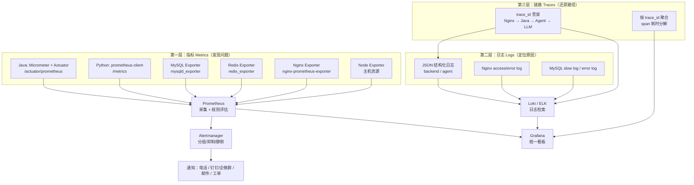
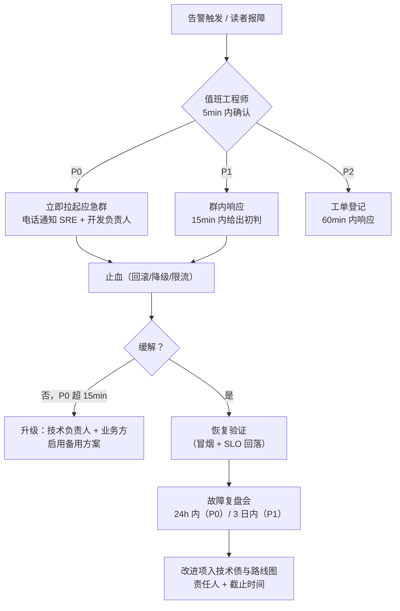
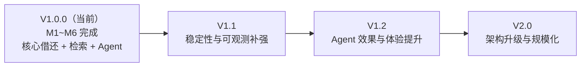

# 08 - SmartLib 运维监控与迭代规划

| 项目 | 内容 |
|---|---|
| 项目代号 | **SmartLib**（高校图书馆智能借阅与推荐平台） |
| 文档版本 | v1.0.0（对齐 `docs/00-项目蓝图.md` v1.0.0） |
| 文档定位 | 阶段门 **M6（运维迭代）** 的主交付物：监控体系、告警规则、日志规范、SLO 与错误预算、值班与演练、容量规划、迭代路线图、技术债、成本、运维索引 |
| 上游契约 | `docs/00-项目蓝图.md` §7 非功能指标（SLO）、§6 六大解决方案、§10 里程碑 M1~M6 |
| 关联文档 | `docs/07-部署上线手册.md`（部署与应急预案）、`docs/06-测试计划与报告.md`（实测数据）、`docs/12-项目复盘与维护手册.md`（复盘与维护） |
| 数据诚信声明 | 所有监控**实测值、压测值、演练结果、成本实际发生额**一律标注「待实测回填」或「目标值 / 假设值」。**禁止编造实测数据。** |

---

## 1. 监控体系总览

### 1.1 三层可观测架构



### 1.2 三层职责与排障顺序

| 层 | 回答的问题 | 典型手段 | 何时用 |
|---|---|---|---|
| 指标 Metrics | 「**有没有问题**、什么时候开始、影响多大」 | PromQL、Grafana 看板、告警 | 告警触发后的第一站 |
| 日志 Logs | 「**为什么**报错、哪个分支、什么参数」 | Loki/ELK 检索 `trace_id`、`level=ERROR` | 指标异常后立即跟进 |
| 链路 Traces | 「慢在**哪一跳**、Agent 调了几次工具」 | trace_id 聚合、span 耗时瀑布图 | 性能问题与 Agent 多步任务 |

**排障口诀**：**先看指标定范围 → 再用日志找原因 → 最后看链路定位跳数**。

### 1.3 工具选型与替代方案

| 能力 | 本项目选型 | 理由 | 替代方案 | 替代代价 |
|---|---|---|---|---|
| 指标采集 | **Prometheus** + Micrometer/Actuator | Spring Boot 原生支持，蓝图 §3.1 已指定 | VictoriaMetrics、Datadog | 学习成本 / 商业费用 |
| 指标看板 | **Grafana** | 生态成熟，可用 Dashboard JSON 版本化 | Kibana、自研看板 | 开发量 |
| 告警路由 | **Alertmanager** | 分组、抑制、静默、去重齐全 | Grafana Alerting、PagerDuty | 功能裁剪 |
| 日志聚合 | **Loki + Promtail**（轻量优先） | 与 Grafana 一体，资源占用低 | ELK（Elasticsearch+Logstash+Kibana） | 资源占用高（ES 需 4C8G+） |
| 链路追踪 | **trace_id 透传 + span 日志**（轻量自研） | 零额外组件，跨 Java/Python 即可串联 | OpenTelemetry + Jaeger/Tempo | 需要 SDK 改造与存储 |
| 采集代理 | Node Exporter / mysqld_exporter / redis_exporter / nginx-prometheus-exporter | 官方或社区标准 exporter | 云厂商托管监控 | 绑定厂商 |
| 日志采集 | Promtail（DaemonSet / 宿主机 agent） | 与 Loki 配套 | Filebeat + Logstash | 资源与配置复杂度 |
| 告警通知 | 钉钉/企业微信 Webhook + 电话（P0） | 国内可达性好 | 邮件、短信、PagerDuty | 触达时效 |

> **替代方案切换条件**：日志量 > 500GB/月 或需要全文复杂查询 → 切 ELK；需要分布式链路采样与依赖拓扑 → 上 OpenTelemetry + Tempo。

### 1.4 采集频率与保留

| 数据 | 采集间隔 | 保留期 | 说明 |
|---|---|---|---|
| 应用指标 | 15s | 原始 15d，降采样 1y | `scrape_interval: 15s` |
| 主机/DB 指标 | 15s / 30s | 原始 15d，降采样 1y | DB 用 30s 降负载 |
| 应用日志 | 实时（5s flush） | 热存 7d，冷存 90d | Loki 保留 7d，归档到对象存储 |
| Nginx access log | 实时 | 热存 7d，冷存 30d | 量大，优先压缩 |
| 审计日志（库存流水） | 实时入 DB | **永久（`stock_ledger`）** | 对账与追责依据 |
| 链路 span | 随日志 | 与日志一致 | 无独立存储 |

---

## 2. 核心指标清单

> 所有指标名按 Micrometer 命名规范（`_total`、`_seconds`、`_bucket`）；SLO 阈值全部对齐蓝图 §7。

### 2.1 业务与性能指标

| 指标名 | 类型 | 含义 | 来源 | 采集方式 | SLO 阈值（蓝图 §7） |
|---|---|---|---|---|---|
| `http_server_requests_seconds_bucket{uri="/api/borrows"}` | Histogram | 借阅接口耗时分布 | Java backend | `/actuator/prometheus` | **P99 < 200ms**（单实例 4C8G） |
| `http_server_requests_seconds_count{uri="/api/borrows"}` | Counter | 借阅接口请求数（推 QPS） | Java backend | 同上 | **≥ 200 QPS**（单实例，S2 策略） |
| `http_server_requests_seconds_bucket{uri="/api/books"}` | Histogram | 检索接口耗时分布 | Java backend | 同上 | **P99 < 300ms**（120 万书目，TopK 20） |
| `smartlib_search_requests_total{engine,degraded}` | Counter | 检索引擎请求数与降级标记 | Java backend | 业务埋点 | 降级比例 < 5%（目标值） |
| `smartlib_search_recall_ratio` | Gauge | 检索召回率（评测任务写入） | 离线评测脚本 | Pushgateway / 定时任务 | **≥ 95%** |
| `smartlib_stock_deduct_total{strategy,result}` | Counter | 库存扣减次数（success/fail/retry） | Java backend | 业务埋点 | 失败率 < 0.5%（目标值） |
| `smartlib_stock_oversell_total` | Counter | **超卖次数（硬约束）** | Java backend + 对账任务 | 业务埋点 + 对账 SQL | **必须恒为 0** |
| `smartlib_stock_ledger_diff_rows` | Gauge | 流水与库存不守恒行数（对账任务） | 定时对账任务 | 每 5min 执行 SQL 写入 | **必须恒为 0** |
| `smartlib_idempotent_hit_total` | Counter | 幂等命中次数 | Java backend | 业务埋点 | 参考指标（无阈值） |
| `cache_gets_total{cache="bookL1",result="hit"}` | Counter | Caffeine L1 命中数 | Java backend | Micrometer Cache | 命中率 > 70%（目标值） |
| `cache_gets_total{cache="bookL2",result="hit"}` | Counter | Redis L2 命中数 | Java backend | Micrometer Cache | 命中率 > 80%（目标值） |
| `smartlib_cache_hit_ratio` | Gauge | 综合缓存命中率 | 计算指标 | PromQL recording rule | > 80%（待实测回填基线） |
| `smartlib_circuit_state{name}` | Gauge | 熔断器状态（0=CLOSED,1=HALF_OPEN,2=OPEN） | Java backend | 业务埋点 | OPEN 持续 > 1min 即告警 |
| `smartlib_circuit_short_circuit_total{name}` | Counter | 熔断短路次数 | Java backend | 业务埋点 | 突增即告警 |
| `smartlib_ratelimit_rejected_total{scope}` | Counter | 限流拒绝数（public/internal/agent） | Java backend | 业务埋点 | 拒绝率 > 1% 告警 |
| `hikaricp_connections_pending` | Gauge | 等待 DB 连接的线程数 | Java backend | Actuator | > 5 持续 1min 告警 |
| `hikaricp_connections_active` | Gauge | 活跃 DB 连接数 | Java backend | Actuator | > 80% 池上限告警 |
| `jvm_gc_pause_seconds_bucket{action="end of major GC"}` | Histogram | Full GC 暂停时长 | Java backend | Actuator | P99 > 1s 告警 |
| `jvm_memory_used_bytes{area="heap"}` | Gauge | 堆使用量 | Java backend | Actuator | > 75% limit 告警 |
| `mysql_global_status_threads_connected` | Gauge | MySQL 当前连接数 | mysqld_exporter | Prometheus 采集 | > 70% `max_connections` |
| `mysql_global_status_slow_queries` | Counter | 慢查询累计数 | mysqld_exporter | Prometheus 采集 | 5min 增量 > 10 告警 |
| `mysql_slave_status_seconds_behind_master` | Gauge | 主从延迟 | mysqld_exporter | Prometheus 采集 | > 10s 告警 |
| `redis_memory_used_bytes` / `redis_memory_max_bytes` | Gauge | Redis 内存使用与上限 | redis_exporter | Prometheus 采集 | 使用率 > 75% 告警 |
| `redis_keyspace_hits_total` / `redis_keyspace_misses_total` | Counter | Redis 命中/未命中 | redis_exporter | Prometheus 采集 | 命中率 < 70% 告警 |
| `nginx_http_requests_total` | Counter | Nginx 请求总数 | nginx-prometheus-exporter | Prometheus 采集 | 参考指标 |
| `nginx_upstream_response_time` | Gauge | 上游响应时间（日志侧统计） | 日志聚合 | Loki 指标查询 | P99 > 500ms 告警（目标值） |

### 2.2 Agent 侧指标（对齐蓝图 §6.4 与 §7）

| 指标名 | 类型 | 含义 | 来源 | 采集方式 | SLO 阈值（蓝图 §7） |
|---|---|---|---|---|---|
| `agent_intent_accuracy` | Gauge | 意图识别准确率（评测集产出） | `eval/run_eval.py` | 定时任务 Pushgateway | **≥ 92%** |
| `agent_tool_param_accuracy` | Gauge | 工具参数正确率 | 同上 | 同上 | **≥ 95%** |
| `agent_e2e_success_ratio` | Gauge | 端到端任务成功率 | 同上 | 同上 | **≥ 88%** |
| `agent_intent_total{intent,source}` | Counter | 意图分布（规则命中 vs LLM 兜底） | Agent | `/metrics` | 规则命中占比监控（成本相关） |
| `agent_tool_calls_total{tool,result}` | Counter | 工具调用次数与结果 | Agent `tool_executor` | `/metrics` | 工具成功率 > 98%（目标值） |
| `agent_tool_duration_seconds_bucket{tool}` | Histogram | 工具调用耗时 | Agent | `/metrics` | P95 < 3s（超时阈值 3000ms） |
| `agent_first_token_seconds_bucket` | Histogram | 首 token 延迟 | Agent SSE 埋点 | `/metrics` | **P95 < 1.5s** |
| `agent_llm_tokens_total{type="prompt\|completion"}` | Counter | Token 消耗 | Agent LLM 客户端 | `/metrics` | 日预算告警（见 §12） |
| `agent_llm_requests_total{provider,result}` | Counter | LLM 调用次数与结果 | Agent LLM 客户端 | `/metrics` | 失败率 > 2% 告警 |
| `agent_llm_duration_seconds_bucket` | Histogram | LLM 调用耗时 | Agent | `/metrics` | P95 < 8s（目标值） |
| `agent_tool_evidence_ratio` | Gauge | 事实性回答带工具证据比例 | Guardrail 埋点 | `/metrics` | **100%（硬约束）** |
| `agent_guardrail_block_total{reason}` | Counter | 护栏拦截次数（幻觉/敏感词/转人工） | Agent Guardrail | `/metrics` | 转人工比例突增告警 |
| `agent_rag_recall_ratio` | Gauge | RAG 召回命中率 | 评测任务 | Pushgateway | > 90%（目标值） |
| `agent_session_active` | Gauge | 活跃会话数 | Agent Memory | `/metrics` | 参考指标 |
| `agent_sse_stream_total{result}` | Counter | SSE 流结果（complete/abort/error） | Agent | `/metrics` | 中断率 < 2% 告警 |

### 2.3 Recording Rules（预计算，降低查询成本）

```yaml
# deploy/prometheus/rules/smartlib-recording.yml
groups:
  - name: smartlib-recording
    interval: 30s
    rules:
      - record: smartlib:borrow_p99_5m
        expr: histogram_quantile(0.99, sum by (le) (rate(http_server_requests_seconds_bucket{uri="/api/borrows"}[5m])))

      - record: smartlib:borrow_qps_5m
        expr: sum(rate(http_server_requests_seconds_count{uri="/api/borrows"}[5m]))

      - record: smartlib:search_p99_5m
        expr: histogram_quantile(0.99, sum by (le) (rate(http_server_requests_seconds_bucket{uri="/api/books"}[5m])))

      - record: smartlib:http_error_ratio_5m
        expr: |
          sum(rate(http_server_requests_seconds_count{status=~"5.."}[5m]))
          /
          clamp_min(sum(rate(http_server_requests_seconds_count[5m])), 0.001)

      - record: smartlib:cache_hit_ratio_5m
        expr: |
          sum(rate(cache_gets_total{result="hit"}[5m]))
          /
          clamp_min(sum(rate(cache_gets_total[5m])), 0.001)

      - record: smartlib:stock_deduct_fail_ratio_5m
        expr: |
          sum(rate(smartlib_stock_deduct_total{result="fail"}[5m]))
          /
          clamp_min(sum(rate(smartlib_stock_deduct_total[5m])), 0.001)

      - record: smartlib:agent_first_token_p95_5m
        expr: histogram_quantile(0.95, sum by (le) (rate(agent_first_token_seconds_bucket[5m])))

      - record: smartlib:agent_tool_success_ratio_5m
        expr: |
          sum(rate(agent_tool_calls_total{result="success"}[5m]))
          /
          clamp_min(sum(rate(agent_tool_calls_total[5m])), 0.001)
```

---

## 3. 告警规则表

**级别定义**：

| 级别 | 含义 | 通知渠道 | 首响时限 |
|---|---|---|---|
| **P0** | 业务不可用 / 数据正确性受损（超卖、不守恒、借还停摆） | 电话 + 群 + 邮件 + 工单 | 5 min |
| **P1** | 核心能力显著劣化（SLO 超标、错误率上升、容量告警） | 群 + 邮件 + 工单 | 15 min |
| **P2** | 指标轻微劣化 / 非核心异常 / 容量趋势预警 | 群 | 60 min |

### 3.1 告警规则（22 条）

| # | 规则名 | 表达式（PromQL） | 级别 | for | 通知渠道 | 处置动作 | 误报规避 |
|---|---|---|---|---|---|---|---|
| 1 | `StockOversell` | `smartlib_stock_oversell_total > 0` | **P0** | 0m | 电话+群+邮件 | 立即按 `docs/07` §12.1 止血；回滚 | 无（硬约束，必须立刻响应） |
| 2 | `StockLedgerMismatch` | `smartlib_stock_ledger_diff_rows > 0` | **P0** | 0m | 电话+群 | 冻结库存写操作，按流水对账修正 | 对账任务本身失败也触发，需同时看任务状态 |
| 3 | `BorrowApiDown` | `sum(rate(http_server_requests_seconds_count{uri="/api/borrows"}[3m])) == 0 and sum(up{job="smartlib-backend"}) > 0` | **P0** | 3m | 电话+群 | 查实例健康、DB 连通性 | 需确认非维护窗口；排除压测环境 |
| 4 | `Http5xxHigh` | `smartlib:http_error_ratio_5m > 0.01` | **P0** | 2m | 电话+群 | 定位异常 URI 与实例，必要时回滚 | 排除 `/actuator` 与管理端点；灰度期单独阈值 |
| 5 | `AllBackendInstancesDown` | `sum(up{job="smartlib-backend"}) < 1` | **P0** | 1m | 电话+群 | 全量不可用，拉起实例/切换 | 排除 Prometheus 自身采集失败（看 `up` 波动） |
| 6 | `BorrowP99High` | `smartlib:borrow_p99_5m > 0.2` | **P1** | 5m | 群+邮件 | 查慢 SQL、连接池、GC | 大促/开学季单独调阈值；避开单点抖动（`for 5m`） |
| 7 | `BorrowQpsDrop` | `smartlib:borrow_qps_5m < 5 and hour() between 8 and 21` | **P1** | 10m | 群 | 查上下游、Nginx 5xx、限流误伤 | 排除假期/闭馆日（用静默日历） |
| 8 | `SearchP99High` | `smartlib:search_p99_5m > 0.3` | **P1** | 5m | 群+邮件 | 检查索引、降级到 DB 直查 | 排除索引重建窗口（重建期静默） |
| 9 | `SearchRecallLow` | `smartlib_search_recall_ratio < 0.95` | **P2** | 1h | 群 | 复跑评测、检查索引完整性 | 评测样本量小导致波动，需 ≥3 次连续 |
| 10 | `CacheHitRatioLow` | `smartlib:cache_hit_ratio_5m < 0.7` | **P2** | 15m | 群 | 查 TTL、key 设计、Redis 内存 | 排除刚发布后缓存冷启动（发布后 30min 静默） |
| 11 | `StockDeductFailHigh` | `smartlib:stock_deduct_fail_ratio_5m > 0.005` | **P1** | 5m | 群+邮件 | 查锁竞争、重试、库存热点书 | 排除活动瞬时抢购（配合 burst 判断） |
| 12 | `StockDeductRetryStorm` | `sum(rate(smartlib_stock_deduct_total{result="retry"}[5m])) > 50` | **P2** | 5m | 群 | 查乐观锁冲突率，评估切 S5 | 与 QPS 同向增长属正常，需看 retry 比率 |
| 13 | `CircuitOpen` | `max(smartlib_circuit_state) >= 2` | **P1** | 1m | 群+邮件 | 查下游依赖（DB/Redis/Agent 上游），确认降级路径生效 | 半开探测期勿告警（用 `>= 2` 而非常态波动） |
| 14 | `CircuitOpenTooLong` | `max_over_time(smartlib_circuit_state[10m]) >= 2` | **P0** | 10m | 电话+群 | 依赖长期不可用，执行应急预案 | 同上 |
| 15 | `RateLimitRejectHigh` | `sum(rate(smartlib_ratelimit_rejected_total[5m])) > 10` | **P1** | 5m | 群 | 判断是攻击还是容量不足，调整阈值/扩容 | 区分 scope：`agent_chat` 收紧属预期，需单独规则 |
| 16 | `HikariPendingHigh` | `max(hikaricp_connections_pending) > 5` | **P1** | 1m | 群+邮件 | 查慢 SQL、长事务、连接泄漏 | 排除 DB 重启瞬间（1m for） |
| 17 | `SlowQuerySpike` | `increase(mysql_global_status_slow_queries[5m]) > 10` | **P1** | 5m | 群 | 拉慢查询日志，加索引/优化 SQL | 排除 DDL 或批量导入窗口（维护静默） |
| 18 | `MysqlReplicationLag` | `mysql_slave_status_seconds_behind_master > 10` | **P1** | 3m | 群+邮件 | 查大事务、从库负载 | 排除批量灌数窗口（静默） |
| 19 | `RedisDown` | `up{job="redis"} == 0 or redis_up == 0` | **P0** | 1m | 电话+群 | 按 `docs/07` §12.2 降级到 S2 | 排除重启（`for 1m`）；确认 exporter 本身健康 |
| 20 | `RedisMemoryHigh` | `redis_memory_used_bytes / redis_memory_max_bytes > 0.75` | **P1** | 10m | 群 | 扩容/调 TTL/清大 key | 排除 `evicted_keys` 增长中的正常淘汰 |
| 21 | `RedisEvicting` | `increase(redis_evicted_keys_total[10m]) > 1000` | **P2** | 10m | 群 | 查大 key 与内存上限 | 冷启动期预热会造成淘汰，需静默 |
| 22 | `JvmFullGcLong` | `histogram_quantile(0.99, sum by (le) (rate(jvm_gc_pause_seconds_bucket{action="end of major GC"}[5m]))) > 1` | **P1** | 5m | 群+邮件 | 查堆内存、索引对象、内存泄漏 | 排除启动期（startup 30min 静默） |
| 23 | `JvmHeapHigh` | `jvm_memory_used_bytes{area="heap"} / jvm_memory_max_bytes{area="heap"} > 0.75` | **P1** | 10m | 群 | 扩容或排查泄漏 | 排除发布后堆增长（30min 静默） |
| 24 | `AgentFirstTokenSlow` | `smartlib:agent_first_token_p95_5m > 1.5` | **P1** | 5m | 群+邮件 | 查 LLM 供应商延迟、RAG 召回、并发 | 排除 LLM 供应商抖动（结合 `agent_llm_duration`） |
| 25 | `AgentLlmFailureHigh` | `sum(rate(agent_llm_requests_total{result="fail"}[5m])) / clamp_min(sum(rate(agent_llm_requests_total[5m])), 0.001) > 0.02` | **P1** | 5m | 群+邮件 | 切备用供应商/降级规则直答 | 排除配额超限（配合 429 状态码判断） |
| 26 | `AgentToolSuccessLow` | `smartlib:agent_tool_success_ratio_5m < 0.98` | **P1** | 10m | 群 | 查后端 `/internal/agent/**` 与签名 | 低流量时段用绝对量下限过滤（`and > 20`） |
| 27 | `AgentToolEvidenceLost` | `agent_tool_evidence_ratio < 1` | **P0** | 5m | 电话+群 | 按 `docs/07` §12.5 降级为规则直答 | 无（硬约束） |
| 28 | `AgentTokenBudgetHigh` | `sum(increase(agent_llm_tokens_total[1d])) > 8e7` | **P2** | 30m | 群 | 提高规则路由占比/限流/调模型 | 排除活动期（预设静默窗口） |
| 29 | `AgentIntentAccuracyLow` | `agent_intent_accuracy < 0.92` | **P1** | 1h | 群+邮件 | 复跑评测，回归 Prompt/模型 | 评测集抽样波动，需连续 2 次 |
| 30 | `AgentE2eSuccessLow` | `agent_e2e_success_ratio < 0.88` | **P1** | 1h | 群+邮件 | 定位失败样本 TOP 原因 | 同上 |
| 31 | `DiskSpaceLow` | `node_filesystem_avail_bytes{mountpoint="/"} / node_filesystem_size_bytes{mountpoint="/"} < 0.15` | **P1** | 10m | 群+邮件 | 清理日志/归档数据/扩容 | 排除已卸载卷（`fstype!~"tmpfs"`） |
| 32 | `DiskSpaceCritical` | `node_filesystem_avail_bytes{mountpoint="/"} / node_filesystem_size_bytes{mountpoint="/"} < 0.05` | **P0** | 5m | 电话+群 | 立即清理或扩容，防止 DB 写失败 | 同上 |
| 33 | `Nginx5xxHigh` | `sum(rate(nginx_http_requests_total{status=~"5.."}[5m])) / clamp_min(sum(rate(nginx_http_requests_total[5m])),0.001) > 0.01` | **P1** | 3m | 群+邮件 | 查上游健康、超时配置 | 排除上游主动重启（滚动发布窗口静默） |
| 34 | `CertExpiring` | `probe_ssl_earliest_cert_expiry - time() < 14 * 24 * 3600` | **P2** | 1h | 群+邮件 | 续签证书并 reload | 排除已自动续签（cert-manager 生效后） |

**共 34 条**（P0 8 条 / P1 18 条 / P2 8 条），覆盖蓝图 §7 全部 SLO 项。

### 3.2 Alertmanager 配置（分组 / 抑制 / 静默）

```yaml
# deploy/prometheus/alertmanager.yml
global:
  resolve_timeout: 5m

route:
  receiver: default-webhook
  group_by: ["alertname", "instance", "uri"]
  group_wait: 30s
  group_interval: 5m
  repeat_interval: 4h
  routes:
    - matchers: ['severity="P0"']
      receiver: p0-call-and-chat
      group_wait: 10s
      repeat_interval: 30m
      continue: true
    - matchers: ['severity="P1"']
      receiver: p1-chat-mail
      repeat_interval: 2h
    - matchers: ['severity="P2"']
      receiver: p2-chat
      repeat_interval: 12h

inhibit_rules:
  # 全局不可用时，抑制其派生告警，避免告警风暴
  - source_matchers: ['alertname="AllBackendInstancesDown"']
    target_matchers: ['severity=~"P1|P2"']
    equal: []
  # MySQL 挂了，抑制慢查询/连接池告警
  - source_matchers: ['alertname="BorrowApiDown"']
    target_matchers: ['alertname=~"HikariPendingHigh|SlowQuerySpike"']
    equal: ["instance"]
  # Redis 挂了，抑制缓存命中率告警
  - source_matchers: ['alertname="RedisDown"']
    target_matchers: ['alertname="CacheHitRatioLow"']
    equal: []

receivers:
  - name: default-webhook
    webhook_configs:
      - url: "http://chat-webhook.internal/alert"
  - name: p0-call-and-chat
    webhook_configs:
      - url: "http://chat-webhook.internal/alert/p0"
    # 电话通道由值班平台（如 OnCall 系统）转发
  - name: p1-chat-mail
    webhook_configs:
      - url: "http://chat-webhook.internal/alert/p1"
        send_resolved: true
  - name: p2-chat
    webhook_configs:
      - url: "http://chat-webhook.internal/alert/p2"
        send_resolved: true
```

### 3.3 告警质量治理

| 问题 | 治理手段 | 目标 |
|---|---|---|
| 告警风暴 | 抑制规则 + 分组 + `group_wait` | 单次故障告警条数 ≤ 5 |
| 频繁误报 | 提高 `for`、加静默日历（假期/维护窗）、加绝对量下限 | 误报率 < 10% |
| 无人响应 | P0 电话升级、值班表轮换、超时 15min 自动升级 | P0 首响 ≤ 5min |
| 告警无动作 | 每条告警必须写「处置动作」，无动作的规则直接删除 | 100% 有 Runbook 链接 |

---

## 4. 日志规范

### 4.1 日志结构（JSON）

```json
{
  "ts": "2025-01-01T10:20:30.123+08:00",
  "level": "ERROR",
  "app": "smartlib-backend",
  "instance": "backend-1",
  "env": "prod",
  "trace_id": "7f3c1a9e4b2d4f0a",
  "span_id": "a1b2c3d4",
  "parent_span_id": "e5f6a7b8",
  "logger": "com.smartlib.service.BorrowService",
  "thread": "http-nio-8080-exec-7",
  "msg": "库存扣减失败，库存不足",
  "error_code": "STOCK_NOT_ENOUGH",
  "http_method": "POST",
  "uri": "/api/borrows",
  "status": 409,
  "duration_ms": 38,
  "reader_id": 100234,
  "book_id": 88761,
  "biz_no": "borrow-20250101-100234-88761",
  "strategy": "optimistic_db",
  "extra": { "available_copies": 0, "requested": 1 }
}
```

### 4.2 字段规范

| 字段 | 类型 | 必填 | 说明 | 示例 |
|---|---|---|---|---|
| `ts` | string | 是 | ISO-8601 带时区（`Asia/Shanghai`） | `2025-01-01T10:20:30.123+08:00` |
| `level` | string | 是 | `TRACE/DEBUG/INFO/WARN/ERROR` | `ERROR` |
| `app` | string | 是 | 应用名 | `smartlib-backend` / `smartlib-agent` |
| `instance` | string | 是 | 实例标识 | `backend-1`、`POD_NAME` |
| `env` | string | 是 | 环境 | `dev/test/staging/prod` |
| `trace_id` | string | 是 | 全链路追踪 ID（16 位十六进制） | `7f3c1a9e4b2d4f0a` |
| `span_id` | string | 是 | 当前 span（8 位十六进制） | `a1b2c3d4` |
| `parent_span_id` | string | 否 | 上游 span，还原调用树 | `e5f6a7b8` |
| `logger` | string | 是 | 类名/模块名 | `com.smartlib.service.BorrowService` |
| `thread` | string | 是 | 线程/协程名（Python 为 task 名） | `http-nio-8080-exec-7` |
| `msg` | string | 是 | 人类可读描述（禁止拼接敏感信息） | `库存扣减失败，库存不足` |
| `error_code` | string | 否 | 业务错误码（对齐 `ErrorCode`） | `STOCK_NOT_ENOUGH` |
| `http_method` / `uri` / `status` | string/int | 否 | 接口上下文 | `POST` / `/api/borrows` / `409` |
| `duration_ms` | number | 否 | 耗时（毫秒） | `38` |
| `reader_id` / `book_id` | number | 否 | 业务主键（**非敏感**，允许记录） | `100234` / `88761` |
| `biz_no` | string | 否 | 业务幂等号，与 `stock_ledger.biz_no` 对应 | `borrow-20250101-...` |
| `strategy` / `engine` | string | 否 | 当前生效的 SPI 实现（便于对比分析） | `optimistic_db` / `inverted_index` |
| `degraded` | boolean | 否 | 是否走了降级路径 | `false` |
| `extra` | object | 否 | 扩展上下文（**必须已脱敏**） | `{"available_copies":0}` |
| `stack` | string | 否 | 异常栈（仅 ERROR/WARN，生产折叠多行） | `...` |

### 4.3 级别使用规范

| 级别 | 使用场景 | 示例 | 生产默认 |
|---|---|---|---|
| `TRACE` | 逐步骤调试细节（参数级） | 缓存 key 命中过程 | **关闭** |
| `DEBUG` | 开发排障细节 | SQL 与参数 | **关闭**（可按需开） |
| `INFO` | 关键业务节点（一次请求 1~3 条） | 借阅成功、检索完成、Agent 任务结束 | **开启** |
| `WARN` | 可恢复异常、降级、重试、限流 | 缓存击穿、熔断开启、限流拒绝 | **开启** |
| `ERROR` | 需要人介入的失败 | 扣减失败、DB 不可用、LLM 调用失败 | **开启** |

**硬规则**：

1. ERROR 必须带 `error_code` 与 `trace_id`，且**必须**有对应告警或工单入口。
2. 禁止在循环体内打 INFO（检索逐条打日志曾导致日志量放大 100 倍）。
3. 异常必须打全栈一次，禁止在上层重复打印同一异常（避免日志风暴）。
4. 生产禁止 `logging.level.root=DEBUG`；如需临时开启，通过 Actuator `loggers` 端点按 logger 精确开启并在 30min 内关闭。

### 4.4 trace_id / span 规范

| 规则 | 内容 |
|---|---|
| 生成 | Nginx 若收到 `X-Trace-Id` 则透传，否则生成；生成规则：16 位十六进制随机 |
| 透传 | Nginx → Java（`TraceIdFilter` 写入 MDC）→ Agent（`X-Trace-Id` 请求头）→ LLM 调用（写入日志） |
| 回传 | 统一响应体 `traceId` 字段返回给客户端，便于读者/馆员报障时提供 |
| span 生成 | 每跨一次进程边界生成新 `span_id`，`parent_span_id` 指向上游 |
| Agent 多步任务 | 每个工具调用一个 span，命名 `tool:<name>`；LLM 调用 span 命名 `llm:<model>` |
| 采样 | 全量记录 `trace_id`（成本低）；ERROR 与慢请求（`duration_ms > 1000`）强制完整上下文 |
| 存储 | 与日志同存（Loki），支持按 `trace_id` 一键串联 |

```bash
# 全链路检索示例：从一条报障信息中的 traceId 还原完整路径
curl -sG 'http://loki.internal/loki/api/v1/query_range' \
  --data-urlencode 'query={app=~"smartlib-.*"} |= "7f3c1a9e4b2d4f0a"' \
  --data-urlencode 'limit=200' | jq -r '.data.result[].values[][1]' | jq -c '{ts,app,level,span_id,msg}'
```

### 4.5 脱敏规则

| 数据类别 | 示例 | 处理方式 | 说明 |
|---|---|---|---|
| 手机号 | `13812345678` | `138****5678` | 保留前 3 后 4 |
| 身份证 | `110101199001011234` | `110101********1234` | 保留前 6 后 4 |
| 银行卡/一卡通号 | `6222021234567890123` | `6222***********0123` | 保留前 4 后 4 |
| 姓名 | `张三` | `张*` | 保留姓氏 |
| 密码 / 密钥 | `password=...` | `***` | **永不记录**，命中即告警 |
| LLM API Key | `sk-xxxx` | `sk-****` | 只记录前后各 2 位 |
| 读者邮箱 | `a@b.edu.cn` | `a***@b.edu.cn` | 保留首字符与域名 |
| 读者 ID | `100234` | **保留原文** | 非敏感且排障必需 |

实现要求：Java 侧 `MaskingConverter`（Logback layout 装饰器）+ `smartlib.log.mask.enabled=true`；Python 侧 `logging.Filter` 统一处理。**任何新增日志字段必须过脱敏白名单/黑名单校验**，并在 Code Review 清单中检查。

```xml
<!-- backend/src/main/resources/logback-spring.xml（要点） -->
<configuration>
  <appender name="JSON" class="ch.qos.logback.core.ConsoleAppender">
    <encoder class="net.logstash.logback.encoder.LogstashEncoder">
      <includeMdc>true</includeMdc>
      <customFields>{"app":"smartlib-backend","env":"${ENV:-prod}"}</customFields>
      <fieldNames>
        <timestamp>ts</timestamp><message>msg</message><thread>thread</thread>
        <logger>logger</logger><level>level</level>
      </fieldNames>
    </encoder>
  </appender>
  <!-- MDC 中注入 traceId/spanId，由 TraceIdFilter 填充 -->
  <root level="INFO">
    <appender-ref ref="JSON"/>
  </root>
  <logger name="com.smartlib" level="INFO"/>
</configuration>
```

### 4.6 日志切割与保留

| 日志 | 切割策略 | 热保留 | 冷保留 | 压缩 | 清理方式 |
|---|---|---|---|---|---|
| 应用日志（容器 stdout） | Docker `json-file`：`max-size=50m`、`max-file=5` | 7d（Loki） | 90d（对象存储） | gzip | Loki retention + 归档任务 |
| 应用日志（落盘 `/var/log/smartlib`） | logback `SizeAndTimeBasedRollingPolicy`：`maxFileSize=100MB`、`maxHistory=7`、`totalSizeCap=5GB` | 7d | — | gzip | 滚动自动删除 |
| Nginx access/error | logrotate：`daily`、`rotate 14`、`compress`、`delaycompress` | 7d | 30d | gzip | logrotate |
| MySQL slow log | `logrotate`：`daily`、`rotate 7` | 7d | 30d | gzip | logrotate |
| MySQL error log | `daily`、`rotate 14` | 14d | 90d | gzip | logrotate |
| 审计（`stock_ledger`） | 按年分区/归档（未来 V1.2） | 在线 1y | 永久（冷存） | — | 归档脚本 |

```conf
# deploy/nginx/logrotate.conf
/var/log/nginx/*.log {
    daily
    missingok
    rotate 14
    compress
    delaycompress
    notifempty
    create 0640 nginx adm
    sharedscripts
    postrotate
        [ -f /var/run/nginx.pid ] && kill -USR1 $(cat /var/run/nginx.pid)
    endscript
}
```

---

## 5. SLO 与错误预算

### 5.1 可用性 SLO 计算过程（99.9%）

**定义（对齐蓝图 §7）**：

- SLI（指标）：成功请求比例 = `1 - (5xx 请求数 + 超时请求数) / 总请求数`，按「借阅 + 检索」核心接口计算。
- SLO（目标）：**99.9%**（月度滚动窗口）。

**可用性时间预算推导（自然月按 30 天计）**：

```
每月总分钟数 = 30 天 × 24 小时 × 60 分钟 = 43,200 分钟
允许不可用时间 = 43,200 × (1 - 99.9%) = 43,200 × 0.001 = 43.2 分钟/月
```

| 计算项 | 30 天月 | 31 天月 | 28 天月（2 月） |
|---|---|---|---|
| 总分钟数 | 43,200 | 44,640 | 40,320 |
| 允许不可用（99.9%） | **43.2 min** | **44.64 min** | **40.32 min** |
| 允许不可用/周（折算） | ≈ 10.08 min | ≈ 10.08 min | ≈ 10.08 min |
| 允许不可用/天（折算） | ≈ 1.44 min | ≈ 1.44 min | ≈ 1.44 min |

**按请求量折算（日均借还 4,000 次，峰值日按 3 倍估）**：

```
日均请求（借还，乐观估计）≈ 4,000 次
月均请求 ≈ 4,000 × 30 = 120,000 次
允许失败请求数 = 120,000 × 0.001 = 120 次/月
```

> 注意：以时间口径计算是 43.2 min/月，以请求口径是 120 次/月（仅借还）。检索 QPS 峰值 1,500，
> 请求口径会显著更严，**上线后按请求口径作为主口径**，时间口径作为对外沟通口径，两者同时监控。

### 5.2 分层 SLO（对齐蓝图 §7 全部指标）

| 类别 | SLO 项 | 目标 | 计量口径 | 预算消耗方式 |
|---|---|---|---|---|
| 可用性 | 服务可用性 | 99.9% | 月度成功请求比例 | 43.2 min/月等值 |
| 可用性 | 单实例故障恢复 | < 30s，错误率 < 0.1% | 演练/真实故障计时 | 每次故障按实际时长扣减 |
| 性能 | 借阅 P99 | < 200ms | 5min 窗口 P99 | 超标时长计入「性能预算」 |
| 性能 | 借阅 QPS | ≥ 200（单实例 S2） | 单实例 5min 平均 | 容量不足触发扩容而非扣预算 |
| 性能 | 检索 P99 | < 300ms | 5min 窗口 P99 | 同上 |
| 质量 | 检索召回率 | ≥ 95% | 评测集离线评估 | 月度评测不达标即扣 10% 预算 |
| 正确性 | 超卖数 | 0 | 对账 SQL + 埋点 | **零容忍：出现即视为 P0 事故** |
| 正确性 | 库存流水守恒 | 恒等 | 对账任务 5min | **零容忍** |
| 正确性 | 超卖数（**200 并发抢 10 册，六策略**） | 本轮已实测 = **0**（六种扣减策略一致；口径见 `docs/06` §6.1.1：本机 H2 `MODE=MySQL`、单 JVM、未做 JVM 调优） | `StockConcurrencyTest` 自动生成 `scripts/bench/results/stock-strategy-bench.md` | 出现即视为 P0 事故（零容忍口径不变） |
| 安全 | 幂等 | 同 Key 只生效一次 | 单测 + 线上抽样 | 出现重复即视为 P1 |
| Agent | 意图识别准确率 | ≥ 92% | 评测集 | 月度评测 |
| Agent | 工具参数正确率 | ≥ 95% | 评测集 | 月度评测 |
| Agent | 端到端成功率 | ≥ 88% | 评测集 | 月度评测 |
| Agent | 首 Token 延迟 | < 1.5s（P95） | SSE 埋点 | 超标时长计入预算 |
| Agent | 工具证据比例 | 100% | Guardrail 埋点 | **零容忍** |

### 5.3 错误预算消耗策略

| 剩余预算 | 状态 | 团队动作 |
|---|---|---|
| 100% ~ 50% | 🟢 健康 | 正常迭代，可发布新功能 |
| 50% ~ 25% | 🟡 关注 | 发布需 SRE 会签；优先修复稳定性缺陷；暂停非必要重构 |
| 25% ~ 0% | 🟠 受限 | **只允许修复类发布**；冻结新功能；每日复盘预算消耗 |
| 已耗尽（< 0） | 🔴 熔断 | **全面冻结功能发布**；集中投入可靠性改进；需技术负责人批准才可解冻；启动专项故障复盘 |

**预算消耗加速规则**：

1. 每次 P0 事故按「实际影响时长 × 2」扣减（惩罚性，鼓励预防）。
2. 出现超卖/不守恒/工具证据缺失，**直接扣减 30% 月度预算**（数据正确性优先）。
3. 计划内维护窗口（提前 3 天公告）不扣减预算；未公告的维护按故障计。

### 5.4 燃烧率（Burn Rate）告警

**燃烧率定义**：`burn_rate = 实际错误率 / SLO 允许错误率`。99.9% SLO 的允许错误率为 `0.001`。

| 告警 | 长窗口 | 短窗口 | 燃烧率阈值 | 等效后果 | 级别 | 动作 |
|---|---|---|---|---|---|---|
| `ErrorBudgetBurnFast` | 1h | 5m | **14.4×** | 2 天内耗尽月度预算 | **P0** | 立即介入，按应急预案止血 |
| `ErrorBudgetBurnMedium` | 6h | 30m | **6×** | 约 5 天耗尽 | **P1** | 当日定位并修复 |
| `ErrorBudgetBurnSlow` | 1d | 2h | **3×** | 约 10 天耗尽 | **P1** | 次日前给出改进计划 |
| `ErrorBudgetBurnTrend` | 3d | 6h | **1×** | 刚好在月底耗尽 | **P2** | 纳入迭代排期 |

```yaml
# deploy/prometheus/rules/smartlib-slo-burn.yml
groups:
  - name: smartlib-slo-burn
    rules:
      # 快烧：1h / 5m 双窗口，14.4 倍
      - alert: ErrorBudgetBurnFast
        expr: |
          (
            sum(rate(http_server_requests_seconds_count{status=~"5.."}[1h]))
            / clamp_min(sum(rate(http_server_requests_seconds_count[1h])), 0.001)
          ) > (14.4 * 0.001)
          and
          (
            sum(rate(http_server_requests_seconds_count{status=~"5.."}[5m]))
            / clamp_min(sum(rate(http_server_requests_seconds_count[5m])), 0.001)
          ) > (14.4 * 0.001)
        for: 2m
        labels: { severity: "P0" }
        annotations:
          summary: "错误预算快速燃烧（1h/5m 双窗口 14.4x）"
          runbook: "docs/08-运维监控与迭代规划.md#55-预算燃烧处置"

      # 中烧：6h / 30m，6 倍
      - alert: ErrorBudgetBurnMedium
        expr: |
          (
            sum(rate(http_server_requests_seconds_count{status=~"5.."}[6h]))
            / clamp_min(sum(rate(http_server_requests_seconds_count[6h])), 0.001)
          ) > (6 * 0.001)
          and
          (
            sum(rate(http_server_requests_seconds_count{status=~"5.."}[30m]))
            / clamp_min(sum(rate(http_server_requests_seconds_count[30m])), 0.001)
          ) > (6 * 0.001)
        for: 5m
        labels: { severity: "P1" }

      # 慢烧：1d / 2h，3 倍
      - alert: ErrorBudgetBurnSlow
        expr: |
          (
            sum(rate(http_server_requests_seconds_count{status=~"5.."}[1d]))
            / clamp_min(sum(rate(http_server_requests_seconds_count[1d])), 0.001)
          ) > (3 * 0.001)
          and
          (
            sum(rate(http_server_requests_seconds_count{status=~"5.."}[2h]))
            / clamp_min(sum(rate(http_server_requests_seconds_count[2h])), 0.001)
          ) > (3 * 0.001)
        for: 10m
        labels: { severity: "P1" }
```

### 5.5 预算燃烧处置（Runbook）

1. **确认影响范围**：看 `smartlib:http_error_ratio_5m` 与 `up`，判断是单实例还是全局。
2. **确认是否已触发 P0 告警**：优先跟随 P0 应急预案（`docs/07` §12）。
3. **止血优先于定位**：先回滚/降级/限流，把错误率压回阈值内，再定位根因。
4. **记录事故**：起止时间、影响请求数、预估预算消耗、根因、改进项 → 写入 `docs/reviews/` 故障复盘纪要。
5. **更新预算台账**：在月度运维报告（`docs/reviews/`）中登记剩余预算。

---

## 6. 值班与故障处理流程

### 6.1 故障分级定义

| 级别 | 定义 | 示例 | 首响时限 | 恢复时限目标 | 升级时限 |
|---|---|---|---|---|---|
| **P0** | 核心借还不可用；出现超卖或流水不守恒；数据正确性受损 | MySQL 挂、全实例宕机、`available_copies<0` | 5 min | 30 min（目标值，待实测回填） | 15 min 未缓解 |
| **P1** | 核心功能显著劣化或部分不可用 | 借阅 P99 > 200ms 持续 10min、检索 504 增多、Redis 挂但已降级、Agent 全量不可用 | 15 min | 2 h（目标值） | 30 min 未缓解 |
| **P2** | 非核心功能异常或指标劣化 | 缓存命中率偏低、单本书信息错误、推荐不准确 | 60 min | 1 个工作日 | 4 h 未缓解 |
| **P3** | 体验问题、建议类 | 文案、排序偏好 | 1 个工作日 | 纳入迭代 | — |

### 6.2 响应与升级路径



### 6.3 值班安排

| 项目 | 内容 |
|---|---|
| 值班周期 | 每周轮换，周一 10:00 交接 |
| 值班角色 | 主值班（SRE）+ 备值班（开发，覆盖业务逻辑问题） |
| 交接内容 | 未闭环告警、进行中变更、错误预算余额、待观察项 |
| 值班工具 | 告警平台（电话/群）、Runbook（`docs/07` §12 + 本文 §5.5）、OnCall 排班表 |
| 值班纪律 | 告警 5min 内认领；无法处置立即升级，**不逞强** |

### 6.4 沟通模板

**① 故障通报（首次，发出后置顶）**

```
【故障通报】SmartLib P1 借阅接口超时
- 发现时间：2025-01-01 10:12（告警 BorrowP99High）
- 影响范围：借阅接口 P99 从 <200ms 升至 1.2s；部分读者借书失败（错误率 1.8%）
- 当前状态：已降级检索到 DB 直查，正在排查连接池
- 影响用户：约影响 10:05–10:12 的借阅请求（估算 300+ 次，待核实）
- 处置人：@SRE-A（主）@Dev-B（备）
- 下次更新：10:30
```

**② 进展更新（每 15min 或状态变化时）**

```
【进展更新】10:30
- 已确认：HikariCP pending > 8，疑似慢 SQL 引发连接耗尽
- 已执行：杀掉 3 个长事务（10:20）；连接池 pending 回落至 0
- 待观察：借阅 P99 已回落 180ms，继续观察 30min
- 下次更新：11:00
```

**③ 恢复通报**

```
【恢复通报】11:05
- 恢复时间：11:02（总影响 50min）
- 根因：报表任务缺索引导致全表扫描，占用连接池
- 止血动作：终止长事务 + 临时限流 + 回滚报表查询
- 后续：12:00 前补索引；24h 内出复盘纪要
- 预算影响：待计算（写入月度运维报告）
```

**④ 复盘纪要（模板，24h 内）**

```
# SmartLib 故障复盘纪要（YYYY-MM-DD）
- 级别 / 时长 / 影响面：
- 时间线（发现→止血→恢复→验证）：
- 直接原因 / 根本原因（五个为什么）：
- 做得好的：
- 需要改进的：
- 改进项（含责任人与截止时间）：
- 错误预算消耗：
```

---

## 7. 故障演练计划

### 7.1 演练类型与频率

| 演练类型 | 目标 | 频率 | 演练方式 | 风险控制 |
|---|---|---|---|---|
| 单实例强杀 | 验证 <30s 无感恢复 | 每月 | `docker kill` / `kubectl delete pod` | 保留另一实例；避开借还高峰 |
| Redis 停机 | 验证缓存降级到 DB 直查 | 每季度 | 停 Redis 容器 5min | 预先确认 S5→S2 降级开关 |
| MySQL 主库切换 | 验证 DB 高可用与只读降级 | 每半年 | 主从切换 / 停主库 | 在预发先演练；有备份 |
| 检索接口压测 | 验证 1500 QPS 峰值下 P99 | 每季度（开学前必做） | `wrk`/`k6` 压测 | 限流保护；观察 DB 负载 |
| 借阅并发抢书 | 验证零超卖（200 线程抢 10 册） | 每次发布前 | `BorrowConcurrencyTest` / `StockConcurrencyTest` | 测试环境执行 |
| 缓存击穿/雪崩 | 验证单飞、逻辑过期、TTL 抖动 | 每季度 | 批量删热点 key | 提前预热脚本 |
| Agent 幻觉事故演练 | 验证规则直答降级与工具证据断言 | 每季度 | 注入无工具证据回答 | 仅测试环境 |
| 备份恢复演练 | 验证备份可恢复 | 每季度 | 恢复至临时库并校验 | 独立实例，不影响生产 |
| 全链路混沌演练 | 组合故障（DB 慢 + Redis 抖） | 每半年 | Chaos Mesh / 手工注入 | 需评审批准，设熔断恢复点 |

### 7.2 演练脚本（示例：单实例强杀）

```bash
#!/usr/bin/env bash
# scripts/drill/kill_one_backend.sh
# 目标：验证单实例故障恢复 < 30s，错误率 < 0.1%
set -euo pipefail

TARGET="${1:-backend-1}"
DURATION="${2:-60}"
BASE_URL="${BASE_URL:-http://localhost}"
OUT_DIR="${OUT_DIR:-./drill-out}"
mkdir -p "$OUT_DIR"
TS=$(date +%Y%m%d-%H%M%S)
RESULT="$OUT_DIR/kill-$TARGET-$TS.txt"

echo "== 演练开始 $(date -Iseconds) 目标=$TARGET 时长=${DURATION}s ==" | tee -a "$RESULT"

# 1) 基线采样（故障前 30s）
echo "-- 基线：连续采样借阅接口耗时与状态" | tee -a "$RESULT"
for i in $(seq 1 30); do
  curl -s -o /dev/null -w "%{http_code} %{time_total}\n" \
    "$BASE_URL/api/books?query=算法&page=1&size=5" >> "$RESULT"
  sleep 1
done

# 2) 后台持续施压（模拟真实流量）
( end=$((SECONDS + DURATION + 60))
  while [ $SECONDS -lt $end ]; do
    curl -s -o /dev/null -w "%{http_code} %{time_total}\n" \
      "$BASE_URL/api/books?query=计算机网络&page=1&size=5" >> "$OUT_DIR/load-$TS.txt"
  done ) &
LOAD_PID=$!

sleep 10

# 3) 强杀目标实例
echo "-- 强杀 $TARGET @ $(date -Iseconds)" | tee -a "$RESULT"
if command -v kubectl >/dev/null 2>&1; then
  kubectl -n smartlib delete pod "$(kubectl -n smartlib get pod -l app=smartlib-backend -o name | head -1)"
else
  docker kill "$TARGET"
fi
KILL_AT=$(date +%s)

# 4) 观察恢复（轮询健康 + 记录首个失败与首个恢复成功的时间点）
FIRST_FAIL=""; FIRST_OK_AFTER=""
while [ $(( $(date +%s) - KILL_AT )) -lt "$DURATION" ]; do
  code=$(curl -s -o /dev/null -w "%{http_code}" "$BASE_URL/api/books?query=算法&page=1&size=5" || echo 000)
  if [ "$code" != "200" ] && [ -z "$FIRST_FAIL" ]; then FIRST_FAIL=$(date +%s); fi
  if [ -n "$FIRST_FAIL" ] && [ "$code" = "200" ] && [ -z "$FIRST_OK_AFTER" ]; then
    FIRST_OK_AFTER=$(date +%s)
  fi
  sleep 1
done

wait $LOAD_PID || true

# 5) 结果统计（注意：仅统计本次演练产生的数据）
echo "== 结果 ==" | tee -a "$RESULT"
total=$(wc -l < "$OUT_DIR/load-$TS.txt")
fail=$(grep -cv '^200' "$OUT_DIR/load-$TS.txt" || true)
echo "总请求=$total 失败=$fail 失败率=$(awk "BEGIN{printf \"%.4f%%\", $fail*100/($total>0?$total:1)}")" | tee -a "$RESULT"
if [ -n "$FIRST_FAIL" ] && [ -n "$FIRST_OK_AFTER" ]; then
  echo "恢复耗时=$(( FIRST_OK_AFTER - FIRST_FAIL ))s" | tee -a "$RESULT"
else
  echo "恢复耗时=未观测到失败或未恢复（需人工核查）" | tee -a "$RESULT"
fi
echo "== 明细见 $RESULT 与 $OUT_DIR/load-$TS.txt ==" | tee -a "$RESULT"
```

### 7.3 验收标准

| 演练 | 验收标准（判定通过） | 不通过处置 |
|---|---|---|
| 单实例强杀 | 恢复时间 **< 30s**；错误率 **< 0.1%**；无超卖；无数据不守恒 | 检查 Nginx `fail_timeout`、readiness 探针、优雅停机；重新演练 |
| Redis 停机 | 借阅仍可用（降级 S2）；错误率 < 0.1%；缓存恢复后命中率回到基线 | 检查 `redis-lua.fallback`、连接超时、熔断阈值 |
| MySQL 主库切换 | 切换 **< 60s**（目标值）；数据零丢失；流水守恒 | 检查高可用组件、备份与 binlog |
| 检索压测 | 1500 QPS 下 P99 **< 300ms**，错误率 < 0.1% | 优化索引/加实例/切 Q5 |
| 并发抢书 | `available_copies == 0` 且成功借出 == 10；流水守恒 | 修复策略实现 |
| 缓存击穿 | 无 DB 雪崩；单飞生效；P99 波动 < 50% | 检查单飞实现与 TTL 抖动 |
| Agent 幻觉演练 | 无工具证据的回答 **0 条**；降级开关生效 < 1min | 修 Guardrail 与断言 |
| 备份恢复 | 恢复数据与备份点一致；校验 SQL 全通过 | 修备份脚本与流程 |

### 7.4 本轮已执行的验证与仍未验证的项（如实登记）

> 本节只记录**本轮真实执行过**的内容，其余一律保持「待实测回填」。数据来源见 `docs/06-测试计划与报告.md` §6.1.1、§6.2.1 与 §8.2；本节与 §8 演练记录的「待实测回填」不冲突——§8 记录的是**尚未执行**的 staging 演练。

**本轮已执行**

| # | 内容 | 结果 | 运行环境（口径） |
|---|---|---|---|
| 1 | 后端测试套件 `scripts/mvn.ps1 -f backend/pom.xml test` | **Tests run: 41, Failures: 0, Errors: 0, Skipped: 0，BUILD SUCCESS**（`CoreComponentsTest` 13、`StockConcurrencyTest` 7、`BorrowFlowTest` 8、`HttpApiTest` 10、`SearchEngineBenchmarkTest` 2、`ScheduledTasksWiringTest` 1） | 本机 Windows / JDK 25 运行（字节码 release 21）/ H2 2.5.252 内存库 `MODE=MySQL` / 单 JVM / **未做 JVM 调优** |
| 2 | 库存扣减六策略并发校验（200 并发抢 10 册） | 六策略**全部零超卖**：成功 10 / 可用库存 0 / 流水之和 −10 / 对账 SQL 无异常。P50/P99（ms）：S2 20/27、S3 18/27、S4 12/19、S1 16/27、S5 322/351、S6 24/28 | 同上；**延迟绝对值仅适合方案间横向对比** |
| 3 | 检索引擎对比（`like` 基线 vs 自研倒排） | P99 **21ms → 5ms（约 4.2 倍）**、QPS **54.6 → 420.5（约 7.7 倍）**、召回率 **83.33% → 98.67%** | **20,000 条书目 / 15 查询 × 10 轮 / TopK=10**，直接调引擎、绕过缓存 |
| 4 | 缺陷闭环 | 本轮真实发现并修复 **7 条**（`docs/06` §8.2 BUG-009~BUG-015），其中 P0 4 条、P1 3 条 | 同上 |

**本轮仍未验证（不得在告警阈值标定、容量规划或应急预案中当作已知量）**

| 未验证项 | 原因 | 补齐方式 |
|---|---|---|
| 单实例 4C8G 下的借阅 QPS ≥ 200、P99 < 200ms（§9.1 容量输入） | 本机未做 JVM 调优，且环境非 4C8G 单实例口径 | 在目标规格环境压测后回填 |
| 检索峰值 1,500 QPS 下的 P99 < 300ms（DRILL-004） | 同上；本轮检索数据量为 20,000 条 | 生成 120 万书目后按 DRILL-004 执行 |
| 单实例强杀恢复 < 30s、错误率 < 0.1%（DRILL-001） | **未启动双实例 + Nginx**，未做故障注入 | 在 staging 执行 §7.2 脚本并回填 §8.1 |
| Redis 停机的降级表现（DRILL-002） | 本机**未部署 Redis**；本轮测到的是**降级路径**（借阅 P99 621ms → 加短路后 351ms），不是 Redis 可用时的正常路径 | 部署 Redis 后执行 §8.2 演练 |
| MySQL 8.0 的 SQL 方言、行锁等待与慢查询表现 | 测试跑在 **H2 `MODE=MySQL`**，H2 无真实行锁竞争 | 在 MySQL 8.0 bench 环境复验并回填 |
| Docker Compose / K8s / Nginx / Elasticsearch 的部署形态 | 本机均**未实际启动** | 在 staging 起全栈后按 §7.1 计划执行 |
| Agent 侧全部指标（意图/参数/端到端/首 token/证据比例）与真实大模型路径 | 本轮未执行 Agent 评测集，且无 API Key | 跑 `agent-service/app/eval/run_eval.py`，mock 与真实 LLM 分列记录 |
| 120 万条生产规模下的绝对延迟与容量拐点 | 数据量为 CI 规模（20,000 条） | 全量数据 + 梯度压测后回填 |

---

## 8. 演练记录

> **说明**：以下两次演练为**计划中的演练方案**。所有「实际结果」栏统一标注为 **待实测回填**；
> 本节**不包含任何编造的实测数据**。演练完成后由演练执行人回填，并附上 `scripts/drill/` 输出文件路径。

### 8.1 演练一：强杀一个 backend 实例

| 项目 | 内容 |
|---|---|
| 演练编号 | DRILL-001 |
| 演练日期 | 待实测回填 |
| 演练类型 | 单实例强杀（混沌演练） |
| 目标 | 验证蓝图 §6.3 A2/A6：单实例故障 30s 内无感恢复，错误率 < 0.1%，零超卖 |
| 环境 | staging（1:1 模拟 prod 拓扑：Nginx + backend×2 + MySQL + Redis） |
| 参与角色 | SRE（执行）、开发（观察）、测试（数据记录） |
| 工具/脚本 | `scripts/drill/kill_one_backend.sh backend-1 60` |
| 前置条件 | 双实例均健康；监控告警就绪；错误预算 > 50%；非业务高峰 |

**演练步骤**

| 步骤 | 操作 | 期望观测点 |
|---|---|---|
| 1 | 记录基线：连续 60s 采样检索/借阅接口状态码与耗时 | P99 与错误率处于 SLO 内 |
| 2 | 启动持续压测（单线程 1 QPS 冒烟 + 并发压测工具 k6 50 并发） | 流量稳定 |
| 3 | 执行 `docker kill backend-1`（或 `kubectl delete pod`） | 实例立即消失 |
| 4 | 观察 Nginx：`max_fails=3` / `fail_timeout=10s` 是否摘除上游 | 日志出现 `upstream ... failed`，流量切到 backend-2 |
| 5 | 观察业务：接口是否 5xx | 期望失败率 < 0.1% |
| 6 | 观察恢复：backend-1 是否被重启/拉起并通过 readiness | 恢复时间 < 30s |
| 7 | 校验数据正确性：超卖与流水守恒 | 恒为 0 |
| 8 | 汇总数据并回填本表 | 输出 `drill-out/kill-backend-1-*.txt` |

**监控现象（演练中应观察到的指标轨迹）**

| 指标 | 预期现象（判定依据，非实测值） |
|---|---|
| `up{job="smartlib-backend",instance="backend-1"}` | 在强杀后 0，重启后回到 1 |
| `nginx_upstream_response_time` | 强杀瞬间出现少量失败/超时，随后恢复 |
| `smartlib:http_error_ratio_5m` | 尖峰后回落到 < 0.1% |
| `smartlib:borrow_p99_5m` | 短暂上升（摘除窗口内），恢复后回落 |
| `sum(rate(http_server_requests_seconds_count{instance="backend-1"}[1m]))` | 降至 0，恢复后重新承接流量 |
| `smartlib_stock_oversell_total` / `smartlib_stock_ledger_diff_rows` | **全程保持 0** |

**实际结果**

| 项目 | 实际值 | 备注 |
|---|---|---|
| 强杀时间点 | 待实测回填 | |
| 首个失败请求时间 | 待实测回填 | |
| 恢复成功时间 | 待实测回填 | |
| **恢复耗时（s）** | **待实测回填** | 判定标准：< 30s |
| 总请求数 / 失败请求数 | 待实测回填 | |
| **错误率（%）** | **待实测回填** | 判定标准：< 0.1% |
| 超卖增加数 | 待实测回填 | 判定标准：= 0 |
| 流水不守恒行数 | 待实测回填 | 判定标准：= 0 |
| 告警是否按预期触发 | 待实测回填 | 应触发实例 down 类告警 |
| 证据文件 | 待回填（`scripts/drill/drill-out/...`） | |

**结论（判定标准）**

| 判定条件 | 结论 |
|---|---|
| 恢复耗时 < 30s 且 错误率 < 0.1% 且 超卖 = 0 且 流水守恒 | ✅ 通过（满足蓝图 §6.3 验收） |
| 恢复耗时 < 30s 但错误率 0.1%~1% | ⚠️ 有条件通过，需优化 Nginx 摘除速度/优雅停机 |
| 恢复耗时 ≥ 30s 或错误率 ≥ 1% 或出现超卖 | ❌ 不通过，必须整改后重演 |

**本次结论：待实测回填。**

### 8.2 演练二：停掉 Redis，观察降级

| 项目 | 内容 |
|---|---|
| 演练编号 | DRILL-002 |
| 演练日期 | 待实测回填 |
| 演练类型 | 依赖故障降级演练 |
| 目标 | 验证蓝图 §6.1 降级（S5→S2）与 §6.5 缓存降级：Redis 不可用时业务不中断，借还可完成，缓存层自动降级到 DB 直查 |
| 环境 | staging |
| 参与角色 | SRE（执行）、开发（观察）、测试（数据记录） |
| 工具/脚本 | `docker compose stop redis` + 压测脚本 `scripts/bench/search_bench.sh` + 业务冒烟脚本 |
| 前置条件 | `smartlib.stock.redis-lua.fallback=true`；当前策略非 S5 时先切 S5 以验证降级路径；错误预算充足 |

**演练步骤**

| 步骤 | 操作 | 期望观测点 |
|---|---|---|
| 1 | 记录基线：缓存命中率、借阅 P99、检索 P99、DB QPS | 均处于 SLO 内 |
| 2 | 将库存策略切为 `redis_lua`（S5，验证降级路径） | 策略生效，日志显示 `strategy=redis_lua` |
| 3 | 执行 `docker compose stop redis` | Redis 容器停止 |
| 4 | 观察降级：策略是否自动降级为 `optimistic_db`（S2） | 日志出现降级 WARN；`degraded=true` |
| 5 | 观察缓存：L2 是否跳过，L1/DB 是否承接 | 检索仍返回结果，`engine/log degraded` 标记 |
| 6 | 观察业务连续性：借书/还书/检索是否可用 | 成功率 ≥ 99.9%（目标），无超卖 |
| 7 | 观察 DB 压力：连接数与慢查询 | 连接数上升但在池内；慢查询无明显增长 |
| 8 | 恢复 Redis（`docker compose start redis`），观察策略自动切回 S5 | 缓存命中率回升，策略回到 `redis_lua` |
| 9 | 回填数据 | 输出演练记录与截图路径 |

**监控现象（应观察到）**

| 指标 | 预期现象 |
|---|---|
| `up{job="redis"}` | 由 1 → 0 |
| `smartlib_circuit_state{name="redis"}` | 可能进入 OPEN（或降级开关直接跳过） |
| `smartlib_stock_deduct_total{strategy="optimistic_db"}` | 停 Redis 后开始增长（证明降级生效） |
| `smartlib:cache_hit_ratio_5m` | 明显下降（L2 缺失） |
| `smartlib:cache_hit_ratio_5m`（恢复后） | 回升至基线 |
| `http_server_requests_seconds_count{uri="/api/borrows",status=~"2.."}` | 保持增长（业务未中断） |
| `hikaricp_connections_active` | 上升（缓存降级后 DB 压力增大） |
| `mysql_global_status_slow_queries` | 应无显著增长（否则说明缓存降级后 SQL 过重） |
| `smartlib_stock_oversell_total` | **全程为 0** |

**实际结果**

| 项目 | 实际值 | 备注 |
|---|---|---|
| 停 Redis 时间点 | 待实测回填 | |
| 策略切换（降级）生效耗时 | 待实测回填 | 目标：≤ 5s（待实测回填） |
| 降级期间借阅成功率 | **待实测回填** | 判定：≥ 99.9% |
| 降级期间借阅 P99 | **待实测回填** | 判定：< 200ms（可能放宽） |
| 降级期间检索 P99 | **待实测回填** | 判定：< 300ms |
| 缓存命中率（降级期） | **待实测回填** | 预期显著下降 |
| 缓存命中率（恢复后 10min） | **待实测回填** | 判定：回到基线 ±10% |
| DB 连接池峰值 / pending | **待实测回填** | 判定：pending 不持续 > 0 |
| 慢查询 5min 增量 | **待实测回填** | 判定：无显著增长 |
| 超卖 / 流水不守恒 | **待实测回填** | 判定：= 0 |
| 恢复 Redis 后是否自动切回 | 待实测回填 | 期望自动或一次配置刷新 |
| 告警触发情况 | 待实测回填 | 应触发 `RedisDown` (P0) |
| 证据文件 | 待回填 | |

**结论（判定标准）**

| 判定条件 | 结论 |
|---|---|
| 借阅成功率 ≥ 99.9% 且 超卖 = 0 且 恢复后命中率回到基线 | ✅ 通过（验证了「Redis 可降级」的关键设计假设） |
| 业务可用但降级期 P99 超 SLO 2 倍以上 | ⚠️ 有条件通过，需优化 DB 直查路径与连接池 |
| 出现借阅失败率 > 0.1% 或 任何超卖 | ❌ 不通过，降级路径不可用，必须整改 |

**本次结论：待实测回填。**

### 8.3 演练记录台账（持续维护）

| 编号 | 类型 | 计划日期 | 实际日期 | 结论 | 遗留问题 | 责任人 | 状态 |
|---|---|---|---|---|---|---|---|
| DRILL-001 | 单实例强杀 | 每月 | 待回填 | 待回填 | 待回填 | SRE | 未执行 |
| DRILL-002 | Redis 停机降级 | 每季度 | 待回填 | 待回填 | 待回填 | SRE | 未执行 |
| DRILL-003 | MySQL 主库切换 | 每半年 | 待回填 | 待回填 | 待回填 | DBA | 未执行 |
| DRILL-004 | 检索 1500 QPS 压测 | 每季度/开学前 | 待回填 | 待回填 | 待回填 | 测试+SRE | 未执行 |
| DRILL-005 | 备份恢复 | 每季度 | 待回填 | 待回填 | 待回填 | DBA | 未执行 |
| DRILL-006 | Agent 幻觉降级 | 每季度 | 待回填 | 待回填 | 待回填 | Agent 开发 | 未执行 |

---

## 9. 容量规划

### 9.1 输入参数（来自蓝图 §1.1 与 §7）

| 参数 | 取值 | 来源 |
|---|---|---|
| 在校师生 | **32,000 人** | 蓝图 §1.1 |
| 馆藏 | **58 万种 / 120 万册** | 蓝图 §1.1 |
| 年借阅量 | **96 万次** | 蓝图 §1.1 |
| 日均借还 | **约 4,000 次** | 蓝图 §1.1 |
| 峰值借还 QPS | **约 30**（容量设计目标 200 QPS，相对业务峰值留 6 倍余量） | 蓝图 §1.1 |
| 峰值检索 QPS | **1,500** | 蓝图 §1.1 |
| 单书目瞬时并发 | **200+**（同一 `book_id` 的同一行库存记录，超卖真实成因） | 蓝图 §1.1 |
| 单实例借阅能力 | ≥ 200 QPS（S2 策略，4C8G） | 蓝图 §7 |
| 借阅 P99 | < 200ms | 蓝图 §7 |
| 检索 P99 | < 300ms（120 万书目，TopK 20） | 蓝图 §7 |
| 可用性 | 99.9% | 蓝图 §7 |

### 9.2 存储容量推算

**表 1：核心表容量（按 3 年数据保留推算）**

| 表 | 行数推算 | 单行估算 | 数据量 | 索引估算（×0.5） | 小计 |
|---|---|---|---|---|---|
| `book` | 58 万种 + 3 年新增 6 万种 ≈ **64 万** | ~1.2 KB（标题/作者/出版社/简介/tags） | ~750 MB | ~380 MB | **~1.13 GB** |
| `book_stock` | 与 book 1:1 ≈ **64 万** | ~120 B | ~75 MB | ~40 MB | **~115 MB** |
| `reader` | 3.2 万 + 年度新增 ≈ **3.5 万** | ~300 B | ~10 MB | ~5 MB | **~15 MB** |
| `borrow_record` | 96 万/年 × 3 年 ≈ **288 万** | ~250 B | ~690 MB | ~350 MB | **~1.04 GB** |
| `stock_ledger` | 借出+归还+预约+修正 ≈ 200 万/年 × 3 年 ≈ **600 万** | ~200 B | ~1.14 GB | ~570 MB | **~1.71 GB** |
| `reservation` | 约 10 万/年 × 3 年 ≈ **30 万** | ~200 B | ~57 MB | ~30 MB | **~87 MB** |
| `idempotent_record` | 稳态（TTL 24h 清理）≈ **10 万** | ~300 B（含 result_json） | ~29 MB | ~15 MB | **~44 MB** |
| `rule_config` | **< 100** | ~200 B | < 1 MB | — | **< 1 MB** |
| `category` | **< 1,000** | ~100 B | < 1 MB | — | **< 1 MB** |
| **合计（3 年）** | — | — | **≈ 2.75 GB** | **≈ 1.39 GB** | **≈ 4.14 GB** |

**表 2：实例侧容量分配**

| 项 | 推算 | 说明 |
|---|---|---|
| MySQL 数据文件 | ~4.2 GB（3 年） | 含索引 |
| MySQL binlog | 按写入量估算：日均新增约 3.8 MB（`borrow_record`+`stock_ledger`），保留 7 天 → **~30 MB**；实际按峰值放大 10 倍预留 **~1 GB** | `binlog_expire_logs_seconds=604800` |
| InnoDB redo/undo + 临时表 | 预留 **~4 GB** | `innodb_buffer_pool_size=4G` 之外 |
| 慢日志/错误日志 | 7 天滚动，预留 **~2 GB** | |
| **MySQL 磁盘建议** | **≥ 100 GB SSD**（含 3 年数据 + binlog + 备份落地 + Buffer） | 使用率警戒 70%、紧急 85% |
| MySQL 内存 | `innodb_buffer_pool_size = 4G`，实例 **8C32G** | 缓冲池可容纳全量热数据（约 4 GB 热集） |
| Redis 内存 | 热书目缓存 30 万条 × ~2 KB ≈ **600 MB**；检索热词结果 ≈ **200 MB**；会话/分布式锁 ≈ **100 MB**；合计 ≈ 900 MB → 预留 **2 GB**（`maxmemory 2gb`） | 淘汰策略 `allkeys-lru` |
| 后端 JVM 内存 | 8 GB limit，堆约 5.6 GB（`MaxRAMPercentage=70`） | 其中倒排索引见下 |
| 倒排索引内存 | 64 万书目 × 平均 15 tokens ≈ **960 万 postings**；每 posting（docId 4B + 权重 4B）≈ 8 B → **约 77 MB**；词典/跳表/正向表开销 ×2~3 → **约 200 MB**；书名规范化 + 拼音索引再 ×1.5 → **约 300 MB** | 单实例堆内可承受 |
| L1 本地缓存 | Caffeine `max-size=10000` × ~2 KB ≈ **20 MB** | 可忽略 |
| Agent 内存 | 4 GB limit；BM25 索引 + 会话内存 ≈ 1~2 GB | FastAPI + httpx 开销小 |
| 日志磁盘（应用） | 50 MB × 5 文件 × 2 实例 ≈ **500 MB**；落盘 5 GB 上限 | 见 §4.6 |

### 9.3 QPS 与实例数推算

**借阅链路**

```
借还业务峰值 QPS = 30（蓝图 §1.1）
借还接口容量设计目标 = 200 QPS（蓝图 §1.1，相对业务峰值 30 留 6 倍余量；**非业务峰值**）
单实例能力   = 200 QPS（蓝图 §7，S2 策略，实测待回填）
               └ 本轮已测得的相关事实（见 §7.4 与 `docs/06` §6.1.1）：200 并发、单册 10 复本场景下
                 六种扣减策略全部零超卖，S2 的 P50/P99 = 20ms / 27ms；
                 但该环境为本机单 JVM、**未做 JVM 调优**，且**未采集 QPS**，
                 因此**不能**据此判定"单实例能力 ≥ 200 QPS"——该 SLO 仍待目标规格环境压测回填。
理论最小实例数 = ceil(200 / 200) = 1（按容量目标）
高可用最低要求 = 2（单实例故障时仍有 1 台承接，满足"单实例故障 < 30s 恢复"）
实际取值     = 2
HPA 配置    = min 2 / max 4（baseline 2 承接常态，检索侧压力上升时自动扩）
常态实例数  = 2（日均 4,000 次借还 → 平均 QPS ≈ 4,000 /(8h×3600s) ≈ 0.14，远低于能力）
说明：借还业务峰值仅约 30 QPS，单实例即可承载，2 台纯为高可用底线；
      真正的容量瓶颈在检索链路（见下），扩容以后端实例数按检索侧取。
```

> **注意**：单书目瞬时并发 200+ 落在同一行库存记录上，**不是靠加后端实例解决的**（多实例只会让更多请求竞争同一行），而由扣减策略（S2 条件更新 / S5 Redis Lua 预扣）与按书分流限流承接，见 §9.4 未来增长预测与扩容触发条件。

**检索链路**

```
峰值检索 QPS = 1,500（蓝图 §1.1）
单实例检索能力 = 待实测回填（暂按 500 QPS 估算，P99 < 300ms）
                 └ 本轮实测（`docs/06` §6.2.1，**口径不同，不可直接用于本推算**）：
                   20,000 条书目 / TopK=10 下，自研倒排 QPS 420.5、P99 5ms（单 JVM、未调优、绕过缓存）。
                   该数值既不是 120 万条口径，也不代表生产指标，仅说明"引擎间相对差距"。
理论最小实例数 = ceil(1500 / 500) = 3（基于估算值，待实测校准）
N+1 冗余    = 4
说明：检索与借阅共用后端实例，因此 P99 需同时满足；
     若检索先饱和，优先扩容后端实例（无状态，扩容成本最低）。
```

**Agent 链路**

```
对话量估算：若 3.2 万师生中 5% 日活、人均 2 次对话 → 3,200 次/日
峰值系数：开学季按 10 倍 → 峰值 约 0.4 QPS（很低）
但 LLM 流式连接占用时间长（首 token < 1.5s，整段 5~20s）
并发连接估算：峰值并发 ≈ 30（0.4 QPS × 平均 15s 占用 ≈ 6，取 5 倍冗余）
单实例 Uvicorn（2 worker）可支撑 50+ 并发 SSE（待实测回填）
实例数：2（满足高可用 + 冗余）
```

**MySQL 连接数**

```
后端实例数（峰值 4）× 每实例连接池上限（30） = 120
Agent 不直连 MySQL（只走 Java 内部接口） → 0
运维/报表/监控 ≈ 20
合计峰值 ≈ 200 → max_connections = 500（预留 2.5 倍余量）
```

### 9.4 未来 1 年增长预测

| 维度 | 当前（V1.0） | 1 年后预测（+12 个月） | 增长率假设 | 影响 | 应对 |
|---|---|---|---|---|---|
| 馆藏种数 | 58 万 | **61 万** | +5%/年 | 索引内存 +5%，DB +30 MB | 无感 |
| 馆藏册数 | 120 万 | **126 万** | +5%/年 | `book_stock` +5% | 无感 |
| 在校师生 | 32,000 | **33,000** | +3%（招生） | 账号与并发小幅上升 | 无感 |
| 年借阅量 | 96 万 | **104 万** | +8%/年（使用率提升） | `borrow_record` 年增 ~250 MB | 3 年后考虑归档 |
| 检索 QPS 峰值 | 1,500 | **1,800** | +20%（推广 Agent 与检索） | 需 4 实例 | HPA max 调到 8 |
| 借还 QPS 峰值 | 30 | **33** | +10% | 容量目标 200 QPS 内，2 实例仍可充分承接 | HPA 按检索侧扩（max 8） |
| Agent 对话量 | 约 3,200/日 | **12,000/日** | +275%（功能完善后推广） | LLM Token ×3.75；并发 ↑ | Agent 实例 4；规则路由占比提至 70% |
| LLM Token 消耗 | 假设 600 万/日 | **2,250 万/日** | 与对话量同比 | 成本显著上升 | 缓存 FAQ 答案 + 规则优先 + 小模型分流 |
| 数据总量（3 年滚动） | ~4.1 GB | **~6.5 GB** | 年增 ~1.5 GB（若 3 年滚动则稳定） | 磁盘仍充裕 | 保持 3 年在线 + 更早数据归档 |
| Redis 内存 | 900 MB | **1.3 GB** | 热数据增长 | 接近 2 GB 上限 | 1 年后评估升至 4 GB |
| 后端实例（峰值） | 2（借还）~ 4（检索） | **4~5** | 检索 QPS 同比 | 成本约 +20% | HPA 自动伸缩 |
| 存储成本 | 100 GB | **150 GB** | | 成本小幅上升 | |

**容量里程碑建议**：

| 触发条件 | 动作 |
|---|---|
| 书目 > 500 万种 | 检索引擎切 Q5（Elasticsearch），`SearchEngine` SPI 换实现 |
| `borrow_record` > 1,000 万行 | 按 `borrow_at` 分区或归档 3 年前数据 |
| `stock_ledger` > 2,000 万行 | 按年分区 + 冷数据归档（审计要求永久保留） |
| Redis 内存使用率持续 > 75% | 扩容至 4 GB 或拆分实例（缓存/会话/锁分离） |
| **借还**业务峰值 QPS > 200（即超过容量设计目标，单实例能力上限） | 评估 S5（Redis Lua 预扣）常态启用，或 MQ 削峰（S6） |
| 单书目瞬时并发持续 > 500，或 S2 热点行排队导致借阅 P99 > 200ms | 按 `book_id` 分流限流 + 该热点书目切 S5（Redis Lua 预扣） |
| LLM 日 Token > 8,000 万 | 引入缓存 FAQ、小模型分流、提高规则命中率 |

---

## 10. 迭代路线图



### 10.1 V1.1（稳定性与可观测补强）

| 项目 | 内容 |
|---|---|
| **目标** | 把「能跑」变成「可运维」：补齐 SLO 度量、演练闭环、降级路径全覆盖；解决 V1.0 遗留的技术债 TOP3 |
| **周期** | 4 周（约 20 个工作日） |
| **需求清单** | ① 库存对账定时任务（5min 一次，差异告警）<br/>② 「可查不可借」只读降级模式产品化<br/>③ Redis 哨兵/Cluster（消除单点）<br/>④ 慢查询治理（补齐缺失索引 + SQL 评审门禁）<br/>⑤ 日志脱敏自动化检查（CI 阶段）<br/>⑥ Agent 对话「答案有误」反馈按钮与评测集闭环<br/>⑦ Grafana 统一看板（业务/资源/Agent 三块）<br/>⑧ 演练自动化脚本完善（DRILL-001~006） |
| **技术方案** | 对账用 `@Scheduled` + SQL 聚合写入 Micrometer Gauge；只读降级用 `ModeSwitch` 开关 + 统一拦截器（写接口返回 503 并带友好文案）；Redis 用哨兵（`spring.data.redis.sentinel.*`）；慢查询用 `EXPLAIN` + `pt-query-digest` 复核后补索引；脱敏检查用自定义 Logback Converter + CI 正则扫描；反馈闭环用 `POST /api/agent/feedback` 落 `eval/dataset.jsonl` 增量集 |
| **工作量（人日）** | 对账 3；只读降级 3；Redis 哨兵 2；慢查询治理 3；脱敏 CI 1；反馈闭环 2；看板 3；演练脚本 3 = **20 人日** |
| **风险** | ① Redis 哨兵改造需停机/双写切换，有短暂不可用风险 → 在 staging 先演练；② 只读降级可能与定时任务冲突 → 明确优先级矩阵 |
| **验收标准** | ① 对账任务连续 7 天 `diff_rows = 0`，且人为造差异能触发 P0 告警；② 停 MySQL 主库时写接口返回 503 且检索可用（演练通过）；③ Redis 单节点宕机不影响业务（演练 DRILL-002 通过并回填）；④ 慢查询 5min 增量从基线下降 ≥ 80%（待实测回填）；⑤ 看板上线且 P0/P1 告警均有 Runbook 链接 |

### 10.2 V1.2（Agent 效果与体验提升）

| 项目 | 内容 |
|---|---|
| **目标** | 把 Agent 从「能答」提升到「答得准、答得快、答得起」：意图准确率 ≥ 92%、端到端 ≥ 88%、首 token < 1.5s 稳定达标，并把 Token 成本压下来 |
| **周期** | 5 周（约 25 个工作日） |
| **需求清单** | ① 意图规则库扩充（覆盖高频 60 个意图，规则命中率提至 ≥ 70%）<br/>② RAG 混合召回（BM25 + 向量，`EMBEDDING_MODE=api` 可选）<br/>③ 多步任务 Plan-Execute 稳定性提升（失败重规划 + 步数预算）<br/>④ 答案缓存（相同问题 + 相同读者状态 → 复用，降 Token）<br/>⑤ SSE 断线续传与前端体验优化（心跳 + 重连）<br/>⑥ 会话上下文压缩（长会话摘要，控制 Token）<br/>⑦ Agent 灰度开关（按读者分层放量）<br/>⑧ 评测集扩充至 300+ 条并接入 CI 回归 |
| **技术方案** | 意图：规则优先 + 加权打分 + LLM 兜底（低置信才调 LLM）；RAG：`rag/retriever.py` 做 RRF 融合排序；Plan-Execute：`planner.py` 增加重规划与预算（`AGENT_MAX_STEPS=6`）；缓存：答案 key = `hash(问题规范化 + 读者关键状态)`，TTL 10min；SSE：`Last-Event-ID` 支持续传 + 15s 心跳；摘要：每 6 轮压缩一次上下文 |
| **工作量（人日）** | 意图库 4；RAG 混合 5；Plan-Execute 4；答案缓存 2；SSE 体验 3；上下文压缩 2；灰度开关 1；评测集与 CI 4 = **25 人日** |
| **风险** | ① 向量检索引入外部依赖（无 Key 时需降级）→ 保留哈希嵌入降级路径；② 答案缓存可能返回过期库存信息 → 事实性问题**禁止命中缓存**（硬约束）；③ 长会话摘要可能丢关键信息 → 保留最近 3 轮原文 |
| **验收标准** | ① `agent_intent_accuracy ≥ 0.92`、`agent_tool_param_accuracy ≥ 0.95`、`agent_e2e_success_ratio ≥ 0.88`（实测回填）；② `agent_first_token_seconds` P95 < 1.5s；③ `agent_tool_evidence_ratio = 1` 恒成立；④ 日 Token 消耗相对基线下降 ≥ 30%（目标值，待实测回填）；⑤ 评测集 ≥ 300 条且 CI 每次发布回归 |

### 10.3 V2.0（架构升级与规模化）

| 项目 | 内容 |
|---|---|
| **目标** | 支撑更大规模与更复杂检索：数据量 > 500 万种时切换专业检索引擎；引入注册中心与 MQ 提升可扩展性；Agent 平台化 |
| **周期** | 8 周（约 40 个工作日） |
| **需求清单** | ① `SearchEngine` SPI 接入 Elasticsearch（Q5）并灰度切换<br/>② 引入 Nacos 做注册与配置中心（A3），配置热更新全覆盖<br/>③ 引入 RocketMQ 事务消息实现 S6（MQ 串行化扣减）用于秒杀场景<br/>④ 预约到馆自动通知（短信/小程序订阅消息）<br/>⑤ 推荐系统升级（协同过滤 + 内容召回，`RecommendService`）<br/>⑥ 数据仓库与报表（借阅分析、热门榜、馆藏利用率）<br/>⑦ 混沌工程常态化（Chaos Mesh）<br/>⑧ 多租户/多校区支持（数据隔离） |
| **技术方案** | ES：`deploy/elasticsearch/` + `ElasticsearchSearchEngine` 实现，双写索引 + 影子读比对（结果集一致性 ≥ 98%）后切流；Nacos：`spring-cloud-alibaba-nacos-discovery/config`，配置项迁到 Nacos 并加 `@RefreshScope`；MQ：`stock` 主题单分区顺序消费 + 事务消息 + 幂等消费；通知：定时任务扫 `reservation.status=READY` 发订阅消息；推荐：离线产出 item-CF 相似矩阵 + 在线召回融合 |
| **工作量（人日）** | ES 接入 8；Nacos 5；MQ 扣减 6；到馆通知 3；推荐升级 6；报表 5；混沌工程 3；多校区 4 = **40 人日** |
| **风险** | ① ES 与自研索引结果不一致（召回差异）→ 影子读比对 + 回滚开关；② 引入 Nacos/MQ/ES 显著增加运维复杂度与成本 → 需配套运维文档与容量规划；③ MQ 最终一致性带来对账复杂度 → 强化 `stock_ledger` 对账 |
| **验收标准** | ① ES 检索 P99 < 100ms 且召回率 ≥ 95%（与自研索引比对）；② 影子读比对一致率 ≥ 98% 后才能切流；③ Nacos 配置热更新生效时间 < 10s 且无需重启；④ MQ 扣减路径 200 并发抢 10 册零超卖且流水守恒；⑤ 通知到达率 ≥ 95%（待实测回填）；⑥ 混沌演练全部通过并留档 |

### 10.4 路线图汇总

| 版本 | 主题 | 周期 | 工作量（人日） | 关键风险 | 核心验收 |
|---|---|---|---|---|---|
| V1.1 | 稳定性与可观测补强 | 4 周 | 20 | Redis 哨兵改造窗口 | 演练全通过 + 对账零差异 |
| V1.2 | Agent 效果与体验 | 5 周 | 25 | 向量依赖 / 缓存正确性 | 三项准确率达标 + 首 token < 1.5s |
| V2.0 | 架构升级与规模化 | 8 周 | 40 | 组件复杂度 / 一致性 | ES P99 < 100ms + MQ 零超卖 |

---

## 11. 技术债清单

| 编号 | 描述 | 影响 | 偿还方案 | 优先级 |
|---|---|---|---|---|
| TD-01 | 库存对账目前依赖人工执行 SQL，无定时任务与告警 | 超卖/流水异常发现滞后（可能数小时） | V1.1 实现 5min 定时对账任务 + `smartlib_stock_ledger_diff_rows` 指标 + P0 告警 | **P0** |
| TD-02 | Redis 单实例，无哨兵/集群 | Redis 挂即触发全站降级，容量与可用性风险 | V1.1 上哨兵；V2.0 评估 Cluster | **P0** |
| TD-03 | MySQL 无自动主从切换，主库故障需人工介入 | 恢复时间不可控，难达 99.9% | V1.1 引入 Orchestrator 或切换云 RDS 高可用版；补「可查不可借」模式 | **P0** |
| TD-04 | 只读降级模式未产品化（DB 挂时写接口报错文案不友好） | 故障期读者体验差，客服压力大 | V1.1 统一 `ModeSwitch` + 友好降级文案 | P1 |
| TD-05 | 慢查询治理未系统化，缺索引评审门禁 | 检索/报表易引发连接池耗尽 | V1.1 补索引 + CI 增加 `EXPLAIN` 门禁 + 月度慢查询报告 | **P1** |
| TD-06 | 日志脱敏依赖开发自觉，无自动校验 | 敏感信息泄露风险（合规） | V1.1 CI 正则扫描 + 关键字段白名单 | **P1** |
| TD-07 | 链路追踪为轻量 trace_id 透传，无采样与依赖拓扑 | 复杂问题定位慢，缺少调用拓扑视图 | V1.2 评估 OpenTelemetry + Tempo/Jaeger | P2 |
| TD-08 | Agent 评测集样本偏少（V1.0 覆盖有限），回归不充分 | 效果回归难以发现，准确率指标置信度低 | V1.2 扩至 300+ 条并接入 CI 回归 | **P1** |
| TD-09 | Agent 无答案缓存与上下文压缩，Token 成本偏高 | 成本随使用量线性上升 | V1.2 实现答案缓存（事实性问题禁缓存）+ 会话摘要 | P2 |
| TD-10 | 自研倒排索引在 > 500 万种时内存与效果受限 | 无法支撑未来规模 | V2.0 接入 ES（Q5）+ 影子读比对 | P2 |
| TD-11 | `idempotent_record` 只有 TTL 清理，无分区，量大后删除变慢 | 表膨胀，清理影响性能 | V1.1 改按时间分区或分批限速删除 | P2 |
| TD-12 | `borrow_record` 与 `stock_ledger` 无分区，3 年后查询变慢 | 报表与对账变慢 | V1.2 按时间分区或归档策略 | P2 |
| TD-13 | 无灰度发布自动化（Nginx 权重手工改） | 灰度推进慢、易出错 | V1.1 灰度脚本化（改权重 + reload + 校验 + 自动回滚） | P1 |
| TD-14 | 单实例能力（200 QPS）来自蓝图设计基线，缺压测实测确认 | 容量规划依据不足 | V1.1 补压测（借阅/检索）并回填 `docs/06`。**本轮进展**：已完成并发正确性验证（六策略零超卖）与检索引擎相对对比（见 §7.4），但**QPS 与 4C8G 口径仍未实测**，故本条债务**未关闭** | **P1** |
| TD-15 | Agent 无多租户/多校区概念 | 未来扩展需重构 | V2.0 设计数据隔离方案 | P3 |
| TD-16 | 前端（小程序）错误上报未接入统一监控 | 前端问题定位依赖读者描述 | V1.2 接入前端错误上报（`window.onerror` / 小程序 `onError`） | P2 |
| TD-17 | 数据备份恢复未定期演练 | 备份可能不可用（最危险的隐性债务） | V1.1 建立每季度恢复演练并留档 | **P0** |
| TD-18 | 无安全扫描流水线（Trivy / dependency-check） | 漏洞上线风险 | V1.1 CI 集成镜像与依赖扫描，HIGH/CRITICAL 阻断 | P1 |

**技术债治理节奏**：每个迭代固定分配 **20% 工作量**偿还技术债；P0 债务必须在 V1.1 内清空。

---

## 12. 成本估算

> **重要说明**：以下**单价为假设值**（用于容量与预算推演的示例口径，非实际采购价、非账单实测值），
> 实际成本必须以云厂商账单为准并回填。金额单位：人民币元。

### 12.1 云资源月成本

| 实例/服务 | 规格 | 数量 | 单价假设（元/月） | 小计（元/月） | 备注 |
|---|---|---|---|---|---|
| 后端应用（ECS/VM） | 4C8G | 2 | 420 | **840** | 常态 2 实例；HPA 峰值临时 +2~3 |
| 后端峰值弹性（按 20% 时间占比计） | 4C8G | 2（折算 0.4） | 420 | **168** | 按量付费折算 |
| Agent 应用（ECS/VM） | 4C8G | 2 | 420 | **840** | Uvicorn 2 worker |
| Nginx / 接入层 | 2C4G | 2 | 210 | **420** | 含 TLS |
| MySQL | 8C32G 高可用（主+备） | 1 套 | 3,200 | **3,200** | 含 100 GB SSD |
| Redis | 2C4G | 1 | 520 | **520** | 哨兵版（V1.1）约 +30% |
| 监控（Prometheus/Grafana/Loki） | 4C8G | 1 | 420 | **420** | 含 200 GB 存储 |
| 对象存储（备份与冷日志） | 200 GB | 1 | 0.12 元/GB | **24** | 备份 + 归档日志 |
| 公网带宽 | 20 Mbps | 1 | 80 元/Mbps | **1,600** | 按固定带宽估算；按流量更省 |
| 负载均衡（如使用云 SLB） | 标准型 | 1 | 180 | **180** | 自建 Nginx 可省 |
| 域名与证书 | 1 年 | 1 | — | **10** | Let's Encrypt 免费，域名摊销 |
| 日志归档存储 | 100 GB | 1 | 0.12 元/GB | **12** | 90 天冷存 |
| **基础设施小计** | — | — | — | **≈ 8,234 元/月** | |

### 12.2 LLM Token 成本

| 项 | 假设值 | 说明 |
|---|---|---|
| 日对话量 | 3,200 次 | 3.2 万师生 × 5% 日活 × 人均 2 次 |
| 单次对话 Token（输入+输出） | 约 3,000 tokens | 含 system prompt、RAG 上下文、多步工具调用 |
| 日 Token 消耗 | 约 600 万 tokens/日 | 3,200 × 3,000 后的量级估算（示例口径） |
| 月 Token 消耗 | 约 1.8 亿 tokens/月 | |
| 单价假设（输入） | 1 元/百万 tokens | **假设值**，需按实际供应商定价替换 |
| 单价假设（输出） | 2 元/百万 tokens | **假设值** |
| 假设输入:输出 = 3:1 | 输入 1.35 亿 + 输出 0.45 亿 | |
| **月度 Token 成本（低价假设）** | 135 × 1 + 45 × 2 = **225 元/月** | 输入 135 百万 tokens、输出 45 百万 tokens |
| **月度 Token 成本（高价假设）** | 135 × 10 + 45 × 20 = **2,250 元/月** | 单价提高 10 倍的情形 |

> **计算口径（务必按此口径替换真实单价）**：
> `月成本 = 输入百万 tokens × 输入单价 + 输出百万 tokens × 输出单价`
> - 低价假设：`135 × 1 + 45 × 2` = `135 + 90` = **225 元/月**
> - 高价假设：`135 × 10 + 45 × 20` = `1,350 + 900` = **2,250 元/月**
>
> 真实金额待云厂商/模型供应商账单回填。V1.2 通过答案缓存 + 规则路由目标降低 **30%**（目标值，待实测回填）。

### 12.3 成本汇总与优化

| 项目 | 月成本（假设，元） | 占比 | 优化手段 |
|---|---|---|---|
| 基础设施 | ≈ 8,234 | ≈ 78%（低价假设下） | 峰值弹性按量、带宽改按流量、监控与 Nginx 合部署 |
| LLM Token（低价假设） | ≈ 225 | ≈ 2% | 答案缓存、规则路由提至 70%、小模型分流 |
| LLM Token（高价假设） | ≈ 2,250 | ≈ 21% | 同上；预算告警 `AgentTokenBudgetHigh` |
| **合计（低价假设）** | **≈ 8,459 元/月** | 100% | |
| **合计（高价假设）** | **≈ 10,484 元/月** | 100% | |
| 年度（低价假设） | ≈ 101,508 元/年 | — | |
| 年度（高价假设） | ≈ 125,808 元/年 | — | |

**成本优化清单（按性价比排序）**：

| # | 手段 | 预计节省 | 代价 |
|---|---|---|---|
| 1 | 规则路由占比从 50% 提到 70%，减少 LLM 调用 | Token 成本 ↓ 30%（目标值） | 意图库维护工作量 |
| 2 | FAQ/政策问答答案缓存（事实性问题不缓存） | Token ↓ 10~15%（目标值） | 缓存一致性管理 |
| 3 | 带宽改按流量计费（校园网出口） | 约 30~50% 带宽成本 | 峰值超量风险 |
| 4 | 监控组件与 Nginx 混部（当前利用率低） | 约 420 元/月 | 单点风险（需评估） |
| 5 | 冷日志用低频对象存储 | 约 30% 日志存储成本 | 检索变慢 |
| 6 | 预算告警 + 月度成本复盘 | 防止成本失控 | 流程成本 |

---

## 13. 运维手册索引

| 场景 | 去哪里看 | 关键章节 |
|---|---|---|
| 首次部署 / 环境搭建 | `docs/07-部署上线手册.md` | §2 环境矩阵、§4 数据库初始化、§5 本地零依赖启动、§6 Compose |
| Compose 一键起 | `docs/07-部署上线手册.md` | §6.2 完整 compose、§6.3 一键启动与验证 |
| K8s 部署与扩缩容 | `docs/07-部署上线手册.md` | §7 清单要点与关键 YAML |
| Nginx / 灰度 / SSE | `docs/07-部署上线手册.md` | §8 Nginx 配置要点（SSE 关缓冲） |
| 发布流程与 checklist | `docs/07-部署上线手册.md` | §9 发布流程、§11 上线 checklist（30 项） |
| 灰度判定与回滚 | `docs/07-部署上线手册.md` | §10 灰度与回滚、§10.4 DB 变更回滚 |
| 线上故障应急（5 大场景） | `docs/07-部署上线手册.md` | §12 应急预案（库存负数/Redis/MySQL/检索超时/Agent 幻觉） |
| 扩容操作 | `docs/07-部署上线手册.md` | §13 容量与扩容 |
| 安全加固 | `docs/07-部署上线手册.md` | §14 安全加固清单（18 项） |
| 监控指标定义 | 本文档 | §2 核心指标清单 |
| 告警规则与阈值 | 本文档 | §3 告警规则表（34 条） |
| 日志格式与脱敏 | 本文档 | §4 日志规范 |
| SLO / 错误预算 / 燃烧率 | 本文档 | §5 SLO 与错误预算 |
| 故障分级与沟通模板 | 本文档 | §6 值班与故障处理流程 |
| 演练计划与记录 | 本文档 | §7 演练计划、§8 演练记录 |
| 容量规划与增长预测 | 本文档 | §9 容量规划 |
| 迭代计划 | 本文档 | §10 迭代路线图（V1.1/V1.2/V2.0） |
| 技术债 | 本文档 | §11 技术债清单（18 条） |
| 成本与预算 | 本文档 | §12 成本估算 |
| 测试与实测数据 | `docs/06-测试计划与报告.md` | 全部 SLO 实测值来源 |
| 方案取舍（6 大痛点） | `docs/09-多种解决方案对比手册.md` | S1~S6、Q1~Q5、A1~A6、G1~G5 |
| 架构决策与变更流程 | `docs/11-架构决策记录ADR.md` | ADR-001~ADR-012 |
| 模块维护与 FAQ | `docs/12-项目复盘与维护手册.md` | 维护交接、FAQ、已知问题、演进建议 |
| 阶段门评审纪要 | `docs/reviews/` | 需求/设计/测试/上线/故障复盘纪要 |

### 13.1 常用命令速查

```bash
# ===== 健康与就绪 =====
curl -sS http://localhost:8080/actuator/health
curl -sS http://localhost:8081/actuator/health/readiness
curl -sS http://127.0.0.1:8000/health

# ===== 关键指标快查 =====
curl -sS "http://localhost:8081/actuator/metrics/http.server.requests?tag=uri:/api/borrows" | jq
curl -sS "http://localhost:8081/actuator/metrics/hikaricp.connections.pending" | jq '.measurements'
curl -sS "http://localhost:8081/actuator/metrics/cache.gets?tag=cache:bookL2&tag=result:hit" | jq '.measurements'

# ===== PromQL 速查（Prometheus 控制台）=====
# 借阅 P99
histogram_quantile(0.99, sum by (le) (rate(http_server_requests_seconds_bucket{uri="/api/borrows"}[5m])))
# 错误率
sum(rate(http_server_requests_seconds_count{status=~"5.."}[5m])) / sum(rate(http_server_requests_seconds_count[5m]))
# 库存扣减失败率
sum(rate(smartlib_stock_deduct_total{result="fail"}[5m])) / sum(rate(smartlib_stock_deduct_total[5m]))
# 熔断状态（>0 表示非 CLOSED）
max(smartlib_circuit_state)
# Agent 首 token P95
histogram_quantile(0.95, sum by (le) (rate(agent_first_token_seconds_bucket[5m])))

# ===== 数据正确性兜底检查 =====
mysql -h 127.0.0.1 -u smartlib_ro -p -N -B smartlib -e \
  "SELECT COUNT(*) AS negative FROM book_stock WHERE available_copies < 0;"

# ===== 日志检索（Loki）=====
curl -sG 'http://loki.internal/loki/api/v1/query_range' \
  --data-urlencode 'query={app="smartlib-backend"} |= "ERROR"' \
  --data-urlencode "start=$(date -d '-1 hour' +%s)000000000" | jq '.data.result | length'

# ===== 演练 =====
bash scripts/drill/kill_one_backend.sh backend-1 60
```

### 13.2 文档维护约定

| 约定 | 内容 |
|---|---|
| 单一事实来源 | 技术栈、接口、SLO、模块以 `docs/00-项目蓝图.md` 为准；本文档不得私自定义 |
| 变更流程 | 涉及版本/接口/SLO 的变更先走 ADR（`docs/11`），再同步本文档 |
| 数据回填 | 所有「待实测回填」必须在对应演练/压测完成后 **7 天内**回填，并注明证据文件路径 |
| 数据诚信 | 禁止估算值写入「实测」栏；估算值必须显式标注「目标值/假设值」 |
| 评审节奏 | 每月一次运维评审（回顾预算余额、告警质量、技术债进度）；每迭代一次路线图对齐 |

---

> **本文档为阶段门 M6 交付物之一**，与 `docs/07-部署上线手册.md`、`docs/12-项目复盘与维护手册.md` 构成完整运维闭环：
> **部署（07）→ 监控与迭代（08）→ 复盘与维护（12）**。
