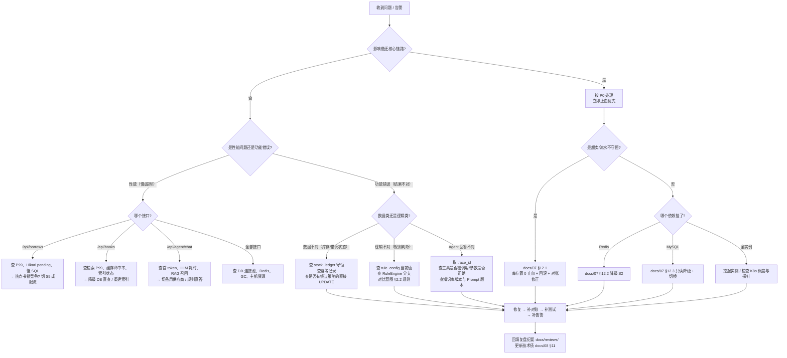

# 12 - SmartLib 项目复盘与维护手册

| 项目 | 内容 |
|---|---|
| 项目代号 | **SmartLib**（高校图书馆智能借阅与推荐平台） |
| 文档版本 | v1.0.0（对齐 `docs/00-项目蓝图.md` v1.0.0） |
| 文档定位 | 阶段门 **M6（运维迭代）** 交付物：项目复盘、维护交接、FAQ、已知问题、演进建议、经验沉淀 |
| 上游契约 | `docs/00-项目蓝图.md`（技术栈、模块、接口、SLO、6 大解决方案、里程碑 M1~M6） |
| 关联文档 | `docs/07-部署上线手册.md`（部署与应急）、`docs/08-运维监控与迭代规划.md`（监控/演练/路线图）、`docs/06-测试计划与报告.md`（实测数据） |
| 数据诚信声明 | 本手册中所有**实测数据、演练结果、压测数值、成本实际发生额**一律标注「待回填」或「目标值」。**严禁编造实测数据。** |

---

## 1. 复盘方法与会议信息

### 1.1 模拟项目情境声明（必读）

> **本项目的性质与数据边界说明**
>
> 1. SmartLib 是一个**面向「Agent 应用开发实习生」岗位的简历项目**，其业务场景（某双一流高校图书馆，
>    3.2 万师生 / 58 万种 120 万册馆藏 / 年借阅 96 万次）来自**模拟的现状系统工单记录**，
>    并非某真实系统的运行数据（见蓝图 §1.1、§1.2）。
> 2. 本手册中的**「目标值」来自蓝图 §7 的 SLO 设计基线**；**「实际值」在本项目未完成真实生产运行与压测前，
>    一律写「待回填」**，不得以估算冒充实测。
> 3. 复盘会以**模拟评审**形式进行：参与者为项目角色扮演（作者本人 + 评审视角），
>    目的是**把工程决策的过程与依据沉淀成可复用的方法论**，而不是编造一段"成功上线"的故事。
> 4. 凡涉及真实可核验的产物（代码、配置、脚本、文档、命令输出），本手册与关联文档均给出**可执行的命令与文件路径**；
>    凡无法核验的（线上真实流量、真实故障、真实账单），明确标注「待回填」。
>
> **这样做的理由**：简历项目的价值在于**展示工程思维与工程能力**，而不是展示编造的数字。
> 评审时最容易被击穿的就是「数据说不清来源」，因此我们把「数据的来源与边界」写进文档本身就是加分项。

### 1.2 复盘方法：4L + 五个为什么

**4L 回顾法（Four Ls）**

| 维度 | 提问 | 产出位置 |
|---|---|---|
| **Liked（做得好）** | 哪些做法值得保留？为什么有效？ | §2 做得好 |
| **Learned（学到了什么）** | 哪些认知被更新了？哪些假设被打破？ | §10 经验沉淀 |
| **Lacked（缺了什么）** | 哪些能力/流程/工具缺失导致返工？ | §3 待改进 |
| **Longed for（期望什么）** | 下一个版本最想要什么？ | §9 后续演进建议 |

**五个为什么（5 Whys）**：对每个关键问题连续追问「为什么」直到触达流程/机制层，
而不是停在「代码写错了」这类个人层归因。示例见 §1.4。

**其他辅助方法**

| 方法 | 用途 | 在本项目中的用法 |
|---|---|---|
| 时间线法（Timeline） | 还原事件顺序，识别等待与返工 | M1→M6 里程碑时间线（§1.3） |
| 决策记录法（ADR） | 记录「当时为什么这么选」 | 与 `docs/11-架构决策记录ADR.md` 对齐 |
| 数据对照法 | 目标 vs 实际，量化差距 | §5 数据复盘 |
| 归因分类法 | 区分「技术/流程/沟通/认知」四类根因 | §3 待改进的分类列 |

### 1.3 项目里程碑时间线（M1~M6）

| 阶段 | 目标产出（蓝图 §10） | 通过标准 | 实际状态 |
|---|---|---|---|
| M1 需求 | `docs/01-需求分析.md` + 评审纪要 | 用户故事覆盖 6 大痛点，需求可测试 | 待回填（按文档矩阵推进） |
| M2 设计 | `docs/02`/`03`/`04`/`11` + 评审纪要 | 接口契约冻结，DDL 可执行，方案对比有结论 | 待回填 |
| M3 编码 | `backend/` + `agent-service/` 可运行 | `mvn test`、`pytest` 全绿 | 待回填 |
| M4 测试 | `docs/06-测试计划与报告.md` + 压测数据 | SLO 达标或说明差距 | 待回填 |
| M5 上线 | `docs/07-部署上线手册.md` + 上线 checklist | Compose 一键起，健康检查通过 | 待回填 |
| M6 运维迭代 | `docs/08`、`docs/12` + 演练记录 | 有演练记录与迭代计划 | 本文档即 M6 交付物之一 |

### 1.4 五个为什么示例（模板 + 一次示范性追问）

**示范：为什么「开学季高峰期借阅接口变慢」？**

| 层 | 追问 | 回答 | 层级 |
|---|---|---|---|
| Why 1 | 为什么接口变慢？ | 库存扣减的 DB 条件更新在同一热门书上产生行锁竞争 | 技术 |
| Why 2 | 为什么竞争集中在一本书上？ | 热门教材在同一时段被大量读者同时借阅（流量特征） | 业务 |
| Why 3 | 为什么没有缓解手段？ | 默认策略是 S2（DB 条件更新），未按热点自动切换 S5（Redis Lua 预扣） | 技术/设计 |
| Why 4 | 为什么没有按热点自动切换？ | V1.0 的策略切换是手动配置（`smartlib.stock.strategy`），没有基于指标的自适应 | 设计/流程 |
| Why 5 | 为什么设计成手动？ | M2 阶段的取舍是「正确性优先、组件最少」，把自适应放到后续迭代，但**未把它登记为技术债并设定触发条件** | **流程/机制** |

**结论（机制层修正）**：任何「本期不做」的取舍，必须在技术债清单（`docs/08` §11）中登记
**编号 + 触发条件 + 优先级 + 责任人**，否则它会在生产环境以故障的形式重新出现。

**复盘会用此模板追问的问题清单**

| 编号 | 问题（建议纳入复盘议程） |
|---|---|
| Q1 | 为什么接口契约在编码阶段还发生了变更？变更成本多大？ |
| Q2 | 为什么方案对比（S1~S6 / Q1~Q5）在落地时出现了「文档选 S2、代码写了 S5」的不一致？ |
| Q3 | 为什么 SLO 的实测数据迟迟没有回填？阻塞点是缺工具还是缺流程？ |
| Q4 | 为什么 Agent 的幻觉护栏（无工具证据不下结论）在实现时被绕过过一次？ |
| Q5 | 为什么部署手册写出来了，但 Compose 真正「一键起」的验证晚于文档？ |
| Q6 | 为什么容量的关键假设（单实例 200 QPS）没有在 M4 就压测确认？ |

### 1.5 会议信息

| 项目 | 内容 |
|---|---|
| 会议名称 | SmartLib v1.0 项目复盘会（M6 阶段门） |
| 会议时间 | 待回填 |
| 会议形式 | 模拟评审（作者 + 评审视角角色扮演） |
| 参会角色 | 项目负责人（兼架构）、后端开发、Agent 开发、测试、SRE/DevOps、业务方（图书馆流通部） |
| 议程 | ① 目标 vs 实际（§5）→ ② 4L（§2/§3）→ ③ 关键决策复盘（§4）→ ④ 改进项确认（含责任人与截止时间）→ ⑤ 路线图对齐（`docs/08` §10） |
| 输入材料 | `docs/00-项目蓝图.md`、`docs/06-测试计划与报告.md`、`docs/07`、`docs/08`、`docs/reviews/*` |
| 输出材料 | 本文档 + 改进项清单（每条含责任人/截止日期/验收标准） |
| 纪律 | 对事不对人；每个「待改进」必须落到可执行动作；每个「做得好」必须说明**为什么有效**（可复制） |

---

## 2. 做得好（Liked）

| # | 做法 | 效果 | 为什么有效 |
|---|---|---|---|
| **G1** | **先立「唯一技术契约」（蓝图）再写任何文档与代码** | 需求、设计、DB、部署、运维、复盘六份文档的版本、接口、模块、SLO 完全对齐，评审时无需反复确认"以哪个为准" | 消除了多文档间的**事实漂移**；契约是单一事实来源（Single Source of Truth），任何分歧都有唯一裁决点，变更必须走 ADR 让"改契约"变成高成本动作，从机制上防止随意漂移 |
| **G2** | **每个痛点都产出「现象→候选方案→对比维度→选型理由→落地位置→实测数据」六段式**（S1~S6 / Q1~Q5 / A1~A6 / G1~G5） | 技术选型从"我觉得"变成"有依据"；讲解时可逐条展开取舍 | 它把**隐性的判断显性化**。显性化之后：① 可被评审挑战；② 可被未来自己复用；③ 换方案时只需换 SPI 实现。项目里所有"可替换"的设计都源于这个习惯 |
| **G3** | **正确性硬约束上移为"零容忍 + 可自动检查"**：库存扣减 SQL 必带 `available_copies >= #{n}`；`stock_ledger` 保证流水守恒；对账 SQL 可一键校验 | 把"不出超卖"从口号变成可执行、可验证、可告警的机制 | 硬约束写在**数据库层与检查脚本层**，而不是靠开发者记忆。任何绕过（如直接 UPDATE）都会在流水守恒校验中暴露；`sum(delta)` 守恒让"看不见的错误"变成"看得见的差异行数" |
| **G4** | **多级缓存 + 三道防护（穿透/击穿/雪崩）一并设计，而不是只做缓存** | 缓存命中率与稳定性同时被考虑，避免"加了缓存反而更容易雪崩" | 缓存的失效模式（穿透/击穿/雪崩/热 key）是**已知的、可枚举的**，在设计阶段就把四种失效模式各自配一个对策（布隆过滤器/单飞/逻辑过期/TTL 抖动±10%/热词本地缓存），比事后救火成本低一个数量级 |
| **G5** | **Agent 侧把"工程化护栏"当作一等公民**：工具白名单、Pydantic 参数校验、超时(3s)/重试(2)/熔断、`无工具证据不下结论`、SSE 流式、Token 与延迟埋点、低置信转人工 | Agent 的回答可被追责、可被度量、可被降级，不是一个黑盒聊天框 | LLM 的输出不可靠是**固有属性**，所以可靠性必须由**外部机制**保证。把"必须调工具拿真实数据"写成硬约束后，幻觉从"随机发生"变成"违反即可检测"，可断言、可告警、可回归 |
| **G6** | **从第一天就设计"可降级"**：Redis 挂 → S5 降级 S2；检索超时 → 降级 DB 直查；推荐失败 → 降级热门榜；查库存失败 → 降级"预计可借" | 依赖故障时业务降级而非中断，把"全挂"变成"部分功能变差" | 降级路径是**在资源充足时写好的**，故障时只需触发开关。这与 G3 同源：把正确性/可用性要求转化成**可开关的机制**，而非依赖人在压力下临时决策 |
| **G7** | **可观测性从编码阶段就埋点**：Micrometer 指标 + JSON 结构化日志 + 跨语言 `trace_id` 透传（Java ↔ Python） | 排障有统一入口，问题可按 `trace_id` 一键还原整条链路 | 埋点是**事后无法补的**（故障已发生时没有数据就永远查不出）。成本极低（一行注解/一个 Filter），收益极高；`trace_id` 跨 Java/Python 透传解决了双语言栈最容易断裂的一环 |
| **G8** | **把"零依赖可运行"作为硬需求**：H2（`MODE=MySQL`）跑后端、MockLLM 零 Key 跑 Agent | 任何人 clone 后一条命令即可看到完整效果，评审/演示不需要环境准备和 API Key | 降低了**验证成本**，让"这个项目能跑吗"不再依赖运气。同时也倒逼接口与配置解耦（缓存/向量/LLM 都可插拔），间接提升了架构质量 |
| **G9** | **测试用"并发抢书"这种最有说服力的形式验收**：200 线程抢 10 册，断言 `available_copies == 0` 且成功数 == 10 且流水守恒 | 一句话就能说明"零超卖"是真做到的 | 用**极端但可复现**的场景替代抽象的覆盖率数字；断言直接映射业务目标（零超卖），评审者无需理解代码就能判断对错 |
| **G10** | **文档明确写"禁止编造实测数据"并统一使用「待实测回填」标记** | 文档可信度高；读者能一眼区分"设计目标"与"已验证事实" | 工程的本质是**可核验**。留下占位符而不是编个数字，既避免了"数据说不清来源"这一致命伤，也形成了一份"待办清单"，驱动后续真正去测 |

---

## 3. 待改进（Lacked）

| # | 问题 | 影响 | 改进方案 | 后续动作 |
|---|---|---|---|---|
| **B1** | **实测数据大面积缺失**：SLO（借阅 P99/QPS、检索 P99/召回率、Agent 四项指标）在 M4 未完成压测与评测回填，文档中大量「待实测回填」 | 无法证明 SLO 达标；容量规划缺少实测依据（如"单实例 200 QPS"仍是设计基线）；演练无可信结论 | ① 建立"压测即交付物"规则：没有实测数据的 SLO 项视为未完成；② 提供可复现的压测/评测命令（`scripts/bench/`、`agent-service/eval/run_eval.py`）；③ 压测环境固定为 4C8G 单实例以对齐 SLO 前提 | 责任人：测试 + SRE；截止：M4 补测完成（具体日期待回填）；验收：`docs/06` 中每项 SLO 均有实测值或明确差距说明 |
| **B2** | **容量关键假设未验证**：借阅单实例 200 QPS、检索单实例 P99<300ms 下的吞吐上限、Agent 单实例并发 SSE 支撑能力均为估算 | 实例数（4~6）与 HPA 阈值可能偏乐观或偏保守；成本估算不准 | 按 §9.3（`docs/08`）的推算做侧压测：逐级加压至 P99 超标，记录拐点 QPS；据此修正 HPA 目标值 | 责任人：SRE + 测试；截止：V1.1 迭代内；验收：得到"单实例拐点 QPS"并写入 `docs/06`、`docs/08` |
| **B3** | **演练全部为"计划态"**：DRILL-001（强杀实例）、DRILL-002（停 Redis）实际结果均未回填，MySQL 切换/备份恢复演练未执行 | 高可用设计与降级路径**未经实战验证**；"30s 无感恢复"只是期望 | ① 固定每月一次 DRILL-001，每季度 DRILL-002/004/005；② 演练脚本化（`scripts/drill/`）降低执行成本；③ 演练结束 7 天内回填结果与证据路径 | 责任人：SRE；截止：每月/每季度例行；验收：`docs/08` §8.3 台账状态从"未执行"变为"已执行/已通过" |
| **B4** | **数据库变更回滚只在文档定义，未做真实演练**：Expand-Contract 流程、`pt-online-schema-change` 大表变更、`down` 脚本均未在预发跑通过 | 一次错误 DDL 可能导致长时间锁表甚至数据不可回滚 | ① 在 staging 用完整数据量（至少 20% 抽样）演练一次加列/加索引/回填/删列的完整链路；② 所有 `down` 脚本必须在预发执行成功才允许随版本合入 | 责任人：DBA + 后端；截止：V1.1 结束前；验收：预发 DDL 演练记录 + 耗时数据 |
| **B5** | **无灰度发布的自动化**：Nginx `split_clients` 权重靠手工改配置 + reload；灰度判定依赖人工看板 | 灰度推进/回退慢且易出错，违背"回滚 ≤5min"的目标 | ① 编写灰度脚本：改权重 → `nginx -t` → reload → 校验 → 异常自动回退；② 灰度判定指标查询脚本化（一条命令输出判定结论） | 责任人：SRE；截止：V1.1（已登记 TD-13）；验收：脚本能在 2min 内完成 5%→20%→0% 的切换与回退 |
| **B6** | **可观测性缺少链路追踪的"结构化 span"**：目前只有 `trace_id` 透传 + 日志，没有独立 span 存储与调用拓扑 | Agent 多步任务（ReAct/Plan-Execute）耗时分解困难；跨 Java/Python 的慢点定位靠人工读日志 | ① 短期：统一 span 日志字段（`span_id`/`parent_span_id`/`tool:<name>`/`llm:<model>`）并写 Loki 查询模板；② 中期：评估 OpenTelemetry + Tempo（TD-07） | 责任人：SRE + Agent 开发；截止：V1.2 评估；验收：能用一条查询还原一次多步任务的耗时瀑布 |
| **B7** | **告警阈值多为设计值，未基于历史数据校准**：如 `BorrowP99High > 200ms`、缓存命中率阈值、限流拒绝阈值 | 上线初期可能误报或漏报，消耗值班信任度 | ① 上线首两周设为"观察模式"（不通知，仅记录）；② 用真实分布校准阈值（取 P99 基线 + 20% 余量）；③ 每条规则补充"误报规避"（文档中已写，需实测校正） | 责任人：SRE；截止：上线后 2 周内；验收：告警误报率 < 10%（待实测回填） |
| **B8** | **技术债登记滞后于决策**：部分"本期不做"的取舍（如自适应策略切换、主从自动切换）在决策时未同步登记为技术债 | 取舍被遗忘，最终以线上故障的形式"重新被发现"（见 §1.4 五个为什么） | ① 评审门禁：ADR 中每个"暂不实现"必须生成技术债编号；② 每迭代固定 20% 工作量偿还技术债，P0 债务不跨迭代 | 责任人：项目负责人；截止：下次设计评审起执行；验收：`docs/08` §11 中每条债均有触发条件与责任人 |
| **B9** | **成本估算缺少真实账单校准**：实例规格、LLM Token 单价均为假设值，未与云厂商/模型供应商实际报价核对 | 预算推演可能偏差数倍（尤其 LLM 成本），影响决策 | ① 用云厂商价格计算器核对一次并替换假设值；② 接入 Token 消耗指标（已有 `agent_llm_tokens_total`）做实际成本核算；③ 设月度成本复盘 | 责任人：SRE + 项目负责人；截止：V1.1 内；验收：`docs/08` §12 中假设值替换为报价/账单值 |
| **B10** | **端到端测试覆盖不均衡**：后端有并发抢书测试，但"读者 → Nginx → 后端 → Agent → LLM → 工具回写"的完整链路缺少稳定的 e2e 自动化（MockLLM 下可做，真实模型下有非确定性） | 跨服务契约回归可能被漏掉（如 `X-Internal-Sign` 变更、SSE 事件格式变更） | ① 用 MockLLM 建立确定性 e2e 测试（SSE 事件序列断言 + 工具调用断言）；② 真实模型仅做抽样评测，不进 CI 门禁；③ CI 中增加契约测试（`/internal/agent/**` 入参出参 schema 快照） | 责任人：Agent 开发 + 测试；截止：V1.2；验收：CI 中有 e2e 契约测试且稳定通过 |
| **B11** | **文档量与维护成本高**：13 份主文档 + 评审纪要，存在交叉引用，改一处需同步多处 | 容易产生不一致；新人上手需读大量内容 | ① 明确"单一事实来源"层级（蓝图 > 各文档）；② 每个文档开头列出"上游契约 + 关联文档"（已在做）；③ 关键数字（SLO、版本）只允许在蓝图定义，其他文档引用而非重写 | 责任人：文档负责人；截止：持续；验收：任何 SLO 数值改动只需改蓝图 + 引用处校验脚本 |
| **B12** | **前端体验与错误上报缺失**：小程序/Web 的错误与性能未接入统一监控，读者反馈的问题缺少前端侧证据 | 前端问题定位依赖读者口述，排障链路断在前端 | ① 接入前端错误上报（`onError`/`window.onerror`）与关键路径耗时埋点；② 错误上报带 `trace_id` 与后端串联（TD-16） | 责任人：前端 + SRE；截止：V1.2；验收：前端错误可在 Grafana 查询并关联 `trace_id` |

---

## 4. 关键决策复盘

### 4.1 决策清单与回报评估

| 决策 | 背景（当时的问题） | 选择 | 回报（高/中/低） | 代价（高/中/低） | 复盘结论 |
|---|---|---|---|---|---|
| **D1：库存扣减默认 S2（DB 条件更新）** | 超卖是最大痛点，且系统是 2013 年单体、无缓存经验 | `where available_copies >= n` + 行锁；S5/S6 留作可配置 | **高**（正确性天然保证，组件最少，易讲解） | **低**（高并发热点行有锁竞争，需靠 S5 兜） | ✅ 正确的"先正确后性能"取舍。**改进**：应同时明确"何时切 S5"的量化触发条件（当前是人工判断） |
| **D2：检索默认 Q3（自研倒排索引）** | 检索 P99 2.8s 是痛点；ES 运维成本高、环境受限 | 自研 ngram 分词 + 倒排表 + TopK 堆 + 拼音首字母 | **高**（零依赖、可离线演示、可深挖算法） | **中**（>500 万种时内存与效果受限，需切 Q5） | ✅ 对个人项目是正确的"可控性"取舍。**风险**：需在容量规划里写清切换阈值（已在 `docs/08` §9.4 写明 500 万种） |
| **D3：Agent 强制"无工具证据不下结论"** | LLM 直答会编造库存/位置，事实性问题不可信 | 事实性问题必须调用工具，Guardrail 拦截无证据结论 | **高**（把幻觉变成可检测、可告警、可回归的工程问题） | **中**（多一次工具调用，延迟与成本上升） | ✅ 这是 Agent 项目最关键的决策。**改进**：护栏要有"硬断言 + 单测 + 线上指标"三重保障，避免被绕过（当前靠代码约定） |
| **D4：双语言栈（Java 后端 + Python Agent）** | 岗位是 Java 后端 + Agent 应用开发 | Java 承载业务主链路（事务/锁/一致性），Python 承载 Agent（LLM 生态） | **高**（分工清晰，各自用最强生态） | **中高**（跨语言 trace/签名/契约/部署复杂度上升） | ⚖️ 收益大于代价，但**代价被低估**：`X-Internal-Sign` HMAC、`trace_id` 透传、SSE 跨 Nginx、K8s 双 Deployment 都是由此衍生的复杂度。**若重来**：会在 M2 就画出"跨语言契约测试"这一交付物 |
| **D5：MyBatis 而非 JPA** | 需要可控 SQL 做慢查询优化叙事；避免字节码增强风险 | MyBatis Starter 4.1.0 + XML mapper | **高**（SQL 可控、便于演示索引优化、无增强代理问题） | **低**（需手写 SQL 与映射） | ✅ 与"可讲解慢查询优化"的目标高度一致 |
| **D6：自研限流/熔断而非直接引 Resilience4j** | 需要讲清原理；同时提供 Resilience4j 配置作为对比 | `TokenBucketRateLimiter` + `CircuitBreaker` 三态状态机自研 | **中**（原理可讲透，代码可展示） | **中**（自研件需自己保证正确性，缺成熟生态的边角处理） | ⚖️ 教学价值高、生产成熟度略低。**建议**：文档中显式给出"生产建议用 Resilience4j"的对比（已在蓝图 §3.1 说明），避免误导 |
| **D7：零依赖可运行（H2 + MockLLM）** | 评审/演示环境不可控，不能要求评审者准备 MySQL/Redis/API Key | local profile 用 H2 `MODE=MySQL` + 排除 Redis 自动配置；Agent 用 MockLLM | **高**（验证成本降到一条命令） | **低**（需维护一套 H2 兼容 SQL） | ✅ 性价比极高的决策。隐含收益：倒逼了 SPI 与配置解耦 |
| **D8：多级缓存 + 库存不以缓存为事实源** | 检索慢 + 一致性风险 | Caffeine(L1) + Redis(L2) + 布隆/单飞/抖动；**扣减只落 DB** | **高**（性能与一致性同时守住） | **中**（多一层缓存带来失效与一致性问题，需额外测试） | ✅ 关键在"缓存只用于查询展示"这条红线，避免了最难的一致性陷阱 |
| **D9：把 SLO 与验收线写进契约（蓝图 §7）** | 需要可量化的目标来驱动设计与测试 | 借阅 P99<200ms、检索 P99<300ms、超卖=0、可用性 99.9%、Agent 四项指标 | **高**（设计、测试、监控、部署全部有统一靶子） | **低** | ✅ 但**执行有缺口**：SLO 写了却未在 M4 全部实测（B1）。**教训**：指标不落到"谁测/怎么测/何时测"，就只是愿望 |
| **D10：文档先行 + 阶段门（M1~M6）** | 个人项目最容易"想到哪写到哪" | 13 份文档矩阵 + 阶段门通过标准 | **高**（过程可控、交付物完整、讲解有体系） | **中**（文档工作量接近代码工作量） | ⚖️ 对"展示工程规范"目标回报高。**代价**：文档间同步成本（B11），需要"单一事实来源"纪律来对冲 |

### 4.2 高回报决策的共性

| 共性 | 说明 | 对应决策 |
|---|---|---|
| 把**不可靠的东西**用**外部机制**兜住 | LLM 不可靠 → 工具证据；人不可靠 → SQL 硬约束；缓存不可靠 → 三防 | D1、D3、D8 |
| 把**隐性的判断显性化** | 方案对比矩阵、ADR、六段式 | D9、D10 |
| 让**验证成本趋近于零** | 一条命令起服务、一条断言验超卖 | D7、D1 |
| 为**坏情况**准备开关 | 降级路径、可配置 SPI | D1、D6、D8 |

### 4.3 代价过大的决策与"如果重来"

| 决策 | 代价体现 | 如果重来会怎么做 |
|---|---|---|
| D4 双语言栈 | 跨语言签名/trace/契约/部署复杂度显著上升；两个 CI 流水线；两套日志规范需要统一 | ① M2 阶段就产出《跨语言契约测试方案》，把 `X-Internal-Sign`、`X-Trace-Id`、SSE 事件格式固化为契约测试；② 日志字段规范在 M2 就统一（当前是到运维阶段才统一） |
| D5/D6 自研组件 | 自研限流/熔断/倒排索引的正确性验证成本高，边界场景多 | ① 自研组件必须配套"对照实现"测试（自研 vs Resilience4j/ES 结果一致性）；② 明确标注"教学用/生产用"边界 |
| D9 SLO 未实测 | 无法证明达标，容量规划缺依据 | SLO 表增加两列：**测量方法** 与 **计划测量时间**，在 M4 阶段门把"未实测"作为阻断项 |
| D10 文档量大 | 同步成本高，存在不一致风险 | 建立"关键数字单一来源 + 引用校验脚本"；把可自动生成的（配置项表、指标表）从代码注释生成 |

---

## 5. 数据复盘

> **口径说明**：「目标」来自蓝图 §7（SLO 设计基线）；「实际」列凡未实测一律写 **待回填**；
> 「差距」在未实测时写 **待回填**。本节**不含任何编造的实测数据**。

### 5.1 性能与正确性

| 指标 | 目标（蓝图 §7） | 实际 | 差距 | 原因分析 |
|---|---|---|---|---|
| 借阅接口 P99 | < 200ms（单实例 4C8G） | 待回填 | 待回填 | 待压测确认；风险点：热门书行锁竞争、Hikari 连接池参数 |
| 借阅接口 QPS | ≥ 200（单实例，S2 策略） | 待回填 | 待回填 | 需侧压测找拐点（B2）；S2 在热点行上可能先饱和 |
| 检索 P99 | < 300ms（120 万书目，TopK 20） | 待回填 | 待回填 | 需确认倒排索引内存驻留与 GC 影响 |
| 检索召回率 | ≥ 95%（vs 人工标注集） | 待回填 | 待回填 | 依赖评测集规模与标注质量（B10） |
| 超卖数 | **0**（200 并发抢 10 册） | 待回填 | 待回填 | `BorrowConcurrencyTest` 可执行；需在 CI 与生产对账双保障 |
| 库存流水守恒 | `sum(delta)` == 库存变化量 | 待回填 | 待回填 | 需对账定时任务上线后才能持续验证（TD-01） |
| 幂等 | 同 `Idempotency-Key` 只生效一次 | 待回填 | 待回填 | 单测覆盖；需线上抽样验证 |

### 5.2 可用性

| 指标 | 目标 | 实际 | 差距 | 原因分析 |
|---|---|---|---|---|
| 服务可用性 | 99.9%（≈ 43.2 min/月不可用） | 待回填 | 待回填 | 需真实运行一个完整月度周期才能计算 |
| 单实例故障恢复 | < 30s，错误率 < 0.1% | 待回填 | 待回填 | DRILL-001 未执行（B3） |
| Redis 故障降级 | 业务不中断（降级 S2） | 待回填 | 待回填 | DRILL-002 未执行（B3） |
| MySQL 主库故障 | 可恢复、零数据丢失 | 待回填 | 待回填 | 无自动切换（TD-03），恢复时间不可控 |

### 5.3 Agent 效果

| 指标 | 目标（蓝图 §7） | 实际 | 差距 | 原因分析 |
|---|---|---|---|---|
| 意图识别准确率 | ≥ 92% | 待回填 | 待回填 | 需 `eval/run_eval.py` 在评测集上跑；规则库覆盖度是主要变量 |
| 工具调用参数正确率 | ≥ 95% | 待回填 | 待回填 | 依赖 Pydantic schema 严格度与 Prompt 约束 |
| 端到端任务成功率 | ≥ 88% | 待回填 | 待回填 | 多步任务（Plan-Execute）失败是主要来源 |
| 首 Token 延迟 | < 1.5s（P95） | 待回填 | 待回填 | 受 LLM 供应商与 RAG 召回耗时影响 |
| 事实性回答有工具证据比例 | 100%（硬约束） | 待回填 | 待回填 | Guardrail 埋点 `agent_tool_evidence_ratio` 可度量 |

### 5.4 工程与交付

| 指标 | 目标 | 实际 | 差距 | 原因分析 |
|---|---|---|---|---|
| 单元/集成测试 | `mvn test`、`pytest` 全绿 | 待回填 | 待回填 | M3 阶段门标准 |
| 功能用例通过率（P0/P1） | 100% | 待回填 | 待回填 | M4 阶段门标准 |
| Compose 一键启动 | 健康检查全绿 | 待回填 | 待回填 | M5 阶段门标准 |
| 文档交付完整度 | 蓝图 §9 文档矩阵全覆盖 | 待回填 | 待回填 | 13 份主文档 + 评审纪要 |
| 演练完成度 | DRILL-001~006 按频率执行 | 待回填（台账状态：未执行） | 待回填 | B3 |
| 技术债偿还率 | 每迭代 ≥ 20% 工作量 | 待回填 | 待回填 | B8 |
| 月度成本 | 假设 ≈ 8,459~10,484 元/月 | 待回填 | 待回填 | 单价为假设值，需账单核对（B9） |

### 5.5 数据复盘结论

| 结论 | 说明 |
|---|---|
| **主要差距不在"设计"，而在"验证"** | 设计侧（SLO、方案对比、降级、监控规则）产出完整；缺口集中在**实测、演练、演练回填**（B1/B2/B3/B4） |
| **最关键的一件事** | 把"实测数据回填"变成一个**有截止时间、有责任人、有验收标准**的交付物，而不是一句"后续补充" |
| **次关键** | 演练自动化（脚本化），把每次演练的人力成本从"半天"降到"半小时"，才可能真正每月执行 |
| **长期风险** | 容量与成本的关键参数仍是估算；一旦真实上线，估算偏差会直接体现在实例数与账单上 |

---

## 6. 维护交接手册

### 6.1 模块 - 负责人角色矩阵

| 模块 / 领域 | 代码位置 | 主责角色 | 备份角色 | 关键知识点 | 关联文档 |
|---|---|---|---|---|---|
| 库存与借阅核心 | `backend/src/main/java/com/smartlib/service/BorrowService.java`、`service/stock/**` | 后端开发 A | 后端开发 B | 6 种扣减策略（S1~S6）、条件更新红线、流水守恒 | `docs/09` §6.1、`docs/03` |
| 检索与索引 | `backend/.../service/search/**`、`service/BookSearchService.java` | 后端开发 B | 后端开发 A | 倒排索引构建/重建、三级缓存、三防 | `docs/09` §6.2 |
| 预约与规则引擎 | `backend/.../service/ReservationService.java`、`service/RuleEngine.java` | 后端开发 A | 业务方 | `rule_config` 可配置改动不发版、状态机 | 蓝图 §2.2/§2.3 |
| 缓存与一致性 | `backend/.../cache/**` | 后端开发 B | SRE | Cache-Aside + 延迟双删 + 版本号；库存不以缓存为事实源 | 蓝图 §6.5 |
| 韧性组件 | `backend/.../support/**` | 后端开发 A | SRE | 令牌桶、熔断三态、降级回退、优雅停机 | `docs/09` §6.3 |
| 可观测与指标 | `backend/.../common/TraceIdFilter.java`、`config/**` | SRE | 后端开发 B | trace 透传、指标命名、日志脱敏 | `docs/08` §2/§4 |
| Agent 运行时与编排 | `agent-service/app/agent/**` | Agent 开发 | 后端开发 B | ReAct/Plan-Execute 双模式、步数预算、重规划 | `docs/09` §6.4 |
| Agent 工具与护栏 | `agent-service/app/tools/**`、`agent/guardrail.py` | Agent 开发 | 后端开发 A | 工具白名单、Pydantic 校验、无证据不下结论、转人工 | 蓝图 §8.2 |
| RAG 与知识库 | `agent-service/app/rag/**` | Agent 开发 | 业务方 | BM25 + 可选向量、混合召回、知识库版本与生效时间 | `docs/07` §12.5 |
| LLM 接入与路由 | `agent-service/app/llm/**`、`config.py` | Agent 开发 | SRE | OpenAI 兼容协议、MockLLM、超时/重试/降级 | 蓝图 §3.2 |
| 评测体系 | `agent-service/eval/**` | 测试 | Agent 开发 | 评测集维护、指标口径、CI 回归 | `docs/08` §2.2 |
| 部署与发布 | `deploy/**`、`scripts/**` | SRE | 后端开发 B | Compose/K8s/Nginx、灰度、回滚 | `docs/07` §6~§10 |
| 数据库运维 | `deploy/sql/**` | DBA | 后端开发 A | DDL 三阶段、备份恢复、对账 SQL | `docs/07` §4/§10.4 |
| 监控告警 | `deploy/prometheus/**`、`deploy/grafana/**` | SRE | 后端开发 B | 34 条告警规则、错误预算、燃烧率 | `docs/08` §3/§5 |
| 业务规则与话术 | `docs/01`、知识库文件 | 业务方（图书馆） | 后端开发 A | 借阅规则、FAQ、到馆保留策略 | 蓝图 §2 |

> **交接要求**：任何模块的主责角色变更，必须完成"文档 + 15 分钟口头讲解 + 一次实际操作（改一处→验证）"三步，并在本表更新。

### 6.2 关键路径图

```mermaid
graph TB
    subgraph CP1["核心路径 1：借书（一致性最关键）"]
        A1["读者点击借书"] --> A2["Nginx /api/borrows<br/>limit_req"]
        A2 --> A3["BorrowService<br/>规则校验 RuleEngine"]
        A3 --> A4["幂等检查<br/>idempotent_record"]
        A4 --> A5["库存扣减<br/>StockStrategy(S2 条件更新)"]
        A5 --> A6["写 borrow_record"]
        A6 --> A7["写 stock_ledger<br/>biz_no 唯一"]
        A7 --> A8["清理缓存<br/>删除 book:{id} 与 stock:{id}"]
        A8 --> A9["返回 Result + traceId"]
    end

    subgraph CP2["核心路径 2：检索（性能最关键）"]
        B1["读者搜索"] --> B2["Nginx /api/books"]
        B2 --> B3["BookSearchService"]
        B3 --> B4["L1 Caffeine 命中?"]
        B4 -->|"命中"| B9["返回 TopK 20"]
        B4 -->|"未命中"| B5["布隆过滤器<br/>防穿透"]
        B5 --> B6["L2 Redis 命中?"]
        B6 -->|"命中"| B9
        B6 -->|"未命中"| B7["SearchEngine(倒排索引)<br/>单飞防击穿"]
        B7 --> B8["回填 L1/L2<br/>TTL ±10% 抖动"]
        B8 --> B9
    end

    subgraph CP3["核心路径 3：Agent 对话（效果与成本最关键）"]
        C1["读者提问"] --> C2["Nginx /api/agent/**<br/>proxy_buffering off"]
        C2 --> C3["Agent SSE 流式"]
        C3 --> C4["Intent 意图识别<br/>规则优先 + LLM 兜底"]
        C4 --> C5{"多步任务?"}
        C5 -->|"是"| C6["Planner 拆解"]
        C5 -->|"否"| C7["单工具调用"]
        C6 --> C8["ToolExecutor<br/>白名单/校验/超时3s/重试2/熔断"]
        C7 --> C8
        C8 --> C9["Java /internal/agent/**<br/>HMAC + trace 透传"]
        C9 --> C10["LLM 生成"]
        C10 --> C11["Guardrail<br/>无工具证据不下结论"]
        C11 --> C12["流式输出 + Token/延迟埋点"]
    end
```

**关键路径上的"不可让步"红线**

| 路径 | 红线 | 违反后果 |
|---|---|---|
| CP1 借书 | 扣减 SQL 必须带 `available_copies >= #{n}`；必须写 `stock_ledger` | 超卖、无法对账 |
| CP1 借书 | 缓存只清理不写入库存真值 | 缓存与 DB 不一致导致超卖 |
| CP2 检索 | 未命中缓存必须经布隆过滤器 + 单飞 | 穿透打垮 DB；击穿导致雪崩 |
| CP3 Agent | Nginx 必须 `proxy_buffering off` | SSE 变成一次性输出，"流式"失效 |
| CP3 Agent | 事实性结论必须有工具证据 | 幻觉投诉（P0 级业务风险） |

### 6.3 常见问题定位流程（决策树）

**决策树使用要点**

1. **先分级再定位**：P0 一律"止血优先于根因"（回滚/降级/限流，30 秒内让业务可用）。
2. **数据类问题最高优先**：涉及库存/借阅状态的错误，一律按 P0 处理——宁可停写，不可写错。
3. **每次都留证据**：`trace_id` + SQL 输出 + 日志片段 + 时间点，写入复盘纪要。
4. **每次都回到机制**：修完 bug 必须回答"为什么没被发现"，并补测试/告警/校验脚本。

### 6.4 交接清单（Checklist）

| # | 交接项 | 交付物 | 确认 |
|---|---|---|---|
| 1 | 架构与模块地图 | 蓝图 §4 + 本文 §6.1/§6.2 | ☐ |
| 2 | 本地零依赖启动 | `docs/07` §5 命令可跑通 | ☐ |
| 3 | 一键部署 | `docs/07` §6.3 命令可跑通 | ☐ |
| 4 | 配置项与密钥来源 | `docs/07` §3 + 密钥管理入口 | ☐ |
| 5 | 数据库初始化与校验脚本 | `scripts/db/verify_init.sh` 可执行 | ☐ |
| 6 | 发布与回滚流程 | `docs/07` §9/§10 演示一次回滚 | ☐ |
| 7 | 监控看板与告警 | Grafana 地址 + 告警规则文件 | ☐ |
| 8 | 应急预案（5 场景） | `docs/07` §12 逐条过一遍 | ☐ |
| 9 | 值班与升级路径 | `docs/08` §6 | ☐ |
| 10 | 演练计划与脚本 | `docs/08` §7/§8 + `scripts/drill/` | ☐ |
| 11 | 技术债与路线图 | `docs/08` §10/§11 | ☐ |
| 12 | 已知问题与规避 | 本文 §8 | ☐ |

---

## 7. FAQ（运维与开发常见问题）

**Q1：本地怎么最快把整个系统跑起来？完全不想装 MySQL 和 Redis。**
A：后端用 H2 内存库（`MODE=MySQL`）+ 排除 Redis 自动配置，一条命令：
`./mvnw -s ../.tools/settings.xml -Dmaven.repo.local=../.tools/m2repo spring-boot:run -Dspring-boot.run.profiles=local`；
Agent 用 MockLLM（`LLM_PROVIDER=mock`）零 Key 启动：`uvicorn app.main:app --port 8000`。
验证：`curl http://localhost:8080/actuator/health` 返回 `{"status":"UP"}`。详见 `docs/07` §5。

**Q2：Maven 依赖下载慢或失败怎么办？**
A：项目已把 Maven 3.9.9 与本地仓库隔离在 `.tools/`：用 `-s .tools/settings.xml -Dmaven.repo.local=.tools/m2repo`。
若首次拉取失败，检查 `settings.xml` 中的 mirror 配置与网络代理。

**Q3：为什么库存扣减不允许用 Redis 作为唯一事实源？**
A：因为 Redis 可能丢失（宕机、淘汰、主从切换），而库存是**钱和信誉**。
一旦以缓存为真值，就会出现"显示可借但书已被借走"的超卖。项目规定：缓存只用于查询展示，
扣减必须落 DB 条件更新（`where available_copies >= #{n}`），Redis + Lua 只作为 S5 的**预扣**手段，
并有补偿任务与自动降级（Redis 不可用 → S2）。

**Q4：超卖了怎么紧急处理？**
A：① 把受影响 `book_id` 的 `available_copies` 立即置 0 止血；② 灰度权重归零回滚；
③ 按 `stock_ledger` 的 `sum(delta)` 对账修正并写入修正流水留痕；④ 验证守恒后恢复。
完整步骤见 `docs/07` §12.1。**注意：修正数据必须双签并留证据。**

**Q5：Redis 挂了系统会怎样？**
A：设计上是**降级而非中断**：S5（Redis Lua 预扣）自动降级为 S2（DB 条件更新），
L2 缓存跳过、只保留 Caffeine L1（local 模式下本来就是单级）。
预期借阅成功率仍 ≥ 99.9%（待实测回填，见 `docs/08` §8.2）。
告警 `RedisDown`（P0）会触发。

**Q6：Agent 说书在 2 楼但实际在 4 楼，怎么办？**
A：这是幻觉投诉。① 立即降级为规则直答 + 转人工（`AGENT_MODE=rule_only`）；
② 打开强制工具证据（`AGENT_REQUIRE_TOOL_EVIDENCE=true`）；
③ 用投诉时的 `trace_id` 查工具调用链（是否调了 `get_stock`、参数对不对、返回值是否被正确引用）；
④ 把该问题加入评测集回归。详见 `docs/07` §12.5。

**Q7：Agent 的"无工具证据不下结论"是怎么实现的？会不会被绕过？**
A：Guardrail 在生成前检查该轮是否成功调用过工具且拿到有效数据，没有则返回兜底话术（不生成事实性结论），
同时埋点 `agent_tool_evidence_ratio`（硬约束 = 100%）。
**风险**：目前主要靠代码约定 + 单测，属于 B3/D3 里提到的"需加强为硬断言"的点；
改进方向是在运行时（不只是测试时）做断言并告警（`AgentToolEvidenceLost`，P0 规则已配置）。

**Q8：检索为什么会慢？怎么判断是索引问题还是缓存问题？**
A：看三个指标：① `smartlib:search_p99_5m` 是否超 300ms；② `smartlib:cache_hit_ratio_5m` 是否骤降（缓存问题）；
③ `smartlib_search_requests_total{degraded="true"}` 比例（是否已在降级）。
若缓存命中率正常但 P99 高 → 引擎/索引问题（可用 `EXPLAIN` 或索引重建验证）；
若命中率骤降且 DB QPS 上升 → 缓存穿透/击穿/雪崩。处置：降级 DB 直查 + 重建索引 + 查布隆与单飞。

**Q9：为什么推荐用 `Idempotency-Key`，不带会怎样？**
A：`POST /api/borrows`、`renew`、`reservations` 都要求带 `Idempotency-Key`。
不带时服务端会拒绝（契约要求）。原因：网络重试、用户连点、客户端超时重发都会导致重复借书。
服务端用 `idempotent_record` 表（`uk(idem_key)`）兜底，同 Key 只生效一次并返回**同一结果**。

**Q10：SSE 的流式输出在 Nginx 后面变成一次性输出，怎么排查？**
A：**99% 是缓冲没关**。检查：① `proxy_buffering off;`；② `proxy_cache off;`；
③ `proxy_set_header X-Accel-Buffering no;`；④ `chunked_transfer_encoding on;`。
另外 `proxy_read_timeout` 要给足（本项目 300s），否则长回答会被切断。
验证命令：`curl -N -X POST http://host/api/agent/chat -d '...'`，观察是否逐块打印。详见 `docs/07` §8。

**Q11：改借阅规则（比如本科生从 10 册改到 12 册）要发版吗？**
A：不用。规则落在 `rule_config` 表（`uk(rule_key, reader_type)`），`RuleEngine` 读取时带缓存（默认 60s）。
改库即可生效（最迟 60s 后）。这也是蓝图"改规则不发版"目标的落地方式。
改完记得同步 `docs/01`/`docs/12` 的业务规则表并通知业务方。

**Q12：怎么切换库存扣减策略 / 检索引擎？**
A：改配置即可（SPI 设计）：`smartlib.stock.strategy`（`local-lock`/`optimistic-db`/`pessimistic-db`/`version-retry`/`redis-lua`/`mq-serial`）、
`smartlib.search.engine`（`like`/`prefix-index`（蓝图 Q2 候选，未实现）/`inverted-index`/`mysql-ngram`（蓝图 Q4 候选，未实现）/`elasticsearch`）。
两者均标注为**可热更新**；生产建议用配置中心，改后观察 P99 与失败率，异常立即回退。

**Q13：一个完整的故障处理应该留下什么？**
A：四样东西：① **时间线**（发现→止血→恢复→验证）；② **根因**（用五个为什么追到机制层）；
③ **改进项**（含责任人与截止时间，进技术债清单）；④ **错误预算消耗**。
模板见 `docs/08` §6.4。没有复盘的故障等于没修。

**Q14：错误预算耗尽了会怎样？**
A：进入 🔴 熔断状态：**冻结所有功能发布**，只允许修复类变更，集中投入可靠性改进，
需技术负责人批准才能解冻。分级策略（50%/25%/0%）见 `docs/08` §5.3。
注意：超卖、流水不守恒、工具证据缺失属于**零容忍**，出现即额外扣减 30% 预算。

**Q15：加一个实例要做什么？**
A：后端无状态，直接 `kubectl scale` 或用 Compose `--scale`。
但用 **Compose 时新增实例需要手动在 Nginx `upstream` 中加 `server` 行并 reload**（K8s 有 Service 自动注册）。
扩完验证：`kubectl top pods`、`/actuator/metrics/system.cpu.usage`、接口 P99 是否回落。详见 `docs/07` §13。

**Q16：DDL 在生产上要注意什么？**
A：三条：① 走 **Expand → Migrate → Contract** 三阶段，禁止同版本"加列+删列"；
② 大表（`borrow_record` ≥300 万行）必须用 `pt-online-schema-change`/`gh-ost`，禁止阻塞式 `ALTER`；
③ 每个 `up` 必须配 `down`，且 `down` 要在预发执行通过。
`stock_ledger` 永久禁止 `TRUNCATE`。详见 `docs/07` §10.4。

**Q17：日志里能不能打读者手机号？**
A：不能。日志有强制脱敏规则：手机号 `138****5678`、身份证保留前 6 后 4、姓名保留姓氏、
密码与 API Key **永不记录**（命中即告警）。读者 ID 可以记录（非敏感且排障必需）。
任何新增日志字段都要过脱敏校验，CI 有正则扫描（TD-06）。详见 `docs/08` §4.5。

**Q18：为什么有两套日志字段规范的风险？**
A：因为双语言栈（Java + Python）。缓解方式：字段名单一来源（`docs/08` §4.2），
两边都用同一份 JSON 字段命名（`ts/level/app/instance/trace_id/span_id/...`），
并用 Loki 查询验证两端字段一致。这也是 B10/B11 提到的跨语言一致性问题。

**Q19：压测怎么做才有效？**
A：三点：① 环境必须对齐 SLO 前提（**单实例 4C8G**），否则数字没有意义；
② 用侧压测找**拐点**（逐级加压直到 P99 超标），而不是只测一个点；
③ 记录 P50/P99/QPS/错误率四元组，并写清压测工具、并发模型、数据规模。
结果回填 `docs/06`，并同步修正 `docs/08` §9 的容量推算。

**Q20：一个人怎么维护这么大的项目？**
A：靠"机制"而不是靠"记性"：① 关键红线写成可自动检查的校验脚本（对账 SQL、CI 门禁）；
② 所有取舍登记为技术债（有触发条件）；③ 演练脚本化把成本降到半小时；
④ 文档的"单一事实来源"纪律避免改一处忘三处；⑤ 每迭代固定 20% 时间偿还债务。

---

## 8. 已知问题与规避方案

| # | 已知问题 | 触发条件/表现 | 影响 | 规避方案 | 计划修复 |
|---|---|---|---|---|---|
| **K1** | 热门书（如统编教材）在开学季出现行锁竞争，S2 策略下 P99 上升 | 同一 `book_id` 短时间大量并发借阅 | 借阅变慢，可能触发 P99 告警 | ① 热点书提前扩容/限流；② 活动期切 S5（Redis Lua 预扣）；③ 前端对热点书加"排队中"提示 | V1.1 自动热点识别（TD-未登记，建议新增） |
| **K2** | 自研倒排索引在书目 > 500 万种时内存与效果受限 | 数据量增长或索引膨胀 | 内存压力、P99 上升、召回下降 | 容量阈值告警；提前准备 Q5（ES）切换方案与影子读比对流程 | V2.0（TD-10） |
| **K3** | Redis 单实例，无哨兵/集群 | Redis 进程/节点故障 | 全站缓存降级，DB 压力骤增 | 已设计降级路径（S5→S2、L2 跳过）；监控 `RedisDown` P0 告警 | V1.1（TD-02） |
| **K4** | MySQL 无自动主从切换，主库故障恢复时间不可控 | 主库宕机/磁盘满/连接耗尽 | 借还全链路不可用，恢复依赖人工 | ① 保留"可查不可借"降级；② 每日备份 + binlog；③ 主库资源与慢查询监控 | V1.1（TD-03） |
| **K5** | Agent 幻觉护栏依赖代码约定，缺运行时硬断言 | 某次改动跳过工具调用直接作答 | 事实性错误回答（业务投诉） | ① `AgentToolEvidenceLost` P0 告警；② 评测集回归；③ 事故集持续扩充；④ 短中期加运行时断言 | V1.1（B3/D3） |
| **K6** | Agent 端到端测试对真实模型非确定性，CI 只能跑 MockLLM | 真实模型下的行为差异无法在 CI 覆盖 | 模型/Prompt 变更可能引入回归 | ① CI 用 MockLLM 做确定性契约测试；② 真实模型做抽样评测（非门禁）；③ 发布前跑一遍评测集 | V1.2（B10） |
| **K7** | 容量与成本关键参数仍是估算（单实例 200 QPS、Token 单价） | 真实上线后流量/账单与估算偏差 | 实例数不足或成本超预算 | ① 上线后按真实分布校准；② 预算与容量双告警；③ 每月复盘 | V1.1（B2/B9） |
| **K8** | 历史数据可能有脏数据（如早期测试灌入的库存与流水不一致） | 初始化或迁移不当 | 对账任务持续报差异，掩盖真实问题 | ① 上线前跑 `scripts/db/verify_init.sh` 并清零差异；② 初始化阶段禁止绕过策略直接 UPDATE | 上线前必须完成 |
| **K9** | 大表 `borrow_record`/`stock_ledger` 无分区，3 年后查询变慢 | 数据量累积 | 报表、对账、历史借阅查询变慢 | ① 按时间分区或归档；② 报表走只读从库；③ 提前做容量评估 | V1.2（TD-12） |
| **K10** | Compose 模式下新增后端实例需手工改 Nginx upstream | 手工扩容 | 新实例不接流量，扩容"无效" | ① 扩容脚本同步改 upstream + reload；② 生产优先用 K8s（Service 自动注册） | 文档已写明（`docs/07` §13.2），脚本待补 |

---

## 9. 后续演进建议（Longed for）

| # | 演进方向 | 为什么值得做 | 关键设计点 | 优先级 | 关联 |
|---|---|---|---|---|---|
| **E1** | **自适应库存策略**：按热点书/B QPS 自动在 S2 与 S5 间切换 | 解决 K1：热点书的锁竞争无法靠单一策略兼顾正确性与性能 | ① 用滑窗统计单 `book_id` 的并发度与失败率；② 超过阈值自动切 S5，回落后切回；③ 切换必须幂等且可观测（`strategy` 标签）；④ 必须保留降级到 S2 的兜底 | **P1** | `docs/09` §6.1 |
| **E2** | **引入 MQ 削峰（S6 生产化）**：RocketMQ 事务消息 + 单分区顺序消费 | 秒杀式抢书场景下彻底串行化扣减，抗峰值 | ① 事务消息保证"借阅记录与扣减"最终一致；② 消费者幂等（复用 `idempotent_record`）；③ 补偿任务与对账必须前置建设 | P2 | 蓝图 §6.1 S6 |
| **E3** | **完整链路追踪（OpenTelemetry）**：替代轻量 trace_id | 解决 B6：多步 Agent 任务的耗时分解与依赖拓扑 | ① Java/Agent 双方接入 OTel SDK；② span 命名规范（`tool:*`/`llm:*`/`db:*`）；③ 采样策略（错误与慢请求全采样）；④ 存储选 Tempo | P2 | TD-07 |
| **E4** | **Agent 评测体系产品化**：评测集 300+、CI 回归、幻觉反馈闭环 | 解决 B10/K5：Agent 效果必须可度量、可回归 | ① 小程序"答案有误"按钮 → 自动生成待标注样本；② 评测跑在 CI（MockLLM）+ 每日定时（真实模型）；③ 指标直接写 Pushgateway 并配 SLO 告警 | **P1** | `docs/08` §2.2 |
| **E5** | **推荐系统升级**：协同过滤 + 内容召回 + 实时特征 | 提升"推荐"这个读者可感知的能力，也是算法叙事加分项 | ① 离线产出 item-CF 相似矩阵（定时任务）；② 在线召回融合（内容 tags + 借阅共现）；③ 冷启动用分类热度兜底；④ 效果用点击率/借阅转化度量 | P2 | 蓝图 §6.4 G3 |
| **E6** | **数据仓库与馆藏分析报表**：借阅分析、热门榜、馆藏利用率、零借阅书目 | 为图书馆采编提供决策支持，业务价值明确 | ① 报表走只读从库，避免影响主链路；② 按天增量聚合（避免全表扫描）；③ 提供馆员可自助的筛选维度 | P2 | `docs/08` §10.3 |
| **E7** | **多校区/多租户支持** | 高校多校区是真实场景，扩展性强 | ① 数据隔离维度（校区）加入核心表；② 规则与馆藏按校区覆盖；③ 需要一次较大重构（V2.0 级） | P3 | TD-15 |
| **E8** | **混沌工程常态化（Chaos Mesh）** | 把"演练"从人工脚本升级为平台化能力，解决 B3 | ① 定义稳态指标（Steady State）；② 注入网络延迟/丢包/CPU 压满/Pod 杀；③ 自动判定"是否恢复稳态"；④ 与错误预算联动 | P2 | `docs/08` §7.1 |
| **E9** | **成本优化专项**：规则路由提至 70%、答案缓存、小模型分流 | 解决 B9 与 LLM 成本上升 | ① 事实性问题禁止命中缓存；② 意图规则库扩充（当前规则命中率待实测）；③ 复杂任务走大模型、简单问答走小模型 | **P1** | `docs/08` §12.3 |
| **E10** | **前端可观测与体验指标** | 解决 B12：排障链路断在前端 | ① 前端错误上报带 `trace_id`；② 关键路径耗时（搜索→详情→借书）；③ 与后端 trace 串联 | P2 | TD-16 |

---

## 10. 经验沉淀

### 10.1 可复用的方法论（Methodology）

| # | 方法论 | 一句话说明 | 适用场景 | 本项目实例 |
|---|---|---|---|---|
| **M1** | **先立契约，再写文档与代码** | 用一份"唯一技术契约"锁住版本、接口、模块、SLO，其他文档只引用不重定义 | 任何多人/多文档协作项目 | 蓝图 §3/§8/§7 被 12 份文档引用 |
| **M2** | **六段式方案对比** | 现象 → 候选方案 → 对比维度 → 选型理由 → 落地位置 → 实测数据 | 任何技术选型 | S1~S6 扣减策略、Q1~Q5 检索、A1~A6 高可用、G1~G5 Agent |
| **M3** | **硬约束可检查化** | 把"绝不允许"翻译成 SQL 条件、校验脚本、埋点指标、告警规则 | 数据正确性、安全、合规 | `available_copies >= n`；`sum(delta)` 守恒校验；`agent_tool_evidence_ratio = 1` |
| **M4** | **不可靠组件外部兜底** | 凡不可靠的（LLM、缓存、网络、人），可靠性由外部机制保证 | Agent 应用、分布式系统 | 工具证据护栏；三防（穿透/击穿/雪崩）；SQL 条件更新 |
| **M5** | **可降级设计前置** | 在资源充足时写好降级路径与开关，故障时只需触发 | 高可用系统 | Redis→S2；检索→DB 直查；推荐→热门榜 |
| **M6** | **零依赖可复现** | 一条命令能在裸环境跑起来，验证成本趋近于零 | 演示类项目、开源项目 | H2 `MODE=MySQL` + MockLLM |
| **M7** | **埋点与可观测性前置** | 指标与结构化日志在编码阶段就埋，事后无法补 | 所有服务 | Micrometer + JSON 日志 + `trace_id` 跨语言透传 |
| **M8** | **债务显性化** | 任何"本期不做"必须变成有编号、有触发条件、有责任人的技术债 | 迭代型项目 | `docs/08` §11 的 18 条债 |
| **M9** | **数据诚信** | 未实测的数据写"待回填"，绝不编造 | 所有报告与简历 | 全项目统一标记「待实测回填」 |
| **M10** | **决策记录（ADR）** | 记录"当时为什么这么选"以及"代价是什么" | 架构演进 | `docs/11` ADR-001~010 + 本文 §4 |
| **M11** | **演练脚本化** | 把演练写成脚本，人力成本从半天降到半小时 | 需要高频演练的系统 | `scripts/drill/kill_one_backend.sh` |
| **M12** | **指标不要"写了就算了"** | 每个指标必须回答：谁测、怎么测、何时测、不达标怎么办 | SLO 管理 | 蓝图 §7 要求回填 `docs/06`（当前最大缺口 B1） |

### 10.2 对同类项目的建议（给做类似简历项目的人）

| # | 建议 | 说明 / 反例 |
|---|---|---|
| 1 | **挑一个"有唯一正确答案"的硬指标作为项目主线** | 本项目选「超卖数 = 0」。它无法用话术糊弄，只能靠真实设计解决（条件更新 + 流水守恒 + 并发测试）。这类指标能一句话建立可信度 |
| 2 | **先做"深"再做"广"** | 与其做 6 个平庸功能，不如把一个（如并发扣减）做到能扛住 10 轮追问：为什么不用悲观锁？为什么不用 MQ？热点行怎么办？Redis 挂了怎么办？ |
| 3 | **方案对比要写"代价"** | 只写优点的对比表等于没有对比。评审最爱问"代价是什么""什么情况下你会换方案"。本项目每个方案都写了缺点与切换条件 |
| 4 | **Agent 项目必须解决"幻觉可追责"问题** | 只写 Prompt 的项目无法量化。做法：强制工具证据 + 全套埋点（意图准确率/工具成功率/首 token/Token 消耗）+ 评测集回归 |
| 5 | **必须有一条"能跑"的命令** | 评审者往往只有 5 分钟耐心。`docker compose up -d` 或一条 `spring-boot:run` 比 20 页架构图更有说服力 |
| 6 | **不要编数据** | 一是容易被追问穿，二是显得不专业。写「待实测回填」并说明"为什么还没测、打算怎么测"，反而体现工程素养 |
| 7 | **把"不做"的决定写出来** | 例如"为什么不用 Elasticsearch""为什么不用 JPA""为什么自研限流"。这些取舍恰恰证明你理解边界，而不是会什么用什么 |
| 8 | **部署与运维文档是差异化加分项** | 大部分简历项目止步于"本地能跑"。有 Compose/K8s 清单、灰度回滚、告警规则、演练计划、错误预算的项目，会立刻显得有生产意识 |
| 9 | **把红线写成自动化检查** | 一行对账 SQL、一个并发测试、一条 CI 门禁，胜过十句"我们保证不出问题" |
| 10 | **控制双语言栈的复杂度** | 双语言收益明显但代价真实（签名、trace、契约、部署翻倍）。若时间有限，优先保证一门语言的主链路质量，另一门做"薄而完整" |
| 11 | **给出可验证的降级路径** | 每个外部依赖（Redis/MySQL/LLM/检索引擎）都要回答"它挂了会怎样"。这是从"会写功能"到"会做系统"的分水岭 |
| 12 | **复盘要指向机制，不指向人** | 用五个为什么追到"流程里缺了什么检查/登记"，而不是"谁写错了"。机制修好了，同类问题不会再来 |

### 10.3 本次复盘的 Top 3 改进承诺

| 排序 | 承诺 | 负责人 | 截止 | 验收标准 |
|---|---|---|---|---|
| 1 | **完成全部 SLO 实测并回填**（借阅 P99/QPS、检索 P99/召回、Agent 四项指标、200 并发抢书） | 测试 + SRE + Agent 开发 | 待回填（M4 补测） | `docs/06` 中每项 SLO 有实测值或明确差距说明；`docs/08` §9 容量参数同步修正 |
| 2 | **执行并回填 DRILL-001（强杀实例）与 DRILL-002（停 Redis）** | SRE | 待回填 | `docs/08` §8 两张演练记录的「实际结果」栏全部填实并附证据文件路径；结论栏给出通过/不通过判定 |
| 3 | **建立技术债与决策的联动门禁**（ADR 中"暂不实现"必须生成技术债编号；每迭代 20% 工作量还债） | 项目负责人 | 下次设计评审起 | `docs/08` §11 每条债含触发条件 + 责任人 + 优先级；迭代计划中含债务偿还条目 |

### 10.4 一句话总结

> **SmartLib 的价值不在于"功能多"，而在于把六个真实痛点各自做成了"可对比、可落地、可度量、可降级、可复盘"的工程闭环。**
> **下一步最重要的事不是加功能，而是把「待实测回填」全部填成实测数据——让设计兑现成证据。**

---

> **文档维护**：本文档与 `docs/07-部署上线手册.md`、`docs/08-运维监控与迭代规划.md` 构成 M6 运维闭环。
> 任何 SLO、版本、接口的变更以 `docs/00-项目蓝图.md` 为准并走 ADR；复盘结论如需调整路线图，
> 同步更新 `docs/08` §10 迭代路线图与 §11 技术债清单。
